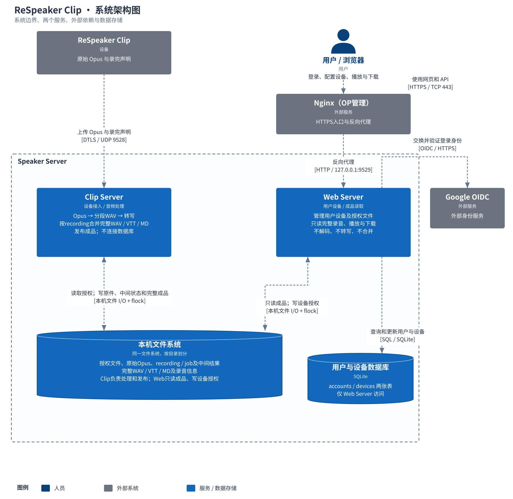

# ReSpeaker Clip · Server / Web 架构与模块设计

v10 · 2026-11-02 · 目标设计，尚未实现服务代码。

<a id="overview"></a>

## 1. 整体架构图



系统有两个应用进程。Clip Server负责设备接入，以及原始Opus从收件、解码、转写到整条录音成品的全部处理；Web Server负责用户和设备管理，只读取、播放和下载已经发布的完整录音。

本机只有一套文件系统，授权、原件、录音状态、job、中间WAV和最终文件按目录区分。每条recording最终生成一个完整WAV、一个完整VTT和一个完整Markdown文件，不做双写或副本复制。SQLite仅有accounts和devices两张表，仅Web访问；Clip完全不连接数据库。Nginx、整体部署和整机备份由OP负责。

<a id="services"></a>

## 2. 两个服务

### 2.1 Clip Server

监听DTLS/UDP 9528，读取Web发布的设备授权文件，验证身份后接收原始Opus。进程内一个后台循环管理recording/job文件，完成逐段解码和模型推理，再按recording合并完整WAV、VTT和MD，最后发布成品清单。Clip不负责Google登录、用户设备数据库或网页请求。

Web停止时，Clip仍可凭已有有效授权收件、处理和发布成品。解码子进程仅在执行期间存在，模型在Clip内常驻，不另设ASR服务或常驻job进程。

### 2.2 Web Server

监听`127.0.0.1:9529`，由OP的Nginx提供HTTPS入口。Web管理accounts/devices、登录会话和设备授权文件；从已发布成品清单读取本人录音，提供完整WAV播放、VTT字幕和WAV/VTT/MD下载。

Web不接触上传半成品，不领取音频job，不执行解码、转写、拼接或格式生成。Clip停止时，Web仍可读取已经发布的成品。

### 2.3 两服务交互

```text
浏览器 → Nginx（HTTPS 443）→ Web Server → accounts / devices
Web Server → 本机授权文件 → Clip Server验证设备
设备 → Clip Server → Opus → 分段WAV → 分段转写
Clip Server → 按recording合并 → 完整WAV + 完整VTT + 完整MD → 发布成品清单
Web Server → 只读成品清单及文件 → 播放与下载
```

两个服务通过本机文件交接授权和成品，不相互调用ASR接口。raw、录音状态、job和中间结果是Clip内部处理数据；Web只读取最终清单和其中引用的成品。两个角色各自单实例，不共享进程内连接或缓存。

<a id="architecture-guide"></a>

## 3. 模块划分


### 3.1 Clip Server 模块

| 模块 | 核心职责 |
| --- | --- |
| 启动与生命周期 | 设备监听、处理循环、模型和角色锁统一管理 |
| DTLS与协议 | 设备连接、帧解析及消息状态机 |
| 身份与凭证验证 | 读取本地授权，验证设备、归属及授权代次 |
| 原件收件与续传 | 校验Opus、记录上传进度、预留容量 |
| recording聚合与结束判定 | 按会话聚合片段，确认最终段号和完整性 |
| 录音/job文件仓储 | 录音、中间结果、执行预算和提交标识 |
| 调度与重试 | 一个后台循环执行解码、ASR、合并及发布 |
| Opus解码 | 每个原始片段生成标准PCM WAV |
| 内置转写与断句 | 中文为主夹少量英语，每句一行及匿名说话人 |
| 整条录音合并 | 拼接PCM、统一字幕时间、生成完整VTT/MD |
| 成品发布 | 一次发布同版本完整WAV/VTT/MD及清单 |
| 设备报告与健康 | 遥测、队列和收件/处理状态 |

### 3.2 Web Server 模块

| 模块 | 核心职责 |
| --- | --- |
| 启动与生命周期 | HTTP、数据库、会话和成品读取资源管理 |
| 登录与用户 | Google OIDC、会话、CSRF和本人资料 |
| 设备管理与授权发布 | 激活、BLE配置确认、解绑与本地授权文件发布 |
| 成品目录与查询 | 只读最终清单，按owner列出完整录音 |
| 播放与下载 | 鉴权后读取已经生成的WAV、VTT和MD |
| 用户与设备数据库 | 仅accounts/devices，显式初始化与迁移 |
| Web页面 | 设备配置、完整录音播放器、字幕及下载 |

### 3.3 公共契约与边界

公共契约定义授权文件、来源、job和成品清单的格式、版本与错误；基础能力提供配置、受控路径、文件锁和原子写入。公共模块不持有数据库连接、网络监听或模型资源。

Clip独占音频处理和成品写入；Web独占数据库和授权变更。请求入口不能绕过仓储直接修改业务状态。两个进程不导入对方的运行资源，跨进程只交换版本化文件。前端只使用API，不读取本地路径或设备凭证文件。

<a id="clip-modules"></a>

## 4. Clip Server 模块说明


### 4.1 启动与生命周期模块

**职责**：组装收件、文件仓储、后台调度、解码执行器和内置模型，管理一个Clip实例。

**输入与输出**：配置、授权、既有录音/job和模型清单 → DTLS监听、处理循环及健康状态。

**处理流程与边界**：校验路径/格式/证书 → 取得clip.instance.lock → 确认旧执行已停止 → 对账进度、来源、录音、job与成品发布 → 开放DTLS并启动处理循环 → 异步加载离线模型。DTLS和处理状态分别报告；模型未就绪时可收件和解码，暂停ASR及成品发布。

SIGTERM先停止新连接和job领取，保存已确认进度、取消排队任务，再等待正在执行的解码/推理/合并。释放角色锁前必须确认旧执行不能再提交；默认停机窗口45秒，OP托管器超时终止整个进程组。Clip崩溃后按持久job预算恢复，不重跑已提交识别结果。

### 4.2 DTLS与协议模块

**职责**：处理既有固件的DTLS连接及v3协议，将有界网络输入转换为已验证消息。

**输入与输出**：网络帧与证书配置 → 认证、上传、续传和会话完成消息。

**处理流程与边界**：验证长度、版本和状态机；身份验证和最终提交交给对应模块。协议层不生成任意文件路径，不接触数据库，不把连接对象传入音频规则。DTLS事件循环不等待模型推理。

<a id="clip-verification"></a>

### 4.3 身份与凭证验证模块

**职责**：完全通过本地授权文件及校验材料确认设备与归属。

**输入与输出**：连接凭证、上报身份、授权版本 → VerifiedDeviceContext，失败则拒绝。

**处理流程与边界**：只有身份、owner、binding与epoch一致才采用上报会话/段号。Web负责授权文件的发布和撤销，Clip只读；文件与凭证规则如下。

Clip Server 完全不连接 SQLite，沿用既有接入协议的认证及完整性验证，不通过查询上传表或来源表确认每次上报。Web Server 根据 devices 发布 `device-authorizations/<device_id>.json`，Clip Server 只读该文件及其引用的私有校验材料。此文件是设备授权的本地投影，不是额外数据库或第二套绑定业务状态。

校验文件包含 schema_version、device_id、device_uid、owner、binding_id、epoch、credential_version、state、verification_material_ref。只有完整 active 授权允许收件；文件缺失、损坏、revoked 或凭证不匹配即拒绝，不猜测归属。设备连接/凭证必须与校验文件中的身份一致，payload 中的 owner/binding/epoch 也必须一致；不能只验证“某台设备的凭证有效”就允许它冒用另一 owner。

验证通过后，直接采用 Clip 上报的 session、segment、recorded_at、采样 profile 和完整性声明，不再要求有一行预登记的来源记录。仍验证字段格式、长度、数值范围、实际音频大小与完整 hash；认证通过不允许任意文件路径、无限文件大小或不同内容覆盖同一来源。设备时间保持 device_unverified 标记，不把认证等同于时钟已校准。

授权投影的写入规则：

设备配置操作与启动对账在 Web 内由同一个配置 mutex 串行化，覆盖下面完整文件/SQL步骤，防止旧的激活操作在较新的撤销后重新发布 active；state.lock 仍只保护文件的短提交，不覆盖数据库事务。配置确认和设备 API 还须核对投影版本，deny/缺失/不一致时显示配置待修复，不声称设备可上传。

- 激活/换绑/凭证轮换前，先在 state 排他锁内原子发布 deny（revoked）并 fsync，阻止旧授权继续收件；释放文件锁后提交 devices 事务，再发布与新行完全一致的 active 文件。active 发布成功后才返回可用上传配置。
- 解绑或禁用账户先持锁发布对应设备 deny，再在 SQLite 更新行；成功响应时 deny 必须已持久化。数据库更新失败也保持 deny，不能因失败把旧授权自动放开。
- Clip 在握手以及最终发布 ready 前均持共享/排他 state 锁复核当前授权；不能仅用连接建立时的旧缓存继续上传。最终复核与 ready 发布在同一短临界区完成。禁用/解绑前已接受的 ready 录音保留原 owner。
- Web 重启逐条对账 devices 与投影。deny/缺失保持拒绝，直到配置操作明确完成；跨存储更新中断时只允许暂时不可用，禁止自动把未完成撤销重新激活。人工重试从 deny 开始，补齐确认；无需新增撤销或投影任务表。
- 不持文件锁等待数据库写事务；所有投影更新使用临时文件、fsync 和原子替换。校验材料由部署私有目录管理，文件 0600，不进入公开 API、日志或版本仓库。


### 4.4 原件收件、续传与容量模块

**职责**：接收原始Opus并保留可恢复进度，完整校验后发布Clip内部来源记录。

**输入与输出**：已验证设备、片段声明及字节流 → progress、不可变raw和ready来源文件。

**处理流程与边界**：先持久化容量预留，再确认接收字节。`incoming/<upload_id>/progress.json`保存身份、source_key、已确认偏移和预留；续传重新验证当前授权。同一source和hash幂等，不同内容报冲突。结束时核对实际size/hash，在同一短锁临界区复核授权，发布并fsync raw、ready后才确认成功；孤立raw不能代表收件完成。

ready schema_version=1，包含source_id、device_id/device_uid、owner、binding_id、binding_epoch、credential_version、session、segment、profile、size/hash、raw相对路径、录音时间及time_source、服务端received_at/verified_at。source_key由已验证绑定身份、代次、会话和段号无歧义生成；路径只由服务端生成。owner在来源和recording中冻结，后续设备换绑不改写旧录音。

每片raw≤8MiB，固定16kHz、mono、20ms profile，单片≤300秒；完整recording≤12小时。所有owner默认音频额度10GiB，由Clip从ready/progress按source_key去重核算，无额度表或Web回调。

容量预留覆盖最终合并：每份片段预留`raw实际声明字节 + 2 × (9,600,000 + 4,096)`，分别容纳分段WAV及其在完整WAV中的字节；末段保守按300秒计算。原件和成品不是冗余副本，而是不同处理阶段的文件。JSON/VTT/MD另有体积上限；合并前再次检查真实剩余空间，至少保留256MiB余量。空间不足时暂停相关工作，不把额度充足当作磁盘可写证明。

预留先落progress，完成时移交ready；两者同时存在按同source只计一次。重启扫描重建，换绑仍计原owner。未完上传确认中止且临时文件已清理后才释放其预留；已接受raw默认保留。首次成品已计入预留，不能按文件数量再次重复计费。维护重建新成品版本还须预留额外物理空间和用户额度，不覆盖已发布版本凑空间。

<a id="ingest"></a>

### 4.5 recording聚合与结束判定模块

**职责**：将同一次设备录音的片段和完成声明聚合为一条recording，确定能否生成完整结果。

**输入与输出**：已接受ready、不可变session-event → recording片段列表、最终段号和完整性状态。

**处理流程与边界**：聚合键为binding_id＋binding_epoch＋source_session，segment_no从1开始。同来源重放幂等，同段号不同内容报source_identity_conflict；不按文件名或mtime猜测owner、顺序及完成状态。Clip在启动和后台循环中对账来源，不由Web导入。

完整录音需要受认证的会话级结束声明（session_end），明确最终段号N。参考实现现有v3 OPEN只携带device/session/segment/size/digest/token，COMPLETE仅确认单份文件收到，不能当作整条录音结束。完整成品的协议前置条件是固件/接入支持同一已验证绑定和会话的session_end元数据；这是待实现的协议能力，不能宣称旧v3已支持。未提供该元数据的设备仍可收件和预处理，但recording保持未发布，不通过Web超时或最后一段长度猜测结束。

设备的结束声明写入`session-events/<session_key>/<event_id>.json`，字段包括owner、绑定/代次、source_session、final_segment_no、claim_hash和verified_at；单事件≤64KiB。相同声明幂等，冲突保留首份并写有界冲突标记；最终段号必须在允许范围内。device-reports可覆盖，不能承载唯一录完证据。

若结束声明随raw上报，ready同时保留已验证声明。ready持久化后、独立事件发布前中断时，Clip直接重放内嵌声明到recording，不要求设备重传。解绑后的已接受证据仍有效，但不能接受新的撤销后上报。

只有明确结束声明指定N、1..N全部来源就绪且无冲突时，integrity为confirmed_complete。有声明但缺片为gap，没有声明为unknown；静默超时不能当录完。缺片可等待补齐，但不得跳号、补静音或把部分结果发布成完整录音；结束后新上报的>N段号视为冲突，不偷偷扩展原recording。

已收到的片段可提前解码和识别，结果只保存在Clip内部。整条录音的成品发布还要求1..N全部解码、转写成功，全部WAV和文字可验证。静音识别成功为有效结果；模型失败不能以空文本冒充成功。

<a id="data-model"></a>
<a id="audio-guide"></a>
<a id="tables"></a>

### 4.6 录音、片段与job文件仓储模块

**职责**：保存内部recording、job、逐段转写和执行提交标识，不建立录音或任务数据库表。

**输入与输出**：已验证来源及阶段结果 → 原子JSON和不可变产物引用。

**处理流程与边界**：Clip为唯一写入方。录音是内部处理结果的提交点；job保存运行状态和预算。Web不读取recording/job/逐段转写，公开查询只看第4.11节的成品发布指针。

```text
/var/lib/speaker/
  db/business.sqlite3                 # Web专用，两张表
  credentials/devices/                # Web管理，Clip只读
  state/
    locks/                            # 固定state锁和两个角色锁
    device-authorizations/            # Web写，Clip只读
    incoming/                         # Clip上传进度
    sources/ready/                    # Clip内部不可变来源
    session-events/                   # Clip内部结束声明
    recordings/<recording_id>/
      recording.json                  # Clip处理状态
      transcripts/<segment_id>.json   # Clip逐段文字
    jobs/<job_id>.json                # Clip执行预算
    device-reports/                   # Clip写，Web可读设备遥测
    status/                           # 各进程写自己的健康状态
  audio/
    incoming/                         # Clip接收临时文件
    raw/                              # Clip不可变原始Opus
    segments/                         # Clip分段WAV
    tmp/                              # Clip处理临时目录
    results/<recording_id>/
      current.json                    # Clip发布指针，Web只读
      revisions/<revision>/
        recording.wav                 # 完整录音
        transcript.vtt                # 完整字幕
        transcript.md                 # 完整文本
        manifest.json                 # 成品清单
```

上述都是同一本机文件系统中的目录，不要求独立卷，不设置复制/副本目录。

#### 4.6.1 recording.json

```jsonc
{
  "schema_version": 5,
  "recording_id": "rec-example",
  "owner": "demo-user",
  "source_namespace": "binding-example",
  "binding_epoch": 1,
  "source_session": "session-example",
  "integrity": "confirmed_complete",
  "final_segment_no": 2,
  "content_revision": 3,
  "state": "processing",
  // Clip内部引用，不返回给Web或浏览器。
  "segments": [
    {
      "segment_id": "seg-1", "segment_no": 1,
      "source_id": "source-1", "raw_ref": "raw/object-1.opus",
      "raw_sha256": "example-raw-hash", "sample_count": 4800000,
      "wav_ref": "segments/seg-1.wav", "transcript_ref": "transcripts/seg-1.json",
      "decode_job_id": "decode-seg-1", "asr_job_id": "asr-seg-1",
      "last_decode_commit": {"job_id":"decode-seg-1","attempt_id":"attempt-d1"},
      "last_asr_commit": {"job_id":"asr-seg-1","attempt_id":"attempt-a1"}
    }
  ],
  "published_revision": null,
  "last_publish_commit": null
}
```

示例仅列第一段，final_segment_no=2时仍须校验第二段实际存在。state为receiving/processing/waiting_segments/failed/published；完整性和处理状态分别记录。所有身份字段及片段hash来自已验证来源。process_config冻结解码profile、模型清单digest、断句及导出格式版本，失败重试沿用。

#### 4.6.2 job文件

```jsonc
{
  "schema_version": 1,
  "job_id": "asr-seg-1",
  "recording_id": "rec-example",
  "segment_id": "seg-1",
  "stage": "asr",
  "generation": 1,
  "input_revision": 3,
  "input_hash": "example-wav-hash",
  "state": "pending",
  "attempt": 0,
  "attempt_id": null,
  "run_after": 0,
  "error_code": null
}
```

stage为decode/asr/assemble/export/publish/repair；录音级阶段segment_id=null。state为pending/running/retry_wait/ready/failed/not_configured，最后一种仅用于显式关闭ASR。job≤64KiB；不保存音频正文、设备凭证或姓名。job ID按录音、阶段、片段和代次确定，重复扫描不增建。

<a id="publication"></a>

### 4.7 调度、重试与中断对账模块

**职责**：在Clip进程内按依赖执行处理链，失败只重试相应阶段。

**输入与输出**：ready来源、内部recording/job → 分段结果及可发布成品。

**处理流程与边界**：一个后台循环负责扫描、领取和提交；耗时解码、推理、PCM拼接和hash在锁外执行，DTLS保持独立响应。顺序为每段decode→asr；录音收齐后assemble和export；完整三件套校验通过后publish。不由Web请求触发处理。

领取在state排他锁内检查依赖、due时间、attempt<4，生成attempt_id，先增加次数并写running再释放锁。分段decode/asr/repair提交仅核对本段attempt_id、generation、输入hash和冻结配置，不因其他新片段改变录音content_revision而丢弃有效结果；录音级assemble/export/publish才额外核对完整content_revision和最终段号。旧执行不得覆盖新状态。每阶段最多4次，退避30秒、2分钟、10分钟；结构/hash冲突直接failed，暂时故障retry_wait。人工重试明确新代次和预算，轮询不重置次数。

模型未就绪、缺片、空间不足等领取前发现的依赖问题不消耗次数。领取后的失败保留已记attempt，不能因进程崩溃退还预算。显式关闭ASR时保存raw及分段WAV，识别等待配置；未生成完整文字时不向Web发布recording。

阶段提交先发布/fsync不可变产物，再写recording的引用和执行提交标识，最后标job ready并补齐下一阶段。结果已提交而job仍running时，重启校验提交标识后补标ready；没有提交结果则保留次数退避重试。不凭临时文件存在猜测成功。

成品发布指针是Web可见提交点：指针已发布而内部recording/job尚未标成功时，Clip校验相同revision/manifest/hash和发布执行标识，补齐内部状态，不重做识别或生成另一套文件。未发布指针的完整目录仍不对Web可见。

WAV缺失可由repair job使用冻结配置从raw重建并核对预期hash，保留已提交文字；原件缺失或重建不同则停止相关阶段并告警。JSON损坏/未知版本不覆盖为空；保留现场交由OP或人工排查。上传续传和job对账是应用内断点处理，不是整机备份。

<a id="storage"></a>
<a id="decode"></a>

### 4.8 Opus解码与本机文件模块

**职责**：把每个已接受原始片段解码为同一profile的PCM WAV，供转写和整条合并。

**输入与输出**：完整raw及冻结profile → 分段WAV、sample_count、size/hash。

**处理流程与边界**：raw格式为`[uint16 little-endian长度][Opus包]`，16kHz、mono、20ms，每包320样本，payload 1–2000字节；不是Ogg容器。逐包校验边界，使用独立decoder，不拼raw、不补帧或猜测缺失样本。其他profile拒绝。

每份raw生成一个16kHz单声道PCM16 WAV，标准段300秒、末段保留实际长度。边读边写，单段PCM最多9,600,000字节，实际时长由sample_count计算，不用段号乘五分钟。受控隔离解码器只见输入和临时输出，不见数据库、授权或其他状态，无网络；默认600秒超时，取消时终止并等待后代退出。

临时文件与最终路径位于同一文件系统，完成校验/fsync后原子发布，不写第二份原件或磁盘副本。Clip独占raw、segments、tmp和results写入；Web仅访问results成品。运行期间不删已发布版本或在途引用；启动对账后只清理确认无引用的临时产物，raw/ready/结束声明默认保留。

<a id="transcript"></a>

### 4.9 内置转写与逐句断句模块

**职责**：在Clip内运行模型，完成中文为主夹少量英语的转写、时间戳和匿名说话人标记。

**输入与输出**：经过验证的分段WAV、冻结模型配置 → 不可变逐段文字和句子列表。

**处理流程与边界**：模型采用Paraformer-zh＋FSMN-VAD＋CT-Punc＋CAM++候选组合；manifest固定权重hash、运行库版本及参数。离线安装、禁自动下载和动态模型路径；不暴露ASR HTTP或Unix socket接口。调度模块通过进程内接口提交已验证WAV。

默认单推理槽、最多8个待处理输入、计算线程4；排队和执行共用600秒deadline。不能安全中断的在途推理占用原槽直至结束，超时结果丢弃，不另开无限替代任务。可捕获模型错误只暂停识别；原生库崩溃/OOM可能中断整个Clip，由托管器重启后对账。

逗号保留在句内，按句末标点断句，每行一句。每句有片段内start_ms/end_ms，满足0≤start<end≤片段实际时长，舍入最多1ms越界可夹取；其他非法时间、编码、NUL或超限整段失败。每句≤10000字符、每段原文≤8MiB、整条≤100000句。静音成功可返回空句列表，识别失败不能伪装静音。

A/B/C仅表示匿名说话人，不做姓名识别。首版沿用片段内聚类，合并成品中保留“片段1·A”等片段作用域，不能把不同片段的A直接当成同一人。未来若增加整条录音内说话人对齐，需要独立验证，不能由文本拼接推断身份。

此前短音频测试仅证明候选组合能运行；300秒输入、中英混合、多人切换和最终长录音仍须真实样本验收，不用模型名代替准确率或吞吐保证。

### 4.10 整条录音合并与格式生成模块

**职责**：从完整recording的成功片段生成一个连续WAV和同时间轴的完整VTT、MD。

**输入与输出**：confirmed_complete、冻结的1..N段WAV及转写 → 完整三件套、时长和hash。

**处理流程与边界**：固定本次content_revision、最终段号、各段hash和配置版本；重新核对1..N齐全且decode/asr均成功。任一缺片、失败、坏文件或版本变化都不发布完整结果；已有成功分段结果保留，补齐后再合并。

WAV按segment_no顺序流式读取各段的PCM data，验证一致的采样率/位宽/声道，写入一个新的RIFF/WAV头及连续PCM数据。不能直接串接含文件头的WAV字节，也不拼接Opus包再解码。总sample_count等于各段之和；12小时PCM约1.38GB，低于标准RIFF数据上限，越界明确拒绝，不截断。合并不额外重采样、补静音或重复模型识别。

第i段起点为前面所有段sample_count之和。逐句全局时间以该起点换算，不用segment_no×300秒；VTT在最终序列化时统一舍入到毫秒，验证0≤start<end≤总时长，并按全局时间及稳定句序输出。静音片段保留真实时长，后续字幕不能前移。末段实际长度直接参与累加。

VTT固定UTF-8、无BOM、LF和HH:MM:SS.mmm，转义&、<、>，匿名voice标记包含安全片段作用域；cue编号全局连续。MD使用固定模板，按同一全局句序输出每句一行，可带时间与匿名标签，转义原文HTML/Markdown控制字符。静音录音仍有完整WAV、合法空VTT和明确“未检测到语音”的MD；不是转写失败。

VTT/MD单文件≤64MiB，清单≤1MiB；生成时检查体积和总句数，不静默截断。整条WAV超过HTTP文字导出限额仍正常支持流式播放/下载，不能套用64MiB上限。三者共享recording_id和revision，不能使用不同版本的音频与文字。

### 4.11 成品发布模块

**职责**：将完整WAV、VTT和MD作为一个成品版本交给Web。

**输入与输出**：已校验的三件套及内部执行凭据 → 不可变revision目录、manifest和原子current指针。

**处理流程与边界**：先在同文件系统临时目录生成三件套，校验全文件hash、WAV格式/总样本及VTT时间范围；fsync文件和目录后发布不可变revision目录及manifest，再在短state锁内核对本次输入版本和执行代次，原子替换current.json并fsync父目录。重试复用同版本、同hash成品，不覆盖已发布文件。Web只能从current指针进入，不能扫描临时/revisions目录猜测可用文件。


```jsonc
{
  "schema_version": 1,
  "recording_id": "rec-example",
  "owner": "demo-user",
  "revision": 1,
  "manifest_ref": "revisions/1/manifest.json",
  "manifest_sha256": "example-manifest-hash",
  "publish_commit": {"job_id":"publish-rec-example","attempt_id":"attempt-p1"}
}
```

manifest采用相同身份和revision，state固定ready，包含完整性依据、total_sample_count、duration_ms、sample_rate=16000、发布时刻及三件套的受控相对路径、size_bytes、sha256。三个artifact全部必填，不能把缺少VTT或MD的版本标ready。

```jsonc
{
  "schema_version": 1,
  "recording_id": "rec-example", "owner": "demo-user", "revision": 1,
  "state": "ready", "integrity": "confirmed_complete", "segment_count": 2,
  "sample_rate": 16000, "total_sample_count": 5600000, "duration_ms": 350000,
  "published_at": 1793577600000,
  "artifacts": {
    "wav": {"path":"recording.wav","size_bytes":11200044,"sha256":"example-wav-hash"},
    "vtt": {"path":"transcript.vtt","size_bytes":320,"sha256":"example-vtt-hash"},
    "md": {"path":"transcript.md","size_bytes":280,"sha256":"example-md-hash"}
  }
}
```

来源owner来自已验证收件，不查询accounts。设备后来解绑不改变历史成品归属。接收完成后的内部处理不重新要求旧设备凭证仍active，但不能据此接收新的撤销后来源。已发布revision不可变；维护性重建使用新revision，完整三件套通过后才切指针，旧成品继续可读。清理不删除任何当前指针、在途读取或处理引用的文件。


### 4.12 设备报告与健康模块

**职责**：报告设备遥测、接入可用性及处理队列状态。

**输入与输出**：已验证报告和进程计量 → device-reports与status/clip.json。

**处理流程与边界**：设备遥测可覆盖，不承担唯一录完证据。健康区分dtls_ready、processing_ready、asr_ready、队列积压及发布错误，OP据此观察；不增加公网管理接口，不让Web通过健康状态领取job。

<a id="web-modules"></a>

## 5. Web Server 模块说明


### 5.1 启动与生命周期模块

**职责**：组装HTTP、两表数据库、登录会话、授权发布和只读成品目录。

**输入与输出**：Web配置、accounts/devices及已发布成品 → 用户设备API、成品播放和下载。

**处理流程与边界**：取得web.instance.lock，核验数据库版本并对账设备授权后开放本机HTTP。Clip或模型未在线不影响Web启动；没有成品时列表为空，不读取job来拼处理进度。Web无音频后台调度，不创建解码/ASR执行器。关闭时等待HTTP读取结束、关闭数据库和会话，再释放角色锁。

<a id="oauth"></a>
<a id="users-api"></a>

### 5.2 登录、会话与用户模块

**职责**：验证Google身份，建立本站会话并管理本人资料。

**输入与输出**：OIDC回调、Cookie和本人资料请求 → 用户视图、会话及CSRF结果。

**处理流程与边界**：账号持久化到accounts，临时登录态和本站会话只在Web内存。每请求核验账号状态；设备和录音模块取得服务端确定的owner，不接受客户端替换。

```jsonc
{
  // TEXT；主键；必填。本地用户 ID，历史 ID 沿用；录音文件通过 owner 引用。
  "user_id": "demo-user",
  // TEXT；唯一。验证通过的 Google 身份标识；待核验的历史用户可空。
  "google_sub": "google-sub-example",
  // TEXT；必填；唯一；大小写不敏感。用户邮箱；账号同步时检查身份冲突。
  "email": "user@example.com",
  // TEXT；必填；默认空字符串；≤100 字符。用户名称，可为空字符串。
  "display_name": "示例用户",
  // TEXT；必填；默认 active。active / disabled；请求鉴权检查账号状态。
  "status": "active",
  // INTEGER；必填；默认 1；>0。认证版本；变更后使旧会话失效。
  "auth_version": 1,
  // INTEGER；可空。最近登录时间。
  "last_login_at": 1793318400000,
  // INTEGER；必填。用户建立时间。
  "created_at": 1793318400000,
  // INTEGER；必填。用户资料更新时间。
  "updated_at": 1793318400000
}
```

新用户 ID 使用 uuid4().hex，历史 user_id 原样迁移。相同 sub 复用用户；邮箱与其他 sub 冲突时返回 account_identity_conflict，保留原归属。

设备别名保存到 devices.display_name，配置确认保存到 devices.confirmed_revision，硬件 UID 直接为 devices.device_uid；不再另建绑定、UID、配置或来源表。录音、片段和 job 文件的[字段说明](#tables)在录音文件及调度模块；只有 accounts 和 devices 使用[本页 SQL](#sql)。

#### 5.2.1 用户接口
用户首次通过 Google 登录时由 Server 自动建立 accounts 记录，HTTP 接口使用 `/users/me` 表示当前会话用户。两项接口均返回 `Cache-Control: private, no-store`；会话失效返回 401，账号禁用返回 403 account_disabled。

GET `/users/me` 和 PATCH `/users/me` 的成功响应使用相同结构：

```jsonc
{
  // string；accounts.user_id；只读，由会话确定。
  "user_id": "demo-user",
  // string；accounts.email，由登录身份同步；只读。
  "email": "user@example.com",
  // string；本站显示名称，允许空字符串，最多 100 字符。
  "display_name": "示例用户"
}
```

PATCH `/users/me` 请求：

```jsonc
{
  // string；必填，最多 100 字符；空字符串用于清空显示名称。
  "display_name": "我的名字"
}
```

PATCH 请求须通过 Origin 和 CSRF 检查，且只能包含 display_name。缺少字段、类型错误、超过 100 字符或包含其他字段，均返回 422。Server 使用参数化 SQL 更新本人记录的 display_name、updated_at，并返回最新资料。user_id、email、google_sub、status、auth_version 和 owner 均不可由此接口修改。

`GET /auth/session` 返回登录状态和 CSRF，其中的 user 与 `/users/me` 都读取 accounts 当前记录。首次 Google 登录可初始化名称，后续登录保留本站名称。用户接口仅管理本人资料；管理员操作和账号删除不在本版范围内。

#### 5.2.2 登录与会话
Web 通过顶层导航发起 Google 登录。Google 授权后回调 Server，Server 校验本次 state 和 Google ID token，按 google_sub 找到或建立 accounts 用户，再创建本站 session、设置 Cookie，303 返回 `/`。后续请求使用本站 Cookie。

- GET `/auth/google/start`：302 跳 Google；scope 为 openid email profile，使用 Code / OIDC + S256 PKCE
- GET `/auth/google/callback`：Google 成功返回 code、state，取消时返回 error、state；校验后设置会话 Cookie 并 303 到 `/`；取消授权返回 `/?login_error=login_cancelled`
- GET `/auth/session`：200 返回下方用户与 CSRF 对象；失效返回 401 session_expired
- DELETE `/auth/session`：校验 Origin/CSRF，删除当前会话、清 Cookie，返回 204；已失效返回 401，Web 同样清理本地状态

- 登录临时状态：Server 内存，5 分钟、一次消费；临时 Cookie 为 Secure/HttpOnly/SameSite=Lax
- 本站 session：Server 内存，闲置 24 小时、最长 7 天；Cookie 为 Secure/HttpOnly/SameSite=Strict、Path=/、host-only、Max-Age=604800
- 退出、到期、Server 重启：会话失效，重新 Google 登录；账号和业务数据继续保留

GET `/auth/session` 成功响应：

```jsonc
{
  // object；从 accounts 读取的本站用户。
  "user": {
    // string；accounts.user_id。
    "user_id": "demo-user",
    // string；accounts.email。
    "email": "user@example.com",
    // string；accounts.display_name，允许空字符串。
    "display_name": "示例用户"
  },
  // string；当前会话的 CSRF token，写请求放入 X-CSRF-Token。
  "csrf_token": "example-csrf-token"
}
```

本站会话仅在 Server 内存保存，以下字段不返回客户端：

```jsonc
{
  // string；随机会话 token 的摘要，Cookie 仅持有原 token。
  "token_hash": "example-token-hash",
  // string；对应 accounts.user_id。
  "user_id": "demo-user",
  // integer；登录时 accounts.auth_version，请求时须与账号当前值一致。
  "auth_version": 1,
  // string；与客户端写请求比对的 CSRF token。
  "csrf_token": "example-csrf-token",
  // integer；最近活动时间，用于 24 小时闲置到期。
  "last_seen_at": 1793318400000,
  // integer；首次创建时间 + 7 天，活动不会延长此时间。
  "absolute_expires_at": 1793923200000
}
```

账号禁用返回 403 account_disabled，身份映射冲突返回 409 account_identity_conflict；回调错误返回 400 login_invalid_or_expired，Google 不可用返回 503 login_unavailable。登录响应和会话接口设置 no-store，日志使用脱敏格式。

服务器配置 GOOGLE_CLIENT_ID、GOOGLE_CLIENT_SECRET_FILE、PUBLIC_WEB_ORIGIN，secret从私有文件读取。Google Console 回调登记为 `PUBLIC_WEB_ORIGIN/api/boa/v1/auth/google/callback`，与请求保持完全一致。协议使用 [Google OIDC](https://developers.google.com/identity/openid-connect/openid-connect)。


<a id="ble"></a>

### 5.3 设备管理与授权发布模块

**职责**：管理devices中的当前归属、配置、别名和撤销状态。

**输入与输出**：已登录用户、设备UID及BLE读回确认 → 设备对象和受控上传配置。

**处理流程与边界**：完整设备操作由配置mutex串行化，遵守deny-first：先拒绝旧授权，再提交设备行，最后发布新active。Clip通过4.3模块消费授权文件；历史录音owner不随换绑改变。

POST `/devices/activate` 请求，200 响应使用下一节的身份与 configuration 字段：

```jsonc
{
  // string；从 Clip 读到的硬件 UID；Server 查询受控登记及本人归属。
  "device_uid": "0011223344556677"
}
```

POST `/devices/{id}/binding/confirm` 请求：

```jsonc
{
  // string；读回的硬件 UID。
  "device_uid": "0011223344556677",
  // string；BLE 读回的绑定 ID，须与当前用户设备一致。
  "binding_id": "demo-binding",
  // integer；读回的上传配置版本。
  "revision": 1,
  // boolean；固定 true，表示配置已写入并读回确认。
  "saved": true
}
```

确认成功响应：

```jsonc
{
  // string；确认完成的绑定 ID。
  "binding_id": "demo-binding",
  // integer；确认完成的配置版本。
  "revision": 1,
  // string；固定 provisioned。
  "state": "provisioned"
}
```

PATCH `/devices/{id}` 请求；200 返回同一 display_name 和路径对应的 device_id：

```jsonc
{
  // string；本人当前设备的别名，1–100 字符。
  "display_name": "我的 Clip"
}
```

DELETE `/devices/{id}/binding` 无 body，成功响应：

```jsonc
{
  // string；固定 revoked，设备上传凭证已撤销。
  "state": "revoked",
  // boolean；是否仍待设备侧清理确认，保存在 devices。
  "device_cleanup_pending": true
}
```

#### 5.3.1 设备与上传配置

GET `/devices` 返回 `{items:[设备对象]}`；POST `/devices/activate` 返回相同身份字段及 configuration。device_id、binding_id、device_uid 均来自同一 devices 行；binding_id 是设备表中的字段，不是独立表。

```jsonc
{
  // string；devices.id；API 路径 {id} 使用此值。
  "device_id": "demo-device",
  // string；devices.device_uid；设备硬件 UID。
  "device_uid": "0011223344556677",
  // string；devices.binding_id；本次绑定 ID。
  "binding_id": "demo-binding",
  // integer >0；绑定代次。
  "epoch": 1,
  // string；devices.display_name，未设置时使用既有设备名称/ID。
  "display_name": "我的 Clip",
  // integer；devices.revision，上传配置版本。
  "revision": 1,
  // 已验证固件信息；无可信来源时 null。
  "firmware": null,
  // 已验证设备能力；无可信来源时 null。
  "capabilities": null,
  // 遥测；value 缺少有效来源时为 null，sampled_at/source 同时为 null。
  "telemetry": {
    // value 为 boolean|null；在线状态。
    "online": {
      // boolean|null；在线状态。
      "value": null,
      // integer|null；遥测采样时间，UTC Unix 毫秒。
      "sampled_at": null,
      // string|null；可信数据来源标识，缺失时为 null。
      "source": null
    },
    // value 为 integer 0–100|null；电量百分比。
    "battery": {
      // integer 0–100|null；电量百分比。
      "value": null,
      // integer|null；遥测采样时间，UTC Unix 毫秒。
      "sampled_at": null,
      // string|null；可信数据来源标识，缺失时为 null。
      "source": null
    },
    // value 为非负 integer|null；待上传片段数。
    "pending": {
      // 非负 integer|null；待上传片段数。
      "value": null,
      // integer|null；遥测采样时间，UTC Unix 毫秒。
      "sampled_at": null,
      // string|null；可信数据来源标识，缺失时为 null。
      "source": null
    }
  },
  // 仅激活响应返回；列表不返回配置/凭证，响应 no-store。
  "configuration": {
    // string；与外层 device_id 相同。
    "device_id": "demo-device",
    // string；与外层 device_uid 相同。
    "device_uid": "0011223344556677",
    // string；configuration.owner_id = accounts.user_id，由 Server 确定。
    "owner_id": "demo-user",
    // string；与外层 binding_id 相同。
    "binding_id": "demo-binding",
    // integer；与外层绑定代次相同。
    "epoch": 1,
    // integer；与外层配置版本相同。
    "revision": 1,
    // string；由部署配置提供的设备上传地址，host:port；本文不定义传输细节。
    "endpoint": "upload.example.com:9528",
    // string；设备上传凭证，仅经受控 BLE 配置写入设备。
    "device_token": "example-device-token"
  }
}
```

列表外层结构：

```jsonc
{
  // array；GET /devices 的设备对象数组；示例为空列表。
  "items": []
}
```

#### 5.3.2 BLE与请求规则
- 绑定：验证登记与 owner；本人重复激活复用绑定，未登记到当前用户的 device_uid 返回 409 enrollment_required
- 配置确认：Web 经 BLE 写入后读回 binding/epoch/revision，再提交 device_uid、binding_id、revision、saved
- 改名：更新本人设备行的 display_name；设备身份和上传凭证保持原值
- 移除：撤销上传凭证；device_cleanup_pending 沿用现有维护确认；已上传录音保留原 owner
- Wi-Fi：Clip 扫描 `{ssid,rssi,security}[]`，选择结果后经 BLE 写入密码，读取 saved/connected/error；密码在调用结束后清空
- 设备能力：以真实 capability 为准；已保存网络最多 5 个，基线为 2.4 GHz WPA2
- 请求管理：切换用户/数据时取消旧请求，退出清理音频和定时器；409 recording_revision_changed 时重新取版本
- 轮询：录音可见 5 秒、设备可见 15 秒；隐藏后 30 秒，恢复可见立即刷新

Clip Wi-Fi 扫描结果由 Web 的 BLE 适配层读取：

```jsonc
[
  {
    // string；Clip 扫描到的网络 SSID，Web 从此列表选择。
    "ssid": "Example-WiFi",
    // integer；信号强度 dBm。
    "rssi": -55,
    // string；设备返回的安全类型，当前基线 WPA2。
    "security": "WPA2"
  }
]
```

迁移沿用旧 user_id，先核验 owner/邮箱映射；缺项返回 migration_owner_mapping_required。账户迁移与业务库 user_version 更新同事务；录音及 job 的文件迁移独立校验并切换状态目录，见录音文件及调度模块。旧设备/绑定/配置/UID 字段合并迁移到 devices，来源与上传进度导出成文件；INSERT 使用显式列名。


<a id="media-api"></a>

### 5.4 成品目录与查询模块

**职责**：按用户读取Clip已经发布的完整recording，不建立录音表或另一套处理状态。

**输入与输出**：当前会话、查询条件及成品指针 → 本人完整录音列表与详情。

**处理流程与边界**：共享state锁内捕获current引用及revision，释放锁后受控打开不可变manifest和文件。校验schema、recording_id、owner、revision、manifest hash及三件套字段，拒绝根外路径、符号链接和非普通文件。列表仅返回state=ready且清单完整的成品；不存在current则未发布，不出现在列表，直接查询返回404 recording_not_found。

Web按会话用户过滤manifest.owner，并核验账号有效；不根据设备当前owner改写或过滤历史录音，不扫描raw/recordings/jobs生成内容。清单损坏或产物不可用返回503 result_unavailable并告警，不能转给Web自动修复、转码或重新生成。

列表可使用可丢弃的内存缓存加速，但每次媒体请求重新鉴权并核对发布指针；缓存不是新数据库、结果索引文件或持久任务表。

```jsonc
{
  "recording_id": "rec-example",
  "revision": 1,
  "state": "ready",
  "duration_ms": 350000,
  "published_at": 1793577600000,
  "files": {
    "wav": "/api/boa/v1/recordings/rec-example/audio.wav?revision=1",
    "vtt": "/api/boa/v1/recordings/rec-example/transcript.vtt?revision=1",
    "md": "/api/boa/v1/recordings/rec-example/transcript.md?revision=1"
  }
}
```

### 5.5 播放、字幕与下载模块

**职责**：鉴权后读取现成WAV/VTT/MD字节，提供整条录音播放和下载。

**输入与输出**：当前用户、recording_id、revision、媒体范围 → 预生成文件流。

**处理流程与边界**：GET/HEAD均检查会话和owner、确认revision与已捕获成品版本一致。不同revision返回409 recording_revision_changed，前端重新获取详情；已经打开的旧版本文件句柄允许读完，不混用新旧音频/字幕。Web不序列化字幕、拼接文件、转写或生成Markdown。

- GET `/recordings`：from/to/cursor/limit，返回本人已发布完整成品。
- GET `/recordings/{id}`：返回成品详情及同revision三件套URL。
- GET/HEAD `/recordings/{id}/audio.wav?revision=N`：完整WAV，支持单范围Range及下载。
- GET/HEAD `/recordings/{id}/transcript.vtt?revision=N`：读取完整VTT，可作为播放器字幕或下载。
- GET/HEAD `/recordings/{id}/transcript.md?revision=N`：读取完整Markdown并作为附件下载。

WAV支持bytes=start-end、start-和-suffix，裁剪end到文件长度；非法/越界416并返回`Content-Range: bytes */size`，多范围退回整文件200。HEAD忽略Range、空body。VTT/MD忽略Range，GET与HEAD使用同一实际文件大小及hash；不因HEAD而触发处理。

受控打开同一文件句柄验证类型、size后流式读取；hash由Clip在发布前全量校验，Web校验manifest及文件不可变性，发现内容校验异常则停止读取。ETag为成品文件SHA-256；返回X-Recording-Revision、private,no-store和nosniff，附件名称由服务端生成。每owner最多4个并发媒体请求，超额429及Retry-After: 1。

前端使用一个完整WAV播放器和同revision的VTT，不切换分段音频。文字按VTT句子显示，使用textContent；下载直接读取对应预生成文件。设备配置与录音页面分离；未发布/失败录音不在成品列表中伪装ready，处理告警归Clip和OP观察。

<a id="sql"></a>
<a id="business-sql"></a>

### 5.6 用户与设备数据库模块

**职责**：集中管理唯一SQLite的连接与两张表。

**输入与输出**：用户/设备用例的受控参数 → 账户/设备行和明确事务结果。

**处理流程与边界**：只接受参数化SQL；业务层不能保存录音/job到表。普通启动核验版本，不自动新建空库；初始化和迁移使用显式维护入口。

只有 Web Server 连接数据库。每个连接设置 foreign_keys=ON、synchronous=FULL、busy_timeout=5000；录音/job/收件文件不参加 SQLite 事务。设备身份、当前归属及配置放在同一个 devices 行中，不保留 users、bindings、device_uids、binding_profiles、sources 等旧表。

```sql
-- v5 新库参考，仅 accounts / devices；不是旧库迁移脚本。
PRAGMA foreign_keys=ON;
PRAGMA journal_mode=WAL;
PRAGMA synchronous=FULL;
PRAGMA busy_timeout=5000;
BEGIN IMMEDIATE;
CREATE TABLE accounts (
  user_id TEXT PRIMARY KEY NOT NULL,
  google_sub TEXT UNIQUE CHECK(google_sub IS NULL OR length(google_sub) BETWEEN 1 AND 255),
  email TEXT NOT NULL UNIQUE COLLATE NOCASE
    CHECK(email=trim(email) AND length(email) BETWEEN 3 AND 254 AND instr(email,'@')>1),
  display_name TEXT NOT NULL DEFAULT '' CHECK(length(display_name)<=100),
  status TEXT NOT NULL DEFAULT 'active' CHECK(status IN ('active','disabled')),
  auth_version INTEGER NOT NULL DEFAULT 1 CHECK(auth_version>0),
  last_login_at INTEGER, created_at INTEGER NOT NULL, updated_at INTEGER NOT NULL
);
CREATE TABLE devices (
  id TEXT PRIMARY KEY NOT NULL,
  device_uid TEXT NOT NULL UNIQUE CHECK(length(device_uid) BETWEEN 1 AND 255),
  owner TEXT REFERENCES accounts(user_id),
  binding_id TEXT UNIQUE,
  epoch INTEGER NOT NULL DEFAULT 0 CHECK(epoch>=0),
  display_name TEXT NOT NULL DEFAULT '' CHECK(length(display_name)<=100),
  state TEXT NOT NULL DEFAULT 'registered'
    CHECK(state IN ('registered','provisioning','provisioned','revoked')),
  revision INTEGER NOT NULL DEFAULT 0 CHECK(revision>=0),
  confirmed_revision INTEGER NOT NULL DEFAULT 0
    CHECK(confirmed_revision>=0 AND confirmed_revision<=revision),
  credential_version INTEGER NOT NULL DEFAULT 0 CHECK(credential_version>=0),
  verification_material_ref TEXT,
  device_cleanup_pending INTEGER NOT NULL DEFAULT 0 CHECK(device_cleanup_pending IN (0,1)),
  firmware_json TEXT CHECK(firmware_json IS NULL OR json_valid(firmware_json)),
  capabilities_json TEXT CHECK(capabilities_json IS NULL OR json_valid(capabilities_json)),
  telemetry_json TEXT CHECK(telemetry_json IS NULL OR json_valid(telemetry_json)),
  created_at INTEGER NOT NULL, updated_at INTEGER NOT NULL,
  CHECK(state NOT IN ('provisioning','provisioned') OR
    (owner IS NOT NULL AND binding_id IS NOT NULL AND epoch>0
      AND revision>0 AND credential_version>0 AND verification_material_ref IS NOT NULL))
);
CREATE INDEX devices_owner ON devices(owner,id);
-- 收件、来源、录音、片段、job、会话均不建表。
PRAGMA user_version=5;
COMMIT;
```

firmware/capabilities/telemetry 来自已验证的 Clip 上报，Web 可将最新值缓存到 devices 的 JSON 字段；缺少值保持 null，不单设遥测表。verification_material_ref 引用私有凭证校验材料，不保存可公开读取的明文设备 token。devices 行保存当前归属；历史录音的 owner 固定在收件与录音 JSON，不随设备重新绑定改写。


<a id="shared-modules"></a>

## 6. 公共契约与一致性

### 6.1 文件所有权

| 数据 | 唯一写入方 | 读取方 |
| --- | --- | --- |
| accounts/devices SQLite | Web | Web |
| 设备授权及凭证材料 | Web设备用例/受控部署 | Clip只读，Web对账 |
| progress、ready、session-events、raw | Clip | Clip内部处理 |
| recording/job、逐段转写、分段WAV | Clip | Clip内部处理 |
| 完整WAV/VTT/MD、manifest和current | Clip | Web只读成品，Clip对账 |
| device-reports | Clip | Web设备遥测及OP |
| status/clip.json、status/web.json | 各自进程 | OP观察 |

音频、文字及JSON都是同一本机文件系统中的文件，不额外设“音频存储服务”。raw→分段WAV→整条WAV是处理链，既不双写同一结果，也不复制到另一磁盘。Web无录音写权限、无job写权限，也无内部ASR客户端。

### 6.2 文件锁与提交

每角色持固定instance.lock，短时元数据提交共用固定state.lock，并配合各进程mutex。锁inode不删除或替换；不能锁随后被rename的业务JSON。JSON用同目录临时文件→fsync→原子替换→fsync父目录；耗时音频I/O、模型、hash和数据库等待不占state锁。

统一锁顺序为角色锁→Web设备配置mutex（如涉及授权）→本进程state mutex→state flock。Web配置mutex覆盖deny-first文件/SQL流程；SQLite短事务与文件发布不冒充跨存储原子事务。Clip内部结果提交用attempt_id/generation/输入hash拒绝旧执行，最终以current指针发布同版本三件套。

### 6.3 数据契约与版本

授权/来源/recording/job/manifest各自维护schema_version，SQLite用user_version；未知必填版本拒绝处理，不猜字段。所有时间统一UTC毫秒，音频内部偏移优先使用整数样本数。文件引用均为受控根下相对路径，不接收任意绝对路径、URL或模型位置。

接口分工：AuthorizationReader验证身份；RecordingRepository/JobRepository在Clip保存内部状态；Decoder/Transcriber/RecordingAssembler/ResultPublisher在Clip处理并发布；PublishedResultReader在Web读取manifest；MediaReader仅打开已授权的成品。模块间通过明确数据契约协作，不传递底层网络/数据库连接。

<a id="web-api"></a>

### 6.4 API公共约定

路径前缀`/api/boa/v1`。除登录入口、回调和health，其余接口验证会话；写请求验证Origin和X-CSRF-Token，精确匹配PUBLIC_WEB_ORIGIN。owner由会话或已验证来源确定，不接收客户端指定。用户和设备接口见第5.2、5.3节；录音接口见第5.4、5.5节，无启动ASR/job/合并接口。

错误统一为`{code,message,request_id}`，message不含私钥、token或磁盘路径。GET/PATCH用户资料、设备激活/配置/解绑沿用上述契约；录音读取不会修改任何处理状态。

### 6.5 服务停止与故障边界

| 情况 | Clip行为 | Web行为 |
| --- | --- | --- |
| Web停止 | 继续有效授权收件、音频处理和成品发布 | 重启后扫描已发布成品 |
| Clip停止 | 停止收件和新处理，保存进度 | 继续读取已有完整WAV/VTT/MD |
| 模型未就绪/失败 | 保存原件，可解码；识别等待，不发布缺文字成品 | 已有成品照常提供 |
| recording缺片/无结束声明 | 保留逐段结果，等待确认 | 不出现在成品列表 |
| SQLite不可写 | 不查库，按已有授权处理 | 暂停用户/设备写入，依赖失败明确返回503 |
| 本机文件系统不可写 | 停止相关收件/处理/发布 | 可读成品继续提供，缺失返回503 |
| 来源/状态/成品损坏 | 保留现场并告警，不清空或猜owner | 损坏成品拒绝读取，其他录音继续可用 |

## 7. 单机运行与部署接口

<a id="deployment-guide"></a>

整体部署、Nginx、HTTPS证书、托管器及整机备份由OP负责；应用只提供两个入口、文件读写边界、配置及健康状态。

### 7.1 入口与目录

浏览器→Nginx HTTPS 443→Web `127.0.0.1:9529`；设备→Clip DTLS/UDP 9528。ASR由Clip内部调用，不设TCP/Unix socket服务。数据库、状态、原件、中间文件和完整成品都在本机目录中，具体目录见第4.6节。

目标入口为`python -m speaker.clipserver`和`python -m speaker.webserver`，当前仓库不含对应产品实现。每角色单实例，Web workers=1且禁用reload；Clip一个处理循环，有界执行线程和短时解码子进程。初始化/迁移为显式维护操作，普通启动不建空库或覆盖既有状态。两个入口的配置/健康检查不监听、不领取job。

PUBLIC_WEB_ORIGIN为对外HTTPS域名，Google回调使用该origin追加`/api/boa/v1/auth/google/callback`。Web只信任指定Nginx地址的转发头，默认127.0.0.1；代理清理伪造头，Web不从任意Host推导回调。Cookie仍为Secure/HttpOnly，Origin/CSRF不因本机HTTP而取消。DTLS仍由Clip验证证书，HTTPS私钥仅OP的Nginx使用。

### 7.2 权限

数据在静态资源目录之外，专用账号、目录0700、文件0600、umask0077。OP按角色限制目录：Clip可写收件、recording/job、中间及成品，只读授权/模型，不可见数据库及Google秘密；Web可写数据库和授权，只读results成品及设备报告，不可见raw、内部recording/job、模型或DTLS私钥。相同UID仍属同一主机信任域，文件契约和应用鉴权不能替代部署隔离。

不要求多磁盘、双写、备份任务或应用换盘流程。空间、进程托管和整机数据保护由OP统一安排，应用只报告故障并保持可对账的持久状态。

<a id="configuration-templates"></a>

### 7.3 应用配置

角色解析器按白名单加载，未知字段报错；Clip拒绝数据库和Google配置，Web拒绝解码/模型/job处理配置。以下只定义应用参数，不提供Nginx或托管器模板。

<a id="shared-env"></a>

#### 7.3.1 storage.env

```dotenv
SPEAKER_STORAGE_ROOT=/var/lib/speaker/audio
SPEAKER_STATE_ROOT=/var/lib/speaker/state
SPEAKER_DEVICE_MATERIAL_ROOT=/var/lib/speaker/credentials/devices
SPEAKER_LOCK_TIMEOUT_SECONDS=2
```

<a id="web-env"></a>

#### 7.3.2 web.env

```dotenv
SPEAKER_BUSINESS_DB_PATH=/var/lib/speaker/db/business.sqlite3
SPEAKER_WEB_HOST=127.0.0.1
SPEAKER_WEB_PORT=9529
PUBLIC_WEB_ORIGIN=https://speaker.example.com
SPEAKER_TRUSTED_PROXY_IPS=127.0.0.1
GOOGLE_CLIENT_ID=replace-with-client-id
GOOGLE_CLIENT_SECRET_FILE=/etc/speaker/secrets/web/google-client-secret
```

<a id="clip-env"></a>

#### 7.3.3 clip.env

```dotenv
SPEAKER_CLIP_HOST=0.0.0.0
SPEAKER_CLIP_PORT=9528
SPEAKER_CLIP_TRANSPORT=dtls
SPEAKER_CLIP_CERT_FILE=/etc/speaker/tls/clip/server-chain.pem
SPEAKER_CLIP_KEY_FILE=/etc/speaker/tls/clip/server.key
SPEAKER_CLIP_MAX_ACTIVE_UPLOADS=32
SPEAKER_CLIP_UPLOAD_IDLE_SECONDS=60
SPEAKER_USER_QUOTA_BYTES=10737418240
SPEAKER_DECODER_TIMEOUT_SECONDS=600
SPEAKER_ASR_ENABLED=true
SPEAKER_ASR_MODEL_ROOT=/opt/speaker/models
SPEAKER_ASR_MODEL_MANIFEST=/opt/speaker/models/manifest.json
SPEAKER_ASR_THREADS=4
SPEAKER_ASR_MAX_CONCURRENT=1
SPEAKER_ASR_QUEUE_SIZE=8
SPEAKER_ASR_TIMEOUT_SECONDS=600
SPEAKER_RECORDING_MAX_SECONDS=43200
SPEAKER_ASSEMBLE_TIMEOUT_SECONDS=1800
```

合并默认1800秒超时，按本机真实长录音压测调整；线程/CPU/内存限制基于300秒片段及12小时合并测试。配置超时不代表已经验证能在该时间完成。模型未就绪不丢原件，完整三件套就绪前不发布到Web。

### 7.4 健康与日志

Web提供`/api/boa/v1/health`，只报告自身及成品目录读取状态；不以Clip在线作为已有成品读取的前提。Clip写status/clip.json，分别报告dtls_ready/processing_ready/asr_ready、积压和发布错误；Web写status/web.json。默认每15秒更新，60秒未更新告警，不含正文/秘密，不授予job权限。

日志只含role/build/request/job/recording等定位ID、阶段、耗时和错误码。监控、保留期、证书轮换、备份和整体恢复交给OP；应用不实现对应任务。

<a id="security-guide"></a>
<a id="security"></a>

## 8. 安全与完整性

### 8.1 身份与授权

Web验证Google身份和当前账号状态，设备配置使用deny-first文件/SQL流程。Clip验证设备身份、owner、绑定及epoch，在握手、续传和原件最终接受前复核授权；不能用旧连接绕过撤销。不查询数据库或要求来源表，已接受录音的owner固定，设备换绑不转移旧结果。

成品列表、GET、HEAD、Range、字幕和附件每次核验会话和manifest.owner。前端状态、URL中的recording_id、设备当前归属都不能替代成品授权。设备凭证只在受保护配置页短暂用于BLE，不写入localStorage、URL、日志或成品。

### 8.2 文件路径与并发

所有引用以服务端生成ID及受控相对路径表示，通过根目录句柄逐级打开，拒绝根外路径、符号链接、非普通文件和任意URL。检查和读取使用同一文件句柄。JSON和manifest严格限制体积与版本；未知字段/版本按契约拒绝，不猜owner。

短时文件锁只解决并发，不替代fsync、原子发布或SQLite事务。大文件在锁外校验和生成，提交时核对执行代次和输入版本。Web不写录音/job、不生成导出；Clip不连接数据库。完整三件套全部持久化后才切current，避免浏览器读到只有音频或只有字幕的版本。

### 8.3 不可信音频与模型输出

解码器通过参数数组和受控文件句柄启动，禁shell；隔离runner隐藏数据库、state、凭证，禁网并限制CPU/内存/输出，无法建立隔离则拒绝处理。超时/取消终止并等待后代，旧执行不得有成品提交权限。

模型在Clip内从离线manifest加载，禁动态代码、自动下载和音频出站。原始音频、模型返回文字及时间戳都须验证；转写成功不保证语义准确，不产生真实姓名。模型输出纯文本，网页用textContent；VTT/MD由Clip生成时转义，Web按已生成文件读取，MD作为附件返回。

### 8.4 资源与故障

DTLS有界连接/握手缓存，默认全局32个上传、每设备1个。片段raw≤8MiB、WAV≤300秒、完整录音≤12小时；实际总样本和预留控制合并体积。逐句、逐段及整条文本有明确上限，空间不足、缺片或识别失败不静默截断成品。大WAV流式合并/读取，不一次加载整个录音。

原生模型库与Clip共用故障域，OOM或崩溃会影响收件和处理；持久状态用于重启续传/对账，已发布成品仍可由Web读取。文件损坏保持告警，应用不自动创建空状态覆盖现场。

### 8.5 秘密、日志与OP边界

Google秘密仅Web读取，DTLS私钥及模型仅Clip读取，HTTPS私钥由OP的Nginx管理；设备校验材料按角色授权。秘密不放入ready、job、manifest、源码、命令行或journal。日志排除Cookie、token、Wi-Fi密码、原始录音及转写正文。


OP负责整机部署、Nginx、存储保障、监控与备份。第9章的设备固件初始化恢复材料是浏览器本地设备维护约束，与服务端整机备份无关。

<a id="web-serial-candidate"></a>

## 9. 附录：Web Serial固件初始化候选设计


原专题日期：2026-10-30。状态：候选、待硬件与浏览器验证；与Server必做范围分别验收。下文保留已有明确约束和恢复规则，合并不意味着已批准擦写设备或已实现初始化功能。

### 9.1 目标与已确认约束

用户打开 HTTPS 网页，通过 USB 将受支持的旧版 Clip 迁移到目标固件，无需安装 Python、桌面助手、浏览器扩展或 SDK。用户确认：备份仅保存在本机，开始擦写外置 Flash 前必须保存恢复文件。

初始化包含固件和外置存储迁移；配网、账户绑定、实际录音上传作为后续独立步骤。失败恢复不依赖账户登录和在线业务 API。SD 卡录音不在迁移范围，也不声称本方案备份了 SD 卡。

首版建议只正式支持经实机验收的桌面 Chrome/macOS 组合，运行时检测 Web Serial、文件选择与写入 API、WASM 和必要存储能力。Windows/其他 Chromium 组合完成驱动与断线验收后再加入。此为设计选择，并非用户限定。不能承诺零交互：系统串口授权、文件保存授权、必要时按键进入 Recovery 均由用户完成。

不支持未知原厂应用、未知布局、未知签名链、Bootloader/网络核升级、任意设备全量出厂烧录。Bootloader/USB Recovery 已损坏的设备可能需要 SWD，网页不能承诺修复。

### 9.2 现有实现与方案比较

参考本地 `/Users/bobo/code/respeaker-boa-integration`，提交 `77ae7fc`。用户最初提到的 `reSpeaker_Clip-https-runtime-0.1.2` 原目录尚未定位，实施前应核对目标快照。

- `tools/flash_maintenance/build_macos.py`：Mac 离线交付打包；不作为网页运行时。
- `upgrade.py`：USB SMP 刷应用、状态记录、双读备份、迁移、完整回读、恢复。
- `flash_tool.py` 与 `applications/flash_maintenance/src/main.c`：维护固件串口 INFO/READ/ARM/ERASE/WRITE 协议。
- `migrate.py`：只读打开旧 LittleFS，重建缩小布局，校验文件、目录、用户属性及重新挂载结果。

候选路线：

| 路线 | 取舍 | 结论 |
| --- | --- | --- |
| 浏览器 USB + 浏览器 WASM 迁移 + 本机恢复包 | 需要移植串口、LittleFS 与恢复协调器；备份不离开本机，写入不依赖网络 | 推荐；符合已确认约束 |
| 浏览器 USB + 服务器计算迁移 | 可以复用 Python，但必须上传原始配置和蓝牙密钥 | 不符合仅本机要求 |
| 网页调用本地助手 | 可复用现有 Python，但需要安装工具 | 不符合免安装要求 |

因此后续设计采用第一条路线。用户已选仅本机保存；WASM、首版平台和文件格式细节为本方案建议，仍可审阅修改。

### 9.3 组件与职责

1. HTTPS 站点提供固定版本前端、WASM、受信发布清单、维护/目标/回退签名镜像和固定 Wi-Fi patch。后端不接收备份、迁移镜像、配置或蓝牙密钥。
2. 浏览器串口层实现 SMP（CBOR、分帧、CRC、镜像查询/上传/重启）和维护协议。二进制数据按精确长度读取，不能对全部串口数据做文本行解析；每条连接仅允许一个在途操作。
3. Worker 内运行 LittleFS WASM 和哈希、迁移检查。固定实现版本及磁盘几何，与现有 Python 流程做相同输入的语义对照；不要求不同 LittleFS 实现输出逐字节相同，但同一恢复任务必须保存并复用确定的目标字节。
4. 本机文件保存不可变恢复材料，IndexedDB 保存任务索引与小型事务记录，OPFS 保存工作副本。浏览器缓存和持久存储仅用于便利恢复。
5. 协调器根据设备实际内容决定下一步；日志记录的是操作意图与观测证据，不能替代设备回读。

使用独立初始化站点源，或至少保障同源代码全部可信；不加载第三方分析、远程脚本或会读取页面内容的错误采集。CSP 限定资源来源、允许固定 WASM 所需策略，设置 Serial Permissions Policy。签名私钥不进入站点。

### 9.4 制品信任与离线准备

首次 USB 写入（安装维护应用）之前完成以下准备：

- 校验布局、原应用白名单、网络核/Bootloader 兼容声明、镜像边界、SHA-256 和 MCUboot 签名。
- 公钥/发布信任锚由可信前端或受信签名清单固定，不能因为下载包自己携带一把公钥就信任它。
- 下载并验证维护、目标、已知原布局回退镜像、patch、对应清单、固定 Worker/WASM；所有关键路径资源预先缓存。
- 用户保存并读回验证一个准备包，至少包含上述恢复制品、任务 ID、兼容条件及格式版本。安装维护应用会覆盖原应用，准备包确保此时已有已知回退镜像。
- 如果用户拒绝文件保存权限、磁盘不足、缓存/读回失败，则不开始安装维护应用。

服务器中断时，已打开页面仍可执行完整写入与恢复。关闭浏览器后离线重开依赖已验收的 Service Worker 缓存；缓存已被清除时须联网打开兼容恢复页面并导入本机恢复包，不能承诺此情形仍能离线启动。恢复入口不要求业务登录，保留历史恢复格式及所需兼容版本。Service Worker 不在进行中的任务里切换前端版本。

### 9.5 备份与恢复包

原始备份区域为 `[0x130000, 0x800000)`，共 7,143,424 字节，约 6.81 MiB。这不是整机备份；它覆盖本次迁移的 LittleFS/patch 区域。Bootloader、网络核与 SD 数据保持原状。

备份必须来自不挂载 LittleFS、不启用录音/蓝牙/Wi-Fi的维护应用：

1. 读取维护协议硬件 UID、协议版本和 Flash 几何。
2. 全区独立读取两次，每次逐块检查长度和 CRC，最终逐字节/哈希一致。两次读取是验证同一来源，不是两份独立物理备份。
3. 旧镜像只读挂载；绝不在挂载失败后自动格式化。备份未通过时不擦写外置 Flash。
4. 在 WASM 中生成 107 块 LittleFS 和尾部 patch；重新挂载后核对所有文件、目录、内容和用户属性。容量不足或任何条目差异时停止，允许从准备包安装旧应用。
5. 保存自包含 `clip-recovery-<任务ID>.cliprestore`，保留准备包；此最终恢复包创建一次，之后不覆盖。
6. 等待文件写入流 `close()`，再从文件句柄重新获取文件、完整解析、重新计算每个成员的 SHA-256。普通下载已触发或“用户点了保存”不构成成功证据。
7. 只有最终恢复包的原始字节和目标字节均读回验证，且当前设备与原始备份重新核对一致，才允许 ARM/擦除。

最终恢复包包含：格式与最小兼容引擎版本、任务 ID、硬件 UID、布局/几何、原始整区字节及摘要、迁移目标整区字节及摘要、迁移清单、双读校验证据、维护/回退/目标签名镜像、patch、受信发布清单与逐项摘要。不得只保存“从服务器重新下载”的 URL。清单中用户属性可能含敏感数据，也仅本机保存。

建议使用简单、限大小的容器格式；解析时禁止路径穿越、重复成员和超大展开。摘要验证完整性，不能把用户导入文件的自述信息当作设备身份或制品真实性证明。

默认恢复包不设置额外密码，避免唯一口令遗失造成无法恢复；作为敏感本机文件提示保管，建议选非云同步目录。网页不能可靠识别用户选中的目录是否实际被 iCloud/其他软件同步，也不能像原生程序一样保证 POSIX 0600 权限。后续可加可选口令加密，但不作为首版恢复的隐藏依赖。

写入完成并重新读回只代表浏览器可验证的保存状态，不能等同于原生 fsync 或保证电脑硬盘断电不丢数据。浏览器工作副本与恢复文件在同一硬盘上，也不能抵御整机磁盘损坏。

### 9.6 设备身份与 USB 模式切换

- VID `0x2886`；应用 PID `0x0069`，Recovery PID `0x8069`。模式改变后旧串口对象可能失效，页面进入等待重连，必要时显示授权按钮，不能自动替用户确认系统权限。
- 旧应用 USB 默认可能关闭。首版提供按键进入 Recovery 的入口；正常串口可用时才尝试 1200 baud 触发。
- Web Serial 的标准 `getInfo()` 不提供原生 pyserial 使用的 USB 序列号字段。不能用 VID/PID、端口对象或型号当作唯一设备身份。
- 维护协议 INFO 已提供硬件 UID；备份、外置擦写、恢复都必须匹配 UID 与几何。多个标签页使用 Web Locks 锁定任务/设备，并由串口独占阻止同机其他程序冲突；不宣称能跨浏览器或跨电脑统一加锁。
- Recovery 的 UID 能力需在首个硬件验证中确认。若旧 Bootloader 无法读取 UID，首版只能要求只连接一台 Clip、每次重新授权时由用户确认物理设备，维护应用启动后再读 UID；此时无法对维护/应用镜像上传前提供与原生 USB 序列号同等级的自动核验。
- 外置存储写入前必须 UID 匹配；恢复中 UID 不符直接停止。若产品要求连应用核也绝不可能刷错设备，则需先解决 Bootloader 身份查询，作为上线阻断条件；不能用软件推断冒充已解决。

### 9.7 状态与写入约束

状态至少包括：`prepared`、`maintenance_installing`、`maintenance_ready`、`backup_verified`、`migration_verified`、`recovery_file_verified`、`apply_started`、`external_verified`、`target_installing`、`boot_verified`、`restore_started`、`original_verified`、`rollback_installing`、`restored`。

每个有副作用操作之前，先将意图持久化到 IndexedDB，等待事务完成，并在用户授权的任务目录追加新的状态快照文件，关闭并读回；不要反复覆盖唯一恢复包或唯一状态文件。各快照有递增序号、任务与制品摘要。恢复时检查所有有效记录，但不因为日志写着成功就跳过 Flash 检查；损坏或缺失记录一律保守处理。

先冻结完整恢复包，再进行外置写入；即使后续状态记录丢失，仍有原始与目标两套字节可以判断。任务目录授权在准备阶段取得，避免每块写入弹出保存对话框。若持久化任何必要记录失败，暂停发送新的擦除命令；已发命令结果按不确定处理。

首版沿用现有维护固件，不要求新增设备端持久事务区，也不更新 Bootloader。写外置 Flash 仅限既有受保护范围；以 64 KiB 为擦除块、16 KiB 为传输块，每块写后校验，结束再完整回读。绝不调用 Bootloader 的擦除 LittleFS/SD 自定义命令。

启动不变量：只接纳已验证的 overwrite-only、无自动回退的既有 Bootloader 组合（当前仓库说明见 `server/web/README.md:77`），USB Recovery 上传直接写应用主槽。安装维护应用后先核对主槽镜像摘要；在外置改写及恢复 O 期间，主槽始终保持维护应用，复位也不能切回旧正常应用。T 完整核对之后才能安装目标应用；O 完整核对之后才能安装旧应用。USB 直写路径不借用 BLE 的 test/confirm 或备用槽恢复语义。应用上传断电后，Bootloader 必须保持可手工进入 Recovery，不能从外置备用槽恢复不匹配应用；这一行为是实机上线门槛。任何会自动回退的 Bootloader 组合首版拒绝，不能仅靠网页安装顺序补救。

目标应用还必须在检测到不支持/损坏布局时拒绝正常业务和自动格式化；核验现有源码，不具备时需在目标固件中实现并单独验收。不能靠“目标应用大概能够挂载”作为保护。

浏览器崩溃、休眠和断电均按可能发生设计。Wake Lock 与离开页面提示只能降低中断概率，不能成为正确性的前提。取消时停止派发后续操作；已发送的块若结果未知必须重新读取，不能立即引导正常启动。

### 9.8 重新打开页面后的恢复判定

用户打开固定恢复入口，授权 USB 与原任务目录；缺少浏览器记录时导入最终恢复包。先验证容器、制品签名，识别当前模式并记录已有应用身份：如果目标应用仍正常运行，优先只读核实状态，不先覆盖成维护应用。如果需要读取外置整区，再进入维护模式核对 UID/几何。恢复模式不依赖账户会话、当天发布版本或最新版固件。

设原始字节为 O、迁移目标为 T、当前读回为 C：

| 证据 | 允许的下一步 |
| --- | --- |
| C = O | 外置区域未迁移或已恢复；可从同一恢复包重新执行迁移，或安装已知旧布局回退应用 |
| C = T | 外置迁移已完整；核对应用镜像后继续目标应用安装/启动验证，不再次迁移 |
| C 既不是 O 也不是 T | 禁止自动续写或自动恢复；可能是部分写入，也可能是正常使用后配置已变化。用户明确选择回退到初始化前快照后，才恢复 O 并安装回退应用 |
| UID/几何不符，或文件不完整 | 不进行擦写，提示连接原设备或找到有效恢复包 |

部分写入时不自动继续从某个进度百分比开始，也不把当前内容当作新的备份。C 既不是 O 也不是 T 本身不能证明迁移中断；快照在擦写前冻结，也不能证明任务后来完成。独立保存完成收据（任务 ID、O/T 摘要、制品摘要、整区回读及启动验证结果），不修改原恢复包；有收据时默认只读核实。收据缺失时不能承诺自动区分正常使用与中断，明确显示“状态不确定”，保留现场，用户选择历史回退时说明会覆盖后来的配置/外置数据。恢复 O 时逐个比较擦除块；不同块重新擦除、完整重写与回读。恢复再次中断后仍使用同一个 O 重复此过程，因此恢复本身可重入。恢复验证完整之前不安装或启动旧正常应用。

如果检测到维护应用而没有有效原始恢复材料，禁止创建新的“首次迁移”任务来覆盖现场。只有尚未中断的当前会话确知从未发出外置写入命令，或已存在经双读确认的原始摘要且当前整区与之相符，才允许重新只读备份。准备包或“没有找到 apply_started 日志”本身不能证明从未写入；有任何不确定就停止，不把可挂载当作“从未被部分改写”的证明。原始备份已丢失且发生外置擦写时，不能承诺无损恢复。

### 9.9 失败处理矩阵

| 失败位置 | 处理与恢复路径 |
| --- | --- |
| 预下载、校验、授权、准备包保存 | 不写设备；修正后重试 |
| 维护应用上传中 | 按键回 Recovery，从准备包重新安装维护应用或已知回退应用；不假定断电后 SMP 进度仍存在 |
| 双读备份或迁移计算 | 不擦外置区域；可重新备份/重算，或在确认 O 未被改写后安装旧应用 |
| 最终恢复包保存/读回 | 不擦外置区域；解决磁盘/权限问题后重新保存 |
| 擦除、传输、块校验中 | 保留维护状态；重连完整读取；确认中断且用户选择恢复后逐块恢复 O |
| 传输中断后维护串口无响应 | 现有维护固件可能已停止解析；按键/1200 baud 回 Recovery，重装维护应用，再核对 UID 并恢复 |
| 外置区域已完整、目标应用上传中 | 核对 C = T，回 Recovery 重传同一个目标应用；不重建备份 |
| 目标应用不启动/启动验证失败 | 回 Recovery，安装维护应用，先确认 UID，再恢复 O，完整回读后安装回退应用 |
| 恢复 O 中再次断电 | 回维护模式，从同一个 O 再次逐块恢复；不创建新原始备份 |
| 浏览器数据被清理/换电脑 | 打开兼容恢复网页，导入本机恢复包与可用完成收据；重新授权并核验设备。没有恢复包时禁止猜测性重建，不能凭 C 不匹配就自动回退 |
| 业务登录过期/服务器离线 | 正在执行的任务不受影响；已缓存的恢复页面及本机材料可用时恢复继续 |

准备包保存时间早于维护应用上传；原始数据恢复包只能在维护应用启动后生成。因此存在一个“只覆盖应用、尚未备份数据”的短窗口，其恢复依赖准备包的回退镜像和已知原布局，不得写成“任何 USB 写入前已备份全部数据”。

### 9.10 启动与初始化完成的定义

分开显示三个结果：

1. 迁移完成：外置整区与 T 完全一致，目标镜像上传后 MCUboot 镜像摘要匹配。
2. 固件启动已验证：重启后得到目标构建标识和相关能力响应；单独 AT+VERSION 的 `ok=true` 不足以证明目标版本。目标应用需提供可核对的构建标识/镜像身份，或采用已验证的 SMP 运行镜像证据；具体能力在实机前置验证确认。暂时无法核实就保持“待启动核实”。
3. 设备可正常使用：后续配网/绑定、真实录音和上传收件校验完成，才标记各自成功。

不能把成功刷写当成录音、Wi-Fi、上传或 BLE OTA 全部验收。完成后的任务默认只查看/复核，不因为正常使用后的 Flash 已变化而自动恢复。用户日后主动回退会还原初始化前配置，须显式说明；不承诺保留之后新产生的设置。

### 9.11 浏览器依据

- [Chrome Web Serial](https://developer.chrome.com/docs/capabilities/serial)：用户授权、USB VID/PID、连接/断开、串口传输。
- [SerialPort.getInfo](https://developer.mozilla.org/en-US/docs/Web/API/SerialPort/getInfo)：标准返回信息不包含 USB 序列号。
- [Chrome File System Access](https://developer.chrome.com/docs/capabilities/web-apis/file-system-access)：授权文件访问，写入流关闭后提交；本方案额外要求重读验证。
- [MDN 存储配额与清理](https://developer.mozilla.org/en-US/docs/Web/API/Storage_API/Storage_quotas_and_eviction_criteria)：持久存储不能抵御用户主动删除，因此浏览器存储不作为唯一恢复来源。
