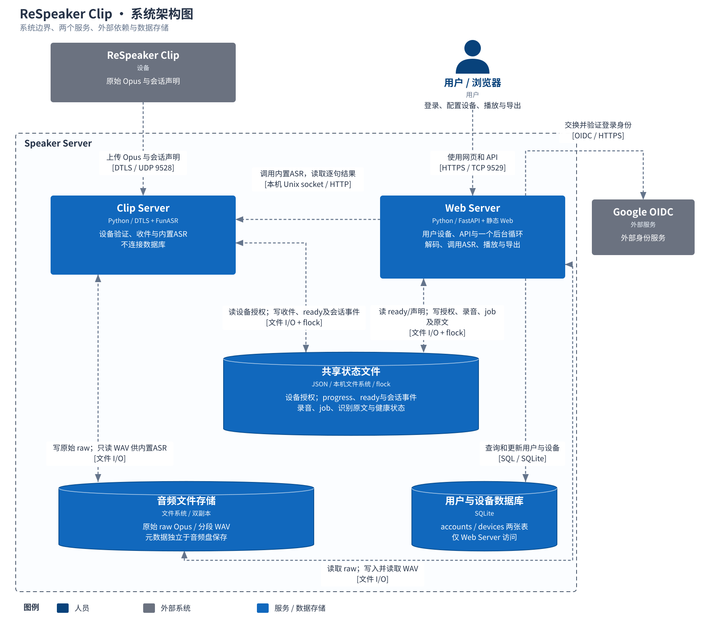
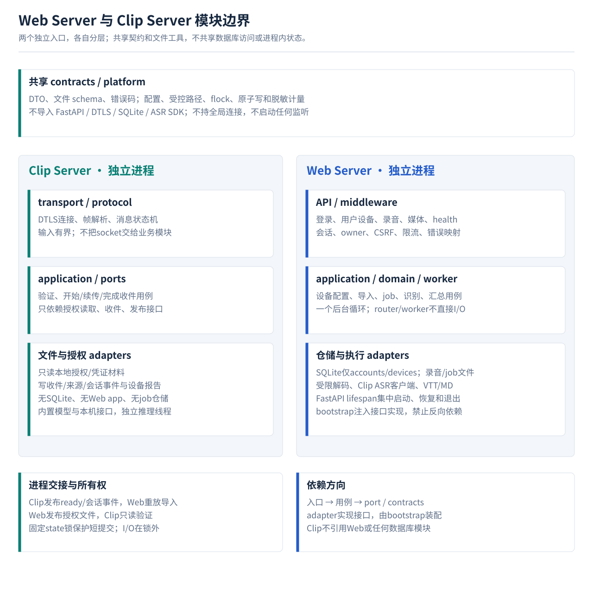
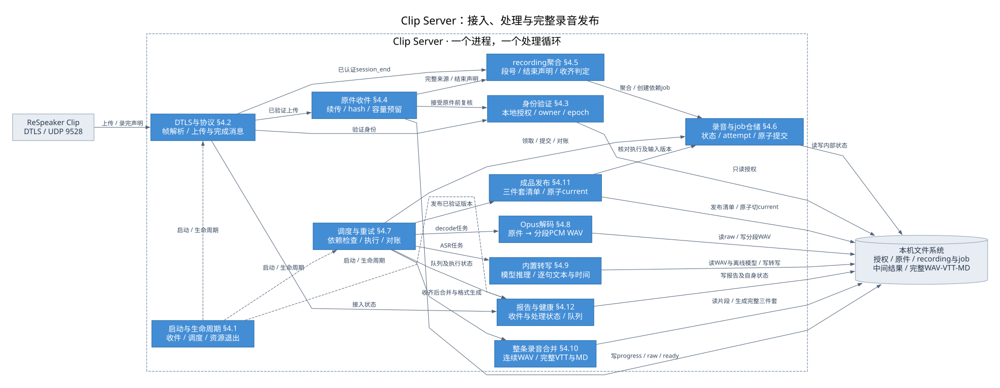
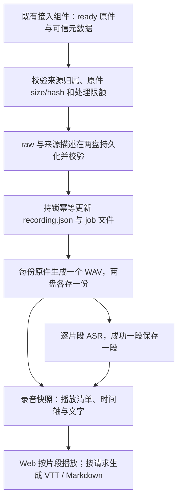
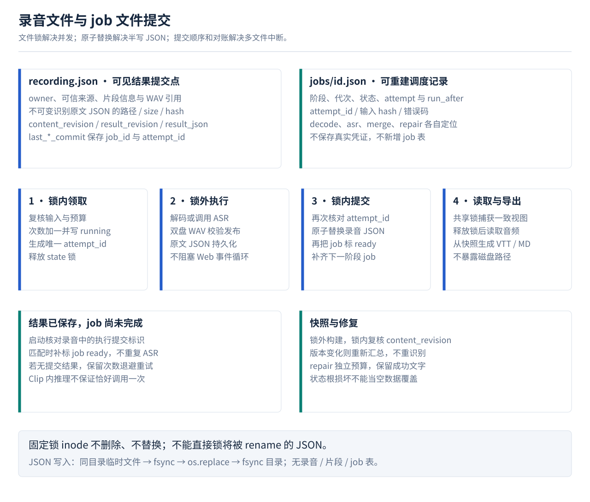
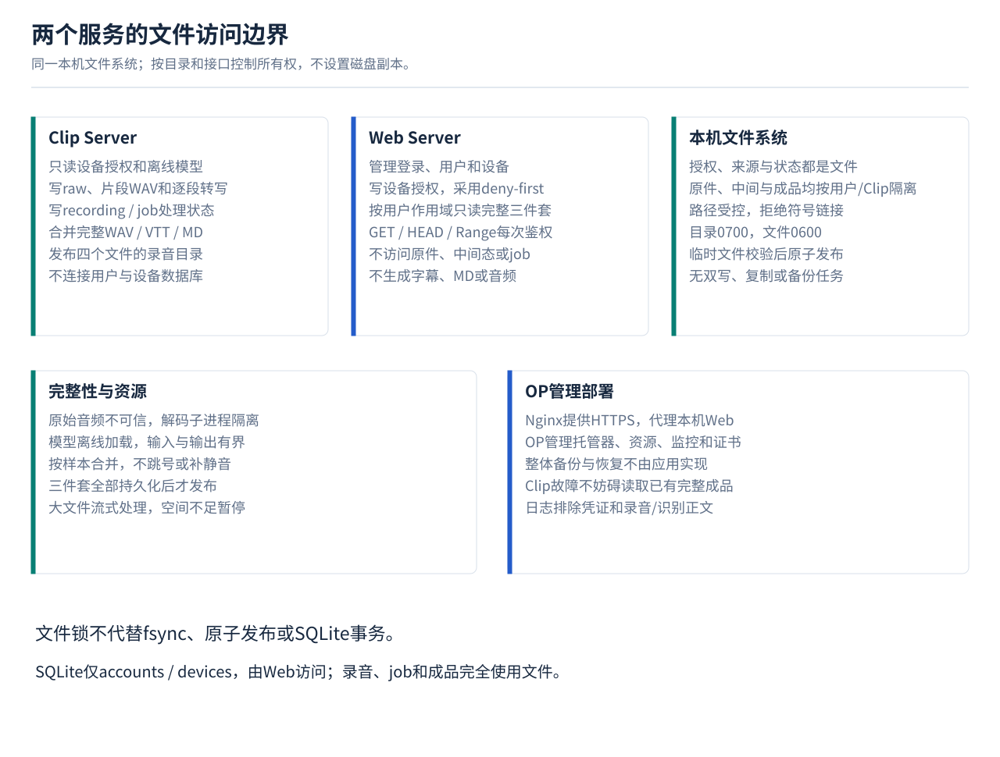

# ReSpeaker Clip · Server / Web 架构与模块设计

v9 · 2026-11-02 · 服务架构与模块设计；不代表代码实现或部署已完成。

<a id="overview"></a>

## 1. 整体架构图




系统由 Clip Server、Web Server 两个独立常驻进程组成。Clip负责设备接入、原始录音收件和ASR推理，Web负责用户设备管理、录音处理、播放和导出；两个服务通过本地文件交接，通过本机Unix socket调用ASR。

SQLite只保留 `accounts` 用户表和 `devices` 设备表，只有Web连接数据库。收件、来源、录音、job和转写结果都使用文件；Clip验证身份及完整性后直接采用设备上报的信息。raw/WAV双盘，状态文件和数据库独立存放。


<a id="services"></a>

## 2. 两个服务

### 2.1 Clip Server

监听DTLS/UDP 9528，负责凭证验证、协议解析、断点续传、额度预留及raw/ready/会话事件发布。完全不连接数据库，内置ASR模型推理，不执行登录、解码或录音job。Web停止时，Clip仍可凭本地有效授权收件。

### 2.2 Web Server

通过HTTPS/TCP 9529提供网页和API，管理两张表及授权文件；进程内一个后台循环导入来源、运行job、解码、转写并汇总。Clip停止时，Web仍可导入、解码和读取已收到的数据，ASR暂停。解码器及维护CLI为短时执行，不另设常驻job服务。

### 2.3 两服务交互

```text
浏览器 ── HTTPS ──> Web Server ──> accounts / devices
                         │
                         ├── 发布设备授权文件 ──> Clip Server 只读验证
                         │
设备 ── DTLS ──> Clip Server ──> raw / ready / session-events
                                         │
                                         └── Web 导入 → job → WAV / ASR → 播放与导出
```

Google验证登录身份；Clip内置ASR接收Web提交的已验证片段WAV并返回文字、时间戳和局部说话人。两个进程通过版本化文件交接收件，通过本机Unix socket调用ASR；不共享内存对象，不依赖对方进程维持自身启动和核心功能。两个服务各自单实例，不能用多个Uvicorn worker或重载重叠进程写同一目录。


<a id="architecture-guide"></a>

## 3. 模块划分




### 3.1 Clip Server 模块

| 模块 | 代码位置 | 核心职责 |
|---|---|---|
| 启动与配置 | bootstrap / __main__ | 加载Clip配置、组装依赖、角色锁与监听生命周期 |
| DTLS与协议 | transport / protocol | 连接、证书、帧解析及消息状态机 |
| 身份验证 | adapters/authorization | 本地授权及凭证校验，输出已验证设备上下文 |
| 收件与额度 | application / adapters/uploads | 断点续传、原件校验、容量预留 |
| 来源与会话事件 | adapters/sources / session_events | 不可变ready与录完声明交接 |
| 设备报告与健康 | adapters/reports / health | 遥测文件、接入及ASR独立健康状态 |
| 内置ASR | asr_api / asr | 本机接口、有界推理、模型管理及逐句A/B/C |

### 3.2 Web Server 模块

| 模块 | 代码位置 | 核心职责 |
|---|---|---|
| 启动与配置 | bootstrap / __main__ | FastAPI、适配器、资源与后台循环组装 |
| 登录与用户 | api/auth、users / application | OIDC、内存会话、CSRF和本人资料 |
| 设备管理 | api/devices / application | 激活、配置、BLE确认、解绑与授权文件发布 |
| 来源导入 | application / adapters/files | 导入已验证ready、聚合会话及去重 |
| 录音/job文件仓储 | domain / adapters/files | 元数据、原文、版本及执行状态持久化 |
| 调度与恢复 | worker | 领取、重试、执行提交、汇总和恢复 |
| 音频解码 | adapters/audio | 逐段raw Opus→WAV及双盘发布 |
| ASR调用与结果校验 | adapters/asr | 调用Clip本机接口、校验逐句结果并持久化 |
| 时间轴与快照 | domain / application | 实际样本偏移、缺号、覆盖及结果版本 |
| 媒体与导出 | api/media / adapters/exports | 清单、Range、VTT和Markdown |
| Web页面 | web/ | API交互、设备配置、播放及文本显示 |
| 数据库访问 | adapters/sqlite | 仅accounts/devices，连接与显式迁移 |
| 存储恢复 | application / manage | 副本修复、版本备份及离线恢复 |

### 3.3 公共模块

contracts只定义DTO、schema、版本和错误；platform提供配置、受控路径、原子写、flock及脱敏计量。共享模块不导入数据库、FastAPI、DTLS或ASR SDK，不持有全局连接或启动监听。

下文按Clip模块、Web模块逐项展开；公共契约在第6章，部署和安全在第7、8章。


### 3.4 源码布局

以下是目标布局；本仓库目前只有设计文档，不创建同名空壳来冒充实现。

```text
pyproject.toml
src/speaker/
  contracts/             # DTO、JSON schema、版本、错误码；无运行时资源
  platform/
    config.py           # 角色配置、路径与限额校验
    filesystem.py       # 受控打开、不可变发布、原子 JSON、fsync
    locking.py          # mutex + flock、固定锁路径与锁等待超时
    telemetry.py        # 脱敏日志、计量接口；不是设备业务数据
  clipserver/
    __main__.py         # python -m speaker.clipserver
    bootstrap.py        # 唯一组装入口、依赖注入及退出清理
    transport/          # DTLS 监听/证书/连接资源
    protocol/           # v3 消息编解码、校验、状态机；不负责落盘
    application/        # 身份确认、开始/续传/完成/中止收件用例
    ports.py            # AuthorizationReader / UploadStore / ReadyPublisher / SessionEventPublisher
    adapters/
      authorization.py  # 只读授权文件及凭证校验材料
      uploads.py        # progress、raw 临时文件、幂等重传
      sources.py        # ready JSON 不可变发布
      reports.py        # 可覆盖的已验证设备遥测
      session_events.py # 不可变完整性/结束声明，Web可重放
    asr_api/            # 仅Unix socket HTTP接口、输入校验与背压
    asr/                # FunASR模型、推理线程、断句和片段内A/B/C
    health.py           # 本机状态文件、DTLS/ASR分别就绪；无公网HTTP
  webserver/
    __main__.py         # python -m speaker.webserver
    bootstrap.py        # FastAPI、SQLite、文件 adapter、后台循环组装
    api/                # auth/users/devices/recordings/media/health routers
    middleware/         # 会话、Origin/CSRF、限流、request_id、安全响应头
    application/        # 用户/设备管理、录音查询、导入、处理、导出用例
    domain/             # 录音、片段、任务、覆盖和版本规则
    ports.py            # repositories、ASR、decoder、clock 等接口
    adapters/
      sqlite/           # 仅 accounts/devices、迁移及连接管理
      files/            # recording/job/transcript/source/authz 仓储
      audio/            # 流式 Opus→WAV、受限子进程管理
      asr/              # Clip Unix socket客户端、结果校验、取消/超时；无模型SDK
      exports/          # 确定性 VTT/Markdown
    worker/             # 一个后台循环：扫描→领取→执行→提交→汇总
    manage.py           # 离线初始化、迁移、对账、备份维护入口
web/
  api/                  # 同源 fetch、CSRF、错误和版本冲突处理
  auth/                 # 内存会话视图；不把凭证写 localStorage
  devices/              # 列表、BLE 配置与读回确认
  recordings/           # 列表、详情、片段播放器、字幕与导出
  shared/               # 展示组件、可取消请求、播放器生命周期
  app.js                # 前端组装，不承载后端权限判断
```

### 3.5 依赖方向

依赖方向固定为入口/bootstrap → application/domain → ports/contracts；具体 adapters 实现 ports，由 bootstrap 注入。协议层只处理字节和验证后的 DTO，不能把 socket、HTTP Request 或 SQLite connection 传入 domain。

- `contracts` 不导入 FastAPI、DTLS、SQLite、ASR SDK；`platform` 不导入两个服务包，也不提供数据库工具。
- `clipserver` 只导入 contracts/platform 和本进程模块；禁止导入 webserver、sqlite3、SQLAlchemy 或旧 registry。安装了某个依赖不等于允许调用它。
- Web router 不直接读写 JSON 或执行 SQL；worker 不自行 open/rename 文件；所有持久化走仓储接口。数据库 adapter 不保存录音或 job。
- Web 和 Clip 各自管理生命周期，不能 import 对方的 app、全局连接、锁或缓存。跨进程使用版本化文件契约及本机ASR接口；禁止导入对方代码。
- 前端模块通过公共 API 协作，不直接接触存储路径；BLE adapter 只在设备配置模块中使用，播放模块不获取设备 token。
- import 不启动监听、不创建目录、不迁移数据库、不加载模型。依赖版本锁定，web/clip 可有各自依赖组，但共用一次验证过的发布版本。

代码检查应使用 AST/import 图验证这些禁用依赖；不能仅靠目录命名判断完成模块化。


<a id="clip-modules"></a>

## 4. Clip Server 模块说明




### 4.1 启动与配置模块

**代码位置**：`clipserver/bootstrap.py、__main__.py`。

**职责**：组装接入与内置ASR依赖并管理一个Clip实例。

**输入与输出**：Clip配置、路径、证书和本地授权 → 设备监听与进程状态。

**处理流程与边界**：先校验路径/schema/证书并取得clip.instance.lock，再恢复未完收件和开放监听。拒绝数据库和Google配置；ASR模型配置只在Clip加载；退出先停接收并保存进度，最后释放锁。


#### 4.1.1 服务入口

目标入口为 `python -m speaker.clipserver`。`__main__.py`只解析命令、调用bootstrap并返回退出码；transport、授权及文件adapter由bootstrap装配，不在import时创建监听或目录。

启动顺序为：角色配置校验 → 真实挂载/目录/证书与格式检查 → 取得clip.instance.lock → 写initializing状态 → 恢复收件并重新验证授权/额度 → 创建DTLS监听 → 开放本机ASR接口并异步加载本地模型 → 分别写dtls_ready/asr_ready状态。核心接入初始化失败则关闭已创建资源；ASR模型缺失/加载失败单独标degraded，DTLS仍可接收；不访问数据库或等待Web在线。

运行中监听异常、元数据盘不可用等全局故障停止接收并退出或显式degraded；单设备凭证错误、单份坏文件只拒绝该请求。SIGTERM/SIGINT先关闭新连接入口，保存已确认进度、结束会话并等待线程/后代，最后释放角色锁；不把未完整文件发布为ready。

### 4.2 DTLS传输与协议模块

**代码位置**：`clipserver/transport、protocol`。

**职责**：处理已支持固件的连接与v3协议，不承担业务落盘。

**输入与输出**：网络字节流、受控证书配置 → 类型化消息与传输响应。

**处理流程与边界**：连接与帧有上限，解析长度/消息版本后交给收件用例。协议层不接触SQLite，不根据payload生成文件路径；认证和最终提交的身份检查交给验证模块。保持既有真机传输语义。


<a id="clip-verification"></a>

### 4.3 身份与凭证验证模块

**代码位置**：`clipserver/adapters/authorization.py`。

**职责**：完全通过本地授权文件及校验材料确认设备与归属。

**输入与输出**：连接凭证、上报身份、授权版本 → VerifiedDeviceContext，失败则拒绝。

**处理流程与边界**：只有身份、owner、binding与epoch一致才采用上报会话/段号。Web负责授权文件的发布和撤销，Clip只读；文件与凭证规则如下。

Clip Server 完全不连接 SQLite，沿用既有接入协议的认证及完整性验证，不通过查询上传表或来源表确认每次上报。Web Server 根据 devices 发布 `device-authorizations/<device_id>.json`，Clip Server 只读该文件及其引用的私有校验材料。此文件是设备授权的本地投影，不是额外数据库或第二套绑定业务状态。

校验文件包含 schema_version、device_id、device_uid、owner、binding_id、epoch、credential_version、state、verification_material_ref。只有完整 active 授权允许收件；文件缺失、损坏、revoked 或凭证不匹配即拒绝，不猜测归属。设备连接/凭证必须与校验文件中的身份一致，payload 中的 owner/binding/epoch 也必须一致；不能只验证“某台设备的凭证有效”就允许它冒用另一 owner。

验证通过后，直接采用 Clip 上报的 session、segment、recorded_at、采样 profile 和完整性声明，不再要求有一行预登记的来源记录。仍验证字段格式、长度、数值范围、实际音频大小与完整 hash；认证通过不允许任意文件路径、无限文件大小或不同内容覆盖同一来源。设备时间保持 device_unverified 标记，不把认证等同于时钟已校准。

授权投影的写入规则：

设备配置操作与启动对账在 Web 内由同一个配置 mutex 串行化，覆盖下面完整文件/SQL步骤，防止旧的激活操作在较新的撤销后重新发布 active；state.lock 仍只保护文件的短提交，不覆盖数据库事务。配置确认和设备 API 还须核对投影版本，deny/缺失/不一致时显示配置待修复，不声称设备可上传。

- 激活/换绑/凭证轮换前，先在 state 排他锁内原子发布 deny（revoked）并 fsync，阻止旧授权继续收件；释放文件锁后提交 devices 事务，再发布与新行完全一致的 active 文件。active 发布成功后才返回可用上传配置。
- 解绑或禁用账户先持锁发布对应设备 deny，再在 SQLite 更新行；成功响应时 deny 必须已持久化。数据库更新失败也保持 deny，不能因失败把旧授权自动放开。
- Clip 在握手以及最终发布 ready 前均持共享/排他 state 锁复核当前授权；不能仅用连接建立时的旧缓存继续上传。最终复核与 ready 发布在同一短临界区完成。禁用/解绑前已接受的 ready 录音保留原 owner。
- Web 重启逐条对账 devices 与投影。deny/缺失保持拒绝，直到配置操作明确完成；跨存储更新中断时只允许暂时不可用，禁止自动把未完成撤销重新激活。人工重试从 deny 开始，补齐确认；无需新增撤销或投影任务表。
- 不持文件锁等待数据库写事务；所有投影更新使用临时文件、fsync 和原子替换。校验材料由部署私有目录管理，文件 0600，不进入公开 API、日志或版本仓库。


### 4.4 收件、断点续传与额度模块

**代码位置**：`clipserver/application、adapters/uploads.py`。

**职责**：接收原始Opus，保存进度并强制执行用户容量预留。

**输入与输出**：已验证身份、上传声明及分片 → progress、临时raw、完整raw或明确错误。

**处理流程与边界**：先验证并持久化预留，再接收/确认数据；同来源重传复用进度，不重复扣额度。实际大小/hash与声明一致后才提交完整原件。

- `incoming/<upload_id>/progress.json` 保存有需要的断点进度及已验证身份上下文，使用固定 state 锁及原子替换。重启恢复未完成上传时重新验证授权；不建 upload/session 表。
- 接收完整 raw 后核对实际 size/hash，持锁复核授权仍有效，先发布并 fsync 不可变 raw，再原子发布不可变 ready 来源 JSON，最后才确认收件成功。只看 progress 或孤立 raw 不能当作完成。
- 来源文件 schema_version=1，含 source_id、device_id/device_uid、owner、binding_id、binding_epoch、credential_version、session、segment、recorded_at/time_source、profile、size/hash、raw_relative_path、服务端 received_at 及 verified_at。身份字段必须与校验上下文一致，其他字段在验证通过后采用 Clip 的声明；不在数据库预登记每份录音。
- source_id 按验证后的绑定身份、会话和段号无歧义生成；同一来源与 hash 重传幂等成功，不同内容报冲突，不能覆盖。文件路径全部由服务端生成。
- 导入时将 binding_id 映射为 source_namespace、session 为 source_session、segment 为 segment_no、size/hash 为 size_bytes/sha256；binding_epoch 原值保存。
- Web 信任此私有 ready 文件中的已验证身份，不重复索要一条 Clip 数据库记录；仍核对 schema、实际音频及处理限额，并将 owner 冻结到录音。设备以后换绑不改变旧录音归属。
- ready 来源与上传进度保留到明确保留策略执行，不由派生文件孤儿清理删除；source 丢失或损坏先告警，不能仅凭 raw 文件名猜测 owner。两个进程都不维护持久来源表或投影标记表。

#### 4.4.1 容量预留规则

用户音频额度在Clip接收前强制执行，不依赖Web在线或查库。首版所有owner共用部署策略 `SPEAKER_USER_QUOTA_BYTES`，默认10GiB；不同用户独立核算。该默认是保守容量策略，不是计费值，可部署调整；调低到已用值以下时拒绝新收件，不能删除旧录音凑额度。

为避免Clip解码或等待Web回报，按每份已接受片段保守预留“一份raw的实际字节数＋一份300秒PCM16 mono WAV上限9,600,000字节＋4,096字节WAV头预算”。末段也按该上限预留，UI分别显示actual_bytes与reserved_bytes，额度判断用reserved_bytes；双盘副本不重复计入用户额度，两盘物理空间仍分别预留。该选择牺牲末段利用率，保证Web停止时也能执行相同规则。

- 新上传先验证身份及声明raw大小，持state排他锁按原owner汇总ready文件和未完成progress的预留，检查剩余额度与磁盘空间，再把source_key/owner/reserved_bytes写入progress并fsync，最后才允许持续写入/确认数据。实际raw不得超过已声明大小及8MiB上限；超过即中止，不继续借用空间。
- 相同规范source_key的重传复用同一progress/reservation；不同内容报冲突。完成时把quota_reserved_bytes写入ready，再结束progress；两份同时存在的崩溃窗口按source_key去重，优先以ready计一次，不能双扣或漏扣。
- Clip重启扫描ready/progress重建额度，无需quota表、独立计数文件或Web回调。身份变更后历史来源仍归原owner核算，不能靠换绑释放旧额度。未完progress保留预留，只有确认对应临时raw已中止并清理后才释放。
- Web将WAV限制在上述预算内，不能申请超出预留的格式/长度；转写/元数据另受JSON限额和元数据卷空间保护。低于物理保留空间时全局暂停，不能把用户额度充足当作磁盘可写证明。
- 当前API没有录音删除入口。原件/ready/关联预留的释放仅在同时停两服务的明确保留/删除维护中执行，核对来源、录音、双盘及备份保留策略后更新整套文件；不能单删ready来释放额度，也不能由派生孤儿清理释放。


### 4.5 来源与会话事件发布模块

**代码位置**：`clipserver/adapters/sources.py、session_events.py`。

**职责**：把已接受的原件和录完证据持久交给Web。

**输入与输出**：完整raw、已验证身份及会话声明 → 不可变ready或session-event。

**处理流程与边界**：发布前在同一短锁临界区复核授权；raw/元数据持久化后才确认成功。Web可以重放既有声明，但不改写Clip的来源文件。

`device-reports` 只保存可覆盖的遥测，不能承载唯一的录完证据。Clip收到现有协议可验证的会话结束/完整性声明时，在 `session-events/<session_key>/<event_id>.json` 发布不可变事件，fsync完成后才确认该声明已接收。协议没有明确声明时继续unknown，不修改固件协议来猜测录完。

事件schema_version=1：owner、device_id、binding_id、binding_epoch、source_session、kind=session_integrity、integrity、声明的final_segment_no（完成声明必须有值）、claim_hash、verified_at。session_key为绑定/代次/会话规范编码的SHA-256，event_id为该身份及规范声明内容的hash。相同声明幂等；每会话最多保存一份完成声明和一个有界conflict.json。不同最终段号/完成声明冲突时保留首份证据、写一次冲突标记并拒绝新声明，Web据此标gap并告警，不能按mtime覆盖或为每次冲突无限创建文件。单事件≤64KiB、final_segment_no必须在部署允许的正整数范围内，未知kind拒绝；应用事件列表只保存这两类有界身份。

完成声明若随某份raw一起到达，ready JSON同时保留session_integrity_claim；先raw/ready，再发布会话事件，全部持久化后才确认整个完成操作。若在ready持久化后、事件发布前中断，Web可直接把ready中已验证的声明按相同event_id重放到recording，不写session-events，也不要求设备重新上传。它恢复的是撤销前已接受的证据；之后解绑不抹去该声明，但不能用它接受新的上报。独立会话声明直接持锁发布事件后确认；重传得到同一event_id。最终授权复核与事件发布同一临界区进行，已撤销凭证不能补造完成事件。

Web启动和循环均分批重放session-events及ready内嵌的已接受声明，跨两种来源按同一event_id去重。录音中保存已应用event_id及final_segment_no；同一声明只应用一次。只在1..N来源均ready且无冲突时confirmed_complete；有缺号为gap，未收齐的声明保留至后续片段补齐。应用事件或补齐改变integrity时原子递增content_revision并补建merge job。没有已导入片段的事件暂留原文件，导入后重放，不创建虚假的空录音。会话事件与ready文件一同备份、保留，不能纳入遥测缓存清理。


### 4.6 设备报告与健康模块

**代码位置**：`clipserver/adapters/reports.py、health.py`。

**职责**：记录已验证遥测和当前进程可用性。

**输入与输出**：设备报告及进程计量 → device-reports与status/clip.json。

**处理流程与边界**：遥测是每设备最新缓存，可覆盖，不承载唯一录完证据；会话结束走4.5模块。健康状态只供本机观察，不增加Clip公网HTTP服务，也不能代替授权或角色锁。字段、心跳和告警见部署模块。


### 4.7 内置ASR接口与模型推理模块

**代码位置**：`clipserver/asr_api、asr`。

**职责**：在Clip进程内常驻模型，完成中文为主、夹少量英语的转写、逐句断句及片段内A/B/C标记；不做语音身份识别。

**输入与输出**：Web通过私有Unix socket提交版本化请求 → 同步返回片段文字、句子时间戳、局部说话人及模型配置版本。接口为`GET /internal/v1/asr/health`和`POST /internal/v1/asr/transcribe`，不绑定公网或loopback TCP端口。请求包含request_id、job_id、attempt_id、audio_ref（受控根编号＋相对WAV路径）、size、SHA-256、sample_count、profile与config_digest；不含用户凭证或任意URL。health返回enabled、asr_ready、config_digest、输入/响应限制；Web在首次领取前冻结digest，重试时不允许静默切换模型。版本不符返回409，未就绪503，忙429；错误只含稳定code及request_id。

**处理流程与边界**：本地权重采用Paraformer-zh＋FSMN-VAD＋CT-Punc＋CAM++，由固定manifest记录权重路径、hash、运行库版本及参数；加载禁网且禁自动下载。WAV为16kHz单声道PCM16、≤300秒，Clip以受控打开的同一文件句柄核对格式/size/hash，并从该句柄读取PCM交给模型，不按请求路径二次打开；拒绝根外及符号链接。只读主/副盘derived目录；不读取或写入recording/job/原文文件，不连接数据库。

一个有界推理执行线程，默认并发1、等待队列8、计算线程4；DTLS事件循环与推理分离，模型推理不能占用收件线程，线程和CPU预算需压测。排队及执行共用600秒deadline；请求体≤64KiB，响应≤16MiB且≤100000句，超限明确失败。逗号留在句内，按句末标点输出一句一行；A/B/C只在当前片段内有效，不跨片段匹配。Web再次验证返回内容后持久化。

取消先移除未开始请求；已运行的模型调用若不能安全中断则标记丢弃结果，在原线程退出前不释放执行槽、不启动替代推理。超时或Web断开不新增后台job；请求ID仅用于关联，不保证跨进程恰好一次。停机先关ASR入口、取消排队，再等待推理；超过45秒由服务管理器终止Clip，Web按持久attempt预算恢复。可捕获的模型加载/推理错误仅使asr_ready=false，DTLS可独立就绪；Clip重启时Web仍可登录、读取、解码和播放，只暂停识别。

socket父目录`/var/lib/speaker/ipc`由安装过程预建、0700，socket为0600、服务账号所有；Clip持角色锁后核实旧socket无活跃监听方才移除，自身退出只清理本次创建的socket。socket不纳入备份，也不是状态文件。模型目录预建且只读，缺失仅降级ASR。两服务仍是两个常驻进程，没有第三个ASR服务。同进程共享内存及故障域：原生模型库崩溃或进程OOM会同时中断DTLS，由systemd重启并按收件进度恢复；有界队列与线程预算降低争用，不能提供进程级故障隔离。

<a id="web-modules"></a>

## 5. Web Server 模块说明


### 5.1 启动、配置与资源装配模块

**代码位置**：`webserver/bootstrap.py、__main__.py`。

**职责**：创建FastAPI、两表SQLite连接、文件仓储和单后台循环。

**输入与输出**：Web配置与持久状态 → API、依赖容器和后台循环。

**处理流程与边界**：通过lifespan集中管理资源；先检查schema/锁与恢复状态，再启用写入/调度。网络、解码和ASR不能阻塞事件循环；import不监听端口或自动建库。


<a id="oauth"></a>
<a id="users-api"></a>

#### 5.1.1 服务入口

目标入口为 `python -m speaker.webserver`。入口只创建一个FastAPI应用和一个后台循环，通过lifespan统一获得/关闭SQLite、仓储、HTTP客户端、解码执行器及后台资源。静态Web由同一服务提供；启动流程不导入Clip监听器。

启动顺序为：角色配置与挂载检查 → 取得web.instance.lock → 核验两表数据库和文件schema → 对账授权、来源、会话事件、录音与job → 恢复遗留执行 → 初始化路由/静态Web及受控后台循环 → 开启HTTPS并发布ready。已有部署缺数据库、未知高schema或授权恢复不安全时拒绝正常写入，不自动新建空数据。

未配置ASR属于功能未启用，不妨碍已具备依赖的登录、收件结果读取和播放；health根据Clip本机接口区分disabled/unavailable/ready；领取前暂不可用保持pending/retry_wait，不消耗新次数；领取后故障按第5.6节保留attempt。运行中依赖故障按模块暂停工作，不能因一个ASR失败重启整个Web。退出先禁止新写请求和job领取，等待/取消在途执行及解码后代，关闭数据库/客户端，再释放角色锁；Web退出不代表Clip内已开始的推理停止。

### 5.2 登录、会话与用户模块

**代码位置**：`webserver/api/auth、api/users、application`。

**职责**：验证Google身份，建立本站会话并管理本人资料。

**输入与输出**：OIDC回调、Cookie和本人资料请求 → 用户视图、会话及CSRF结果。

**处理流程与边界**：账号持久化到accounts，临时登录态和本站会话只在Web内存。每请求核验账号状态；设备和录音模块取得服务端确定的owner，不接受客户端替换。

```jsonc
{
  // TEXT；主键；必填。本地用户 ID，历史 ID 沿用；录音文件通过 owner 引用。
  "user_id": "demo-user",
  // TEXT；唯一。验证通过的 Google 身份标识；待核验的历史用户可空。
  "google_sub": "google-sub-example",
  // TEXT；必填；唯一；大小写不敏感。用户邮箱；账号同步时检查身份冲突。
  "email": "user@example.com",
  // TEXT；必填；默认空字符串；≤100 字符。用户名称，可为空字符串。
  "display_name": "示例用户",
  // TEXT；必填；默认 active。active / disabled；请求鉴权检查账号状态。
  "status": "active",
  // INTEGER；必填；默认 1；>0。认证版本；变更后使旧会话失效。
  "auth_version": 1,
  // INTEGER；可空。最近登录时间。
  "last_login_at": 1793318400000,
  // INTEGER；必填。用户建立时间。
  "created_at": 1793318400000,
  // INTEGER；必填。用户资料更新时间。
  "updated_at": 1793318400000
}
```

新用户 ID 使用 uuid4().hex，历史 user_id 原样迁移。相同 sub 复用用户；邮箱与其他 sub 冲突时返回 account_identity_conflict，保留原归属。

设备别名保存到 devices.display_name，配置确认保存到 devices.confirmed_revision，硬件 UID 直接为 devices.device_uid；不再另建绑定、UID、配置或来源表。录音、片段和 job 文件的[字段说明](#tables)在录音文件及调度模块；只有 accounts 和 devices 使用[本页 SQL](#sql)。

#### 5.2.1 用户接口
用户首次通过 Google 登录时由 Server 自动建立 accounts 记录，HTTP 接口使用 `/users/me` 表示当前会话用户。两项接口均返回 `Cache-Control: private, no-store`；会话失效返回 401，账号禁用返回 403 account_disabled。

GET `/users/me` 和 PATCH `/users/me` 的成功响应使用相同结构：

```jsonc
{
  // string；accounts.user_id；只读，由会话确定。
  "user_id": "demo-user",
  // string；accounts.email，由登录身份同步；只读。
  "email": "user@example.com",
  // string；本站显示名称，允许空字符串，最多 100 字符。
  "display_name": "示例用户"
}
```

PATCH `/users/me` 请求：

```jsonc
{
  // string；必填，最多 100 字符；空字符串用于清空显示名称。
  "display_name": "我的名字"
}
```

PATCH 请求须通过 Origin 和 CSRF 检查，且只能包含 display_name。缺少字段、类型错误、超过 100 字符或包含其他字段，均返回 422。Server 使用参数化 SQL 更新本人记录的 display_name、updated_at，并返回最新资料。user_id、email、google_sub、status、auth_version 和 owner 均不可由此接口修改。

`GET /auth/session` 返回登录状态和 CSRF，其中的 user 与 `/users/me` 都读取 accounts 当前记录。首次 Google 登录可初始化名称，后续登录保留本站名称。用户接口仅管理本人资料；管理员操作和账号删除不在本版范围内。

#### 5.2.2 登录与会话
Web 通过顶层导航发起 Google 登录。Google 授权后回调 Server，Server 校验本次 state 和 Google ID token，按 google_sub 找到或建立 accounts 用户，再创建本站 session、设置 Cookie，303 返回 `/`。后续请求使用本站 Cookie。

- GET `/auth/google/start`：302 跳 Google；scope 为 openid email profile，使用 Code / OIDC + S256 PKCE
- GET `/auth/google/callback`：Google 成功返回 code、state，取消时返回 error、state；校验后设置会话 Cookie 并 303 到 `/`；取消授权返回 `/?login_error=login_cancelled`
- GET `/auth/session`：200 返回下方用户与 CSRF 对象；失效返回 401 session_expired
- DELETE `/auth/session`：校验 Origin/CSRF，删除当前会话、清 Cookie，返回 204；已失效返回 401，Web 同样清理本地状态

- 登录临时状态：Server 内存，5 分钟、一次消费；临时 Cookie 为 Secure/HttpOnly/SameSite=Lax
- 本站 session：Server 内存，闲置 24 小时、最长 7 天；Cookie 为 Secure/HttpOnly/SameSite=Strict、Path=/、host-only、Max-Age=604800
- 退出、到期、Server 重启：会话失效，重新 Google 登录；账号和业务数据继续保留

GET `/auth/session` 成功响应：

```jsonc
{
  // object；从 accounts 读取的本站用户。
  "user": {
    // string；accounts.user_id。
    "user_id": "demo-user",
    // string；accounts.email。
    "email": "user@example.com",
    // string；accounts.display_name，允许空字符串。
    "display_name": "示例用户"
  },
  // string；当前会话的 CSRF token，写请求放入 X-CSRF-Token。
  "csrf_token": "example-csrf-token"
}
```

本站会话仅在 Server 内存保存，以下字段不返回客户端：

```jsonc
{
  // string；随机会话 token 的摘要，Cookie 仅持有原 token。
  "token_hash": "example-token-hash",
  // string；对应 accounts.user_id。
  "user_id": "demo-user",
  // integer；登录时 accounts.auth_version，请求时须与账号当前值一致。
  "auth_version": 1,
  // string；与客户端写请求比对的 CSRF token。
  "csrf_token": "example-csrf-token",
  // integer；最近活动时间，用于 24 小时闲置到期。
  "last_seen_at": 1793318400000,
  // integer；首次创建时间 + 7 天，活动不会延长此时间。
  "absolute_expires_at": 1793923200000
}
```

账号禁用返回 403 account_disabled，身份映射冲突返回 409 account_identity_conflict；回调错误返回 400 login_invalid_or_expired，Google 不可用返回 503 login_unavailable。登录响应和会话接口设置 no-store，日志使用脱敏格式。

服务器配置 GOOGLE_CLIENT_ID、GOOGLE_CLIENT_SECRET_FILE、PUBLIC_WEB_ORIGIN，secret从私有文件读取。Google Console 回调登记为 `PUBLIC_WEB_ORIGIN/api/boa/v1/auth/google/callback`，与请求保持完全一致。协议使用 [Google OIDC](https://developers.google.com/identity/openid-connect/openid-connect)。


<a id="ble"></a>

### 5.3 设备管理与授权发布模块

**代码位置**：`webserver/api/devices、application`。

**职责**：管理devices中的当前归属、配置、别名和撤销状态。

**输入与输出**：已登录用户、设备UID及BLE读回确认 → 设备对象和受控上传配置。

**处理流程与边界**：完整设备操作由配置mutex串行化，遵守deny-first：先拒绝旧授权，再提交设备行，最后发布新active。Clip通过4.3模块消费授权文件；历史录音owner不随换绑改变。

POST `/devices/activate` 请求，200 响应使用下一节的身份与 configuration 字段：

```jsonc
{
  // string；从 Clip 读到的硬件 UID；Server 查询受控登记及本人归属。
  "device_uid": "0011223344556677"
}
```

POST `/devices/{id}/binding/confirm` 请求：

```jsonc
{
  // string；读回的硬件 UID。
  "device_uid": "0011223344556677",
  // string；BLE 读回的绑定 ID，须与当前用户设备一致。
  "binding_id": "demo-binding",
  // integer；读回的上传配置版本。
  "revision": 1,
  // boolean；固定 true，表示配置已写入并读回确认。
  "saved": true
}
```

确认成功响应：

```jsonc
{
  // string；确认完成的绑定 ID。
  "binding_id": "demo-binding",
  // integer；确认完成的配置版本。
  "revision": 1,
  // string；固定 provisioned。
  "state": "provisioned"
}
```

PATCH `/devices/{id}` 请求；200 返回同一 display_name 和路径对应的 device_id：

```jsonc
{
  // string；本人当前设备的别名，1–100 字符。
  "display_name": "我的 Clip"
}
```

DELETE `/devices/{id}/binding` 无 body，成功响应：

```jsonc
{
  // string；固定 revoked，设备上传凭证已撤销。
  "state": "revoked",
  // boolean；是否仍待设备侧清理确认，保存在 devices。
  "device_cleanup_pending": true
}
```

#### 5.3.1 设备与上传配置

GET `/devices` 返回 `{items:[设备对象]}`；POST `/devices/activate` 返回相同身份字段及 configuration。device_id、binding_id、device_uid 均来自同一 devices 行；binding_id 是设备表中的字段，不是独立表。

```jsonc
{
  // string；devices.id；API 路径 {id} 使用此值。
  "device_id": "demo-device",
  // string；devices.device_uid；设备硬件 UID。
  "device_uid": "0011223344556677",
  // string；devices.binding_id；本次绑定 ID。
  "binding_id": "demo-binding",
  // integer >0；绑定代次。
  "epoch": 1,
  // string；devices.display_name，未设置时使用既有设备名称/ID。
  "display_name": "我的 Clip",
  // integer；devices.revision，上传配置版本。
  "revision": 1,
  // 已验证固件信息；无可信来源时 null。
  "firmware": null,
  // 已验证设备能力；无可信来源时 null。
  "capabilities": null,
  // 遥测；value 缺少有效来源时为 null，sampled_at/source 同时为 null。
  "telemetry": {
    // value 为 boolean|null；在线状态。
    "online": {
      // boolean|null；在线状态。
      "value": null,
      // integer|null；遥测采样时间，UTC Unix 毫秒。
      "sampled_at": null,
      // string|null；可信数据来源标识，缺失时为 null。
      "source": null
    },
    // value 为 integer 0–100|null；电量百分比。
    "battery": {
      // integer 0–100|null；电量百分比。
      "value": null,
      // integer|null；遥测采样时间，UTC Unix 毫秒。
      "sampled_at": null,
      // string|null；可信数据来源标识，缺失时为 null。
      "source": null
    },
    // value 为非负 integer|null；待上传片段数。
    "pending": {
      // 非负 integer|null；待上传片段数。
      "value": null,
      // integer|null；遥测采样时间，UTC Unix 毫秒。
      "sampled_at": null,
      // string|null；可信数据来源标识，缺失时为 null。
      "source": null
    }
  },
  // 仅激活响应返回；列表不返回配置/凭证，响应 no-store。
  "configuration": {
    // string；与外层 device_id 相同。
    "device_id": "demo-device",
    // string；与外层 device_uid 相同。
    "device_uid": "0011223344556677",
    // string；configuration.owner_id = accounts.user_id，由 Server 确定。
    "owner_id": "demo-user",
    // string；与外层 binding_id 相同。
    "binding_id": "demo-binding",
    // integer；与外层绑定代次相同。
    "epoch": 1,
    // integer；与外层配置版本相同。
    "revision": 1,
    // string；由部署配置提供的设备上传地址，host:port；本文不定义传输细节。
    "endpoint": "upload.example.com:9528",
    // string；设备上传凭证，仅经受控 BLE 配置写入设备。
    "device_token": "example-device-token"
  }
}
```

列表外层结构：

```jsonc
{
  // array；GET /devices 的设备对象数组；示例为空列表。
  "items": []
}
```

#### 5.3.2 BLE与请求规则
- 绑定：验证登记与 owner；本人重复激活复用绑定，未登记到当前用户的 device_uid 返回 409 enrollment_required
- 配置确认：Web 经 BLE 写入后读回 binding/epoch/revision，再提交 device_uid、binding_id、revision、saved
- 改名：更新本人设备行的 display_name；设备身份和上传凭证保持原值
- 移除：撤销上传凭证；device_cleanup_pending 沿用现有维护确认；已上传录音保留原 owner
- Wi-Fi：Clip 扫描 `{ssid,rssi,security}[]`，选择结果后经 BLE 写入密码，读取 saved/connected/error；密码在调用结束后清空
- 设备能力：以真实 capability 为准；已保存网络最多 5 个，基线为 2.4 GHz WPA2
- 请求管理：切换用户/数据时取消旧请求，退出清理音频和定时器；409 recording_revision_changed 时重新取版本
- 轮询：录音可见 5 秒、设备可见 15 秒；隐藏后 30 秒，恢复可见立即刷新

Clip Wi-Fi 扫描结果由 Web 的 BLE 适配层读取：

```jsonc
[
  {
    // string；Clip 扫描到的网络 SSID，Web 从此列表选择。
    "ssid": "Example-WiFi",
    // integer；信号强度 dBm。
    "rssi": -55,
    // string；设备返回的安全类型，当前基线 WPA2。
    "security": "WPA2"
  }
]
```

迁移沿用旧 user_id，先核验 owner/邮箱映射；缺项返回 migration_owner_mapping_required。账户迁移与业务库 user_version 更新同事务；录音及 job 的文件迁移独立校验并切换状态目录，见录音文件及调度模块。旧设备/绑定/配置/UID 字段合并迁移到 devices，来源与上传进度导出成文件；INSERT 使用显式列名。


<a id="ingest"></a>

### 5.4 来源导入与会话聚合模块

**代码位置**：`webserver/application、adapters/files`。

**职责**：扫描已验证来源并将同一设备录音会话聚合为录音。

**输入与输出**：ready与会话事件文件 → recording更新、处理job及完整性版本。

**处理流程与边界**：Web不读取接收半成品，不要求Clip有来源表。导入按身份幂等并校验raw；先两盘原件/描述，再提交录音和补齐job。

Clip Server 在身份/凭证及完整性验证通过后，接受 Clip 上报的元数据，保存 raw 并原子发布 `sources/ready/<source_id>.json`。Web Server 扫描这些文件开始导入；设备传输过程不在本文范围内。




- 一个 recording.json 对应一次录音，其中一个 segment 对应设备生成的一份 raw 文件。每个 segment 生成一个 WAV、保存一份识别结果。Server 不再二次切块。
- 录音聚合键为 source_namespace（绑定 ID）+ binding_epoch + source_session；segment_no 从 1 开始。owner 取可信来源，不接受 Web 自行指定。
- 只导入 ready 来源；通过受控文件句柄验证原件存在、类型、实际大小及完整 SHA-256，缺失/冲突时保留来源并记录导入错误，暂不创建业务 segment，保留来源文件待修复。来源通过校验后，先按第5.7节复制原件和来源描述到副本盘，两份均持久化才提交录音文件。额度核算按同一物理文件去重，重复导入不重复计费。
- 持 state 排他锁按 source_namespace/source_id 去重，复核 owner、录音、段号、size/hash，首次导入递增 content_revision。相同来源幂等返回，不同内容报 source_identity_conflict。
- 来源 JSON 发布后保持不可变，不再维护 projected_at 或已消费表。Web 每批500份扫描 ready 文件，并根据 recording 中的来源身份去重、补齐 job；重复扫描不增加版本。进程内已扫描缓存只加速，重启丢弃重建，不能成为唯一处理依据。旧时间单位在迁移时归一为 UTC 毫秒。
- 导入后即可处理；后段可提前独立识别。缺号只阻止无法确定偏移的全局结果发布，不阻止后段本地处理。
- integrity 为 unknown / gap / confirmed_complete，由接入侧可信完整性元数据提供；没有明确完成依据时保持 unknown，静默不能当作录完。完整性变化也更新 content_revision；声明通过下述持久session-events交接，不依赖device-reports最新缓存。


<a id="data-model"></a>
<a id="audio-guide"></a>
<a id="tables"></a>

### 5.5 录音、片段与job文件仓储模块

**代码位置**：`webserver/domain、adapters/files`。

**职责**：持久化录音、原文引用、处理任务和版本。

**输入与输出**：来源/处理结果、期望版本和执行标识 → 一致文件视图或冲突。

**处理流程与边界**：一个recording.json是单条录音的可见提交点，job独立文件可对账恢复。写入只经仓储，router和worker不直接open/rename；片段原文不可变。

数据库只保留 accounts 用户表和 devices 设备表。每条录音一个 recording.json，内含 owner、来源聚合键、片段元数据和结果快照；每个处理单元一个 job JSON，保存状态、执行次数与重试时间。录音、片段及 job 均不存 SQLite。owner 引用 accounts.user_id，由应用校验；设备当前归属、绑定代次和配置版本全部放入 devices；Clip 收件与来源状态不入库。

设备每 5 分钟生成一个 segment，末段可不足 5 分钟。Server 每段解码为一个 WAV，并直接识别这一段，不做二次切块或重叠上下文。失败只重试对应片段，已有成功结果保留。播放器按片段 WAV 清单播放，字幕按实际样本数汇总。字段、缺号及恢复规则见[音频处理设计](#tables)。

字段示例使用 JSONC，实际请求和响应使用标准 JSON。时间统一为 UTC Unix 毫秒，示例中的 hash 和凭证不是真实数据。

同一个 SQLite 只保留 accounts 与 devices，且只有 Web Server 连接。Clip Server 不连接数据库；来源、上传进度、录音、job 全部使用文件。以下目录位于独立持久化的 SPEAKER_STATE_ROOT，不使用录音、片段或 job 表，也不维护 SQLite 文件索引。

```text
state/
  schema.json
  locks/state.lock
  locks/clip.instance.lock
  locks/web.instance.lock
  device-authorizations/<device_id>.json
  incoming/<upload_id>/progress.json
  sources/ready/<source_id>.json
  session-events/<session_key>/<event_id>.json
  device-reports/<device_id>.json
  status/clip.json
  status/web.json
  recordings/<recording_id>/recording.json
  recordings/<recording_id>/transcripts/<segment_id>/<publication_id>.json
  jobs/<job_id>.json
```

`schema.json` 保存 `{recording_schema_version:4,job_schema_version:1}` 和初始化标识，升级前核对版本；不是运行中的事务日志。授权与来源 schema 均为1；接收进度只表示未完成收件，不能作为 ready 依据。

recording_id 由服务端根据 `(source_namespace,binding_epoch,source_session)` 的无歧义规范编码计算 SHA-256，segment_id 由 `(source_namespace,source_id)` 同样计算；同时保存并复核原始身份字段及 owner。迁移保留历史 ID；启动扫描文件重建来源/聚合键到已有 ID 的映射，导入先查该映射，只有不存在旧录音时才用上述规则生成新 ID，避免旧会话被重复创建。不能把设备提供的 session/owner 直接用作路径。job_id 由录音、片段、阶段及处理代次决定。同一工作单元幂等生成同名 job，不因重启创建重复任务。

#### 5.5.1 recording.json

一个文件内保存整条录音的元数据、segments 和 result_json；小文件原子替换即为单条录音的一致性提交边界。片段识别正文使用不可变 JSON 文件引用，避免每次把所有原文重写一遍。recording.json 限 32 MiB；片段原文及快照仍受第5.7节单独限额约束。

```jsonc
{
  "schema_version": 4,
  "id": "recording-001",
  "owner": "user-001",
  "source_namespace": "binding-001",
  "binding_epoch": 1,
  "source_session": "session-001",
  "recorded_at": null,
  "time_source": "server_received",
  "received_at": 1793491200000,
  "last_received_at": 1793491200000,
  "integrity": "unknown",
  "final_segment_no": null,
  "applied_integrity_event_ids": [],
  "content_revision": 1,
  "result_revision": 0,
  "result_json": null,
  "merge_error_json": null,
  "segments": [
    {
      "id": "segment-001",
      "source_namespace": "binding-001",
      "source_id": "source-001",
      "segment_no": 1,
      "raw_relative_path": "raw/object-001.raw-opus",
      "size_bytes": 1024,
      "sha256": "aaaaaaaaaaaaaaaaaaaaaaaaaaaaaaaaaaaaaaaaaaaaaaaaaaaaaaaaaaaaaaaa",
      "sample_count": null,
      "process_config_json": {"decoder_version":"example-build","raw_profile":"clip-16k-mono-20ms-v1","asr":null},
      "wav_state": "none",
      "wav_relative_path": null,
      "wav_size_bytes": null,
      "wav_sha256": null,
      "transcript_ref": null,
      "decode_job_id": "decode-job-001",
      "asr_job_id": null,
      "last_decode_commit": null,
      "last_asr_commit": null
    }
  ],
  "updated_at": 1793491200000
}
```

final_segment_no / applied_integrity_event_ids 是recording schema v4的可选恢复字段，旧文件缺失时按null/[]读取；若未来改为必填则提升文件schema并迁移。

原件及来源描述两盘完成才添加 segment；同一录音内 segment_no 唯一，来源身份/大小/hash 冲突报 source_identity_conflict。owner 必须在 accounts 存在且与可信来源一致，这些原来的外键/唯一约束改由持锁应用校验。

transcript_ref 为 `{relative_path,size_bytes,sha256}`，引用状态根下已 fsync 的不可变原文文件。文中 transcript_json 指该文件解析出的片段原文对象，不是数据库字段。成功静音保存合法 `cues:[]`，失败不能伪装为空成功。result_json 的完整结构仍见第5.9.2节，录音与快照在同一个 recording.json 内替换。

#### 5.5.2 jobs/<job_id>.json

```jsonc
{
  "schema_version": 1,
  "id": "decode-job-001",
  "recording_id": "recording-001",
  "segment_id": "segment-001",
  "stage": "decode",
  "generation": 1,
  "state": "pending",
  "attempt": 0,
  "run_after": 1793491200000,
  "attempt_id": null,
  "expected_input_sha256": "aaaaaaaaaaaaaaaaaaaaaaaaaaaaaaaaaaaaaaaaaaaaaaaaaaaaaaaaaaaaaaaa",
  "error_code": null,
  "created_at": 1793491200000,
  "updated_at": 1793491200000
}
```

stage 为 decode / asr / merge / repair；录音汇总的 segment_id 为 null，冻结要汇总的 content_revision。state 为 pending / running / retry_wait / ready / failed / not_configured，后者仅用于 ASR。执行次数、重试时间和错误以 job 为准，不在 segment 再复制另一套计数。接口所需 decode_state/asr_state 由引用的 job 和已发布文件推导；修复使用独立 repair job 和代次，不覆盖成功 ASR。

last_decode_commit / last_asr_commit 保存 `{job_id,attempt_id}`，用于识别录音更新已提交但 job 尚未标完成的崩溃窗口；汇总通过 result_revision 判断。job 不包含 ASR 凭证或音频正文；单 job 文件上限 64 KiB。


<a id="publication"></a>

### 5.6 后台调度、提交与恢复模块

**代码位置**：`webserver/worker`。

**职责**：按持久job顺序执行并恢复未完成工作。

**输入与输出**：到期job、录音版本、固定配置 → 执行结果、重试状态及汇总请求。

**处理流程与边界**：领取前先保存attempt和唯一attempt_id，锁外执行；提交时重读版本和执行标识。录音结果先提交再补标job成功；重启不清空预算，不重识别已保存成功片段。

- Clip Server 只负责验证、raw 接收及收件/ready 来源文件，不写 recording/job，不连接数据库。设备凭证与 owner/binding/epoch 从本地授权文件验证；通过后信任上报会话及段号等业务信息，校验边界见[主文档](#clip-verification)。Web 负责录音/job/识别原文及两表数据库。
- 各角色独占自己的 instance.lock，Web 内只运行一个后台循环；两个主进程可并行运行，解码子进程为临时受控执行。state.lock 是短临界区的共享锁文件，不是常驻排他锁；所有发布收件/授权/录音/job/识别原文指针的路径用 LOCK_EX，一致性读取用 LOCK_SH。线程还须共用 mutex；锁 fd 不泄露到解码子进程。
- 锁文件不删除、不替换，不能用“文件存在”或 PID 判锁，不能直接锁将被 rename 的 JSON；进程崩溃由 OS 释放 flock。锁顺序固定为角色锁 → 进程内 mutex → state.lock；不在持 state 锁时等待 SQLite 写事务，数据库只用于用户/设备，ready 来源和导入均无数据库步骤。
- 状态 JSON 采用同目录临时文件 → 完整写入 → fsync 文件 → os.replace → fsync 父目录。首次目录创建也 fsync 父目录；schema、owner、ID、关联、体积和旧版本在替换前校验。rename 保证读到完整新旧文件；断电持久化依赖 fsync。
- 领取 job 时在 LOCK_EX 内核对输入/就绪状态、due 时间和 attempt<4，生成唯一 attempt_id，增加 attempt 并原子写 running，随后释放锁。解码、复制双盘和 ASR 本机接口调用均在锁外执行。提交重新取锁并核对 job 的 attempt_id、generation、输入 hash 及目标仍存在，旧执行不得覆盖新状态。
- 解码和 ASR 各最多 4 次，退避 30 秒、2 分钟、10 分钟；结构/hash/额度超限直接 failed，暂时故障 retry_wait。merge 通过版本差重建、短退避调度，永久超限保存 merge_error_json。人工重试明确新建代次/预算，不能轮询即重置次数。
- 任一音频盘异常暂停 ready 发布、导入和处理；未领取 job 不增加次数。在途执行先完成或取消并等待退出；不能让旧解码器或旧本地回调仍可写入时开始恢复。Web 常驻角色锁释放前必须停止并等待后台及子进程；SIGKILL 后子进程不得有元数据提交权限，重启先确认旧执行终止。
- Clip显式关闭ASR时job为not_configured，不消耗次数；启用后显式变pending。Clip未在线或模型加载/故障时保持pending/retry_wait，领取前通过本机health检查就绪和队列容量，不消耗新次数；领取后发生的超时/忙/断连保留已记attempt并退避。解码前冻结解码配置，首次 ASR 前冻结模型/语言，失败重试沿用；成功结果不在线换模型重跑。
- 列表和调度扫描录音/job JSON，进程内可缓存但文件为真相，重启重建；不引入持久表索引。API 在共享锁内读取所需小文件得到一致性视图，随后释放锁、在锁外做媒体 I/O；长期扫描不持锁做 hash 或网络调用。文件损坏隔离并告警，不清空状态；目录规模很大时再实测扫描开销。



#### 5.6.1 文件提交边界

flock 只负责互斥，不能让多个 JSON 的替换自动变成事务。录音文件是可见结果的提交点，job 是可重建调度记录，按以下顺序发布：

1. raw/WAV 在两音频盘各写临时文件、校验 hash/样本并 fsync，再以不可变路径发布并 fsync 目录；ASR 原文在独立状态根写不可变 JSON、fsync。不得覆盖已发布文件。
2. 取 state 排他锁，重新验证当前 job attempt_id/generation、输入 hash 和录音版本；将文件引用、sample_count 或 transcript_ref、提交标识与 content_revision 一起写入新的 recording.json，原子替换并 fsync。这是该结果唯一的可见提交点。
3. 再将对应 job 原子标 ready；需要下一阶段时按确定 ID 生成 job。原件导入遵循先录音后补齐 job 的相同顺序，补齐并持久化；来源文件保持原值，后续扫描按身份去重。不能先把 job 标成功再引用尚未提交的结果。

两盘只写成一份时不提交 ready 元数据。录音与 job 之间中断可对账重放；旧快照保持可读。原件新增、文件可用性、识别覆盖或完整性改变才递增 content_revision；单纯领取/重试计数不递增，failed 回 pending 等可见状态变化递增。

#### 5.6.2 汇总与版本竞争

工作者持共享 state 锁捕获 content_revision、segment 引用和对应 job 状态，释放锁后读取不可变原文并构建快照。提交再取排他锁，重读 recording.json，比较当前 content_revision 与构建输入版本；一致时一次替换 result_json/result_revision 并清除 merge_error_json，不一致则丢弃构建结果，下一轮重汇总。不使用 UPDATE 或数据库 CAS。

每个工作单元结束后检查内容版本差，并幂等补建 merge job；只重汇总、不重识别成功片段。永久结构/体积错误记录对应版本的 merge_error_json；在内容或维护配置明确变更前不循环重试该版本。

#### 5.6.3 中断对账与恢复

- ready 来源未导入：按身份和 hash 幂等补录音；同来源和段号冲突拒绝覆盖，未 ready 接入原件仍由 Clip Server 管理。
- recording 已提交、job 未创建：根据 segment 引用及缺失处理阶段补建确定 ID 的 job，不能因为进程内曾扫描过来源就跳过对账。
- recording 已有同一 job_id/attempt_id 的提交标识、job 仍 running：校验引用结果后补标 ready，不再解码或请求 ASR；merge 按 result_revision 核对。
- job 为 running、录音无该执行的提交结果：确认旧执行终止，保留 attempt 转 retry_wait；已满4次转 failed。Clip内推理可能已完成，但结果未落盘时仍可能重复调用，文件锁不保证跨进程恰好一次。
- 文件已发布但 recording 未提交：视为未引用产物，不根据“文件存在”猜测成功；启动对账后才清理。Clip Server 正在接收的临时/raw 文件不参与派生孤儿扫描。
- WAV 单文件缺失但两盘健康：持锁将 wav_state 改 missing，保留 sample_count/原预期 hash/transcript_ref，递增版本并补建 repair job；优先从匹配 hash 的副本复制，否则用固定配置从 raw 重建。两盘均校验通过后在录音中更新不可变 WAV 引用并递增版本。保留成功 ASR 和既有预算，不重识别；重复 missing 检测不能反复创建新代次。
- 原始依赖缺失或修复字节不同：repair_dependency_unavailable/repair_content_mismatch，保留文字。等待修复不消耗 ASR 次数。
- JSON 损坏、缺失或未知 schema：停止相关处理并告警，从独立版本备份恢复或人工确认重建；不按空列表/空录音覆盖。账号与设备库不因录音文件损坏回滚。
- VTT/Markdown 生成失败只影响当前读取，不能抹去已存原文。版本不支持报 export_format_unavailable。

#### 5.6.4 旧表迁移

该仓库仍为设计稿，不执行线上 DDL 或删除真实表。已有部署须先同时停两个服务、备份全部数据库/状态/音频，再由专门离线迁移器把旧 recordings、recording_segments、来源/收件/会话事件与任务状态导出为上述文件，并把旧用户/设备/绑定/UID/配置归并为 accounts / devices 两表，保留 ID、owner、来源、版本、原文和重试次数。校验唯一性、引用、文件 hash 与旧条目总数，running 按上面的恢复规则处理；旧合成 WAV 不能冒充片段结果。

新状态树写在独立 staging 目录，全部校验并 fsync 后，在同文件系统内切换 state 根，用户/设备单库版本单独迁移；通过迁移清单记录阶段、禁止版本不配套时启动。旧库保持备份只读，确认验收前不删旧表；回退先停两服务并恢复整套一致备份，不能把旧库与新状态文件混用。


<a id="storage"></a>
<a id="decode"></a>
<a id="replication-policy"></a>

### 5.7 音频解码与双盘存储模块

**代码位置**：`webserver/adapters/audio`。

**职责**：将每份原始Opus独立流式解码成一个WAV。

**输入与输出**：固定profile的完整raw与解码配置 → 样本数、size/hash和已发布双盘WAV。

**处理流程与边界**：受限隔离runner只见输入与临时输出，不见数据库/凭证、无网络。逐包校验，失败不发布半份音频；两盘通过后才提交引用。

raw 为 uint16 little-endian 长度 + Opus payload，限定 16 kHz、mono、20 ms profile，每包 320 样本、payload 1–2000 字节。每份原件独立建立 decoder，校验包边界、size/hash；不拼 raw 共用解码器，不补帧或自行裁剪 pre-skip。其他 profile 报 unsupported_media_profile。

- 每份原件流式解码为一个 16 kHz、单声道 PCM16 WAV，设备标准片段为 5 分钟，末段保留实际时长。Server 不做切块、上下文重叠或整条音频合成。
- 5 分钟 PCM 为 9,600,000 字节，另加 WAV 头。边读边写 WAV，不将整份 PCM 保留在内存。实际时长由 sample_count 计算，不能用 segment_no×5 分钟推断。
- 完整扫描原件并验证两盘 WAV 副本后，原子更新录音 JSON 的 sample_count 与 wav 元数据，再标解码 job 为 ready，随后才能识别。扫描失败不发布半份音频，重试只重解码当前 segment。
- ASR 直接读取已校验的片段 WAV，不额外生成上下文音频。片段边界可能截断句子，本版接受这一限制，不跨片段去重或拼接音频识别。
- raw≤8 MiB、单片段≤5 分钟、整条已收录音≤12 小时；process_config_json≤64 KiB、每段 transcript_json≤8 MiB、汇总文字≤8 MiB、result_json≤16 MiB、单次导出≤64 MiB。超限明确失败，不截断或自动细分原件。
- 解码默认超时 10 分钟，片段 ASR 默认超时 600 秒。ASR adapter 须登记输入时长/字节上限，并支持 300 秒及对应 WAV 字节数；服务不支持时拒绝启用该 ASR 配置，不退回二次切块。未配置 ASR 时仍可解码和播放。

#### 5.7.1 主盘与副本盘

主盘和副本盘分别配置 SPEAKER_PRIMARY_ROOT、SPEAKER_REPLICA_ROOT，必须位于两个独立磁盘或独立故障域的存储卷。两个目录、两个分区或硬链接不能替代独立磁盘。部署时核实设备与挂载，不能只凭路径不同认定隔离。

raw、来源描述和 WAV 在两盘使用相同的相对路径，录音 JSON 保存相对路径和 size/hash。先在两盘写好 raw，校验 SHA-256、fsync 文件与目录，再将不可变来源描述作为这一份原件的完成记录写入两盘；两份描述均完整持久化后才更新录音 JSON。恢复时只处理格式完整、原件 hash 匹配的来源描述，不按孤立 raw 文件猜测归属。

来源描述固定为 schema_version=1，保存 source_id、source_namespace（原 binding_id）、binding_epoch、source_session、segment_no、raw_relative_path、object_id、size_bytes、sha256、received_at、recorded_at、time_source 和 owner。它用于核对文件及幂等重放未完成导入；账号身份、授权和录音文件状态以独立状态根为准，账号与授权以独立账号/设备数据库为准，不在描述中复制账户资料或凭证。

WAV 在两盘各自写临时文件，校验样本与 hash、fsync 后，在各自磁盘内创建不可变最终路径并 fsync 目录；两份成功后才更新录音 JSON。跨盘必须复制数据，不能用 rename/link 或硬链接充当第二份副本。临时和最终路径只要求在各自磁盘内同属一个文件系统。

单文件校验失败时，优先使用另一盘中与录音 JSON 中的预期 hash 一致的副本修复；无法判断哪份正确时停止该文件恢复并告警，不能按修改时间覆盖另一份。整盘故障按第5.13节离线恢复。

raw 按保留策略保存，WAV 用于播放和识别。用户逻辑额度按一份业务数据核算；两盘物理容量分别检查和预留，计入各自临时文件及待清理旧文件，均至少保留 256 MiB 空闲空间。任一数据盘容量不足或不可写就暂停录音导入、解码、识别及文件修复并告警，不静默退化为单副本。独立数据库及状态根健康时，用户/设备查询与已有文字结果仍可用；主盘健康时可继续读取音频，主盘故障时音频暂不可用，不自动切换读取副本盘。

#### 5.7.2 清理

孤儿清理由 Web Server 在启动持角色锁并恢复状态后、开放写入和开始调度前执行。分别扫描两盘 derived/临时目录，保留当前录音 JSON 和已发布快照引用的文件。只有两盘对账通过且确认无引用的文件才删除并 fsync；对账失败时停止清理。

运行期间不做孤儿删除，修复产生的旧 WAV 留到下次启动清理，仍计入物理容量。raw 和来源描述不参与孤儿清理，默认保留。每日版本备份位于独立的 SPEAKER_BACKUP_ROOT，不能被副本对账或孤儿扫描删除。


<a id="transcript"></a>

### 5.8 ASR调用与逐句结果校验模块

**代码位置**：`webserver/adapters/asr`。

**职责**：调用Clip内置模型的本机接口，校验结果并提交录音/job文件；不加载模型。

**输入与输出**：已验证的300秒以内WAV引用、冻结的模型/语言配置 → 经校验的Transcript。

**处理流程与边界**：中文为主夹少量英语；每行一句，逗号保留在句内，按句末标点断句。匿名说话人用A/B/C且只在当前片段有效；不做姓名识别或跨片段声纹关联。未配置时保留可播放音频，不消耗识别次数。

ASR 返回的时间戳相对当前 segment，从 0 开始。转换为整数毫秒后验证 0≤start_ms<end_ms≤片段实际时长，原文保存到 transcript_json。最多 1 ms 的舍入越界可夹到范围，其他越界整段识别失败。

拒绝非法编码、空白句和 NUL。每句≤10000 字符、整条录音≤100000 cues，同时检查 JSON 体积。成功静音为 asr_state=ready、cues=[]；识别失败不以空数组代替。

speaker 仅在当前片段有效，保存为 `segment_id:局部编号`；无标识为 null。不同片段的 A 不表示同一个人，本版不做跨片段说话人匹配。

正式 ASR adapter 要求整段≤300秒的输入契约。此前本地短录音测试只证明过候选 Paraformer/FSMN/CT-Punc/CAM++ 组合能运行，未证明长录音断句、多人或中英准确率；模型名和参数作为可冻结配置，不写死在 router/worker。模型只在Clip进程内加载，Web仅调用Unix socket客户端；不另起模型服务进程。


### 5.9 时间轴、覆盖状态与快照模块

**代码位置**：`webserver/domain、application`。

**职责**：把片段原文和播放信息汇总为同版本快照。

**输入与输出**：实际sample_count、片段结果、完整性声明 → result_json及content/result版本。

**处理流程与边界**：样本数累计后统一换算毫秒；缺号后的结果先保存而不错误前移。锁外构建、锁内核对版本后整体替换，版本竞争只重汇总。

#### 5.9.1 顺序、缺号与部分结果

按 segment_no 累加完整校验过的 sample_count，得到从 1 开始的连续前缀。先累计整数样本，最后统一换算为毫秒，避免逐段舍入产生累计误差。收件时间不参与音频偏移计算。未知样本数或缺号处停止全局发布；后段可先识别并保留原件内时间，补齐后只重汇总。

ASR 失败的片段保留原时长，后面字幕不能前移。已知时长但 WAV 缺失的片段仍保留区间，清单标 missing、URL 为空；播放到这里停止并提示修复，不跳过缺失内容。

进度在 state 共享锁内读取录音及相关 job 后聚合，只有 API 层字段，不在 recording.json 重复存储：

- 音频：全部已收原件可定位且 WAV ready 为 ready；有可用片段但不全为 partial；无可用片段且有可执行/待补原件为 pending；无可用片段且处理终止为 failed。
- 文字：无 ASR 配置且没有已启动识别为 not_configured；全部已收片段识别成功且可定位为 ready；有成功可定位片段但不全为 partial；无成功且尚可继续为 pending；无成功且处理终止为 failed。成功静音算成功。
- ready 只描述当前已收内容，录音是否完整单看 integrity。快照 partial 还包含完整性未知；`result_stale` 表示当前内容版本尚未汇总，两者不能混用。

#### 5.9.2 结果快照

audio_items 中的 start_sample/end_sample 是整条录音上的全局半开区间；二者之差必须等于该 segment 的 sample_count。原始片段的 ASR 时间仍是片段内毫秒，汇总时按起始样本偏移换算为全局时间。

下面示例含 5 分钟第一段和 1 分钟末段。第二段从样本 4,800,000、即 300,000 ms 开始，结束于样本 5,760,000；示例中第二段识别成功且为静音。schema_version=3 是 JSON 结构版本，export_format_version=2 是独立的字幕序列化版本。

```jsonc
{
  // INTEGER；等于本快照发布时的 content_revision。
  "revision": 7,
  // INTEGER；冻结导出格式，保证同一快照 GET/HEAD 字节一致。
  "export_format_version": 2,
  // ENUM；快照捕获的原件完整性。
  "integrity": "unknown",
  // BOOLEAN；有缺号、待处理、失败片段或尚未确认录完。
  "partial": true,
  // INTEGER|null；当前可定位前缀总时长。
  "duration_ms": 360000,
  // ARRAY；样本区间为全局位置，URL 由 API 生成；缺失文件仍保留区间。
  "audio_items": [
    {"segment_id": "segment-001", "start_sample": 0, "end_sample": 4800000, "wav": {"state": "ready", "relative_path": "derived/segment-001/publication.wav", "size_bytes": 9600044, "sha256": "bbbbbbbbbbbbbbbbbbbbbbbbbbbbbbbbbbbbbbbbbbbbbbbbbbbbbbbbbbbbbbbb"}},
    {"segment_id": "segment-002", "start_sample": 4800000, "end_sample": 5760000, "wav": {"state": "ready", "relative_path": "derived/segment-002/publication.wav", "size_bytes": 1920044, "sha256": "cccccccccccccccccccccccccccccccccccccccccccccccccccccccccccccccc"}}
  ],
  // ARRAY；state 为 not_configured / pending / ready / failed；pending 包括 running/retry_wait。
  "coverage": [
    {"segment_id": "segment-001", "start_ms": 0, "end_ms": 300000, "state": "ready"},
    {"segment_id": "segment-002", "start_ms": 300000, "end_ms": 360000, "state": "ready"}
  ],
  // ARRAY；缺号之后尚不能定位的原件 ID。
  "unpositioned_segment_ids": [],
  // ARRAY；全局毫秒，排序后从 1 编号；合法说话重叠保留。
  "cues": [{"cue_index": 1, "start_ms": 0, "end_ms": 2400, "speaker": "segment-001:A", "text": "确认一下今天的安排。"}]
}
```

存在成功可定位片段（含静音）时开放文字导出。VTT、Markdown 都使用此处的 cues；纯静音导出合法空字幕。部分结果在 Web 和 Markdown 标题注明，VTT 响应头注明。快照是整体替换，不逐句在当前快照上追加。


<a id="media-api"></a>

### 5.10 录音查询、媒体与导出模块

**代码位置**：`webserver/api/recordings、api/media、adapters/exports`。

**职责**：提供本人录音查询、分段播放和确定性导出。

**输入与输出**：会话、录音ID及revision、Range → 详情、清单、音频字节、VTT/Markdown或错误。

**处理流程与边界**：每次GET/HEAD/Range重新鉴权及核对版本；使用同一打开句柄读取。导出只读取快照，不重新识别；Web根据版本冲突重取详情。

详情对象如下；列表 items 返回 id、time_source、recorded_at、received_at、duration_ms、audio_state、transcript_state、preview_text、partial、result_stale。列表外层为 `{items:[...],next_cursor:null}`，next_cursor 为不透明字符串或 null。

```jsonc
{
  // string；recording.json 中的 id。
  "id": "demo-recording",
  // enum；device_unverified / server_received / client_confirmed。
  "time_source": "server_received",
  // integer|null；录音时间，仅 client_confirmed 时用于日期筛选。
  "recorded_at": null,
  // integer；首次收件时间，UTC Unix 毫秒。
  "received_at": 1793318400000,
  // integer|null；当前可定位连续音频前缀的时长，毫秒。
  "duration_ms": 5800,
  // enum；pending / partial / ready / failed，表示当前已收输入的音频进度。
  "audio_state": "ready",
  // enum；not_configured / pending / partial / ready / failed。
  "transcript_state": "ready",
  // string；已发布快照的第一句；快照无成功文字或静音时为空字符串。
  "preview_text": "我们确认一下今天的安排。",
  // enum；unknown / gap / confirmed_complete，由接入侧可信元数据确定。
  "integrity": "unknown",
  // integer >=0；原件、可见片段结果/文件状态或完整性变化时增加。
  "content_revision": 1,
  // integer；已发布快照对应的 content_revision；允许跳号，未发布为 0。
  "result_revision": 1,
  // boolean；content_revision > result_revision，新内容尚未进入当前快照。
  "result_stale": false,
  // boolean；快照存在缺口或未获录音闭合确认；没有快照时为 true。
  "partial": true,
  // string|null；按段号取首个 decode_error_code；wav_state=missing 且无该错误码时使用 audio_unavailable。
  "audio_error_code": null,
  // string|null；按段号取首个 asr_error_code，再取当前内容版本 merge_error_json.code；返回字符串或 null。
  "transcript_error_code": null,
  // object；链接共用 result_revision；无可用结果时对应值为 null。
  "links": {
    // 有已发布的可定位音频清单时提供；返回片段播放清单。
    "audio": "/api/boa/v1/recordings/demo-recording/audio?revision=1",
    // 有已发布的成功文字结果时提供；允许明确标记的 partial 或成功静音。
    "transcript": "/api/boa/v1/recordings/demo-recording/transcript?revision=1",
    // 同版本文字可读时提供；按请求生成，不检查字幕文件。
    "vtt": "/api/boa/v1/recordings/demo-recording/transcript.vtt?revision=1",
    // 文字可读时提供，从同版本 JSON 生成。
    "markdown": "/api/boa/v1/recordings/demo-recording/transcript.md?revision=1"
  }
}
```

录音分页外层结构：

```jsonc
{
  // array；录音列表对象数组；字段为详情对象中注明的列表字段。
  "items": [],
  // string|null；Server 生成的不透明游标，末页或空列表为 null。
  "next_cursor": null
}
```

Web Server 持 state 共享锁读取录音和 job 后，根据 segment 计算当前进度；duration、preview、partial 和 links 则读取已提交快照。result_stale 表示有新内容待汇总。ready 只表示已收到的内容处理完成，录音是否完整由 integrity 表示。导出失败不改变识别结果，错误字段没有对应错误时返回 null。

from/to 为 YYYY-MM-DD，默认时区 Asia/Shanghai，结束日包含当天。列表按有效录音时间/id 降序：recorded_at 非空且 time_source=client_confirmed 时使用 recorded_at，其余使用 received_at。默认 30 条、上限 100；筛选改变时重置游标，空列表返回 items=[]、next_cursor=null。

音频、JSON、VTT 和 Markdown 的请求、返回格式与错误码见[音频接口](#media-api)。错误对象如下；401 会话失效、403 权限/CSRF、404 不存在或跨 owner、409 状态冲突、422 参数错误、503 依赖不可用。

```jsonc
{
  // object；错误类型与可展示说明，不包含文件路径、凭证或堆栈。
  "error": {
    // string；稳定错误码，供 Web 判断。
    "code": "recording_revision_changed",
    // string；可展示说明。
    "message": "录音版本已更新，请重新读取。"
  },
  // string；本次请求标识，用于服务端日志定位。
  "request_id": "example-request"
}
```

#### 5.10.1 播放与导出接口

以下接口均使用录音详情返回的 result_revision；详细请求、响应和错误规则见[媒体 API](#media-api)。

| 方法与路径 | 返回内容 |
|---|---|
| GET `/recordings/{id}/audio?revision=N` | 按 segment 排序的播放清单 |
| GET / HEAD `/recordings/{id}/segments/{segment_id}.wav?revision=N` | 清单引用的片段 WAV，支持单范围 Range |
| GET `/recordings/{id}/transcript?revision=N` | schema_version=3 的汇总文字与 coverage |
| GET / HEAD `/recordings/{id}/transcript.vtt?revision=N` | 从同版本快照生成的 VTT |
| GET / HEAD `/recordings/{id}/transcript.md?revision=N` | 从同版本快照生成的 Markdown |

音频清单使用 segment_id 标识片段，不直接暴露磁盘路径。state=missing 时 url 为 null。若服务端已切换快照版本，返回 409 recording_revision_changed，Web 重新获取详情及链接。

#### 5.10.2 媒体读取规则

前缀 `/api/boa/v1`，所有读取验证会话、owner 与 revision，跨 owner 为 404。详情返回 content_revision、result_revision、result_stale，以及实时计算的 audio_state/transcript_state；partial/duration/preview/links 来自已发布快照。

- GET `/recordings/{id}/audio?revision=N`：从同一 result_json 返回音频清单，含 revision、partial、duration_ms、items；每项为 segment_id、start_ms、duration_ms、sample_count、state、url。sample_count=end_sample-start_sample，start_ms=round(start_sample×1000/16000)，duration_ms=round(end_sample×1000/16000)-start_ms，确保相邻段边界连续；missing 的 URL 为 null。
- GET/HEAD `/recordings/{id}/segments/{segment_id}.wav?revision=N`：该片段必须在此录音当前快照清单中；读取片段 WAV，支持单范围 Range。不能仅凭 segment_id 绕过归属与版本检查。
- GET `/recordings/{id}/transcript?revision=N`：返回 revision、schema_version=3、time_unit=ms、partial、coverage、unpositioned_segment_ids、cues。内部磁盘路径不返回 Web。
- GET/HEAD `/recordings/{id}/transcript.vtt?revision=N` 与 `transcript.md?revision=N`：从本次读取的同版本快照确定性生成字节；按 export_format_version 转义并序列化，计算长度与 ETag，不落盘。

快照版本与 N 不符为 409 recording_revision_changed；没有可定位音频为 409 audio_not_ready。没有成功可定位识别片段为 409 transcript_not_ready；若该录音尚无 ASR 配置则 503 asr_not_configured。即使有更新的当前进度，也不据此隐藏旧快照已提交的成功文字。文件不可用为 503 audio_unavailable。

Web 根据清单将全局播放位置换算为片段内偏移，最多预取下一段。遇到 missing 或缺号处停止并提示。片段切换可能有间隙，无缝播放需另行验证。result_stale 时可继续读取旧快照；新快照切换后新请求须重取版本，已打开文件句柄/导出字节可完成，不混用两个版本。

片段 WAV 支持 bytes=start-end、start-、-suffix，按文件大小裁 end；非法或越界返回 416 和 `Content-Range: bytes */size`；多范围按整文件 200。HEAD 忽略 Range，空 body。文字导出忽略 Range，HEAD 与 GET 使用同样的序列化字节计算长度。

VTT 固定 UTF-8、无 BOM、LF、HH:MM:SS.mmm，正文先转义 &、<、>，去首尾换行、压平内部空白行；speaker 使用服务端安全匿名 ID。Markdown 固定模板转义原文控制字符；同快照及格式版本生成同字节。单次超出 64 MiB 报 export_limit_exceeded，不能截断正文。文件/导出 ETag 为实际字节 SHA-256；响应设 X-Recording-Revision、X-Recording-Partial、private,no-store、nosniff，下载文件名由 Server 生成。

错误 body 沿用API公共约定；媒体每 owner 最多 4 个活动请求，超额 429、Retry-After: 1。GET/HEAD/Range 均重新鉴权，以同一文件句柄校验类型/size 后读取。


### 5.11 Web页面与交互模块

**代码位置**：`web/api、auth、devices、recordings、shared`。

**职责**：组织页面状态、BLE配置和录音播放展示。

**输入与输出**：同源API、浏览器授权的BLE、用户操作 → 页面、播放及下载。

**处理流程与边界**：API层统一带CSRF和处理401/409；设备模块独占BLE配置与token短期引用。录音模块按清单把全局时间换成片段偏移，最多预取下一段；缺失段停止提示。退出/切换用户取消旧请求、释放播放器及敏感引用。

模块之间只通过公共接口共享状态，不直接读另一模块的DOM或私有缓存。ASR正文使用textContent呈现；每行一句可带当前片段A/B/C前缀。音频播放、文字覆盖和录音是否完整分别展示，不能把ready当作录音已结束。

录音可见时5秒轮询，设备可见时15秒；隐藏后30秒，恢复可见立即刷新。Google、文件路径、凭证验证和用户权限都由服务端执行，前端状态不是授权依据。


<a id="sql"></a>
<a id="business-sql"></a>

### 5.12 用户与设备数据库模块

**代码位置**：`webserver/adapters/sqlite`。

**职责**：集中管理唯一SQLite的连接与两张表。

**输入与输出**：用户/设备用例的受控参数 → 账户/设备行和明确事务结果。

**处理流程与边界**：只接受参数化SQL；业务层不能保存录音/job到表。普通启动核验版本，不自动新建空库；初始化和迁移使用显式维护入口。

只有 Web Server 连接数据库。每个连接设置 foreign_keys=ON、synchronous=FULL、busy_timeout=5000；录音/job/收件文件不参加 SQLite 事务。设备身份、当前归属及配置放在同一个 devices 行中，不保留 users、bindings、device_uids、binding_profiles、sources 等旧表。

```sql
-- v5 新库参考，仅 accounts / devices；不是旧库迁移脚本。
PRAGMA foreign_keys=ON;
PRAGMA journal_mode=WAL;
PRAGMA synchronous=FULL;
PRAGMA busy_timeout=5000;
BEGIN IMMEDIATE;
CREATE TABLE accounts (
  user_id TEXT PRIMARY KEY NOT NULL,
  google_sub TEXT UNIQUE CHECK(google_sub IS NULL OR length(google_sub) BETWEEN 1 AND 255),
  email TEXT NOT NULL UNIQUE COLLATE NOCASE
    CHECK(email=trim(email) AND length(email) BETWEEN 3 AND 254 AND instr(email,'@')>1),
  display_name TEXT NOT NULL DEFAULT '' CHECK(length(display_name)<=100),
  status TEXT NOT NULL DEFAULT 'active' CHECK(status IN ('active','disabled')),
  auth_version INTEGER NOT NULL DEFAULT 1 CHECK(auth_version>0),
  last_login_at INTEGER, created_at INTEGER NOT NULL, updated_at INTEGER NOT NULL
);
CREATE TABLE devices (
  id TEXT PRIMARY KEY NOT NULL,
  device_uid TEXT NOT NULL UNIQUE CHECK(length(device_uid) BETWEEN 1 AND 255),
  owner TEXT REFERENCES accounts(user_id),
  binding_id TEXT UNIQUE,
  epoch INTEGER NOT NULL DEFAULT 0 CHECK(epoch>=0),
  display_name TEXT NOT NULL DEFAULT '' CHECK(length(display_name)<=100),
  state TEXT NOT NULL DEFAULT 'registered'
    CHECK(state IN ('registered','provisioning','provisioned','revoked')),
  revision INTEGER NOT NULL DEFAULT 0 CHECK(revision>=0),
  confirmed_revision INTEGER NOT NULL DEFAULT 0
    CHECK(confirmed_revision>=0 AND confirmed_revision<=revision),
  credential_version INTEGER NOT NULL DEFAULT 0 CHECK(credential_version>=0),
  verification_material_ref TEXT,
  device_cleanup_pending INTEGER NOT NULL DEFAULT 0 CHECK(device_cleanup_pending IN (0,1)),
  firmware_json TEXT CHECK(firmware_json IS NULL OR json_valid(firmware_json)),
  capabilities_json TEXT CHECK(capabilities_json IS NULL OR json_valid(capabilities_json)),
  telemetry_json TEXT CHECK(telemetry_json IS NULL OR json_valid(telemetry_json)),
  created_at INTEGER NOT NULL, updated_at INTEGER NOT NULL,
  CHECK(state NOT IN ('provisioning','provisioned') OR
    (owner IS NOT NULL AND binding_id IS NOT NULL AND epoch>0
      AND revision>0 AND credential_version>0 AND verification_material_ref IS NOT NULL))
);
CREATE INDEX devices_owner ON devices(owner,id);
-- 收件、来源、录音、片段、job、会话均不建表。
PRAGMA user_version=5;
COMMIT;
```

firmware/capabilities/telemetry 来自已验证的 Clip 上报，Web 可将最新值缓存到 devices 的 JSON 字段；缺少值保持 null，不单设遥测表。verification_material_ref 引用私有凭证校验材料，不保存可公开读取的明文设备 token。devices 行保存当前归属；历史录音的 owner 固定在收件与录音 JSON，不随设备重新绑定改写。


<a id="disk-recovery"></a>

### 5.13 副本修复、备份与离线恢复模块

**代码位置**：`webserver/application、manage.py`。

**职责**：恢复文件副本并保存可核对的一致版本备份。

**输入与输出**：当前录音/job引用、来源、两盘内容及备份清单 → 修复后的文件与一致状态。

**处理流程与边界**：单盘故障只写替换盘，沿用当前数据库、文字和预算。完整元数据回退先deny并核对授权；不能为恢复方便重置owner或放开旧凭证。

#### 5.13.1 独立状态存储与版本备份

仅含 accounts / devices 的单个 SQLite，以及授权/收件/来源/录音/job/识别原文状态目录，均存放在独立于两块音频盘的持久存储上，分别配置路径。数据盘只保存 raw、来源描述和 WAV，不存在线数据库，也不承担定时数据库检查点。来源/会话事件/报告/健康文件均为文件契约，不增加数据库表。单个音频盘损坏不回滚用户、设备、录音 JSON、job 预算或识别原文。

每日完整备份时，拒绝新的 HTTP 写请求，同时停止 Clip Server 和 Web Server，等待所有在途工作结束后关闭数据库，复制该库、完整 STATE_ROOT（锁文件只保留路径，不恢复锁持有状态）、raw/来源描述、WAV、配置及必要恢复数据到 SPEAKER_BACKUP_ROOT。此时数据库已关闭，可进行文件复制；禁止直接复制正在写入的 SQLite/WAL/SHM 文件。备份保留相对目录映射和文件 size/hash 清单，校验数据库完整性/外键、状态 schema/关联/任务预算及文件内容后才发布成功版本，保留最近 7 份；失败保留旧版本。

备份目录与在线数据库、状态根、两个音频根分开，建议使用独立介质或离线存储。备份须加密，密钥单独保存；孤儿清理和双盘文件对账不扫描备份目录。独立元数据存储自身损坏时，按已验证一致备份恢复数据库及授权/收件/来源/录音/job/原文状态并核对关联文件，不套用下面的数据盘换盘流程；元数据回退后先deny并核对授权代次，详见安全设计，不能自动启用旧active。

#### 5.13.2 单个数据盘损坏后的恢复

两个数据盘只保护录音文件。任一盘故障，立即暂停录音导入、解码、识别和文件修复；不自动降为单副本写入，不自动切盘。独立数据库和状态目录健康时，账号、设备信息和已有文字结果可以继续读取。副本盘坏时，主盘音频仍可读取；主盘坏时，音频读取暂不可用。

实际换盘和复制在离线维护中进行：停掉 Clip Server、Web Server 和所有在途工作，幸存盘只读，替换盘可写。数据库和录音/job JSON 沿用原文件，不从旧备份恢复，不清空会话数据、不禁用账号、不撤销当前授权；Server 重启导致的内存会话失效按普通重启处理。

1. **准备替换盘**：核实挂载、独立故障域、权限、加密和容量，明确源盘与目标盘。副本盘坏时从主盘复制；主盘坏时从副本盘复制。只恢复录音文件，数据库路径不变。挂载缺失时不能自动创建普通目录继续写入。
2. **复制并校验**：按相同相对路径复制 raw、来源描述和 WAV，与 recording.json 中的 size/hash 核对。先验证幸存数据，不能清空或覆盖源盘；复制中断后保留源数据，已校验文件可复用，未完成文件重新复制。
3. **对账**：以当前 recording/job JSON、识别原文及 ready 来源文件为准补齐两盘文件。两盘文件已写成但录音 JSON 未提交的，验证可信来源后幂等重放导入；不新建账号或更改录音归属。WAV 缺失时先从有效副本复制，两份都缺失才按原 raw 和固定配置重建，保留全部已提交识别结果；raw 两份均缺失或内容不符时告警并停止对应录音恢复。
4. **恢复服务**：确认两盘挂载及文件校验通过，再走正常启动流程，恢复遗留 running、保留执行次数，完成对账后清理无引用临时/派生文件，再开放导入和后台处理。只继续原本未完成的任务，不因换盘重跑成功片段。失败时保留幸存数据和维护记录。

两种故障共用同一套文件复制与对账流程，区别只是复制方向。无需数据库回滚、账号重建、授权重置或新的恢复任务表。两块数据盘同时损坏时，独立状态根中的文字、录音元数据和 job 仍在，但录音文件需要从独立完整备份恢复。双盘保护从业务完成原件复制后开始，未交付的接入文件不在本节范围内。磁盘和备份故障均须告警。


<a id="shared-modules"></a>

## 6. 公共模块与接口约束


### 6.1 contracts：数据契约

所有跨层/跨进程输入先转换为版本化DTO，包含schema、固定身份、时间单位、大小/摘要及错误码。文件schema版本与SQLite user_version分别维护，不能用文档版本替代；未知必填版本拒绝写入，不猜字段。

接口名为目标契约，具体函数签名可在实施时按 Python 类型确定；不得改变此处的信任和提交边界。

| 接口 | 所属进程 | 输入 → 输出及保证 |
|---|---|---|
| AuthorizationReader.verify | Clip | 连接凭证＋上报身份 → VerifiedDeviceContext；失败不返回 owner；只读私有文件 |
| Protocol.decode | Clip | 有上限的帧 → 类型化消息；拒绝越界、未知必填版本，不做路径拼接 |
| UploadStore.begin/resume/write | Clip | 已验证上下文＋声明 → 服务端 upload_id/offset；重传只接受一致字节 |
| QuotaPolicy.reserve/rebuild | Clip | 已验证owner/source/声明大小 → progress中的原子预留；扫描ready/progress去重，无数据库 |
| SessionEventPublisher.commit | Clip | 已验证结束声明 → 不可变会话事件；确认前fsync、冲突有界，Web可重放 |
| ReadyPublisher.commit | Clip | 完整校验 raw＋上下文 → SourceReceipt；最终持锁复核当前授权，然后原子发布 |
| DeviceService.configure/revoke | Web | 当前用户＋设备操作 → 更新两表及授权投影；遵守 deny-first 顺序 |
| SourceReader.list_ready / list_session_events | Web | 游标/批量上限 → SourceReceipt；只扫描私有目录，不删除 Clip 文件 |
| RecordingRepository.capture/commit | Web | owner/id/期望版本 → 一致视图或版本冲突；commit 内统一原子写及校验 |
| JobRepository.claim/complete | Web | job ID、输入版本、attempt_id → 执行凭据或冲突；处理次数不能丢失 |
| Decoder.run | Web | 已打开 raw、固定 profile、输出句柄 → 样本数/size/hash；隔离执行、不提交可见状态 |
| AsrClient.transcribe | Web | 冻结配置＋已校验WAV引用 → Clip私有socket → Transcript；不加载模型 |
| LocalAsrGateway.transcribe | Clip | peer UID＋受控WAV引用＋config_digest → 逐句Transcript；有界队列，不写job |
| ExportRenderer.render | Web | 不可变快照＋格式版本 → 确定字节/ETag；不重新调用 ASR |

VerifiedDeviceContext 至少包含 device_id/device_uid/owner/binding_id/epoch/credential_version。SourceReceipt及session-events对应[ready与会话文件契约](#ingest)。Transcript 对应 schema_version=3 的 cues。文件 schema 版本不等于文档版本或 SQLite user_version；任何必填字段变化都要有兼容/迁移规则。

设备凭证验证、信息完整性和格式校验通过后，直接采用 Clip 上报的会话、段号及声明；不要求数据库有来源行。凭证已验证与音频内容可信度是不同属性，不能据此生成真实姓名或保证转写正确。

### 6.2 platform：配置、路径与文件锁

| 数据 | 唯一写入方 | 读取方 | 提交方式 |
|---|---|---|---|
| accounts/devices SQLite | Web SQLite adapter | Web | SQLite 短事务，禁止持 state 锁等待事务 |
| device-authorizations / 凭证材料 | Web 设备用例；材料按部署策略管理 | Clip、Web 对账 | deny-first；版本校验；原子 JSON |
| incoming/progress、raw 收件文件 | Clip | Clip 恢复；Web 不读取半成品 | 固定 state 锁＋进度文件；音频流写在锁外 |
| sources/ready | Clip | Web | 完整 raw fsync 后不可变发布；不维护 projected_at |
| session-events | Clip | Web | 会话结束/完整性声明不可变发布；Web也可从ready内嵌声明重放，只写录音不补写事件 |
| device-reports | Clip | Web | 每设备最新已验证报告原子替换；可丢缓存，不承载授权 |
| recordings / jobs / transcripts | Web 文件仓储 | Web | 结果先提交录音，再补 job 完成；幂等对账 |
| derived/WAV 与双盘来源描述 | Web 音频/文件 adapter | Web；Clip仅只读WAV供ASR | 两盘校验发布后才更新录音引用 |
| status/clip.json、status/web.json | 各进程写自己的文件 | 本机健康检查/运维 | 原子小文件；不含正文和凭证 |

原始 raw 的主盘收件路径由 Clip 写成后不可变；Web 只能读取及补齐副本，不覆盖主盘已发布 raw。半成品、源文件、已发布原文与派生文件的清理规则分开。

每进程持独立 instance.lock；短时状态提交共享 state.lock，锁内仅元数据操作。设备配置另有 Web 内配置 mutex 覆盖完整文件/SQL流程。统一锁顺序：角色锁 →（涉及设备配置时）配置 mutex → 本进程 state mutex → state flock；不得反向获取。JSON/file 写入实现集中在仓储和 platform，不允许业务模块各自实现不同的锁法。

### 6.3 日志与计量

统一产生role/build/request/job等定位ID、耗时、计数和错误码。不得记录token、Cookie、Wi-Fi密码、设备凭证或正文；健康/遥测文件不是授权记录，不新增日志或审计表。指标与具体业务模型通过接口隔离。


<a id="web-api"></a>

### 6.4 API公共约定

路径前缀 `/api/boa/v1`。除登录入口、回调和 health，其余接口验证会话；写请求携带 Origin、X-CSRF-Token；Server 精确匹配 PUBLIC_WEB_ORIGIN 和当前会话 CSRF，缺失或不匹配返回 403。owner 由 Server 确定。

- GET `/users/me`：读取会话对应的当前用户；200：用户资料对象
- PATCH `/users/me`：`{display_name}`；修改本人显示名称；200：更新后的用户资料对象
- GET `/devices`：无；200：`{items:[设备对象]}`
- POST `/devices/activate`：`{device_uid}`；查询受控登记和本人归属；200：device_id、device_uid、binding_id、epoch、revision、configuration；no-store
- POST `/devices/{id}/binding/confirm`：`{device_uid,binding_id,revision,saved:true}`；200：`{binding_id,revision,state:"provisioned"}`
- PATCH `/devices/{id}`：`{display_name}`；1–100 字符；200：device_id、display_name
- DELETE `/devices/{id}/binding`：无；200：`{state:"revoked",device_cleanup_pending}`
- GET `/recordings`：from、to、cursor、limit；200：`{items:[录音列表对象],next_cursor}`
- GET `/recordings/{id}`：id；200：录音详情对象
- GET `/health`：无；200：服务状态与版本

### 6.5 与现有代码的模块对应

已读取本机参考仓库 `/Users/bobo/code/respeaker-boa-integration/server`：现入口 `python -m server` 仍把 Web/API/DTLS 放在同一进程，其 README 还描述 registry；它不是本设计已完成的证明。实施必须先固定源码 commit、依赖锁和迁移输入，不能同时启动新旧接收器争抢 UDP 9528 或同一目录。

| 既有模块 | 迁移目标 | 需拆开的耦合 |
|---|---|---|
| dtls_upload_protocol / dtls_server_transport | Clip protocol/transport | 保留协议和真机互通，去掉入口/数据库副作用 |
| dtls_upload_session / dtls_upload_store / resume_store | Clip application 与文件 adapters | 将状态存储改为 progress/ready 文件；不能保留隐藏 SQLite fallback |
| boa registry / device_configurations / web_sessions | Web 设备服务、SQLite两表、内存会话 | 合并两表与文件授权投影，删除旧表运行时依赖 |
| storage app/store | Web media 与 files adapters | 拆开权限、Range、路径读取和数据库录音索引 |
| boa run/boa_app/frontend | Web bootstrap/API 与静态 Web | 移除 DTLS 启动，集中 lifecycle 和配置 |

旧 TCP 9528 App API 是否需要保留必须在迁移前盘点；目标 Web/API 统一 HTTPS 9529，Clip 使用 UDP 9528。需要兼容旧 App 时，只能由 Web 同进程显式增开兼容监听，并纳入独立验收；不能悄悄运行第三个旧服务或继续访问旧 registry。


### 6.6 服务生命周期与故障隔离

Web 采用 FastAPI lifespan 组装/关闭资源，后台循环与 HTTP 请求分别调度；不把长期 job 放入请求级 BackgroundTasks。进入服务前：校验配置/根目录/格式 → 取得角色锁 → 数据库版本核验 → 文件和 job 对账 → 启用 HTTP 写入及后台调度。读取可降级，写入须等恢复完成；readiness 与 liveness 分开。

用户额度由Clip按ready/progress中的保守容量预留强制执行，默认每owner10GiB且不查库；同一source重传/重启不重复预留，完整规则见第4.4节。device-reports仅为遥测缓存，会话完成必须落不可变session-events；缺少协议完成声明时保持unknown。

Clip 启动不需要 Web 在线：校验配置和证书 → 角色锁 → 授权/来源 schema 检查 → 恢复未完收件（重新验证当前授权）→ 监听设备。缺少单台设备授权只拒绝该设备，不查库补全。

SIGTERM 时先停止接新写入/新 job，再取消或等待在途 I/O，结束并等待解码子进程，持久化当前已验证状态，最后释放角色锁；超出停机窗口由管理器终止整个服务控制组。重启仍保留 attempt；Clip内已开始的推理可能继续完成。

| 故障 | Clip 行为 | Web 行为 |
|---|---|---|
| Web 停止 | 有效授权且空间允许时继续收件 | 由文件在重启后补导入 |
| Clip 停止 | 停收与推理，不生成假ready | 继续导入/解码/播放/导出；ASR暂停 |
| ASR 不可用/未配置 | DTLS接入不受影响 | 保存 raw/WAV；文字 pending/not_configured，不阻断收件 |
| SQLite 暂不可写 | 不查库；已发布授权仍可验证 | 暂停用户设备写入；登录/查询按连接状态返回503，不假装成功；不得先放开新授权 |
| 任一音频盘异常 | 暂停 ready 发布，停止或有界暂停收件 | 暂停导入/音频处理；健康状态根可读旧文字 |
| 状态根不可用 | 拒绝新收件与 ready 发布 | 停止写入/调度，不能自动初始化空状态 |
| 单份来源/JSON 损坏 | 隔离该来源并告警 | 保留其他成功录音；不清空或猜测 owner |

<a id="deployment-guide"></a>

## 7. 部署与运行配置


当前为设计仓库。文中的 `speaker.webserver`、`speaker.clipserver` 和维护CLI均是**待实现的目标入口**，示例不是可直接安装的现成发行包。本次只补齐设计和模板，不安装服务、不改线上数据库、不开放端口。

### 7.1 部署基线与选择

基线为单台受控Linux/systemd主机、本机支持flock/原子rename/fsync的文件系统、两个常驻应用进程。Web直接提供HTTPS 9529，Clip沿用DTLS/UDP 9528；ASR内置于Clip，不增加反向代理、消息队列或第三个常驻模型进程。开发Mac可分别运行两个入口，但不能把Mac检查结果当作Linux/systemd沙箱验收。

每角色一个实例，Web一个后台循环，Uvicorn workers=1且禁用reload。不使用NFS/SMB、多机或共享目录上的多副本。端口、证书、挂载、本机ASR socket和模型目录在部署时明确配置，不从请求推导。

| 网络方向 | 地址 | 用途与控制 |
|---|---|---|
| 浏览器 → Web | TCP 9529 / HTTPS | 网页、Google回调和全部业务API；域名/端口须与PUBLIC_WEB_ORIGIN一致 |
| Clip → Clip Server | UDP 9528 / DTLS | 既有设备协议和凭证校验；不新增Clip公网HTTP管理口 |
| Web → Google | 出站HTTPS/DNS | OIDC登录、签名密钥及token交换；按实际配置放行 |
| Web → Clip内置ASR | `/var/lib/speaker/ipc/asr.sock`，Unix socket HTTP | 不开放TCP端口；仅本机服务账号可连接（同UID进程属于同一信任域） |
| 运维 → 主机 | 受控管理网络 | systemd/journal、健康检查、备份与迁移；不公开元数据目录 |

旧App使用TCP 9528的情况在迁移前单独盘点，不默认放通或承诺兼容。若启用兼容监听，仍属于Web同一进程，需明确路由、会话及发布验收；不能启动旧统一Server来填兼容空白。UDP/TCP同号不是同一个监听器。

Clip默认启用内置模型；模型未准备好或显式关闭时仍可收件/解码/播放，Web暂停领取ASR任务。本地短音频耗时不能推算五分钟录音吞吐；启用前测试300秒真实音频、响应上限、取消和故障重试。CPU、内存、磁盘预留依据这一测试设置，不能把示例配置当容量保证。

#### 7.1.1 两个入口的命令规范

| 命令 | 行为 | 副作用边界 |
|---|---|---|
| `python -m speaker.clipserver` | 启动DTLS收件与内置ASR角色 | 仅访问Clip允许的文件与证书，无SQLite连接 |
| `python -m speaker.webserver` | 启动HTTPS/Web/API和一个后台循环 | 唯一数据库访问角色，不启动DTLS |
| 两入口加 `--check-config` | 检查本角色配置、路径、证书和必需依赖 | 不监听、不领job、不写ready，不创建/迁移数据库 |
| 两入口加 `--check-health` | 检查本机角色状态、新鲜度及角色锁占用 | 只读检查，不替代真实功能测试 |
| 两入口加 `--version` / `--help` | 输出构建标识或命令说明 | 不初始化运行资源，不读取秘密值 |

参数解析不接受未知选项。生产地址、TLS和存储参数从共享storage.env及角色env获得，不在argv传token/密码；HTTP-only/按ID登录等旧调试选项不进入生产命令。两个入口禁止自行后台化，主进程始终由systemd管理。

普通启动退出码：0为正常停止，2为配置错误，3为重复实例/角色锁占用，4为存储或schema错误，5为证书/必需依赖初始化失败，6为监听绑定失败，1为其他未处理致命错误。单个job或设备请求失败不转换为整个服务退出。`--check-health`独立使用0=ready、1=degraded、2=failed/不可判断；日志只输出错误码与定位信息，不泄露校验材料。

以上是完整入口行为契约，本文不提供或声称已存在对应服务源码。systemd模板调用这些目标入口，模板本身不能证明服务已实现。

### 7.2 目录与权限

```text
/opt/speaker/releases/<build-id>/        # 只读代码、静态Web及独立锁定环境
/opt/speaker/current -> releases/<id>    # 同一发行版本，切换前停服务
/opt/speaker/models/                   # 管理员离线安装的只读模型及manifest
/etc/speaker/storage.env               # 两进程共享路径，无DB地址或秘密值
/etc/speaker/web.env                   # DB地址、Google配置、本机ASR客户端及秘密路径
/etc/speaker/clip.env                  # DTLS、内置模型及队列配置，无DB配置
/etc/speaker/tls/web/                  # Web的证书链和私钥
/etc/speaker/tls/clip/                 # Clip的证书链和私钥
/etc/speaker/secrets/web/              # Google秘密；Clip沙箱不可见
/etc/speaker/secrets/clip/             # 接入专属秘密；Web沙箱不可见
/var/lib/speaker/ipc/                  # 预建0700；Clip创建0600 asr.sock，不备份
/var/lib/speaker/db/business.sqlite3    # 仅accounts/devices，由Web访问
/var/lib/speaker/credentials/devices/   # Web管理、Clip只读的设备校验材料
/var/lib/speaker/state/                # 持久状态及固定锁，布局见录音文件及调度模块
/mnt/speaker-primary/audio/            # 主音频盘，含incoming/raw/manifests/derived/tmp
/mnt/speaker-replica/audio/            # 副本盘，含raw/manifests/derived/tmp
/mnt/speaker-backup/backups/           # 独立加密版本备份，不供在线服务写入
```

元数据卷、主/副音频盘及备份介质的故障域独立；不能只凭不同路径确认。安装管理员先核实真实挂载，再创建目录及权限；已有部署缺库/缺状态拒绝自动初始化。挂载断开时也不能通过重启自动创建普通目录代替数据盘。

使用专用speaker账号；数据目录0700，文件0600，UMask=0077。代码/环境由管理员部署且在线服务只读。两个进程相同OS账号是当前单机选择，systemd沙箱仍分隔可写路径及私钥；这不提供对主机提权攻击的完整隔离。备份恢复用独立维护权限，不给两个在线服务整个备份盘写权限。

### 7.3 角色配置和证书

模板仅展示字段与目标路径：

- [共享storage.env](#shared-env)
- [Web专用web.env](#web-env)
- [Clip专用clip.env](#clip-env)

角色化配置解析器按白名单加载：Clip拒绝数据库/Google选项；模型配置仅Clip接受，Web只接受socket和调用超时，Web不启动DTLS。未知关键字段、示例域名/占位client-id、缺失秘密文件、无效证书/私钥、schema不支持或路径重叠时拒绝生产启动。

Google client secret通过`*_FILE`读取；内置ASR不使用远端API key，兼容旧环境变量的迁移不得把秘密打印出来。证书SAN匹配实际域名；DTLS证书与Clip固件信任锚/算法配套，HTTPS和DTLS可以用不同证书。续签先验证新文件再原子部署、重启对应角色；不更换设备信任锚来掩盖证书配置错误。证书轮换会中断连接，断点恢复仍需重新认证。

直连9529基线的PUBLIC_WEB_ORIGIN示例为`https://speaker.example.com:9529`，Google回调为该origin追加`/api/boa/v1/auth/google/callback`。若前面已有443代理，明确代理和可信转发头配置，origin改为真实对外地址；不得让模板的9529与443地址混用。

### 7.4 两个systemd服务

目标模板：[speaker-web.service](#web-unit)、[speaker-clip.service](#clip-unit)。只有产品入口和依赖实现后才能部署，不能把模板复制到服务器当作实施完成。

两服务独立启动、独立Restart=on-failure，无相互Requires/BindsTo；RequiresMountsFor用于存储依赖而非进程依赖。KillMode=control-group终止服务所有后代；应用在45秒停机窗口内停止领取/接收、保存进度、取消I/O、等待解码子进程，最后释放角色锁。超时强制停止后的恢复由持久文件承担，Web停止后Clip中的在途推理可能还会运行。

模板采用ProtectSystem=strict、ProtectHome、PrivateTmp、NoNewPrivileges、清空CapabilityBoundingSet等基线；按角色列出可写目录。Clip的数据库/录音/job和Web秘密路径不可见，授权/设备校验材料只读；Web不能修改Clip的incoming、ready、session-events或报告文件。按部署平台验证指令支持，不能静默忽略不支持的沙箱后仍声称隔离生效。

所有ReadWritePaths/ReadOnlyPaths/InaccessiblePaths的目录须预先存在；实际盘路径改变时同时修改env和单元允许列表。给整个STATE_ROOT或整个`/var/lib/speaker`写权限会破坏模块化的OS边界，不能用它来快速消除权限报错。模板未设统一MemoryMax/CPUQuota，正式部署基于解码和ASR压测给每角色设置资源drop-in；解码单次资源上限仍由应用强制。生产解码另由已验证的隔离runner隐藏DB/state/秘密并禁网，例如受控bubblewrap；若目标主机不支持所需用户/挂载/网络命名空间，doctor须阻止启用解码，不能关闭隔离凑运行。发行依赖清单须包含runner版本和目标平台要求。

### 7.5 安装与首次启动

以下维护子命令是待实现契约，命令返回非零时停止后续步骤；普通启动绝不自动迁移或初始化。

```sh
# 待实现：先在候选发行目录验证配置/权限/挂载和依赖，不打开公网监听。
<release>/.venv/bin/python -m speaker.webserver.manage doctor --role web
<release>/.venv/bin/python -m speaker.webserver.manage doctor --role clip
# 仅首次空存储，需明确确认，不覆盖已有状态。
<release>/.venv/bin/python -m speaker.webserver.manage init-store
# 已有部署使用migrate，不能用init-store替代。
<release>/.venv/bin/python -m speaker.webserver.manage verify-store
```

1. 校验发布清单/哈希/源码commit及锁定依赖；在独立发行目录安装，不在在线venv内升级。
2. 核实所有独立挂载/权限、证书/Google配置、两表SQL和文件schema；预建私有ipc目录，离线安装模型并核对manifest/hash、运行库版本及许可证。doctor的Clip模式不打开数据库；检查授权文件格式和本地凭证材料即可。
3. 首次init-store只创建两表和文件根/固定锁/schema；设备登记、激活和BLE读回确认按主设计完成。没有授权文件时Clip应拒绝设备，不能创建默认用户。
4. 实现就绪后安装审核过的两个单元，Linux执行`systemd-analyze verify`检查，再`daemon-reload`。该检查不证明应用可启动或协议可用。
5. 首次可先启动Web完成设备配置再启动Clip；以后任一角色可独立重启。运行store/doctor验证、HTTPS登录与跨用户鉴权、真实Clip上传和双盘hash对照。
6. 在Clip服务沙箱内确认DB路径不可见且正常上传成功；暂停Web后继续收件、暂停Clip后读取、解码及导出已有文件并确认ASR暂停，验收两进程解耦。不得在同一OS命名空间直接跑Python来冒充沙箱验证。

管理员操作命令（只有单元与入口实际安装后）：

```sh
sudo systemctl start speaker-web.service speaker-clip.service
sudo systemctl status speaker-web.service speaker-clip.service
sudo systemctl restart speaker-web.service
sudo systemctl restart speaker-clip.service
sudo journalctl -u speaker-web.service -u speaker-clip.service --since today
```

正式启用前关闭所有开发ID登录/HTTP-only/无认证入口；原始收件/状态目录不得被静态Web映射。设备DTLS及Google回调要分别在真实网络验收，不能用health=200代替。

### 7.6 健康、计量与告警

Web的`GET /api/boa/v1/health`返回版本、live/ready/degraded及后台是否暂停，不能包含路径/用户/凭证。进程活着且在恢复中可live=true/ready=false；存储或调度不可用时返回503，保留可读旧数据的接口按各自依赖执行。监控不能只以Type=simple的active判断ready。

Clip不增加公网HTTP管理口；周期原子写`status/clip.json`，字段为schema_version、build_id、instance_id、started_at、heartbeat_at、state、dtls_ready、asr_ready、asr_enabled、asr_config_digest、队列深度、匿名计数与错误码。Web写独立status/web.json。默认每15秒更新，60秒未更新告警；状态文件只供健康观察，不授予job、锁或上传权限。

待实现的`--check-health`一次性命令只读状态文件并核对新鲜度及实例锁被占用，返回ready/degraded/failed对应退出码；不能仅信任PID文件。正式监控同时观察网络监听、证书到期、角色存活及功能探针，系统时钟变化和主机重启后重建状态。

| 计量 | 告警触发及处理 |
|---|---|
| 角色状态/heartbeat | 非预期退出、重启循环、超过60秒无更新，定位日志且不清空state |
| 数据盘/状态卷 | 不可写、挂载变化、hash错误、剩余空间<256MiB；立即暂停写入及调度 |
| 授权投影 | deny/版本不一致长期未处理；提示配置待修复，不能自动active |
| 队列 | ready未导入/到期job积压持续增长；初始10分钟告警，按实测容量调整 |
| 执行 | 解码/ASR超时、失败预算耗尽、旧attempt拒绝提交；只修对应片段 |
| 锁/数据库 | state锁等待超时或DB busy持续增长，排查长临界区与慢磁盘 |
| 备份/证书 | 每日备份失败或最近成功>26小时；证书14天内到期告警 |

计量不得携带录音正文或秘密。journal保留期/磁盘额度按主机策略配置，不能让日志耗尽元数据卷；这些是文件/监控数据，不新增业务表。

### 7.7 发布、升级与回滚

发布物包含代码/静态Web、依赖锁、BUILD清单、schema兼容范围和SHA-256；不包含真实数据、token、证书私钥、录音或本地模型缓存。两个角色使用相同兼容contracts版本，旧版本不认识新ready schema时拒绝写入，不猜测字段。

有存储/契约迁移的升级：关闭外部写入入口 → 同时停止两个服务及后代 → 一致备份并验证 → 在staging导出旧状态、合并两表 → 验证ID/owner/来源/hash/预算 → 切换状态根和版本 → 切current发行 → 启动并对账 → 真机收件/读取验证后开放写入。具体两表及文件迁移见录音文件及调度模块，不复制在线SQLite/WAL/SHM，也不直接删除旧表。

仅代码且读写schema兼容的升级可分别重启；同时旧新发行不运行。回滚前先停两角色，确认旧版本能读取当前数据，不能只改current链接却忽略格式已升级；不兼容时恢复整套一致备份并核对备份后新增数据，不能把新raw与旧owner映射混用。回退导致授权历史不完整时先deny并人工核实，不自动恢复旧active。

### 7.8 备份与故障演练

每日一致备份：拒绝新的写入 → 停两个服务并等待后代退出 → 关闭数据库 → 复制两表数据库、完整状态/来源/会话事件/原文、raw/WAV及配置/必要凭证恢复材料 → 生成相对路径size/hash清单 → 验证SQLite完整性、JSON关联和hash → 发布成功版本，保留最近7份。秘密恢复材料独立加密授权，不进入普通发行包；备份失败不清理旧有效版本。

普通音频换盘只写替换盘，沿用当前DB/state，不回滚文字/job预算或授权。元数据卷损坏从一致备份恢复整套元数据，再与音频核对；未知归属或旧授权不能自动补猜。单盘/双盘/元数据丢失的流程以[音频恢复设计](#disk-recovery)为准。

发布前至少在隔离环境演练：杀掉各进程、文件发布各阶段崩溃、Web停机时收件/完成声明不丢失、重复上传和重启不漏计用户额度、磁盘满/挂载丢失、单盘替换、元数据恢复和凭证撤销。保留所用build/备份版本、校验结果、耗时和未恢复项；未演练不标记可恢复。

systemd配置语义依据[systemd.service](https://www.freedesktop.org/software/systemd/man/latest/systemd.service.html)、[systemd.exec](https://www.freedesktop.org/software/systemd/man/latest/systemd.exec.html)及[systemd.kill](https://www.freedesktop.org/software/systemd/man/latest/systemd.kill.html)。目标主机版本须单独核实。


<a id="configuration-templates"></a>

### 7.9 完整配置模板


这些是与第7章一致的目标模板，尚无对应产品入口。实际使用前替换路径/域名/client-id、准备秘密文件与挂载，按目标Linux版本验证。示例私有路径不是秘密内容，不得把真实秘密粘进文档。

<a id="shared-env"></a>

#### 7.9.1 共享 storage.env

```dotenv
# Shared paths only. No DB path or secret values.
SPEAKER_PRIMARY_ROOT=/mnt/speaker-primary
SPEAKER_REPLICA_ROOT=/mnt/speaker-replica
SPEAKER_STORAGE_ROOT=/mnt/speaker-primary/audio
SPEAKER_STATE_ROOT=/var/lib/speaker/state
SPEAKER_DEVICE_MATERIAL_ROOT=/var/lib/speaker/credentials/devices
SPEAKER_BACKUP_ROOT=/mnt/speaker-backup/backups
SPEAKER_LOCK_TIMEOUT_SECONDS=2
# Conservative audio reservation per owner: raw + maximum one WAV per source.
SPEAKER_USER_QUOTA_BYTES=10737418240
```

<a id="web-env"></a>

#### 7.9.2 Web 专用 web.env

```dotenv
# Paths/placeholders only. Replace domains and create private files before startup.
SPEAKER_BUSINESS_DB_PATH=/var/lib/speaker/db/business.sqlite3
SPEAKER_WEB_HOST=0.0.0.0
SPEAKER_WEB_PORT=9529
PUBLIC_WEB_ORIGIN=https://speaker.example.com:9529
SPEAKER_WEB_CERT_FILE=/etc/speaker/tls/web/server-chain.pem
SPEAKER_WEB_KEY_FILE=/etc/speaker/tls/web/server.key
GOOGLE_CLIENT_ID=replace-with-client-id
GOOGLE_CLIENT_SECRET_FILE=/etc/speaker/secrets/web/google-client-secret
# Fixed private Clip ASR endpoint; no remote endpoint/API key.
SPEAKER_ASR_SOCKET=/var/lib/speaker/ipc/asr.sock
SPEAKER_ASR_TIMEOUT_SECONDS=600
```

<a id="clip-env"></a>

#### 7.9.3 Clip 专用 clip.env

```dotenv
# Target settings; bind address must be set for the deployment network.
# Clip must reject unknown DB-related settings instead of using an old registry.
SPEAKER_CLIP_HOST=0.0.0.0
SPEAKER_CLIP_PORT=9528
SPEAKER_CLIP_TRANSPORT=dtls
SPEAKER_CLIP_CERT_FILE=/etc/speaker/tls/clip/server-chain.pem
SPEAKER_CLIP_KEY_FILE=/etc/speaker/tls/clip/server.key
SPEAKER_CLIP_MAX_ACTIVE_UPLOADS=32
SPEAKER_CLIP_UPLOAD_IDLE_SECONDS=60
SPEAKER_ASR_SOCKET=/var/lib/speaker/ipc/asr.sock
SPEAKER_ASR_ENABLED=true
SPEAKER_ASR_MODEL_ROOT=/opt/speaker/models
SPEAKER_ASR_MODEL_MANIFEST=/opt/speaker/models/manifest.json
SPEAKER_ASR_THREADS=4
SPEAKER_ASR_MAX_CONCURRENT=1
SPEAKER_ASR_QUEUE_SIZE=8
SPEAKER_ASR_TIMEOUT_SECONDS=600
```

<a id="web-unit"></a>

#### 7.9.4 speaker-web.service

```ini
# TARGET TEMPLATE: entry point is not implemented in this design-only repository.
[Unit]
Description=Speaker Web and recording worker
Wants=network-online.target
After=network-online.target
RequiresMountsFor=/var/lib/speaker/db /var/lib/speaker/state /var/lib/speaker/credentials/devices /mnt/speaker-primary /mnt/speaker-replica
StartLimitIntervalSec=120
StartLimitBurst=5

[Service]
Type=simple
User=speaker
Group=speaker
WorkingDirectory=/opt/speaker/current
EnvironmentFile=/etc/speaker/storage.env
EnvironmentFile=/etc/speaker/web.env
Environment=PYTHONDONTWRITEBYTECODE=1
ExecStart=/opt/speaker/current/.venv/bin/python -m speaker.webserver
Restart=on-failure
RestartSec=5
TimeoutStopSec=45
KillMode=control-group
UMask=0077
LimitCORE=0
NoNewPrivileges=yes
PrivateTmp=yes
ProtectSystem=strict
ProtectHome=yes
ProtectKernelTunables=yes
ProtectControlGroups=yes
RestrictSUIDSGID=yes
CapabilityBoundingSet=
ReadWritePaths=/var/lib/speaker/db /var/lib/speaker/credentials/devices
ReadWritePaths=/var/lib/speaker/state/locks /var/lib/speaker/state/device-authorizations /var/lib/speaker/state/recordings /var/lib/speaker/state/jobs /var/lib/speaker/state/status
ReadWritePaths=/mnt/speaker-primary/audio/raw /mnt/speaker-primary/audio/manifests /mnt/speaker-primary/audio/derived /mnt/speaker-primary/audio/tmp
ReadWritePaths=/mnt/speaker-replica/audio/raw /mnt/speaker-replica/audio/manifests /mnt/speaker-replica/audio/derived /mnt/speaker-replica/audio/tmp
ReadOnlyPaths=/var/lib/speaker/ipc
ReadOnlyPaths=/var/lib/speaker/state/incoming /var/lib/speaker/state/sources /var/lib/speaker/state/session-events /var/lib/speaker/state/device-reports
InaccessiblePaths=/etc/speaker/clip.env /etc/speaker/secrets/clip /etc/speaker/tls/clip
StandardOutput=journal
StandardError=journal
SyslogIdentifier=speaker-web

[Install]
WantedBy=multi-user.target
```

<a id="clip-unit"></a>

#### 7.9.5 speaker-clip.service

```ini
# TARGET TEMPLATE: entry point is not implemented in this design-only repository.
# Replace storage paths together with all drop-ins before installation.
[Unit]
Description=Speaker Clip receiver and embedded ASR
Wants=network-online.target
After=network-online.target
RequiresMountsFor=/var/lib/speaker/state /var/lib/speaker/credentials/devices /mnt/speaker-primary /mnt/speaker-replica
StartLimitIntervalSec=120
StartLimitBurst=5

[Service]
Type=simple
User=speaker
Group=speaker
WorkingDirectory=/opt/speaker/current
EnvironmentFile=/etc/speaker/storage.env
EnvironmentFile=/etc/speaker/clip.env
Environment=PYTHONDONTWRITEBYTECODE=1
ExecStart=/opt/speaker/current/.venv/bin/python -m speaker.clipserver
Restart=on-failure
RestartSec=5
TimeoutStopSec=45
KillMode=control-group
UMask=0077
LimitCORE=0
NoNewPrivileges=yes
PrivateTmp=yes
ProtectSystem=strict
ProtectHome=yes
ProtectKernelTunables=yes
ProtectControlGroups=yes
RestrictSUIDSGID=yes
CapabilityBoundingSet=
ReadWritePaths=/var/lib/speaker/state/locks /var/lib/speaker/state/incoming /var/lib/speaker/state/sources /var/lib/speaker/state/session-events /var/lib/speaker/state/device-reports /var/lib/speaker/state/status
ReadWritePaths=/mnt/speaker-primary/audio/incoming /mnt/speaker-primary/audio/raw
ReadWritePaths=/var/lib/speaker/ipc
ReadOnlyPaths=/opt/speaker/models /mnt/speaker-primary/audio/derived /mnt/speaker-replica/audio/derived
ReadOnlyPaths=/var/lib/speaker/state/device-authorizations /var/lib/speaker/credentials/devices
InaccessiblePaths=/var/lib/speaker/db /var/lib/speaker/state/recordings /var/lib/speaker/state/jobs
InaccessiblePaths=/etc/speaker/web.env /etc/speaker/secrets/web /etc/speaker/tls/web
StandardOutput=journal
StandardError=journal
SyslogIdentifier=speaker-clip

[Install]
WantedBy=multi-user.target
```


<a id="security-guide"></a>
<a id="security"></a>

## 8. 安全设计


这是待实施的安全要求及验收标准，不是安全审计通过、漏洞已修复或生产已加固的声明。应用只有 accounts/devices 两表；Clip Server 完全不连接数据库。录音处理状态全部是受保护的文件。

### 8.1 信任边界与保护对象

保护用户身份、设备凭证、原始录音、识别文字、归属、任务预算及完整备份。浏览器输入、设备网络包、上传的编码音频、ASR 返回值均要经过相应入口验证。

- **浏览器 → Web**：通过 Google 登录建立本站会话；任何 owner 均从会话确定，不接受 URL/body 指定另一个 owner。
- **Clip → Clip Server**：验证既有设备凭证及传输完整性，并绑定 device_uid/owner/binding/epoch；通过后直接采用上报业务信息。不能通过上报一个 device_uid 就获得该设备权限。
- **Clip Server → ready 文件 → Web**：私有文件是已验证交接记录；Web校验格式/来源身份与实际raw，不能要求数据库存在来源行。普通用户、网页和ASR不能写入来源目录。
- **Web → 解码器 / Clip内置ASR**：编码音频和模型返回结果均须验证；解码器隔离执行，ASR结果经过结构/时间/长度校验后才可提交。
- **主机与磁盘**：本方案信任受控管理员、服务发行包和专用服务账号。两个进程不等于两个互相不信任的安全租户；同机提权或服务账号全面失陷不在文件锁的保护能力内。

| 主要威胁 | 设计控制 | 控制效果 |
|---|---|---|
| 用户越权读取他人录音/设备 | 每请求绑定会话 owner；内部 ID 不授予访问权 | 两用户交叉测试，详情/Range/HEAD/导出均拒绝 |
| Clip 冒用 owner 或旧绑定 | 凭证与身份一并校验，最终提交前重读授权文件 | 修改 owner/epoch、撤销中途上传均不能发布 ready |
| 文件路径穿越与替换 | 服务端 ID、根目录句柄、O_NOFOLLOW、普通文件检查 | `../`、绝对路径、symlink、检查后替换均拒绝 |
| 重传覆盖、额度绕过或重复任务 | source 内容冲突拒绝；job 确定 ID、attempt_id 检查 | 同内容幂等、不同内容不覆盖、重启不漏扣额度、旧回调不能覆盖新执行 |
| 恶意音频、超大JSON、连接耗尽 | 有界解析、限额、隔离解码、背压与超时 | 上限边界、畸形帧、磁盘满、并发压测 |
| ASR本机接口滥用 / 结果注入 | 固定私有socket、受控WAV引用、有界队列、输出纯文本 | 非法路径/超限输入拒绝、队列满背压、XSS用例 |
| 崩溃或回退恢复旧授权 | deny-first、原子写、受控一致备份及恢复核对 | 中断每个阶段；元数据回退不自动激活旧授权 |

### 8.2 Web 身份和请求

Google OIDC 使用授权码、S256 PKCE、一次性 state，验证 issuer/audience/签名/有效期和绑定的 nonce；只接受已配置的回调 URI，不能使用请求 Host 自动推导回调。账号映射使用 google_sub，邮箱冲突拒绝自动合并。Google token 不作为本站会话凭证，不落日志或录音文件。

本站会话、CSRF 和登录临时状态只在 Web 内存，参数沿用主设计。Cookie 使用 Secure/HttpOnly/SameSite/host-only，登录成功旋转会话，退出及账号 auth_version 变化后失效。受保护请求每次核验账号状态；Web 重启要求重新登录，不新建匿名账户继承旧录音。

写接口校验精确 PUBLIC_WEB_ORIGIN 和当前会话 CSRF；只允许固定请求字段，不直接把 body 字典写进SQLite/JSON。默认同源，不启用任意 CORS。Host 采用明确允许列表；基线不在反向代理后，未来代理部署只能信任指定代理地址，不能信任任意转发头。

前端只用 textContent 等文本接口显示名称、ASR正文和错误；不渲染输入中的 HTML。CSP 限制资源为本站，禁止任意对象和嵌入；需要的脚本采用本站文件或明确 nonce/hash，不能用放开 unsafe-inline 来绕过实现问题。X-Content-Type-Options=nosniff、禁止被其他站点 frame；确认生产域名和TLS配置后启用HSTS。BLE/串口只在用户触发及浏览器授权后使用，服务端授权仍独立检查。

POST激活返回的设备token仅在当前受保护页面用于BLE写入，列表/普通设备详情不返回；不进localStorage、URL、分析上报或持久客户端日志。成功写入后释放页面引用。固件初始化的本机备份按第9章候选专题处理，不传到服务器。

### 8.3 Clip 身份与授权文件

复用与当前固件实际互通的DTLS及设备凭证验证。迁移必须固定证书类型、CA/主机名校验和握手/应用认证契约，不能为拆进程关闭证书验证或让HTTP明文兼容模式进入正式部署。单纯文件SHA-256只证明内容匹配，不证明谁上传。

`device-authorizations/<device_id>.json` 的有效身份及版本是Clip验证上下文，设备token/密钥通过私有verification_material_ref读取；引用必须落在配置的凭证根目录，不能访问任意文件。缺失、损坏、未知schema、revoked、过期（该凭证机制若有有效期）或身份不一致一律拒绝；禁止回退到旧registry或默认用户。

验证成功后信任session/segment、采样profile、设备时间及完整性声明的来源；仍限制格式、大小、范围，设备时间标记device_unverified。来源路径由服务器生成，重复source只允许相同size/hash；更换owner、binding或epoch不得继承旧未完收件。

授权变更严格按主设计的配置mutex与deny-first顺序：先落盘deny，再提交devices，最后为已完成的新配置发布active。Clip在握手/恢复续传/最终ready提交时复核；最终复核与ready发布在同一state锁临界区。设备撤销操作必须等deny完成才响应成功，旧连接不能只靠缓存继续完成新录音。

账户禁用同样先deny其全部设备，再提交账户状态/auth_version；失败保留deny并显示待修复。独立进程不承诺Web停机期间能执行新的解绑操作，但已经持久化的deny仍必须生效。凭证轮换保留旧已接受录音的owner和hash，不改写历史归属。

首次无库验证测试应同时移除Clip的DB环境变量，并在OS层隐藏数据库目录：正常授权可上传，撤销拒绝，录音/来源表完全不存在。只在代码中“不调用SQL”不足以证明隔离完成。

### 8.4 文件与锁的安全

文件位于Web静态根之外；目录0700，JSON/音频/SQLite/WAL/SHM/私钥0600。初始版本两个进程同OS账号，systemd额外限定每个角色可写/可见路径。浏览器无法直接访问state、凭证和音频目录。

root、ID、相对路径、schema和归属均在仓储边界校验；通过根目录句柄逐级打开且不跟随符号链接，检查同一文件句柄的类型/size，读取媒体不重新按路径打开另一文件。文件名不使用任意session/owner原文；权限检查覆盖GET/HEAD/Range、导出和后台执行。

共享flock是建议锁，只对遵循协议的程序有效。固定锁文件不能删除或原子替换；每进程mutex串行化线程；子进程不继承锁fd。锁顺序、短提交及fsync见录音文件及调度模块。损坏JSON不能被忽略成空数据；错误返回定位ID与错误码，不返回私有路径或堆栈。

不可变发布引用先于job成功；旧attempt/generation回调拒绝提交。文件锁不让Clip内ASR调用恰好一次，也不提供跨文件事务。Web进程锁释放不代表Clip内推理已停止，恢复据持久job预算和提交标识处理。

### 8.5 有界资源与默认限额

音频及结果上限沿用音频设计：raw≤8MiB，单段≤300秒，单录音≤12小时；job≤64KiB，recording≤32MiB，每段识别原文≤8MiB，result_json≤16MiB，单次导出≤64MiB。上传声明不代替实际字节检查；边收边计量，超限立即停止。

初始可调整默认值（属于部署选择，发布前压测，不是吞吐承诺）：

| 控制 | 初始值与行为 |
|---|---|
| Web JSON请求体 | 64KiB；OIDC参数同样有长度和一次性状态上限 |
| 媒体并发 | 每owner最多4个活动请求，超出429/Retry-After:1 |
| 登录尝试 | 每来源IP 10次/分钟，达到上限429；未信任代理头不能用作IP |
| 设备管理写请求 | 每已登录owner 30次/分钟，超出429；不按攻击者自报owner计数 |
| 用户音频容量预留 | 默认每owner10GiB；Clip从ready/progress计算，按source去重，Web停机仍强制；细则见录音文件及调度模块 |
| Clip活动上传 | 每设备1个、全局32个；保留协议要求的有限重传状态，超额显式busy |
| Clip握手/未认证连接 | 全局有界缓存，初始128；握手10秒、无有效数据60秒清理；应结合DTLS库能力验证 |
| state锁等待 | 默认2秒，超时报告storage_busy/退避；不在锁内做hash/复制/ASR |
| 来源/任务扫描 | 每批500，轮间让出执行；解析体积和JSON深度有界 |
| 解码/ASR | 每段600秒；解码子进程限制CPU/地址空间/输出字节，内置ASR限制排队/执行deadline、计算线程和响应体 |

客户端限额只改善交互，服务器检查才生效。IP/owner/设备限流器容量必须有界、过期淘汰；不能为每个任意伪造ID永久分配内存。不为了保留限流计数新增表；重启后短期计数重置属于单机基线限制。

### 8.6 解码、ASR和导出

解码器以参数数组启动，禁用shell，输入/输出由受控句柄或服务端路径传入；不继承Google或设备token环境。Linux生产采用已验证的隔离runner（例如bubblewrap）：只映射只读输入与可写输出临时目录，隐藏DB/state/凭证、去除网络命名空间并清空秘密环境；进程内不导入仓储还不够。无法建立隔离时拒绝处理不可信音频，不能静默回退为可读全部Web文件的普通子进程。超时/取消终止并等待退出；残留临时文件只在对账后清理。两盘成功前不能把WAV标ready。

ASR只连接固定Unix socket，不接受客户端指定URL。Clip校验本机peer UID、受控WAV引用、大小/hash及配置版本；拒绝符号链接、根外路径、任意模型路径和动态代码加载。模型只从离线清单加载，不联网下载、不启动额外进程或持久任务队列。推理有界，队列满返回忙，DTLS执行线程不能等待推理。

输出先校验JSON体积、编码、空白/NUL、单句字符上限、cue数和时间范围。未知speaker保存null；A/B/C仅是当前音频片段内匿名聚类，不是姓名或跨片段身份。中英混合、多人重叠与准确率需真实样本验收，不能用格式校验替代。

VTT/Markdown从固定快照确定性生成，转义正文和匿名speaker，下载文件名由服务端生成；JSON保存纯文本。导出错误不修改识别状态，超限失败而不静默截断。GET/HEAD采用相同字节和ETag计算。

### 8.7 密钥、日志与备份

Google/OIDC秘密只交给Web；ASR权重只由Clip只读加载，DTLS私钥只交给Clip；设备校验材料按需供两进程的指定模块读取。环境文件保存路径或部署参数；生产秘密文件置于发行包、状态备份清单及源码之外的受控位置。恢复所需材料用独立加密恢复包备份，不放入录音ready/job JSON，也不打印到命令行或journal。

日志只含role/build/request_id、device/recording/job等内部ID、阶段、耗时和错误码；不记录Cookie/Authorization、Wi-Fi密码、Google code/token、设备token、正文或原始音频。HTTP查询串、异常对象和DTLS调试日志均需脱敏。日志和计量端点只面向本机运维，不增加第三张审计表。

双音频盘只保护raw/WAV；完整版本备份还包含两表数据库、授权/收件/来源/会话事件/录音/job/原文状态、必要配置和凭证恢复材料，秘密恢复材料单独加密授权。账号退出不删除业务录音；文件保留与删除需要明确维护流程和备份保留期，不能由孤儿清理猜测用户要删除。

普通换音频盘沿用当前数据库/状态，不变更授权。**从旧元数据备份回退**可能重新带回已撤销凭证：恢复时先deny，核对当前可确认的设备代次/凭证版本与维护记录，未知的旧授权不能自动active；必要时对受影响设备显式轮换。不因换音频盘重置账号，也不能为“快速恢复”关闭身份检查。


文件访问和音频处理还遵守以下约束：



- 用户隔离：所有列表、GET/HEAD/Range、JSON/VTT/Markdown 读取与后台处理先限定 owner；原件 owner 来自验证通过的 Clip 授权上下文
- 文件路径：raw 沿用服务端 object_id，派生路径使用服务端 segment_id/发布 UUID；历史 owner 不直接拼进路径。以存储根目录句柄逐级 openat/O_NOFOLLOW，拒绝符号链接和非普通文件；路径检查与打开使用同一目录链
- 元数据写入：Web 的两表 SQLite 使用参数化 SQL；录音/job JSON 在 state 排他锁内校验 owner、ID、schema 和版本后原子替换，不接收客户端路径
- 存储访问：数据位于 Web 静态资源之外，由专用服务账号访问；目录 0700，音频、SQLite/WAL/SHM、配置和备份 0600
- 浏览器与Web使用HTTPS；Web与Clip ASR只走本机私有socket；原件接入仅消费可信ready来源
- 静态数据：数据卷与独立备份启用存储层加密；卷解锁和备份密钥由部署环境管理，密钥与备份分开授权
- 文件完整性：发布、ASR 输入和恢复核对完整 SHA-256；下载使用同一已打开文件句柄检查类型与 size，异常停止读取并标记产物不可用
- 资源限制：导入检查实际字节数、用户额度和空间；解码限制输出/时长/超时；媒体 GET/HEAD 按 owner 最多 4 个活动请求，超额返回 429 与 Retry-After: 1
- 解码执行：以服务账号用参数数组启动受控解码器，输入输出来自验证后的文件标识；部署环境限制 CPU/内存，并用隔离runner隐藏元数据/凭证且禁网；超时结束子进程及其临时输出
- ASR本地处理：固定Unix socket，Clip只读受控WAV和模型目录，不允许音频出站；运行时禁止自动下载模型
- 文本输出：JSON 保留纯文本，Web 用 textContent；VTT 转义，Markdown 用固定模板并转义原文中的 HTML/Markdown 控制字符后作为附件返回；响应设置 nosniff 和 private,no-store
- 日志：记录 request_id、recording_id/segment_id、阶段、错误码和必要计量；认证凭证与录音/识别正文只用于业务处理
- 清理：Wi-Fi 密码、Google token 用毕释放引用，ASR权重及临时推理数据只在本机使用；临时音频在处理结束后清理，仅在启动开放服务前由持锁工作者清理无录音/快照引用的派生残留；原件与 WAV 按第5.7节保留/清理

ASR不将录音上传外部供应方；模型离线安装并核对版本/hash。临时推理数据不持久保存，识别原文按录音保留策略由Web管理。

存储保护参考 [OWASP 文件上传](https://cheatsheetseries.owasp.org/cheatsheets/File_Upload_Cheat_Sheet.html)与[访问控制](https://cheatsheetseries.owasp.org/cheatsheets/Authorization_Cheat_Sheet.html)；额度、超时和保留期按本文配置。


<a id="web-serial-candidate"></a>

## 9. 附录：Web Serial固件初始化候选设计


原专题日期：2026-10-30。状态：候选、待硬件与浏览器验证；与Server必做范围分别验收。下文保留已有明确约束和恢复规则，合并不意味着已批准擦写设备或已实现初始化功能。

### 9.1 目标与已确认约束

用户打开 HTTPS 网页，通过 USB 将受支持的旧版 Clip 迁移到目标固件，无需安装 Python、桌面助手、浏览器扩展或 SDK。用户确认：备份仅保存在本机，开始擦写外置 Flash 前必须保存恢复文件。

初始化包含固件和外置存储迁移；配网、账户绑定、实际录音上传作为后续独立步骤。失败恢复不依赖账户登录和在线业务 API。SD 卡录音不在迁移范围，也不声称本方案备份了 SD 卡。

首版建议只正式支持经实机验收的桌面 Chrome/macOS 组合，运行时检测 Web Serial、文件选择与写入 API、WASM 和必要存储能力。Windows/其他 Chromium 组合完成驱动与断线验收后再加入。此为设计选择，并非用户限定。不能承诺零交互：系统串口授权、文件保存授权、必要时按键进入 Recovery 均由用户完成。

不支持未知原厂应用、未知布局、未知签名链、Bootloader/网络核升级、任意设备全量出厂烧录。Bootloader/USB Recovery 已损坏的设备可能需要 SWD，网页不能承诺修复。

### 9.2 现有实现与方案比较

参考本地 `/Users/bobo/code/respeaker-boa-integration`，提交 `77ae7fc`。用户最初提到的 `reSpeaker_Clip-https-runtime-0.1.2` 原目录尚未定位，实施前应核对目标快照。

- `tools/flash_maintenance/build_macos.py`：Mac 离线交付打包；不作为网页运行时。
- `upgrade.py`：USB SMP 刷应用、状态记录、双读备份、迁移、完整回读、恢复。
- `flash_tool.py` 与 `applications/flash_maintenance/src/main.c`：维护固件串口 INFO/READ/ARM/ERASE/WRITE 协议。
- `migrate.py`：只读打开旧 LittleFS，重建缩小布局，校验文件、目录、用户属性及重新挂载结果。

候选路线：

| 路线 | 取舍 | 结论 |
| --- | --- | --- |
| 浏览器 USB + 浏览器 WASM 迁移 + 本机恢复包 | 需要移植串口、LittleFS 与恢复协调器；备份不离开本机，写入不依赖网络 | 推荐；符合已确认约束 |
| 浏览器 USB + 服务器计算迁移 | 可以复用 Python，但必须上传原始配置和蓝牙密钥 | 不符合仅本机要求 |
| 网页调用本地助手 | 可复用现有 Python，但需要安装工具 | 不符合免安装要求 |

因此后续设计采用第一条路线。用户已选仅本机保存；WASM、首版平台和文件格式细节为本方案建议，仍可审阅修改。

### 9.3 组件与职责

1. HTTPS 站点提供固定版本前端、WASM、受信发布清单、维护/目标/回退签名镜像和固定 Wi-Fi patch。后端不接收备份、迁移镜像、配置或蓝牙密钥。
2. 浏览器串口层实现 SMP（CBOR、分帧、CRC、镜像查询/上传/重启）和维护协议。二进制数据按精确长度读取，不能对全部串口数据做文本行解析；每条连接仅允许一个在途操作。
3. Worker 内运行 LittleFS WASM 和哈希、迁移检查。固定实现版本及磁盘几何，与现有 Python 流程做相同输入的语义对照；不要求不同 LittleFS 实现输出逐字节相同，但同一恢复任务必须保存并复用确定的目标字节。
4. 本机文件保存不可变恢复材料，IndexedDB 保存任务索引与小型事务记录，OPFS 保存工作副本。浏览器缓存和持久存储仅用于便利恢复。
5. 协调器根据设备实际内容决定下一步；日志记录的是操作意图与观测证据，不能替代设备回读。

使用独立初始化站点源，或至少保障同源代码全部可信；不加载第三方分析、远程脚本或会读取页面内容的错误采集。CSP 限定资源来源、允许固定 WASM 所需策略，设置 Serial Permissions Policy。签名私钥不进入站点。

### 9.4 制品信任与离线准备

首次 USB 写入（安装维护应用）之前完成以下准备：

- 校验布局、原应用白名单、网络核/Bootloader 兼容声明、镜像边界、SHA-256 和 MCUboot 签名。
- 公钥/发布信任锚由可信前端或受信签名清单固定，不能因为下载包自己携带一把公钥就信任它。
- 下载并验证维护、目标、已知原布局回退镜像、patch、对应清单、固定 Worker/WASM；所有关键路径资源预先缓存。
- 用户保存并读回验证一个准备包，至少包含上述恢复制品、任务 ID、兼容条件及格式版本。安装维护应用会覆盖原应用，准备包确保此时已有已知回退镜像。
- 如果用户拒绝文件保存权限、磁盘不足、缓存/读回失败，则不开始安装维护应用。

服务器中断时，已打开页面仍可执行完整写入与恢复。关闭浏览器后离线重开依赖已验收的 Service Worker 缓存；缓存已被清除时须联网打开兼容恢复页面并导入本机恢复包，不能承诺此情形仍能离线启动。恢复入口不要求业务登录，保留历史恢复格式及所需兼容版本。Service Worker 不在进行中的任务里切换前端版本。

### 9.5 备份与恢复包

原始备份区域为 `[0x130000, 0x800000)`，共 7,143,424 字节，约 6.81 MiB。这不是整机备份；它覆盖本次迁移的 LittleFS/patch 区域。Bootloader、网络核与 SD 数据保持原状。

备份必须来自不挂载 LittleFS、不启用录音/蓝牙/Wi-Fi的维护应用：

1. 读取维护协议硬件 UID、协议版本和 Flash 几何。
2. 全区独立读取两次，每次逐块检查长度和 CRC，最终逐字节/哈希一致。两次读取是验证同一来源，不是两份独立物理备份。
3. 旧镜像只读挂载；绝不在挂载失败后自动格式化。备份未通过时不擦写外置 Flash。
4. 在 WASM 中生成 107 块 LittleFS 和尾部 patch；重新挂载后核对所有文件、目录、内容和用户属性。容量不足或任何条目差异时停止，允许从准备包安装旧应用。
5. 保存自包含 `clip-recovery-<任务ID>.cliprestore`，保留准备包；此最终恢复包创建一次，之后不覆盖。
6. 等待文件写入流 `close()`，再从文件句柄重新获取文件、完整解析、重新计算每个成员的 SHA-256。普通下载已触发或“用户点了保存”不构成成功证据。
7. 只有最终恢复包的原始字节和目标字节均读回验证，且当前设备与原始备份重新核对一致，才允许 ARM/擦除。

最终恢复包包含：格式与最小兼容引擎版本、任务 ID、硬件 UID、布局/几何、原始整区字节及摘要、迁移目标整区字节及摘要、迁移清单、双读校验证据、维护/回退/目标签名镜像、patch、受信发布清单与逐项摘要。不得只保存“从服务器重新下载”的 URL。清单中用户属性可能含敏感数据，也仅本机保存。

建议使用简单、限大小的容器格式；解析时禁止路径穿越、重复成员和超大展开。摘要验证完整性，不能把用户导入文件的自述信息当作设备身份或制品真实性证明。

默认恢复包不设置额外密码，避免唯一口令遗失造成无法恢复；作为敏感本机文件提示保管，建议选非云同步目录。网页不能可靠识别用户选中的目录是否实际被 iCloud/其他软件同步，也不能像原生程序一样保证 POSIX 0600 权限。后续可加可选口令加密，但不作为首版恢复的隐藏依赖。

写入完成并重新读回只代表浏览器可验证的保存状态，不能等同于原生 fsync 或保证电脑硬盘断电不丢数据。浏览器工作副本与恢复文件在同一硬盘上，也不能抵御整机磁盘损坏。

### 9.6 设备身份与 USB 模式切换

- VID `0x2886`；应用 PID `0x0069`，Recovery PID `0x8069`。模式改变后旧串口对象可能失效，页面进入等待重连，必要时显示授权按钮，不能自动替用户确认系统权限。
- 旧应用 USB 默认可能关闭。首版提供按键进入 Recovery 的入口；正常串口可用时才尝试 1200 baud 触发。
- Web Serial 的标准 `getInfo()` 不提供原生 pyserial 使用的 USB 序列号字段。不能用 VID/PID、端口对象或型号当作唯一设备身份。
- 维护协议 INFO 已提供硬件 UID；备份、外置擦写、恢复都必须匹配 UID 与几何。多个标签页使用 Web Locks 锁定任务/设备，并由串口独占阻止同机其他程序冲突；不宣称能跨浏览器或跨电脑统一加锁。
- Recovery 的 UID 能力需在首个硬件验证中确认。若旧 Bootloader 无法读取 UID，首版只能要求只连接一台 Clip、每次重新授权时由用户确认物理设备，维护应用启动后再读 UID；此时无法对维护/应用镜像上传前提供与原生 USB 序列号同等级的自动核验。
- 外置存储写入前必须 UID 匹配；恢复中 UID 不符直接停止。若产品要求连应用核也绝不可能刷错设备，则需先解决 Bootloader 身份查询，作为上线阻断条件；不能用软件推断冒充已解决。

### 9.7 状态与写入约束

状态至少包括：`prepared`、`maintenance_installing`、`maintenance_ready`、`backup_verified`、`migration_verified`、`recovery_file_verified`、`apply_started`、`external_verified`、`target_installing`、`boot_verified`、`restore_started`、`original_verified`、`rollback_installing`、`restored`。

每个有副作用操作之前，先将意图持久化到 IndexedDB，等待事务完成，并在用户授权的任务目录追加新的状态快照文件，关闭并读回；不要反复覆盖唯一恢复包或唯一状态文件。各快照有递增序号、任务与制品摘要。恢复时检查所有有效记录，但不因为日志写着成功就跳过 Flash 检查；损坏或缺失记录一律保守处理。

先冻结完整恢复包，再进行外置写入；即使后续状态记录丢失，仍有原始与目标两套字节可以判断。任务目录授权在准备阶段取得，避免每块写入弹出保存对话框。若持久化任何必要记录失败，暂停发送新的擦除命令；已发命令结果按不确定处理。

首版沿用现有维护固件，不要求新增设备端持久事务区，也不更新 Bootloader。写外置 Flash 仅限既有受保护范围；以 64 KiB 为擦除块、16 KiB 为传输块，每块写后校验，结束再完整回读。绝不调用 Bootloader 的擦除 LittleFS/SD 自定义命令。

启动不变量：只接纳已验证的 overwrite-only、无自动回退的既有 Bootloader 组合（当前仓库说明见 `server/web/README.md:77`），USB Recovery 上传直接写应用主槽。安装维护应用后先核对主槽镜像摘要；在外置改写及恢复 O 期间，主槽始终保持维护应用，复位也不能切回旧正常应用。T 完整核对之后才能安装目标应用；O 完整核对之后才能安装旧应用。USB 直写路径不借用 BLE 的 test/confirm 或备用槽恢复语义。应用上传断电后，Bootloader 必须保持可手工进入 Recovery，不能从外置备用槽恢复不匹配应用；这一行为是实机上线门槛。任何会自动回退的 Bootloader 组合首版拒绝，不能仅靠网页安装顺序补救。

目标应用还必须在检测到不支持/损坏布局时拒绝正常业务和自动格式化；核验现有源码，不具备时需在目标固件中实现并单独验收。不能靠“目标应用大概能够挂载”作为保护。

浏览器崩溃、休眠和断电均按可能发生设计。Wake Lock 与离开页面提示只能降低中断概率，不能成为正确性的前提。取消时停止派发后续操作；已发送的块若结果未知必须重新读取，不能立即引导正常启动。

### 9.8 重新打开页面后的恢复判定

用户打开固定恢复入口，授权 USB 与原任务目录；缺少浏览器记录时导入最终恢复包。先验证容器、制品签名，识别当前模式并记录已有应用身份：如果目标应用仍正常运行，优先只读核实状态，不先覆盖成维护应用。如果需要读取外置整区，再进入维护模式核对 UID/几何。恢复模式不依赖账户会话、当天发布版本或最新版固件。

设原始字节为 O、迁移目标为 T、当前读回为 C：

| 证据 | 允许的下一步 |
| --- | --- |
| C = O | 外置区域未迁移或已恢复；可从同一恢复包重新执行迁移，或安装已知旧布局回退应用 |
| C = T | 外置迁移已完整；核对应用镜像后继续目标应用安装/启动验证，不再次迁移 |
| C 既不是 O 也不是 T | 禁止自动续写或自动恢复；可能是部分写入，也可能是正常使用后配置已变化。用户明确选择回退到初始化前快照后，才恢复 O 并安装回退应用 |
| UID/几何不符，或文件不完整 | 不进行擦写，提示连接原设备或找到有效恢复包 |

部分写入时不自动继续从某个进度百分比开始，也不把当前内容当作新的备份。C 既不是 O 也不是 T 本身不能证明迁移中断；快照在擦写前冻结，也不能证明任务后来完成。独立保存完成收据（任务 ID、O/T 摘要、制品摘要、整区回读及启动验证结果），不修改原恢复包；有收据时默认只读核实。收据缺失时不能承诺自动区分正常使用与中断，明确显示“状态不确定”，保留现场，用户选择历史回退时说明会覆盖后来的配置/外置数据。恢复 O 时逐个比较擦除块；不同块重新擦除、完整重写与回读。恢复再次中断后仍使用同一个 O 重复此过程，因此恢复本身可重入。恢复验证完整之前不安装或启动旧正常应用。

如果检测到维护应用而没有有效原始恢复材料，禁止创建新的“首次迁移”任务来覆盖现场。只有尚未中断的当前会话确知从未发出外置写入命令，或已存在经双读确认的原始摘要且当前整区与之相符，才允许重新只读备份。准备包或“没有找到 apply_started 日志”本身不能证明从未写入；有任何不确定就停止，不把可挂载当作“从未被部分改写”的证明。原始备份已丢失且发生外置擦写时，不能承诺无损恢复。

### 9.9 失败处理矩阵

| 失败位置 | 处理与恢复路径 |
| --- | --- |
| 预下载、校验、授权、准备包保存 | 不写设备；修正后重试 |
| 维护应用上传中 | 按键回 Recovery，从准备包重新安装维护应用或已知回退应用；不假定断电后 SMP 进度仍存在 |
| 双读备份或迁移计算 | 不擦外置区域；可重新备份/重算，或在确认 O 未被改写后安装旧应用 |
| 最终恢复包保存/读回 | 不擦外置区域；解决磁盘/权限问题后重新保存 |
| 擦除、传输、块校验中 | 保留维护状态；重连完整读取；确认中断且用户选择恢复后逐块恢复 O |
| 传输中断后维护串口无响应 | 现有维护固件可能已停止解析；按键/1200 baud 回 Recovery，重装维护应用，再核对 UID 并恢复 |
| 外置区域已完整、目标应用上传中 | 核对 C = T，回 Recovery 重传同一个目标应用；不重建备份 |
| 目标应用不启动/启动验证失败 | 回 Recovery，安装维护应用，先确认 UID，再恢复 O，完整回读后安装回退应用 |
| 恢复 O 中再次断电 | 回维护模式，从同一个 O 再次逐块恢复；不创建新原始备份 |
| 浏览器数据被清理/换电脑 | 打开兼容恢复网页，导入本机恢复包与可用完成收据；重新授权并核验设备。没有恢复包时禁止猜测性重建，不能凭 C 不匹配就自动回退 |
| 业务登录过期/服务器离线 | 正在执行的任务不受影响；已缓存的恢复页面及本机材料可用时恢复继续 |

准备包保存时间早于维护应用上传；原始数据恢复包只能在维护应用启动后生成。因此存在一个“只覆盖应用、尚未备份数据”的短窗口，其恢复依赖准备包的回退镜像和已知原布局，不得写成“任何 USB 写入前已备份全部数据”。

### 9.10 启动与初始化完成的定义

分开显示三个结果：

1. 迁移完成：外置整区与 T 完全一致，目标镜像上传后 MCUboot 镜像摘要匹配。
2. 固件启动已验证：重启后得到目标构建标识和相关能力响应；单独 AT+VERSION 的 `ok=true` 不足以证明目标版本。目标应用需提供可核对的构建标识/镜像身份，或采用已验证的 SMP 运行镜像证据；具体能力在实机前置验证确认。暂时无法核实就保持“待启动核实”。
3. 设备可正常使用：后续配网/绑定、真实录音和上传收件校验完成，才标记各自成功。

不能把成功刷写当成录音、Wi-Fi、上传或 BLE OTA 全部验收。完成后的任务默认只查看/复核，不因为正常使用后的 Flash 已变化而自动恢复。用户日后主动回退会还原初始化前配置，须显式说明；不承诺保留之后新产生的设置。

### 9.11 浏览器依据

- [Chrome Web Serial](https://developer.chrome.com/docs/capabilities/serial)：用户授权、USB VID/PID、连接/断开、串口传输。
- [SerialPort.getInfo](https://developer.mozilla.org/en-US/docs/Web/API/SerialPort/getInfo)：标准返回信息不包含 USB 序列号。
- [Chrome File System Access](https://developer.chrome.com/docs/capabilities/web-apis/file-system-access)：授权文件访问，写入流关闭后提交；本方案额外要求重读验证。
- [MDN 存储配额与清理](https://developer.mozilla.org/en-US/docs/Web/API/Storage_API/Storage_quotas_and_eviction_criteria)：持久存储不能抵御用户主动删除，因此浏览器存储不作为唯一恢复来源。
