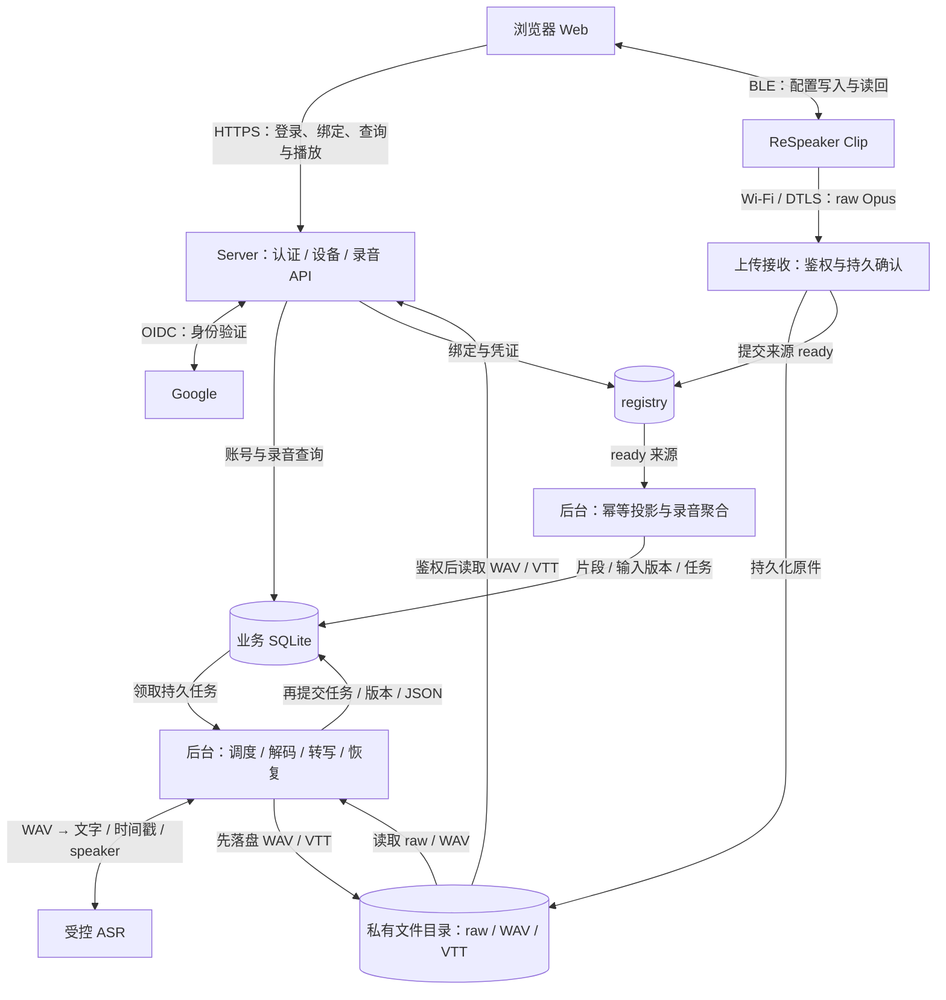

# ReSpeaker Clip · Server / Web 开发设计

v1 · 2026-10-30

## 1. 整体架构与主要模块

本文描述 Server / Web 的开发设计。系统由 ReSpeaker Clip、浏览器 Web、Server 和外部身份/识别服务组成：Web 负责登录、设备配置与录音查看；Clip 负责录音与上传；Server 负责归属校验、可靠收件、后台处理和结果读取。

### 1.1 架构总览


- **客户端**：浏览器经同源 HTTPS 调用 Server，经 BLE 与 Clip 交互；Clip 经 Wi-Fi 使用 DTLS 直传录音。BLE 用于设备配置，录音上传走 Clip 到 Server 的连接。
- **Server**：按图中 Python / FastAPI 单进程基线组织接入、认证、设备、录音和后台任务模块；解码使用受控子进程。模块是职责划分，后台任务按顺序领取执行。
- **外部依赖**：Google 提供登录身份验证，本站会话由 Server 维护；ASR 通过服务端配置的受控端点接收 WAV，返回文字、时间戳和 speaker。未配置 ASR 时仍可生成和播放 WAV。
- **存储边界**：registry 保存设备绑定、凭证和上传来源；业务 SQLite 保存用户、录音、片段、任务及转写 JSON；私有文件目录保存 raw、WAV 和 VTT。会话与登录临时状态保存在内存。

图中 Web 9529、HTTPS 兼容接口 9528、UDP/DTLS 9528 表示接入基线；Web 对外访问使用 HTTPS，Google 回调地址按部署配置精确登记。本文描述设计约定，部署和实机验收需另行验证。

### 1.2 主要模块

| 模块 | 位置 | 主要职责与输出 | 详细设计 |
|---|---|---|---|
| Web 页面与设备交互 | 浏览器 | 登录入口、设备/录音列表、播放与导出；经 BLE 配置设备并读回确认 | [Web API](#web-api)、[设备规则](#ble) |
| 录音与上传 | Clip | 录音、保存原始 Opus 片段、扫描/连接 Wi-Fi、通过 DTLS 上传并处理确认 | [设备规则](#ble)、[收件约定](docs/audio-processing.md#ingest) |
| 认证与会话 | Server | Google OIDC 回调、账号映射、本站 Cookie、CSRF、账号状态检查；确定请求用户 | [登录与会话](#oauth) |
| 设备与绑定 | Server | UID 登记校验、绑定/激活、上传配置发放与确认、改名、凭证撤销 | [设备规则](#ble) |
| 上传接收 | Server | 校验凭证与 owner、断点续传、raw 和来源索引持久化；完成后返回 COMPLETE | [原件收件](docs/audio-processing.md#ingest) |
| 来源投影与录音聚合 | Server 后台 | 将 registry 的 ready 来源幂等投影到业务库，按来源/session 聚合片段并更新输入版本 | [收件与聚合](docs/audio-processing.md#ingest) |
| 任务调度与恢复 | Server 后台 | 持久任务、顺序领取、租约、重试、版本检查、发布恢复与文件修复 | [双写与恢复](docs/audio-processing.md#publication) |
| 音频解码 | 受控子进程 | 校验并按序解码 raw Opus，生成 16 kHz、单声道 PCM16 WAV | [音频存储与解码](docs/audio-processing.md#storage) |
| 转写与导出生成 | Server 后台 / ASR | 调用 ASR、校验 cues，提交转写 JSON 与 VTT；Markdown 从同组原文生成 | [转写设计](docs/audio-processing.md#transcript) |
| 录音查询与媒体读取 | Server | 按 owner 返回录音与当前版本链接，鉴权读取 WAV/JSON/VTT/Markdown，支持音频 Range | [Web API](#web-api)、[媒体 API](docs/audio-processing.md#media-api) |
| 持久存储与备份 | Server 数据卷 / 独立备份 | 管理两套 SQLite、私有文件、文件/数据库双写、加密快照与恢复 | [数据模型](#data-model)、[存储安全](docs/audio-processing.md#security) |

### 1.3 主流程与模块衔接



1. **登录与绑定**：Web 发起 Google 登录，Server 建立本站会话；激活设备后返回上传配置，Web 经 BLE 写入 Clip、读回并向 Server 确认。Wi-Fi 扫描与连接由 Clip 执行。
2. **录音与收件**：Clip 上传 raw；Server 校验凭证和归属，完成原件、身份元数据及 registry 来源索引持久化后才返回 COMPLETE。该确认不等待解码或转写。
3. **后台处理**：ready 来源投影为录音和片段，生成版本化任务；后台依次解码 WAV、调用 ASR 并发布转写。文件先落盘，随后事务提交任务与录音指针；转写 JSON 与 VTT 指针一起提交。
4. **查看与导出**：Web 查询录音状态和链接，Server 按会话 owner、录音版本及产物状态读取结果。WAV 可独立播放，文字和字幕使用与音频一致的版本。

### 1.4 文档导航

本页承载总体架构、模块边界和 Server / Web 契约；[音频处理设计](docs/audio-processing.md)展开收件、文件存储、解码、转写、双写恢复及媒体读取。

[对象与表](#data-model) · [Web API](#web-api) · [登录与会话](#oauth) · [设备规则](#ble) · [SQL](#sql)

<a id="data-model"></a>

## 2. 对象与数据表

| 对象 | 保存位置 | 关系 |
|---|---|---|
| 用户 | accounts | user_id 是业务数据的 owner |
| 设备绑定 | registry.bindings、device_uids | bindings.id 标识绑定，bindings.device 标识设备，owner 标识所属用户 |
| 录音 | recordings | 属于一个 owner，包含多个原始片段和处理结果 |
| 原始片段 | recording_segments | 通过 recording_id、owner 关联录音，保存 raw 元数据并承担来源去重 |
| 后台处理 | jobs | 关联一条录音的一个输入版本，保存 WAV/VTT 文件元数据和发布状态 |
| 转写 | recordings.transcript_json | 保存原文、时间戳和 speaker；VTT/Markdown 使用同组 cues |
| 会话 | Server 内存 | token 摘要、user_id、auth_version、CSRF 和有效期；服务重启后重新登录 |

### API 与存储字段对应

| API 字段 | 存储来源 / 含义 |
|---|---|
| device_id | registry.bindings.device |
| binding_id | registry.bindings.id |
| device_uid | registry.device_uids.uid |
| 设备 display_name | registry.bindings.display_name；未设置时使用既有设备名称/ID |
| 设备 revision | binding_profiles.revision，表示上传配置版本 |
| 录音 id | recordings.id |
| 录音 input_revision / audio_revision / transcript_revision | recordings 同名字段；分别表示已收输入、当前 WAV、当前文字版本 |
| 转写接口 revision | recordings.transcript_revision，返回文字时须等于 audio_revision |
| owner / configuration.owner_id | accounts.user_id；owner 用于业务归属，owner_id 沿用设备配置字段 |

### accounts 字段

| 字段 | 类型 | 约束 / 默认 | 含义 |
|---|---|---|---|
| user_id | TEXT | 主键；必填 | 本地用户 ID，历史 ID 沿用；其他表通过 owner 引用。 |
| google_sub | TEXT | 唯一 | 验证通过的 Google 身份标识；待核验的历史用户可空。 |
| email | TEXT | 必填；唯一；大小写不敏感 | 用户邮箱；账号同步时检查身份冲突。 |
| display_name | TEXT | 必填；默认空字符串；≤100 字符 | 用户名称，可为空字符串。 |
| status | TEXT | 必填；默认 active | active / disabled；请求鉴权检查账号状态。 |
| auth_version | INTEGER | 必填；默认 1；>0 | 认证版本；变更后使旧会话失效。 |
| last_login_at | INTEGER | 可空 | 最近登录时间，可空。 |
| created_at | INTEGER | 必填 | 用户建立时间。 |
| updated_at | INTEGER | 必填 | 用户资料更新时间。 |

新用户 ID 使用 uuid4().hex，历史 user_id 原样迁移。相同 sub 复用用户；邮箱与其他 sub 冲突时返回 account_identity_conflict，保留原归属。

设备别名保存到 bindings.display_name，配置确认保存到 binding_profiles.confirmed_revision；UID 映射由 device_uids 维护。音频相关三张表的[字段说明](docs/audio-processing.md#tables)在音频文档，完整 DDL 见[本页 SQL](#sql)。

<a id="web-api"></a>

## 3. Web 前后端 API

路径前缀 `/api/boa/v1`。除登录入口、回调和 health，其余接口验证会话；写请求携带 Origin、X-CSRF-Token；Server 精确匹配 PUBLIC_WEB_ORIGIN 和当前会话 CSRF，缺失或不匹配返回 403。owner 由 Server 确定。

| 接口 | 请求参数 | 成功响应 |
|---|---|---|
| GET `/devices` | 无 | 200：`{items:[设备对象]}` |
| POST `/devices/activate` | `{device_uid}`；查询受控登记和本人归属 | 200：device_id、device_uid、binding_id、epoch、revision、configuration；no-store |
| POST `/devices/{id}/binding/confirm` | `{device_uid,binding_id,revision,saved:true}` | 200：`{binding_id,revision,state:"provisioned"}` |
| PATCH `/devices/{id}` | `{display_name}`；1–100 字符 | 200：device_id、display_name |
| DELETE `/devices/{id}/binding` | 无 | 200：`{state:"revoked",device_cleanup_pending}` |
| GET `/recordings` | from、to、cursor、limit | 200：`{items:[录音列表对象],next_cursor}` |
| GET `/recordings/{id}` | id | 200：录音详情对象 |
| GET `/health` | 无 | 200：服务状态与版本 |

| 返回对象 | 字段 / 来源 |
|---|---|
| 设备 | device_id、device_uid、binding_id、epoch、display_name、firmware、capabilities、telemetry；身份字段按上表映射，设备能力取自已验证读回或固件资料，缺失为 null |
| configuration | 沿用上传配置：device_id、device_uid、owner_id、binding_id、epoch、revision、endpoint、device_token；身份值与外层响应一致 |
| 录音列表 | recordings 的 id、time_source、recorded_at、received_at、duration_ms、audio_state、transcript_state；preview_text 从当前同版本 JSON 的第一句提取，未就绪时为空 |
| 录音详情 | 列表字段，加 integrity、input_revision、audio_revision、transcript_revision、audio_error_code、transcript_error_code、links |
| links | audio、transcript、vtt、markdown；使用 audio_revision 构造地址。audio 要求当前 WAV 任务 publication_state=ready；文字要求 transcript_state=ready 且 transcript_revision=audio_revision；vtt 另要求当前 VTT 任务 publication_state=ready；其余为 null，媒体接口再次校验 |

audio_error_code 取当前 input_revision 的失败 decode 任务，transcript_error_code 取当前 audio_revision 的失败 transcribe 任务；值为对应 jobs.error_code，未失败时为 null。新输入处理中仍可返回上一份已发布音频的链接；VTT 文件修复失败只影响 vtt 链接，JSON/Markdown 仍按已提交文字状态返回。

telemetry 的 online、battery、pending 分别返回 `{value,sampled_at,source}`；缺少有效来源时 value=null。时间统一为 UTC Unix 毫秒。配置/凭证响应使用 no-store。

from/to 为 YYYY-MM-DD，默认时区 Asia/Shanghai，结束日包含当天。列表按有效录音时间/id 降序：recorded_at 非空且 time_source=client_confirmed 时使用 recorded_at，其余使用 received_at。默认 30 条、上限 100；筛选改变时重置游标，空列表返回 items=[]、next_cursor=null。

音频、JSON、VTT 和 Markdown 的请求、返回格式与错误码见[音频接口](docs/audio-processing.md#media-api)。统一错误 body 为 `{error:{code,message},request_id}`：401 会话失效、403 权限/CSRF、404 不存在或跨 owner、409 状态冲突、422 参数错误、503 依赖不可用。

<a id="oauth"></a>

## 4. 登录与会话

Web 通过顶层导航发起 Google 登录。Google 授权后回调 Server，Server 校验本次 state 和 Google ID token，按 google_sub 找到或建立 accounts 用户，再创建本站 session、设置 Cookie，303 返回 `/`。后续请求使用本站 Cookie。

| 接口（前缀 `/api/boa/v1`） | 请求 / 响应 |
|---|---|
| GET `/auth/google/start` | 302 跳 Google；scope 为 openid email profile，使用 Code / OIDC + S256 PKCE |
| GET `/auth/google/callback` | Google 成功返回 code、state，取消时返回 error、state；校验后设置会话 Cookie 并 303 到 `/`；取消授权返回 `/?login_error=login_cancelled` |
| GET `/auth/session` | 200：`{user:{user_id,email,display_name},csrf_token}`；失效返回 401 session_expired |
| DELETE `/auth/session` | 校验 Origin/CSRF，删除当前会话、清 Cookie，返回 204；已失效返回 401，Web 同样清理本地状态 |

| 数据 | 保存方式 / 有效期 |
|---|---|
| 登录临时状态 | Server 内存，5 分钟、一次消费；临时 Cookie 为 Secure/HttpOnly/SameSite=Lax |
| 本站 session | Server 内存，闲置 24 小时、最长 7 天；Cookie 为 Secure/HttpOnly/SameSite=Strict、Path=/、host-only、Max-Age=604800 |
| 退出、到期、Server 重启 | 会话失效，重新 Google 登录；账号和业务数据继续保留 |

账号禁用返回 403 account_disabled，身份映射冲突返回 409 account_identity_conflict；回调错误返回 400 login_invalid_or_expired，Google 不可用返回 503 login_unavailable。登录响应和会话接口设置 no-store，日志使用脱敏格式。

服务器配置 GOOGLE_CLIENT_ID、GOOGLE_CLIENT_SECRET、PUBLIC_WEB_ORIGIN。Google Console 回调登记为 `PUBLIC_WEB_ORIGIN/api/boa/v1/auth/google/callback`，与请求保持完全一致。协议使用 [Google OIDC](https://developers.google.com/identity/openid-connect/openid-connect)。

<a id="ble"></a>

## 5. 设备与请求规则

| 处理项 | 规则 |
|---|---|
| 绑定 | 验证登记与 owner；本人重复激活复用绑定，未登记到当前用户的 device_uid 返回 409 enrollment_required |
| 配置确认 | Web 经 BLE 写入后读回 binding/epoch/revision，再提交 device_uid、binding_id、revision、saved |
| 改名 | 更新本人 active binding 的 display_name；设备身份和上传凭证保持原值 |
| 移除 | 撤销上传凭证；device_cleanup_pending 沿用现有维护确认；已上传录音保留原 owner |
| Wi-Fi | Clip 扫描 `{ssid,rssi,security}[]`，选择结果后经 BLE 写入密码，读取 saved/connected/error；密码在调用结束后清空 |
| 设备能力 | 以真实 capability 为准；已保存网络最多 5 个，基线为 2.4 GHz WPA2 |
| 请求管理 | 切换用户/数据时取消旧请求，退出清理音频和定时器；409 recording_revision_changed 时重新取版本 |
| 轮询 | 录音可见 5 秒、设备可见 15 秒；隐藏后 30 秒，恢复可见立即刷新 |

迁移沿用旧 user_id，先核验 owner/邮箱映射；缺项返回 migration_owner_mapping_required。迁移与 user_version 更新同事务；registry 增量检查字段后执行，INSERT 使用显式列名。

<a id="sql"></a>

## 6. 数据库 DDL

<a id="business-sql"></a>

### 6.1 业务库

运行时每个数据库连接都设置 foreign_keys=ON、synchronous=FULL、busy_timeout=5000；两个库分别提交，跨库顺序见音频文档。

```sql
-- 录音助手 v1：四张业务表初始 DDL。
-- 原始音频/派生文件在磁盘；转写 JSON 在 recordings；会话只在内存。
PRAGMA foreign_keys=ON;
PRAGMA journal_mode=WAL;
PRAGMA synchronous=FULL;
PRAGMA busy_timeout=5000;
BEGIN IMMEDIATE;
CREATE TABLE accounts (
  user_id TEXT PRIMARY KEY NOT NULL,
  google_sub TEXT UNIQUE CHECK(google_sub IS NULL OR length(google_sub) BETWEEN 1 AND 255),
  email TEXT NOT NULL UNIQUE COLLATE NOCASE
    CHECK(email=trim(email) AND length(email) BETWEEN 3 AND 254 AND instr(email,'@')>1),
  display_name TEXT NOT NULL DEFAULT '' CHECK(length(display_name)<=100),
  status TEXT NOT NULL DEFAULT 'active' CHECK(status IN ('active','disabled')),
  auth_version INTEGER NOT NULL DEFAULT 1 CHECK(auth_version>0),
  last_login_at INTEGER, created_at INTEGER NOT NULL, updated_at INTEGER NOT NULL
);
CREATE TABLE recordings (
  id TEXT PRIMARY KEY NOT NULL, owner TEXT NOT NULL REFERENCES accounts(user_id),
  source_kind TEXT NOT NULL CHECK(source_kind IN ('clip_direct','app_upload')),
  source_namespace TEXT NOT NULL, binding_epoch INTEGER NOT NULL CHECK(binding_epoch>=0),
  source_session TEXT NOT NULL,
  recorded_at INTEGER, time_source TEXT NOT NULL CHECK(time_source IN ('device_unverified','server_received','client_confirmed')),
  received_at INTEGER NOT NULL, last_received_at INTEGER NOT NULL,
  integrity TEXT NOT NULL DEFAULT 'unknown' CHECK(integrity IN ('unknown','gap','confirmed_complete')),
  input_revision INTEGER NOT NULL DEFAULT 0 CHECK(input_revision>=0),
  audio_revision INTEGER, transcript_revision INTEGER,
  audio_state TEXT NOT NULL DEFAULT 'pending' CHECK(audio_state IN ('pending','running','ready','failed')),
  transcript_state TEXT NOT NULL DEFAULT 'pending' CHECK(transcript_state IN ('not_configured','pending','running','ready','failed')),
  wav_job_id TEXT, vtt_job_id TEXT, duration_ms INTEGER CHECK(duration_ms>=0),
  -- 唯一文字主源：{"schema_version":1,"time_unit":"ms","cues":[...]}。
  -- cue 结构/时间/speaker 校验由应用负责；数据库保证外层结构与体积。
  transcript_json TEXT,
  updated_at INTEGER NOT NULL,
  UNIQUE(source_kind,source_namespace,binding_epoch,source_session), UNIQUE(id,owner),
  CHECK((source_kind='clip_direct' AND binding_epoch>0) OR (source_kind='app_upload' AND binding_epoch=0)),
  CHECK(audio_revision IS NULL OR (audio_revision>0 AND audio_revision<=input_revision)),
  CHECK(transcript_revision IS NULL OR (transcript_revision>0 AND transcript_revision<=input_revision)),
  CHECK(audio_state<>'ready' OR (wav_job_id IS NOT NULL AND audio_revision IS NOT NULL)),
  CHECK(transcript_json IS NULL OR CASE WHEN json_valid(transcript_json) THEN
    length(CAST(transcript_json AS BLOB))<=8388608
    AND COALESCE(json_type(transcript_json)='object'
      AND json_type(transcript_json,'$.schema_version')='integer'
      AND json_extract(transcript_json,'$.schema_version')=1
      AND json_extract(transcript_json,'$.time_unit')='ms'
      AND json_type(transcript_json,'$.cues')='array',0)
    ELSE 0 END),
  CHECK(transcript_state<>'ready' OR (vtt_job_id IS NOT NULL AND transcript_json IS NOT NULL
    AND transcript_revision IS NOT NULL AND audio_revision IS NOT NULL AND transcript_revision=audio_revision)),
  FOREIGN KEY(wav_job_id,id,owner,audio_revision) REFERENCES jobs(id,recording_id,owner,input_revision) DEFERRABLE INITIALLY DEFERRED,
  FOREIGN KEY(vtt_job_id,id,owner,transcript_revision) REFERENCES jobs(id,recording_id,owner,input_revision) DEFERRABLE INITIALLY DEFERRED
);
CREATE INDEX recordings_owner_date ON recordings(owner,recorded_at DESC,id DESC);
CREATE INDEX recordings_owner_received ON recordings(owner,received_at DESC,id DESC);
CREATE TABLE recording_segments (
  id TEXT PRIMARY KEY NOT NULL, owner TEXT NOT NULL, recording_id TEXT NOT NULL,
  source_namespace TEXT NOT NULL, source_id TEXT NOT NULL,
  segment_no INTEGER NOT NULL CHECK(segment_no>0),
  state TEXT NOT NULL CHECK(state IN ('receiving','ready')),
  -- 同一行兼作 raw 文件索引与来源幂等收据，未收完整时允许为空。
  raw_relative_path TEXT UNIQUE,
  size_bytes INTEGER CHECK(size_bytes>0), sha256 TEXT CHECK(length(sha256)=64),
  received_at INTEGER NOT NULL, imported_at INTEGER,
  UNIQUE(source_namespace,source_id), UNIQUE(recording_id,segment_no),
  FOREIGN KEY(recording_id,owner) REFERENCES recordings(id,owner),
  CHECK(state<>'ready' OR (raw_relative_path IS NOT NULL AND size_bytes IS NOT NULL
    AND sha256 IS NOT NULL AND imported_at IS NOT NULL))
);
CREATE TABLE jobs (
  id TEXT PRIMARY KEY NOT NULL, owner TEXT NOT NULL, recording_id TEXT NOT NULL,
  input_revision INTEGER NOT NULL CHECK(input_revision>0),
  kind TEXT NOT NULL CHECK(kind IN ('decode','transcribe')),
  state TEXT NOT NULL CHECK(state IN ('pending','running','retry_wait','succeeded','failed')),
  attempt INTEGER NOT NULL DEFAULT 0 CHECK(attempt BETWEEN 0 AND 4), run_after INTEGER NOT NULL,
  lease_token TEXT, lease_until INTEGER,
  input_json TEXT NOT NULL CHECK(json_valid(input_json)),
  -- 一个 decode 只产出 WAV，一个 transcribe 只产出 VTT；原文同时提交到 recordings。
  -- 文件索引与发布记录并入本行；每次发布使用新 UUID 路径，重试和修复不覆盖旧文件。
  publication_state TEXT NOT NULL DEFAULT 'none' CHECK(publication_state IN ('none','prepared','ready','missing','abandoned')),
  tmp_relative_path TEXT UNIQUE, final_relative_path TEXT UNIQUE,
  size_bytes INTEGER CHECK(size_bytes>0), sha256 TEXT CHECK(length(sha256)=64),
  sample_count INTEGER CHECK(sample_count>=0),
  error_code TEXT, created_at INTEGER NOT NULL, updated_at INTEGER NOT NULL,
  UNIQUE(recording_id,input_revision,kind), UNIQUE(id,recording_id,owner,input_revision),
  FOREIGN KEY(recording_id,owner) REFERENCES recordings(id,owner),
  CHECK(state<>'running' OR (lease_token IS NOT NULL AND lease_until IS NOT NULL)),
  CHECK(publication_state<>'prepared' OR (tmp_relative_path IS NOT NULL AND final_relative_path IS NOT NULL)),
  CHECK(publication_state<>'ready' OR (state='succeeded' AND final_relative_path IS NOT NULL
    AND size_bytes IS NOT NULL AND sha256 IS NOT NULL)),
  CHECK(state<>'succeeded' OR publication_state IN ('ready','missing'))
);
CREATE INDEX jobs_claim ON jobs(state,run_after,id);
CREATE UNIQUE INDEX jobs_single_running ON jobs((1)) WHERE state='running';
-- 用户/归属/版本由 FK 与 CHECK 约束；指针对应任务 kind、ready/hash 由发布和读取接口核验。
-- 迁移与 PRAGMA user_version 更新同事务执行，未知更高版本返回启动错误。
PRAGMA user_version=1;
COMMIT;
```

<a id="registry-sql"></a>

### 6.2 registry 增量

```sql
-- 复用既有 registry 表：新增 0 张表。设计参考，真实迁移先检查 table_info。
-- users 保留 Bearer 凭证映射，bindings 保留设备归属和上传凭证。
PRAGMA foreign_keys=ON;
PRAGMA synchronous=FULL;
PRAGMA busy_timeout=5000;
BEGIN IMMEDIATE;
ALTER TABLE bindings ADD COLUMN display_name TEXT
  CHECK(display_name IS NULL OR length(display_name) BETWEEN 1 AND 100);
ALTER TABLE bindings ADD COLUMN name_updated_at INTEGER;
ALTER TABLE sources ADD COLUMN projected_at INTEGER;
CREATE INDEX sources_projection_pending ON sources(projected_at,created,id) WHERE state='ready';
COMMIT;
-- sources ready 行作为持久待投影项。
-- 业务 segments/recordings 先提交，之后才标 projected_at；重放由 namespace/source_id 去重。
-- 启动时分批对账全部 ready 来源，不只相信 projected_at，确保备份恢复后可补投影。
-- 改名仅更新本人当前 bindings.display_name；保留原 UID、凭证和历史 owner。
```
