# 录音助手 — Server & Web

ReSpeaker Clip 配套 Server/Web 的精简设计与实施文档。以[当前原型](https://comfy-faloodeh-ec9b57.netlify.app/)和用户补充的 VTT 要求为范围；当前只管理文档，尚未实施产品代码或生产迁移。

先看[原型核对与删减](docs/2026-10-29-prototype-review.md)，再读[图解](docs/boa-v1-illustrated-guide.md)。

## 文档导航

| 文档 | 内容 |
|---|---|
| [原型核对](docs/2026-10-29-prototype-review.md) | 实际页面、保留/删除项及固件能力差距 |
| [架构图解](docs/boa-v1-illustrated-guide.md) | 8 张图与关键步骤；包含完整 VTT 示例 |
| [Server/Web 设计](docs/superpowers/specs/2026-10-29-boa-server-web-v1-design.md) | 基本用户、设备、收件、WAV、转写/VTT、API、恢复 |
| [业务库 SQL](docs/superpowers/specs/2026-10-29-boa-v1-business-schema.sql) | 11 张表：用户/会话/归属/任务/文件/cues |
| [registry SQL](docs/superpowers/specs/2026-10-29-boa-v1-registry-additions.sql) | 只增来源完成 outbox |
| [实施计划](docs/superpowers/plans/2026-10-29-boa-server-web-v1-implementation-plan.md) | S01–S12，共 12 项任务、60 个步骤 |
| [VTT 示例](docs/examples/recording.vtt) | 人工编写的带时间戳与 A/B 说话人的字幕示例 |

## 第一版只做这些

- 基本用户、账号退出；两个页面：录音、设备。
- 用户添加设备、BLE 激活配置与 Wi-Fi、设备改名/移除；真实能力未具备时明确标记。
- 日期筛选、基础播放、文字/复制；下载 WAV、Markdown、VTT。
- raw 与一份当前 WAV 双保留，SQLite 元数据与文件可靠发布，私有 ASR 输出 cues/VTT。

不开发纪要、全文搜索、Word、录音回收站、复杂账号/管理页面、OTA/维修或 MP3。OAuth 流程不展开，保留现有可信登录结果的接入边界。

源码基线来自 [BofAI/reSpeaker_Clip](https://github.com/BofAI/reSpeaker_Clip)。此仓库先管理设计，实施在核对后的源仓库隔离工作区执行，引用固定文档 commit。历史大版本文档由 Git 保留，旧 T00–T23 不再是当前待办。

图源 `.mmd` 与 SVG 一起提交，见[维护说明](docs/assets/diagrams/README.md)。SQL 是设计参考，真实迁移需验证旧数据。录音、数据库、凭证和签名材料不提交。
