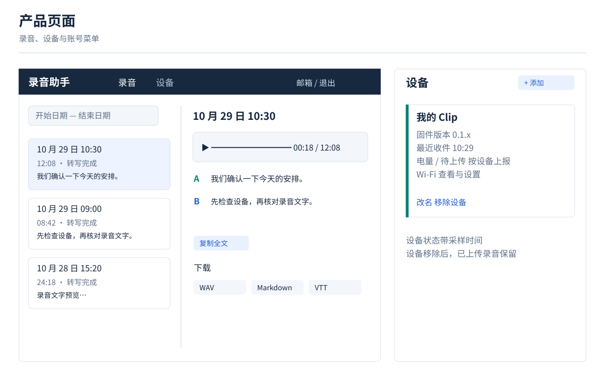
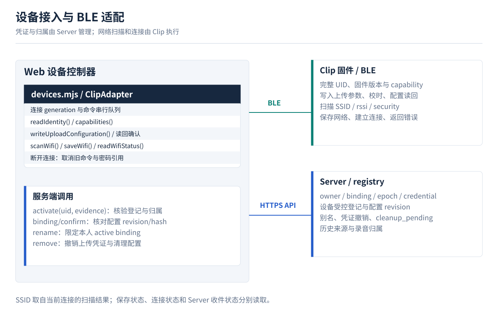

# 录音助手 — Server & Web

[图解](docs/boa-v1-illustrated-guide.md) · [设计细则](docs/superpowers/specs/2026-10-29-boa-server-web-v1-design.md) · [12 项任务](docs/superpowers/plans/2026-10-29-boa-server-web-v1-implementation-plan.md) · [SQL](docs/superpowers/specs/2026-10-29-boa-v1-business-schema.sql) · [VTT 示例](docs/examples/recording.vtt)

[Google 登录与转写格式](docs/superpowers/specs/2026-10-29-google-login-and-transcript-contract.md) · [自我评审](docs/2026-10-29-design-self-review.md)

当前为设计文档，尚未实施产品代码。[原型核对](docs/2026-10-29-prototype-review.md) · [图源维护](docs/assets/diagrams/README.md)
