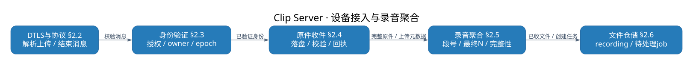
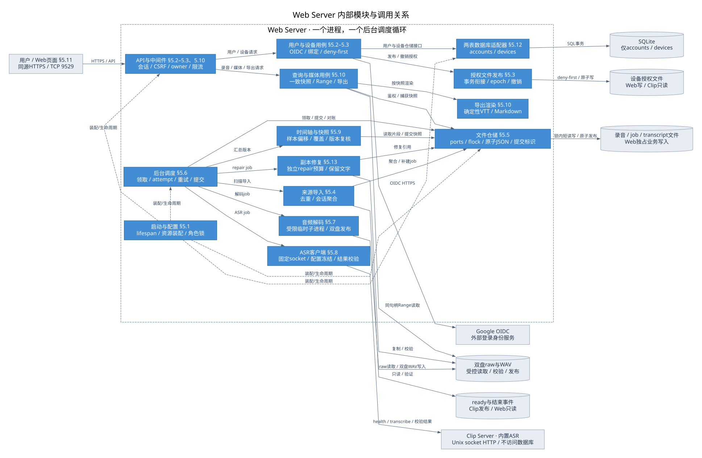
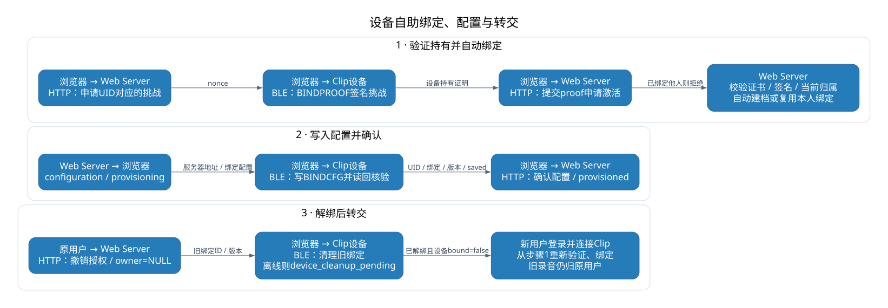

# ReSpeaker Clip · 架构与模块设计

v13 · 2026-11-02 · 设计文档，服务尚未实现。

## 1. 整体架构


单机运行两个服务，通过本机文件交接授权和成品。浏览器通过HTTP访问Web Server，通过蓝牙直接配置Clip设备。

## 2. 两个服务

| 服务 | 职责 | 数据 |
| --- | --- | --- |
| Clip Server | 接收Opus，解码、转写、合并及发布完整录音；ASR内置 | 录音、job及产物全部用文件，不连接数据库 |
| Web Server | 登录、管理设备、查询及播放成品 | SQLite仅accounts、devices两张表；只读录音成品 |

Web停止不影响Clip按有效授权处理录音；Clip停止不影响Web读取已有成品。Nginx、进程托管和整体备份由OP管理。

## 3. 模块划分

| Clip Server | Web Server |
| --- | --- |
| 设备接入：协议、身份验证、收件与续传 | 登录与用户：Google登录、会话、本人资料 |
| 文件管理：录音聚合、状态、job | 设备管理：绑定、配置、撤销与授权文件 |
| 音频处理：调度、解码、内置ASR、合并 | 成品读取：目录查询、播放、下载 |
| 成品发布 | 用户设备数据库、页面与健康 |

公共能力只提供配置、路径校验、文件锁和原子写入。

## 4. Clip Server 模块

### 4.1 启动与生命周期

读取配置、取得Clip单实例锁、恢复未完成任务，然后启动DTLS和后台处理循环。退出先停止收件及新任务，保存进度，等待执行结束。

### 4.2 DTLS与协议



监听DTLS/UDP 9528，解析认证、上传、续传及录完消息；接入循环不等待ASR。

### 4.3 身份与凭证验证

读取Web发布的`SPEAKER_DATA_ROOT/device-authorizations/<device_id>.json`，验证设备凭证、owner、binding_id和epoch。握手、续传及最终接受均复核；缺失、损坏或撤销一律拒绝。

Web串行执行设备授权变更：先写deny，再更新devices，最后发布匹配的active；解绑保持deny。中断后默认拒绝，不能自动恢复未完成授权。已接受录音保留原owner。

### 4.4 原件收件与续传

Server不管理Clip设备的录音、队列或运行状态，只检查上传文件是否收完整。验证身份后接收临时文件，核对大小和hash，原子保存原件并持久化收件记录，然后返回成功回执；回执只表示收件成功，不表示转写完成。同一录音、段号及hash重传时复用文件并重发回执，不同内容报冲突。

上传中只保存服务端已接收的偏移，用于断点续传；回执后由Server后台执行解码、转写及合并，设备不必等待。

单片最多300秒、8MiB，整条最多12小时；默认每用户10GiB，跨其所有Clip计算。收件预留原件、分段WAV及完整WAV空间，空间不足暂停。

### 4.5 录音聚合与结束判定

一条录音分多个文件时，上传元数据需说明所属录音、段号和最终段号N；Server只记录哪些文件已收齐。收齐1..N且全部解码、转写成功后才发布；缺片不跳号、不补静音。最终段号写入服务端收件记录，不跟踪设备内部状态。

**现有v3文件上传完成消息不能代表整条录音结束；固件需补充受认证的session_end。** 未支持时可收件和预处理，不能靠超时猜测录完。

### 4.6 文件仓储

服务端只配置一个存储根`SPEAKER_DATA_ROOT`，音频和处理状态放在同一用户、Clip目录下。路径由ID推导，不维护地址映射表：

```text
${SPEAKER_DATA_ROOT}/
├── db/business.sqlite3                         # Web专用
├── device-authorizations/<device_id>.json       # Web写，Clip读
├── credentials/devices/                        # 私有设备凭证材料
├── locks/                                     # 两个角色锁及state.lock
└── users/<owner>/clips/<device_id>/
    ├── incoming/<recording_id>/<upload_id>/
    │   ├── audio.part
    │   └── progress.json
    ├── raw/<recording_id>/<segment_no>.opus
    ├── segments/<recording_id>/<segment_no>.wav
    ├── processing/<recording_id>/              # 服务端处理进度
    │   ├── state.json
    │   ├── transcripts/<segment_no>.json
    │   └── jobs/<job_id>.json
    └── recordings/<recording_id>/              # 正式成品，Web只读
        ├── recording.wav
        ├── transcript.vtt
        ├── transcript.md
        └── recording.json
```

owner来自已验证授权，Web读取时来自登录会话。不同用户、不同Clip分别隔离；设备换绑不搬迁旧文件，也不改变旧录音权限。

### 4.7 音频处理与成品


- **转码**：将已收完整的Opus片段逐包解码为16kHz、单声道PCM16 WAV，保留实际样本数。原件是长度前缀Opus包序列，不是Ogg。
- **ASR**：内置Paraformer-zh + FSMN-VAD + CT-Punc + CAM++候选组合，离线处理中文为主、少量英语。按句末标点断句，每行一句，保留时间戳和匿名说话人A/B/C；标签仅在片段内有效，跨段标作“片段1·A”等。效果需真实录音验收。
- **合并与发布**：录音收齐且各段处理成功后，按段号拼接PCM并重写WAV头；字幕按实际样本数累加偏移，生成完整VTT和MD。四个成品文件在recordings父目录的隐藏临时目录中写齐、校验并fsync后，原子发布整个录音目录，Web只读取成品。

后台单任务执行，job保存进度；失败最多尝试4次，重启复用已成功的结果。缺片或ASR失败不发布，静音保留真实时长。

成品目录示例，根目录由配置决定：

```text
${SPEAKER_DATA_ROOT}/users/demo-user/clips/demo-device/recordings/rec-demo-20261102-001/
├── recording.wav
├── transcript.vtt
├── transcript.md
└── recording.json
```

recording.json只含录音ID、归属、开始时间（UTC毫秒）和完整时长（毫秒）；缺少设备时间时用首段接收时间：

```json
{
  "recording_id": "rec-demo-20261102-001",
  "owner": "demo-user",
  "recorded_at": 1793584800000,
  "duration_ms": 642000
}
```

VTT示例（仅展示格式）：

```vtt
WEBVTT

1
00:00:00.800 --> 00:00:04.200
<v s001_A>我们先确认今天的录音流程。</v>

2
00:05:00.300 --> 00:05:03.500
<v s002_A>Next, we review the results.</v>
```

MD每句一行，例如：`[00:05:00.300] 片段2·A：Next, we review the results.`。

## 5. Web Server 模块



### 5.1 登录与用户

Google OIDC登录后建立或复用accounts用户，创建本站内存会话，提供本人资料查询和改名。校验登录回调、账号状态及Cookie；写请求检查Origin和CSRF。退出或Web重启后重新登录。

### 5.2 设备管理

用户首次登录后，由OP通过Web本机维护入口将核验过的设备UID登记到该用户，生成device_id并保存到devices；转交设备也由该入口变更归属。未登记到当前用户的设备不能激活。

Web负责激活、下发配置、确认、改名和撤销，按第4.3节发布授权文件；浏览器直接通过蓝牙写入并读回配置。凭证只在配置响应中返回，不进入列表、日志或前端持久缓存。数据库仅accounts、devices两表，只由Web访问。

### 5.3 成品读取

从登录会话取得owner，只查询本人Clip下的正式recordings目录，返回录音ID列表；再按ID读取录音信息、播放WAV、加载VTT和下载MD。每次读取均鉴权，WAV支持Range；不触发转码或ASR。

忽略临时目录，损坏成品告警并拒绝读取；无权限或不存在返回404，文件损坏返回503。设备换绑不改变历史录音权限，数据根不对外静态暴露。

## 6. 接口

### 6.1 Web Server HTTP接口

统一前缀`/api/boa/v1`。除登录入口、回调和health，其余验证会话；写请求还验证Origin和`X-CSRF-Token`。错误为`{code,message,request_id}`，私有响应不缓存。

| 方法与路径 | 输入 / 返回 |
| --- | --- |
| GET /auth/google/start | 跳转Google登录 |
| GET /auth/google/callback | 校验回调，创建会话并返回页面 |
| GET /auth/session | 当前用户及csrf_token |
| DELETE /auth/session | 退出登录，204 |
| GET /users/me | user_id、email、display_name |
| PATCH /users/me | 仅修改display_name |
| GET /devices | 本人设备列表，不含凭证 |
| POST /devices/activate | 输入device_uid；返回设备信息及configuration |
| POST /devices/{id}/binding/confirm | 输入device_uid、binding_id、revision、saved=true；核对后确认配置 |
| PATCH /devices/{id} | 仅修改display_name |
| DELETE /devices/{id}/binding | 先撤销授权，返回revoked及device_cleanup_pending |
| GET /recordings | 返回录音ID列表；支持device_id、from/to、limit、cursor |
| GET /health | Web自身及成品目录可读状态，不返回秘密 |

激活时的configuration示例（凭证为占位值）：

```json
{
  "device_id": "demo-device",
  "device_uid": "0011223344556677",
  "owner_id": "demo-user",
  "binding_id": "00112233445566778899aabbccddeeff",
  "epoch": 1,
  "revision": 1,
  "endpoint": "upload.example.com:9528",
  "device_token": "0123456789abcdef0123456789abcdef"
}
```

录音列表只返回ID和游标：

```json
{
  "items": [{"device_id":"demo-device","recording_id":"rec-demo-20261102-001"}],
  "next_cursor": null
}
```

前端用ID拼固定路由，四个文件都支持GET/HEAD：

```text
/api/boa/v1/recordings/<device_id>/<recording_id>/recording.json
/api/boa/v1/recordings/<device_id>/<recording_id>/recording.wav
/api/boa/v1/recordings/<device_id>/<recording_id>/transcript.vtt
/api/boa/v1/recordings/<device_id>/<recording_id>/transcript.md
```

后台取会话owner，按第4.6节推导磁盘路径。API不返回磁盘地址或下载URL，路径参数不能指定owner。from/to为UTC毫秒，limit默认50、最大200；按录音时间及ID稳定倒序分页，游标不携带授权。

### 6.2 Clip设备蓝牙接口

浏览器通过Web Bluetooth直接连接Clip，使用GATT传递AT命令，与HTTP接口独立。

| GATT | UUID |
| --- | --- |
| 服务 | 6e400001-b5a3-f393-e0a9-e50e24dcca9e |
| RX：写命令 | 6e400002-b5a3-f393-e0a9-e50e24dcca9e |
| TX：接收通知 | 6e400003-b5a3-f393-e0a9-e50e24dcca9e |

先订阅TX再写RX。命令串行发送，单条UTF-8最多255字节；通知可能分片，拼成完整JSON再解析。超时重连读回状态，不能盲目重发。响应按具体命令读取ok/data或error/msg，事件另行处理。

| AT命令 | 用途 |
| --- | --- |
| AT+IDENTITY? | 读设备UID及绑定协议能力 |
| AT+BINDING? | 读绑定ID、epoch、revision及保存状态 |
| AT+BINDCFG=host,port,device_id,token,binding_id,epoch,revision | 保存服务器配置和绑定 |
| AT+BINDCLR=binding_id,revision | 清理本机绑定 |
| AT+NETSCAN | 扫描Wi-Fi，以wifi_scan事件返回ssid_hex、rssi等 |
| AT+NETCFG=ssid,password / AT+NETCFG? | 保存、读回Wi-Fi配置；saved不代表已联网 |
| AT+NETCHECK / AT+NETCHECK? | 启动、查询联网检查；不代表上传端点一定可达 |

**BINDING/BINDCFG/BINDCLR是绑定v1目标契约。** 参考客户端已有约定，基础固件尚缺对应注册和能力标记；须确认固件支持`binding_protocol_version=1`再启用，缺失提示升级。

binding_id为32位小写十六进制，epoch/revision为正uint32；token为32–96位字母、数字、下划线或连字符。host不带协议和路径，port为1–65535；整条命令仍受255字节限制。Wi-Fi SSID最多32字节且不含逗号，WPA2密码8–63字节；密码仅用于蓝牙调用，不发送Web。

### 6.3 设备配置配合流程



绑定前确保设备空闲；写入后读回UID、binding_id、epoch、revision及saved，全部匹配才提交HTTP确认。BLE失败保留待配置状态，不显示成功。

解绑先经HTTP撤销服务端授权，再经BLE清理设备；设备离线保留device_cleanup_pending，不恢复上传权限。Wi-Fi扫描及写入全部在浏览器与设备之间完成。

## 7. 单机配置与运行

Web监听`127.0.0.1:9529`，OP用Nginx提供HTTPS；Clip监听DTLS/UDP 9528。两个服务分别启动，模型在Clip进程内加载，解码子进程按需执行。

两服务读取同一份storage.env。只配置一个服务端存储根，不限定父目录或目录名称；其下目录按第4.6节统一推导。以下占位值须替换为实际绝对路径：

```dotenv
SPEAKER_DATA_ROOT=<absolute-storage-root>
SPEAKER_LOCK_TIMEOUT_SECONDS=2
```

web.env：

```dotenv
SPEAKER_WEB_HOST=127.0.0.1
SPEAKER_WEB_PORT=9529
PUBLIC_WEB_ORIGIN=https://speaker.example.com
SPEAKER_TRUSTED_PROXY_IPS=127.0.0.1
SPEAKER_UPLOAD_ENDPOINT=upload.example.com:9528
GOOGLE_CLIENT_ID=replace-with-client-id
GOOGLE_CLIENT_SECRET_FILE=/etc/speaker/secrets/web/google-client-secret
```

clip.env：

```dotenv
SPEAKER_CLIP_HOST=0.0.0.0
SPEAKER_CLIP_PORT=9528
SPEAKER_CLIP_TRANSPORT=dtls
SPEAKER_CLIP_CERT_FILE=/etc/speaker/tls/clip/server-chain.pem
SPEAKER_CLIP_KEY_FILE=/etc/speaker/tls/clip/server.key
SPEAKER_USER_QUOTA_BYTES=10737418240
SPEAKER_ASR_MODEL_ROOT=/opt/speaker/models
SPEAKER_ASR_MODEL_MANIFEST=/opt/speaker/models/manifest.json
```

SPEAKER_UPLOAD_ENDPOINT是设备可达的公开DTLS地址，区别于Clip监听地址；Google回调固定为`PUBLIC_WEB_ORIGIN/api/boa/v1/auth/google/callback`。Web只信任配置的代理地址；HTTPS私钥由OP管理。

整个存储根均不对外静态暴露；数据库、凭证、处理状态和成品按上述子目录区分。首版两个进程使用同一个非root专用系统账号`speaker`，目录0700、文件0600，因此可互读授权及成品，无需额外共享权限配置。

读写职责由模块约束：Clip写处理数据和成品，Web写数据库和授权、只读成品；Clip不加载Google秘密或数据库配置。两进程属于同一系统账号信任域，此处不提供操作系统级的相互隔离。

## 8. 文件一致性与故障处理

使用固定instance.lock保证每角色单实例，固定state.lock保护短元数据提交，锁文件不删除或替换。JSON通过同目录临时文件、fsync及原子替换提交；音频、模型、hash和SQL不占state锁。所有临时产物与目标位于同一文件系统。

| 情况 | 处理 |
| --- | --- |
| 模型未就绪或失败 | 保存原件，等待识别；不发布缺文字成品 |
| 缺片或无录完声明 | 保留分段结果，等待补齐，不进入Web列表 |
| 进程中断 | 按持久文件、执行标识和成品目录对账续跑 |
| 空间不足、文件损坏 | 停止相关处理并告警，不覆盖为空或猜测成功 |
| 模型原生库崩溃 | 可能使整个Clip重启；Web继续读取已有成品 |

状态文件维护schema_version，未知版本拒绝处理；成品recording.json仍只保留四字段。模型离线固定版本，文本安全转义；日志排除凭证和录音正文。应用不实现备份任务、磁盘复制或整体恢复流程。
