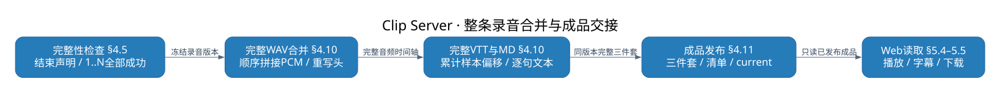

# ReSpeaker Clip · 架构与模块设计

v13 · 2026-11-02 · 设计文档，服务尚未实现。

## 1. 整体架构


单机运行两个服务，通过本机文件交接授权和成品。浏览器通过HTTP访问Web Server，通过蓝牙直接配置Clip设备。

## 2. 两个服务

| 服务 | 职责 | 数据 |
| --- | --- | --- |
| Clip Server | 接收Opus，解码、转写、合并及发布完整录音；ASR内置 | 录音、job及产物全部用文件，不连接数据库 |
| Web Server | 登录、管理设备、查询及播放成品 | SQLite仅accounts、devices两张表；只读录音成品 |

Web停止不影响Clip按有效授权处理录音；Clip停止不影响Web读取已有成品。Nginx、进程托管和整体备份由OP管理。

## 3. 模块划分

| Clip Server | Web Server |
| --- | --- |
| 设备接入：协议、身份验证、收件与续传 | 登录与用户：Google登录、会话、本人资料 |
| 文件管理：录音聚合、状态、job | 设备管理：绑定、配置、撤销与授权文件 |
| 音频处理：调度、解码、内置ASR、合并 | 成品读取：目录查询、播放、下载 |
| 成品发布、设备状态与健康 | 用户设备数据库、页面与健康 |

公共能力只提供配置、路径校验、文件锁和原子写入。

## 4. Clip Server 模块

### 4.1 启动与生命周期

读取配置、取得Clip单实例锁、恢复未完成任务，然后启动DTLS和后台处理循环。退出先停止收件及新任务，保存进度，等待执行结束。

### 4.2 DTLS与协议


监听DTLS/UDP 9528，解析认证、上传、续传及录完消息；接入循环不等待ASR。

### 4.3 身份与凭证验证

读取Web发布的`SPEAKER_STATE_ROOT/device-authorizations/<device_id>.json`，验证设备凭证、owner、binding_id和epoch。握手、续传及最终接受均复核；缺失、损坏或撤销一律拒绝。

Web串行执行设备授权变更：先写deny，再更新devices，最后发布匹配的active；解绑保持deny。中断后默认拒绝，不能自动恢复未完成授权。已接受录音保留原owner。

### 4.4 原件收件与续传

验证后采用设备上报信息，仍检查格式、大小、hash及用户额度。上传先写临时文件和进度，校验通过才发布原件及ready记录；按已确认偏移续传。相同来源重传幂等，不同内容报冲突。

单片最多300秒、8MiB，整条最多12小时；默认每用户10GiB，跨其所有Clip计算。收件预留原件、分段WAV及完整WAV空间，空间不足暂停。

### 4.5 录音聚合与结束判定

按已验证绑定、会话和段号聚合。必须有会话结束声明及最终段号N，并收齐1..N且全部解码、转写成功，才能发布；缺片不跳号、不补静音。

**现有v3文件上传完成消息不能代表整条录音结束；固件需补充受认证的session_end。** 未支持时可收件和预处理，不能靠超时猜测录完。

### 4.6 文件仓储

路径由配置根目录和ID推导，不维护地址映射表：

```text
A = SPEAKER_USER_DATA_ROOT/<owner>/clips/<device_id>
S = SPEAKER_STATE_ROOT/users/<owner>/clips/<device_id>

A/
├── incoming/<recording_id>/<upload_id>/audio.part
├── raw/<recording_id>/<segment_no>.opus
├── segments/<recording_id>/<segment_no>.wav
└── recordings/<recording_id>/
    ├── recording.wav
    ├── transcript.vtt
    ├── transcript.md
    └── recording.json

S/
├── incoming/<recording_id>/<upload_id>/progress.json
├── sources/ready/<recording_id>/<source_id>.json
├── session-events/<recording_id>/<event_id>.json
├── recordings/<recording_id>/recording.json
├── recordings/<recording_id>/transcripts/<segment_no>.json
└── jobs/<recording_id>/<job_id>.json
```

owner来自已验证授权，Web读取时来自登录会话。不同用户、不同Clip分别隔离；设备换绑不搬迁旧文件，也不改变旧录音权限。

owner、recording_id采用`[a-z0-9][a-z0-9_-]{0,127}`，device_id同样字符但最多32位；段号1..999999999。禁止任意路径及符号链接。生产recording_id为紧凑UTF-8 JSON数组`[owner,device_id,binding_id,epoch,source_session]`的SHA-256小写十六进制，epoch为整数；本文短ID仅作示意。

内部录音文件保存归属、段号、原件hash、各阶段结果及发布状态；job只需保存阶段、输入摘要、状态、尝试次数、执行标识和下次执行时间。它们不提供给Web。

### 4.7 调度与重试


一个后台循环执行任务，耗时工作放在锁外。job先记running和执行标识，再执行；提交时校验输入、配置和执行标识，拒绝旧结果。分段任务只核对本段输入，录音级任务还需核对整条输入版本。

每阶段最多4次，失败后按30秒、2分钟、10分钟退避；缺片、模型未就绪等依赖等待不消耗次数。重启沿用持久次数及已提交结果，不重复识别成功片段。

### 4.8 Opus解码

原始文件为`[uint16小端长度][Opus包]`序列，并非Ogg。按16kHz、单声道、20ms协议逐包解码为PCM16 WAV，记录实际样本数。解码器用受限子进程执行，禁止网络，限制时间与输出大小。

### 4.9 内置ASR与断句

候选组合：**Paraformer-zh + FSMN-VAD + CT-Punc + CAM++**，离线固定权重，面向中文为主、少量英语。默认一个推理任务、4计算线程；模型未就绪时保留原件，等待识别。

按句末标点断句，每行一句，保留时间戳；匿名说话人用A/B/C。首版说话人标签仅在片段内有效，成品标作“片段1·A”，不把不同片段的A当作同一个人。中英混合及多人效果仍需真实样本验收。

### 4.10 完整录音合并



按段号拼接各段PCM数据，重写WAV头；不能直接拼接WAV文件字节。字幕偏移按前段实际样本数累计，生成整条录音的VTT和MD，每句一行。静音保留时长；识别失败不能当成空文本成功。

### 4.11 成品发布与示例

同一recording目录下先写隐藏临时目录，四文件全部校验、fsync后，在短锁内复核输入并原子重命名整个目录。Web只看正式目录；发布后只读，重试核对后一致则复用，不逐文件覆盖。重启核对已发布目录与内部提交记录，补齐job状态。

配置`SPEAKER_USER_DATA_ROOT=/var/lib/speaker/audio/users`时，第1段原件实际地址：

```text
/var/lib/speaker/audio/users/demo-user/clips/demo-device/raw/rec-demo-20261102-001/1.opus
```

同一录音的最终目录：

```text
/var/lib/speaker/audio/users/demo-user/clips/demo-device/recordings/rec-demo-20261102-001/
├── recording.wav
├── transcript.vtt
├── transcript.md
└── recording.json
```

`recording.json`只保留四个字段；开始时间是UTC毫秒，缺少设备时间时取首段接收时间，时长按完整WAV计算：

```json
{
  "recording_id": "rec-demo-20261102-001",
  "owner": "demo-user",
  "recorded_at": 1793584800000,
  "duration_ms": 642000
}
```

VTT格式示例（非真实识别结果）：

```vtt
WEBVTT

1
00:00:00.800 --> 00:00:04.200
<v s001_A>我们先确认今天的录音流程。</v>

2
00:05:00.300 --> 00:05:03.500
<v s002_A>Next, we review the results.</v>
```

MD对应每句一行：`[00:05:00.300] 片段2·A：Next, we review the results.`。段2字幕接续整条音频时间轴；局部A标签不代表跨段同一人。

### 4.12 设备状态与健康

写入当前设备遥测及Clip健康文件，供Web或OP读取。设备状态不能代替录完声明；日志不含凭证或录音正文。

## 5. Web Server 模块


### 5.1 启动与生命周期

校验配置、数据库版本和成品目录，取得Web单实例锁后监听本机HTTP。退出关闭连接；内存会话失效，用户重新登录。

### 5.2 登录与用户

Google OIDC登录后按sub建立或复用accounts用户，创建本站内存会话。校验state、nonce、PKCE和ID token；每请求检查账号状态。Cookie使用Secure、HttpOnly及SameSite；写请求检查Origin和CSRF。

### 5.3 设备管理与授权

验证登记及当前用户归属，未登记到当前用户的UID返回409 enrollment_required；提供绑定配置、接收浏览器读回确认、改名及撤销。Web只提供HTTP接口，**蓝牙由浏览器直接调用设备**。配置中的凭证只在受控配置响应返回，不进入列表、日志或前端持久缓存。

### 5.4 成品目录查询

先取会话owner，只扫描本人Clip下的正式recordings目录；校验录音信息及四文件齐全，返回device_id、recording_id及分页游标。忽略临时目录，损坏条目跳过并告警。

### 5.5 播放与下载

按会话owner及两个ID推导成品路径，每次GET/HEAD/Range均鉴权。读取四种固定文件，WAV支持Range；MD作为附件，文本转义后展示。无权限或本人目录不存在统一404，已知成品损坏返回503。

设备当前绑定不影响原用户访问历史录音。数据根不作为Nginx静态目录，Web不生成音频或文本。

### 5.6 用户设备数据库

| 表 | 必要信息 |
| --- | --- |
| accounts | 用户ID、Google sub、邮箱、显示名、账号状态及时间 |
| devices | 设备ID/UID、当前owner、绑定ID/代次、配置版本、确认版本、状态及凭证材料引用 |

只由Web使用参数化SQL访问。device_uid唯一，owner关联accounts；凭证材料放私有文件。录音、Clip运行状态和job不建表。

## 6. 接口

### 6.1 Web Server HTTP接口

统一前缀`/api/boa/v1`。除登录入口、回调和health，其余验证会话；写请求还验证Origin和`X-CSRF-Token`。错误为`{code,message,request_id}`，私有响应不缓存。

| 方法与路径 | 输入 / 返回 |
| --- | --- |
| GET /auth/google/start | 跳转Google登录 |
| GET /auth/google/callback | 校验回调，创建会话并返回页面 |
| GET /auth/session | 当前用户及csrf_token |
| DELETE /auth/session | 退出登录，204 |
| GET /users/me | user_id、email、display_name |
| PATCH /users/me | 仅修改display_name |
| GET /devices | 本人设备列表，不含凭证 |
| POST /devices/activate | 输入device_uid；返回设备信息及configuration |
| POST /devices/{id}/binding/confirm | 输入device_uid、binding_id、revision、saved=true；核对后确认配置 |
| PATCH /devices/{id} | 仅修改display_name |
| DELETE /devices/{id}/binding | 先撤销授权，返回revoked及device_cleanup_pending |
| GET /recordings | 返回录音ID列表；支持device_id、from/to、limit、cursor |
| GET /health | Web自身及成品目录可读状态，不返回秘密 |

激活时的configuration示例（凭证为占位值）：

```json
{
  "device_id": "demo-device",
  "device_uid": "0011223344556677",
  "owner_id": "demo-user",
  "binding_id": "00112233445566778899aabbccddeeff",
  "epoch": 1,
  "revision": 1,
  "endpoint": "upload.example.com:9528",
  "device_token": "0123456789abcdef0123456789abcdef"
}
```

录音列表只返回ID和游标：

```json
{
  "items": [{"device_id":"demo-device","recording_id":"rec-demo-20261102-001"}],
  "next_cursor": null
}
```

前端用ID拼固定路由，四个文件都支持GET/HEAD：

```text
/api/boa/v1/recordings/<device_id>/<recording_id>/recording.json
/api/boa/v1/recordings/<device_id>/<recording_id>/recording.wav
/api/boa/v1/recordings/<device_id>/<recording_id>/transcript.vtt
/api/boa/v1/recordings/<device_id>/<recording_id>/transcript.md
```

后台取会话owner，按第4.6节推导磁盘路径。API不返回磁盘地址或下载URL，路径参数不能指定owner。from/to为UTC毫秒，limit默认50、最大200；按录音时间及ID稳定倒序分页，游标不携带授权。

### 6.2 Clip设备蓝牙接口

浏览器通过Web Bluetooth直接连接Clip，使用GATT传递AT命令，与HTTP接口独立。

| GATT | UUID |
| --- | --- |
| 服务 | 6e400001-b5a3-f393-e0a9-e50e24dcca9e |
| RX：写命令 | 6e400002-b5a3-f393-e0a9-e50e24dcca9e |
| TX：接收通知 | 6e400003-b5a3-f393-e0a9-e50e24dcca9e |

先订阅TX再写RX。命令串行发送，单条UTF-8最多255字节；通知可能分片，拼成完整JSON再解析。超时重连读回状态，不能盲目重发。响应按具体命令读取ok/data或error/msg，事件另行处理。

| AT命令 | 用途 |
| --- | --- |
| AT+IDENTITY? | 读设备UID及绑定协议能力 |
| AT+BINDING? | 读绑定ID、epoch、revision及保存状态 |
| AT+BINDCFG=host,port,device_id,token,binding_id,epoch,revision | 保存服务器配置和绑定 |
| AT+BINDCLR=binding_id,revision | 清理本机绑定 |
| AT+NETSCAN | 扫描Wi-Fi，以wifi_scan事件返回ssid_hex、rssi等 |
| AT+NETCFG=ssid,password / AT+NETCFG? | 保存、读回Wi-Fi配置；saved不代表已联网 |
| AT+NETCHECK / AT+NETCHECK? | 启动、查询联网检查；不代表上传端点一定可达 |

**BINDING/BINDCFG/BINDCLR是绑定v1目标契约。** 参考客户端已有约定，基础固件尚缺对应注册和能力标记；须确认固件支持`binding_protocol_version=1`再启用，缺失提示升级。

binding_id为32位小写十六进制，epoch/revision为正uint32；token为32–96位字母、数字、下划线或连字符。host不带协议和路径，port为1–65535；整条命令仍受255字节限制。Wi-Fi SSID最多32字节且不含逗号，WPA2密码8–63字节；密码仅用于蓝牙调用，不发送Web。

### 6.3 设备配置配合流程


绑定前确保设备空闲；写入后读回UID、binding_id、epoch、revision及saved，全部匹配才提交HTTP确认。BLE失败保留待配置状态，不显示成功。

解绑先经HTTP撤销服务端授权，再经BLE清理设备；设备离线保留device_cleanup_pending，不恢复上传权限。Wi-Fi扫描及写入全部在浏览器与设备之间完成。

## 7. 单机配置与运行

Web监听`127.0.0.1:9529`，OP用Nginx提供HTTPS；Clip监听DTLS/UDP 9528。两个服务分别启动，模型在Clip进程内加载，解码子进程按需执行。

两服务读取同一份storage.env；下面的根目录都是配置项，改为`/data/recordings`时直接使用该根，不再额外拼audio/users：

```dotenv
SPEAKER_USER_DATA_ROOT=/var/lib/speaker/audio/users
SPEAKER_STATE_ROOT=/var/lib/speaker/state
SPEAKER_DEVICE_MATERIAL_ROOT=/var/lib/speaker/credentials/devices
SPEAKER_LOCK_TIMEOUT_SECONDS=2
```

web.env：

```dotenv
SPEAKER_BUSINESS_DB_PATH=/var/lib/speaker/db/business.sqlite3
SPEAKER_WEB_HOST=127.0.0.1
SPEAKER_WEB_PORT=9529
PUBLIC_WEB_ORIGIN=https://speaker.example.com
SPEAKER_TRUSTED_PROXY_IPS=127.0.0.1
SPEAKER_UPLOAD_ENDPOINT=upload.example.com:9528
GOOGLE_CLIENT_ID=replace-with-client-id
GOOGLE_CLIENT_SECRET_FILE=/etc/speaker/secrets/web/google-client-secret
```

clip.env：

```dotenv
SPEAKER_CLIP_HOST=0.0.0.0
SPEAKER_CLIP_PORT=9528
SPEAKER_CLIP_TRANSPORT=dtls
SPEAKER_CLIP_CERT_FILE=/etc/speaker/tls/clip/server-chain.pem
SPEAKER_CLIP_KEY_FILE=/etc/speaker/tls/clip/server.key
SPEAKER_USER_QUOTA_BYTES=10737418240
SPEAKER_ASR_MODEL_ROOT=/opt/speaker/models
SPEAKER_ASR_MODEL_MANIFEST=/opt/speaker/models/manifest.json
```

SPEAKER_UPLOAD_ENDPOINT是设备可达的公开DTLS地址，区别于Clip监听地址；Google回调固定为`PUBLIC_WEB_ORIGIN/api/boa/v1/auth/google/callback`。Web只信任配置的代理地址；HTTPS私钥由OP管理。

数据根、状态根互不包含；数据库和凭证不放用户数据根或静态目录。目录0700、文件0600，按服务限制访问：Clip写处理数据和成品，Web写数据库和授权、只读成品。Clip不加载Google秘密或数据库配置。

## 8. 文件一致性与故障处理

使用固定instance.lock保证每角色单实例，固定state.lock保护短元数据提交，锁文件不删除或替换。JSON通过同目录临时文件、fsync及原子替换提交；音频、模型、hash和SQL不占state锁。所有临时产物与目标位于同一文件系统。

| 情况 | 处理 |
| --- | --- |
| 模型未就绪或失败 | 保存原件，等待识别；不发布缺文字成品 |
| 缺片或无录完声明 | 保留分段结果，等待补齐，不进入Web列表 |
| 进程中断 | 按持久文件、执行标识和成品目录对账续跑 |
| 空间不足、文件损坏 | 停止相关处理并告警，不覆盖为空或猜测成功 |
| 模型原生库崩溃 | 可能使整个Clip重启；Web继续读取已有成品 |

状态文件维护schema_version，未知版本拒绝处理；成品recording.json仍只保留四字段。模型离线固定版本，文本安全转义；日志排除凭证和录音正文。应用不实现备份任务、磁盘复制或整体恢复流程。
