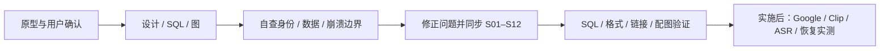

# 录音助手 · Server + Web 完整设计与开发计划

2026-10-29 · 第一版设计，尚未实施产品代码、生产迁移或部署。

**一个服务、两个页面、4 张新增业务表。** Google 登录与会话留内存；识别原文存 SQLite；保留 raw + WAV，支持 Markdown / VTT。

参考：[产品原型](https://comfy-faloodeh-ec9b57.netlify.app/) · [代码仓库](https://github.com/BofAI/reSpeaker_Clip)。此前检查的代码基线为 `77ae7fc`，实施前重新核对当前源码。本文是唯一设计文档，配图先读，细则按需展开；SQL、JSON、VTT、开发任务和自我评审均在本页。

<a id="contents"></a>

[产品范围](#scope) · [架构](#system-architecture) · [Google 登录](#google-login) · [设备与 Wi-Fi](#devices) · [录音处理](#ingest) · [转写格式](#transcript-format) · [Web/API](#web) · [四表设计](#sqlite-model) · [开发任务](#implementation) · [SQL](#sql) · [自我评审](#self-review)

<a id="scope"></a>

## 1. 最小产品范围


<details>
<summary>展开实现细则</summary>

| 位置 | 保留的功能 |
|---|---|
| 登录/账号 | Google OAuth 2.0 / OIDC 登录；基本用户落库，临时状态与本站会话只在内存。账号菜单显示邮箱和退出 |
| 录音列表 | 按日期分组、开始/结束日期筛选、时长、转写开头预览、真实上传/处理状态 |
| 录音详情 | 日期时间标题、文字和 A/B 等说话人标签、基础播放/暂停/进度、复制文字 |
| 下载 | WAV 音频、Markdown 文字；按用户新增要求提供 WebVTT 文件 |
| 添加设备 | 准备 → BLE 连接 → 自动激活/凭证配置/校时 → Wi-Fi → 完成 |
| 设备卡片 | 名称、版本、可信的状态/电量/待上传信息、Wi-Fi 添加/删除、改名、移除 |
| Server 内部 | 原始文件与 WAV 双保留、SQLite 入库、ASR/VTT、最小持久任务和文件恢复、同用户鉴权 |

不开发：邀请、组织、本地密码、多身份绑定、纪要/结论/待办/章节、全文搜索、Word/TXT 导出、录音改名/删除/回收站、历史结果切换、审计页面、管理员工作台、OTA/维修面板、公开分享、MP3、副本音频库、独立消息队列或多服务拆分。

维护侧仍可复用既有固件/设备工具，不为它们增加新产品页面或开发任务。录音删除在本版没有入口，云端录音不自动过期；不得以精简为由让原件自动消失。

</details>

<a id="system-architecture"></a>

## 2. 架构与模块


<details>
<summary>展开实现细则</summary>

沿用 Python/FastAPI 单个常驻进程、静态 HTML/CSS/ES modules、SQLite、本机持久目录。Web HTTPS 9529 与 HTTPS API 9528 共享后台，Clip 使用 UDP/DTLS 9528。媒体工具是有超时/资源限制的子进程；ASR 使用配置的私有端点。不开多个 worker 共用目录，不在接收线程或事件循环执行解码。

模块只按职责拆：`auth`（Google 登录/内存会话）、`users`（基本资料）、`devices`（既有绑定适配）、`recordings`（来源/列表）、`jobs`（一个活动处理任务）、`files`（持久发布/恢复）、`decode`（WAV）、`transcript`（ASR/cues/VTT）、`routes`（同源 API）。不新增通用工作流平台。

Web 的 `/api/boa/v1` 在 9529 同源转交同进程处理；浏览器不直接跨端口调用 9528，不启用跨域 Cookie。旧 9528 接口继续服务原有客户端。Google 回调也固定在 9529 的公开 HTTPS origin；反向代理场景只信任显式配置的代理，不从任意 Host/X-Forwarded-* 拼回调地址。

浏览器可见时每 5 秒更新活动录音、每 15 秒更新设备；隐藏后降到 30 秒，恢复时立即更新。采用轮询即可，不增加 WebSocket/SSE。

</details>

<a id="user-model"></a>
<a id="google-login"></a>

## 3. 基本用户与会话


<details>
<summary>展开实现细则</summary>

`accounts` 保留 9 个字段：`user_id`、`google_sub`、`email`、`display_name`、`status`、`auth_version`、`last_login_at`、`created_at`、`updated_at`。内部 user_id 关联所有 owner，既有用户沿用旧 ID；google_sub 唯一，旧用户迁移未核验时允许为空。邮箱唯一但不是自动合并身份的依据；头像首字母从名字/邮箱派生。

状态只有 active/disabled。登录使用 Google OAuth 2.0 Authorization Code + OpenID Connect；具体契约见[Google 登录与内存边界](#google-login)。不建 OAuth、token、browser_sessions 表。每个请求重新核对 accounts.status/auth_version；已有 Bearer 兼容身份也经过相同门禁，不能绕过禁用。

内存保存一次性登录状态（5 分钟）和本站会话（闲置 24 小时、绝对 7 天）；随机 opaque Cookie 引用服务端会话。退出即删除，Server 重启全部失效、用户重新登录，设备上传凭证与后台任务不受影响。登录跳转的临时 Cookie 使用 Secure/HttpOnly/SameSite=Lax，本站会话使用 Secure/HttpOnly/SameSite=Strict，均为 host-only、Path=/；不把内存 map 序列化到磁盘。容量/清理/重放边界见登录契约。

所有读取按服务端身份过滤 owner，跨用户对象统一 404；写请求校验准确 Origin 与会话 CSRF。普通用户不因首次登录获得开发者权限，既有维护通道权限仅为兼容，不复制成新用户角色体系。

</details>

| SQLite | 内存 | 浏览器 |
|---|---|---|
| accounts、设备归属、录音、原文、任务 | 一次性 LoginFlow、Session、Google 公钥缓存 | HttpOnly Cookie；页面临时 CSRF token |
| 重启保留 | 退出/到期/重启清除 | 会话失效后重新 Google 登录 |

<details>
<summary>展开 Google 登录步骤、内存结构与异常处理</summary>

### 方案取舍

| 方案 | 取舍 |
|---|---|
| **选用：基本用户表 + 内存登录/会话** | 用户归属稳定；没有 OAuth/会话表，重启重登；适合既定单进程 |
| SQLite 持久会话 | 重启可续登，但增加会话持久化/清理；本版不选 |
| 完全不存用户、每次直接使用 Google token | 可构造极简服务，但旧 user_id、设备/录音归属及禁用管理更难保持；本版不选 |

### Google 接入

1. 配置 Google Web application client、同意屏幕和精确的 HTTPS 回调 URI。只申请 `openid email profile`，不申请 Drive/Gmail 权限，不请求 offline access 或 refresh token。Client secret 在服务器环境/私密配置中，不进 Web、SQLite、Git 或日志。
2. `GET /api/boa/v1/auth/google/start` 创建高熵 state、nonce、浏览器绑定值和 S256 PKCE verifier；LoginFlow 放有界内存 map。设置 5 分钟临时 `__Host-boa_oauth` Cookie，然后 302 跳 Google。使用 Authlib 处理授权码流程，PKCE 明确启用；不得用默认的客户端签名 session Cookie 替代本设计的服务端内存存储。
3. 回调是 `GET /api/boa/v1/auth/google/callback?code=&state=`。先匹配未过期 state 与临时 Cookie 的摘要，再原子取走 LoginFlow，随后交换 code。重复回调不可成功；nonce/签名验证失败也不能再次使用同一流程。Google 拒绝授权时清理匹配的流程并回登录页。
4. 通过标准 Google ID token 验证库校验签名、Google issuer、本站 client_id/audience、到期时间，再比较 nonce；多 audience 时校验 azp，要求有效 sub、email 和 `email_verified=true`。不将客户端提供的 sub 当身份。公钥允许按缓存头有界缓存；网络/密钥服务不可用时拒绝本次新登录，不绕过验证。已有本站会话不逐请求访问 Google。
5. 按 google_sub 同步 accounts，沿用稳定 user_id。首次登录建立用户；相同 sub 复用；同邮箱不同 sub 或邮箱更新撞已有账号时返回 `409 account_identity_conflict`，不自动合并、不更改归属、不创建会话。旧 sub 为空的用户只能经维护侧核实映射，不能凭邮箱自助认领。禁用账号返回 403。
6. 生成新的本站随机 session token 和 CSRF token，内存登记后设置会话 Cookie，清临时 Cookie，303 到固定 `/`。不接受任意 return URL。Google access/id token 仅在校验期间使用，结束即不再保留；不写存储、错误响应或日志。语言运行时无法保证字节级擦除，不能承诺安全擦除内存。
7. 静态首页加载后通过同源 `GET /auth/session` 取得基本资料和 CSRF token；响应 `Cache-Control: no-store`。会话 Cookie 不暴露给 JS；CSRF token 只保存在页面内存。退出 `DELETE /auth/session` 校验 Origin/CSRF 后删会话、清 Cookie，并通知其他标签停止播放/请求。退出本站不退出 Google，也不撤设备上传凭证。

### 最少内存结构

| map | 键 | 值 | 生命周期 |
|---|---|---|---|
| login_flows | SHA-256(state) | binding_digest、nonce、pkce_verifier、expires_at | 5 分钟；原子消费 |
| sessions | SHA-256(随机 32 字节 token) | user_id、auth_version、csrf_token、created_at、last_seen_at | 闲置 24 小时、绝对 7 天 |

随机值使用系统 CSPRNG，比较敏感值用恒定时间。TTL 用可注入单调时钟，不因系统校时延长；持久业务时间仍为 UTC Unix 毫秒。每次有效会话请求更新 last_seen，轮询也算活动；绝对 7 天不滑动。会话 Cookie 固定 Max-Age=604800，不因轮询反复延长。

- 临时 Cookie：`__Host-boa_oauth`，Secure / HttpOnly / SameSite=Lax / Path=/，无 Domain。Google 顶层 GET 跳回时可发送；不能设 Strict 导致回调缺浏览器绑定。
- 会话 Cookie：`__Host-boa_session`，Secure / HttpOnly / SameSite=Strict / Path=/，无 Domain。登录成功始终换新 token，不接受客户端选择 session ID。
- 每浏览器同时一个登录流程；再次发起覆盖临时 Cookie，旧流程回调安全失败，过期清理；页面可重新发起。不同浏览器互不影响，不串身份。
- 每 60 秒及 map 操作时删除过期项；LoginFlow 最多 1000，Session 最多 10000。满额先清过期项，仍满则 503 `auth_capacity_exceeded`，不驱逐有效会话。start 每 IP 每分钟最多 30 次，超过 429；IP 来自可信连接/显式受信代理，不信任任意转发头。
- Google 请求总超时 10 秒；code 交换失败不重复使用，返回可重新发起的登录错误。state/绑定/nonce/token 无效为 400 `login_invalid_or_expired`，Google 取消为 `login_cancelled`，端点不可达为 503 `login_unavailable`。对外不返回 code/token/供应方原始响应。
- `/auth/session` 会话缺失或到期为 401；每次鉴权重新查 accounts.status/auth_version，禁用返回 403 并删会话，auth_version 不匹配返回 401。写操作要求同源 Origin + `X-CSRF-Token`；GET 不产生业务写入，登录 start/callback 的临时状态变化除外。对登录路由关闭 query/body/Cookie 的访问日志和代理追踪，回调无第三方资源，使用 `Referrer-Policy: no-referrer` 与 no-store。
- 服务单进程且持数据目录锁；多 worker 启动拒绝。重启丢会话是预期行为，不增加 Redis。独立设备 DTLS 凭证、已入库的 jobs/来源索引 与录音不依赖网页会话。

配置项：`GOOGLE_CLIENT_ID`、`GOOGLE_CLIENT_SECRET`、`PUBLIC_WEB_ORIGIN`（精确 HTTPS origin）、由 origin 和固定路径导出的回调 URI。Google Console 登记值必须完全相同；配置缺失时接口返回 503 `login_not_configured`，Web 显示登录不可用，不开放模拟登录入口。

官方依据：[Google OpenID Connect](https://developers.google.com/identity/openid-connect/openid-connect)、[Web Server OAuth](https://developers.google.com/identity/protocols/oauth2/web-server)。上述会话 TTL、容量与表结构为本产品选择，不是 Google 限制。

</details>

<a id="devices"></a>

## 4. 设备添加、Wi-Fi 与移除


<details>
<summary>展开实现细则</summary>

1. 用户在空录音页或设备页点击添加，主动打开 BLE 选择器。
2. 连接后读取完整 UID、固件和能力；不能以 BLE 名称代替 UID。
3. Server 根据已验证用户与**既有可信设备登记/凭证依据**取得或建立绑定，申请设备上传凭证。已属其他用户则拒绝；同用户重复请求复用同绑定，不反复轮换凭证。
4. Web 通过 BLE 写入上传配置，读回 binding/epoch/revision，再上报确认；同步设备时间，区分“客户端写入”与“实际收件”。
5. 通过 BLE 请求 Clip 扫描周围 Wi-Fi；用户从返回列表选择 SSID、输入密码、写入设备并读取连接结果，完成后回到列表。网页关闭不影响后续设备自行上传。

**激活的必要前提：** 当前代码以开发者受控登记/配置为主。原型的自动激活需要接上现有可信设备发放能力；UID 和“网页声称已连接”都不是所有权证明。若现有固件/发放机制不能提供依据，自动激活实机验收必须标为未完成；不以新增用户邀请、激活码页面或假成功绕过这个缺口。

### Wi-Fi：Clip 扫描，Web 选择设置

**用户确认的唯一新增配置路径：** Web 通过 BLE 请求 Clip 扫描周围 Wi-Fi，显示 Clip 返回的列表，用户选择一个 SSID、填写密码，再经 BLE 写入 Clip。网络来自录音设备所在位置，不从 Mac、浏览器或 Server 获取周边 Wi-Fi，也不提供手动填写 SSID/远处网络入口。

1. 先连接目标 Clip；Web 发 `scanWifi()`，由 Clip 实际执行无线扫描。
2. Clip 通过 BLE 返回可用 SSID、信号强度和安全类型；Web 显示列表与重新扫描按钮。列表只代表搜到，不能当作已保存配置。
3. 用户选择列表中的网络，输入密码；页面保留选中的 SSID，不开放任意 SSID 输入框。
4. Web 经 BLE 将选中 SSID/密码交给 Clip，由设备保存并尝试连接；密码不经过 Server，不入 SQLite、日志或 localStorage。
5. 读取 Clip 的保存/连接结果，分别显示“已保存”“连接中”“已连接”或具体失败；密码错误允许重输，扫描为空/超时允许重扫，不用手填 SSID 绕过。不把仅保存成功显示为联网成功，Wi-Fi 连通也不等于服务器已收录音。

保留已保存网络的查看/删除，最大数量按设备能力、上限 5 个；添加新网络始终来自当次 Clip 扫描结果。若当前固件没有扫描/结果返回能力，添加配置显示“不支持/待固件能力补齐”，不能降级为手动 SSID 或假扫描。多配置存储不足时按真实容量展示，不宣称完整 5 网络支持。当前文档基线为 2.4 GHz WPA2，原型中的“办公室-5G”名称不是 5 GHz 支持证据。

### 设备卡片

改名写既有 registry.bindings.display_name，更新时同时核对 owner、binding_id 与 active；未命名回退既有显示名/设备 ID。别名随绑定隔离，不另建 device_preferences，不改 UID/凭证。固件版本仅展示，不增加升级入口。在线、电量、待上传数必须有来源和采样时间；只有最近收件证据时显示“最近收件/状态未知”，不能假装在线。移除先撤销服务端上传凭证，尝试清理在线 BLE 上传配置；离线清理失败沿用既有交接锁。**已上传录音保留原 owner**，重新添加走受控绑定。

</details>

<a id="ingest"></a>

## 5. 收件、录音聚合与原件保留


<details>
<summary>展开实现细则</summary>

保持 v3 原协议：数据 fsync → 持久检查点 → 整文件 size/hash 校验 → rename/目录 fsync。只有 raw 和可恢复归属的身份元数据持久后才回 COMPLETE，不等待 WAV、ASR 或 VTT。设备撤销后不能继续写入；旧绑定的历史文件仍属原用户。

既有 registry 的 `sources` ready 行就是持久待投影项，新增 projected_at 标记，不再建 outbox 表。消费者在 business 单事务建立/更新 recording 与 recording_segments；同一片段行保存 raw 路径/size/hash，并以唯一 `(source_namespace,source_id)` 兼作来源收据。业务事务成功后才标 projected_at。文件已落盘但索引失败，可从既有 identity/raw 对账；业务已提交但未标记时重放，ready→ready 且 hash 相同不重复增版本，hash 冲突拒绝。启动分批核对全部 ready 来源，不能只信标记。

录音按 `(source_kind, source_namespace, binding_epoch, source_session)` 聚合；新 ready 片段才递增 input_revision，重复 source 不增加。App 原上传接口只作为兼容来源，不添加文件上传页面。可定期读取已有 receiving 索引创建上传中的录音元信息，未收完整时不标片段 ready、不生成处理任务。

旧协议没有总片段清单，所以显示“已收到 N 个片段/完整性未知”，不伪造 3/5 或整段完成。收到连续片段后静默 10 分钟可处理当前已收内容，这不是结束证据；有缺号则等待补齐，不补静音、不生成虚假完整时间轴。后续片段到达更新输入版本并重做派生内容；不做用户可选择的历史版本功能。

</details>

<a id="recording-decode"></a>

## 6. raw + WAV 双保留


<details>
<summary>展开实现细则</summary>

- Clip raw 格式为 `uint16 little-endian length + raw Opus packet`；先检查包边界/时长/声道，再正确封装或用受控解码器处理，不能直接当 Ogg 或 WAV。
- 校验 raw hash 后解码为 **16 kHz、mono、PCM16 little-endian WAV**。逐段临时解码，再按冻结片段顺序合为一份 `recording.wav`，记录样本数、长度和独立 hash。
- 一份已发布 WAV 同时用于原型播放、ASR 和下载，不另存 MP3、长期片段 WAV 或第二份 ASR WAV。临时分段文件成功后清理；原始文件始终保留。
- 内部存储路径按 raw 来源或 job/attempt 与输入版本确定，不覆盖已发布路径；更新不覆盖正在播放的文件。当前指针只指向 jobs 中 ready 的文件；旧派生文件在任务与读取不再使用后可清理，raw 不参与此清理。
- Ogg granule 的 48 kHz 时基与 PCM 16 kHz 区分；raw 没有 pre-skip 元数据时保留当前样本策略并标明时间来源。禁止隐式丢样、补音或把解码错误当正常音频。

单 raw 段遵守既有 8 MiB 上限，连续录音处理默认上限 8 小时。16 kHz mono PCM16 约 115.2 MB/小时，先检查磁盘预算与工具超时；超限留 raw 并给出可恢复失败。原型“音频原文件（.wav）”实际是**设备原件解码所得 WAV**，不是原始 Opus 改后缀，建议按钮文字为“下载音频（.wav）”。

</details>

<a id="dual-write"></a>

## 7. 任务兼作文件索引与发布恢复


<details>
<summary>展开实现细则</summary>

只需 decode、transcribe 两类持久任务；VTT 随 transcribe 生成，Markdown 下载即时生成，不创建导出任务系统。

| 步骤 | 操作 | 可见性 |
|---|---|---|
| 1 | jobs 一行保存输入快照、lease、临时/最终路径与 publication_state=prepared | 不可下载 |
| 2 | 事务外写临时文件，检查 size/hash，flush/fsync | 不可下载 |
| 3 | jobs 记录预期 size/hash；持录音锁检查当前 input_revision 和 lease | 不可下载 |
| 4 | 同文件系统独占 rename，相关目录 fsync | 文件存在仍不算 ready |
| 5 | DB 再检查 fence，同事务提交 jobs 成功/文件 ready、录音指针和下一阶段状态 | 当前用户可读 |

文件与 SQLite 不是一个原子事务；靠 jobs 内的发布字段恢复，不靠“同时写成功”的假设。WAV rename 后 DB 提交前崩溃，重启任务用新 lease 校验文件后补提交；VTT 同时依赖 cues，若 cues 事务未提交则重跑 ASR 并重新整体发布，不能套用仅校验文件的补提交。输入已过期则不改当前指针。jobs 对应文件缺失则标 publication_state=missing：WAV 由 raw 重建，VTT 优先由已提交的同版本 cues 重建；原件缺失单独告警。不同 hash 的同路径对象拒绝覆盖。

每个 decode 任务只发布一份 WAV，每个 transcribe 任务只发布一份 VTT，文件 MIME 由 kind 派生；不建通用 storage_objects/file_publications。原件元数据在 recording_segments，不复制到 jobs。

任务 input_json 冻结原件清单和媒体/ASR 配置版本，transcribe 还固定所消费的 wav_job_id 与 WAV hash；运行环境不匹配时不偷偷换工具执行。需因配置变化重做时由维护流程建立新输入修订，禁止同 revision 悄悄改变时间轴。

单个活动任务，60 秒 lease、15 秒续期；瞬时错误最多重试 3 次，间隔 30 秒/2 分钟/10 分钟。解码超时 10 分钟、ASR 最长 60 分钟作为可配置初值。启动先恢复来源索引/事件，再恢复文件发布和过期任务；API/接收线程不等待模型执行。

</details>

<a id="vtt"></a>
<a id="transcript-format"></a>

## 8. 转写与 WebVTT


<details>
<summary>展开实现细则</summary>

ASR 消费当前 WAV，返回 cue 的 start_ms/end_ms/text 和可空 speaker。说话人按当前录音稳定映射为 A/B/C；供应方无分离结果时显示未区分，不能猜姓名。只接 ASR，不接纪要模型。

### 8.1 生成与存储

1. 校验 JSON 片段：文本非空、毫秒为整数、`0 <= start < end`、时间不超当前 WAV 时长（允许最多 1ms 表示精度误差），起点不倒序。合法的多人重叠允许保留。
2. 准备版本化 JSON `{schema_version:1,time_unit:"ms",cues:[...]}`，在步骤 5 的最终事务中整体写入 `recordings.transcript_json`，关联 transcript_revision；不另建 transcript_cues 表。它是唯一结构化文字主源，**识别出的原文必须存入 SQLite**，VTT 和 Markdown 均由同一批 cues 生成。采用 UTF-8 纯文本、整数毫秒和可空 speaker，完整 JSON/字段/空结果约定见[转写格式](#transcript-format)及下方 [JSON 示例](#json-example)。不把 VTT 标签或转义后的 HTML 存进 text。
3. 生成 UTF-8 `transcript.vtt`，使用 `WEBVTT` 文件头、空行、稳定 cue 编号、`HH:MM:SS.mmm --> HH:MM:SS.mmm` 和可选 voice 标签。说明依据：[W3C WebVTT 格式](https://www.w3.org/TR/webvtt1/)。
4. 用户文本的 `& < >` 转义，空白行规范化，speaker 标签只来自受控映射，不将 ASR 内容当任意 HTML/VTT 控制块。
5. VTT 通过相同文件发布流程校验/持久，随后在短事务中提交 transcript_json、vtt_job_id 指针和 transcript_revision/state；中断时不显示文字 ready，重启可重做。若仅有已 rename 的 VTT 而 cues 事务未提交，不能只凭文件 hash 补 ready：废弃该次未提交的派生产物并用同版本 WAV 重跑 ASR，新的 cues/VTT 重新一起发布；raw/WAV 保留。

ASR 耗时不影响 WAV 播放。新 WAV 发布后，只展示与 audio_revision 相同的 cues/VTT；旧文字不贴到新时间轴。没有用户历史版本切换：处理中提示等待即可。当前输入更新期间仍可保留上一份音频与同版本文字，标“更新中”；新音频替换时旧文字先隐藏。

<a id="vtt-example"></a>

### 8.2 实际 VTT 示例

以下为人工编写的演示内容，不是用户录音。完整内容如下。

```vtt
WEBVTT

1
00:00:00.000 --> 00:00:02.400
<v A>我们确认一下今天的安排。</v>

2
00:00:02.400 --> 00:00:05.800
<v B>先检查设备，再核对录音文字。</v>
```

下载 MIME 为 `text/vtt; charset=utf-8`。Web 默认显示清爽文字及 speaker，不强制显示时间戳、不增加字幕编辑器；时间戳用于当前音频对应的定位与 VTT 下载。需要跟随播放时使用这同一组 cues，不额外维护另一套字幕数据。

### 8.3 下载

原型保留 WAV 与 `.md`；按用户追加要求，在同一个导出菜单加 `.vtt`，不增加新页面。WAV/VTT 为磁盘文件，其索引在对应 jobs 行，Markdown 按当前 cues 流式生成：日期标题和 A/B 文字，不夹带摘要。没有 Word、TXT、异步导出记录、过期链接或公开分享链接。

</details>

| 字段 | 格式 | 示例 |
|---|---|---|
| recording_id + revision | API 录音与版本，数据库使用 id/transcript_revision | demo-recording / 1 |
| cue_index | 从 1 开始的连续整数 | 1 |
| start_ms / end_ms | 相对当前 WAV 的整数毫秒 | 0 / 2400 |
| speaker | 稳定匿名标签或 NULL | A |
| text | UTF-8 纯文本原文 | 我们确认一下今天的安排。 |

<details>
<summary>JSON、发布事务、空结果与异常恢复</summary>

### 格式与边界

SQLite 在 `recordings.transcript_json` 存一份 `{schema_version:1,time_unit:"ms",cues:[...]}`，录音 owner 与 transcript_revision 在同一行，不再建逐句表。`text` 保存识别内容，不做总结、改写或 HTML/VTT 转义，不存带 `<v>` 的字幕字符串。统一 CRLF 为 LF，拒绝 NUL/非法编码与纯空白句；原有标点、中文和换行保留。speaker 只能为 A/B/C…稳定映射或 NULL，不能猜真实姓名；Web 用 textContent 渲染。文字是用户数据，不写日志或跟踪系统。

API 外层固定为 `schema_version:1, recording_id, revision, time_unit:"ms", cues:[], next_cursor`；`revision` 对应 recordings.transcript_revision，并须等于当前 audio_revision；不能直接使用可能领先的 input_revision，cue 字段名固定为 cue_index/start_ms/end_ms/speaker/text。owner 不在客户端传入，也不暴露给其他用户。不存 API 分页 envelope 副本，不保存供应方完整 response；v1 只保留展示/导出必需内容。

供应方秒数在 adapter 中转为整数毫秒；校验 `0 <= start_ms < end_ms <= duration_ms`，最大 1ms 精度误差可夹到音频边界，夹后仍须 start < end。按 start_ms 与供应方稳定顺序排序后生成连续 cue_index；合法多人重叠保留。单句最多 10000 字符、每录音最多 100000 cues、持久 JSON 编码后最多 8 MiB UTF-8，超限报 `transcript_limit_exceeded`，不静默截断。数字/类型/文本不合法则整批失败，不发布部分文字。

静音时允许 **0 cues**：transcript_state=ready，JSON cues=[]，VTT 为 `WEBVTT\n\n`，Markdown 仅日期标题，Web 显示“未识别到文字”。ASR 未配置、失败与成功无文字是不同状态；用户仍可播放 WAV。此处不额外增加“空文本”表。

### 原子发布

1. ASR 读取冻结的同版本 WAV，校验并准备 cues；任务持有效 lease。
2. 从同组 cues 生成 UTF-8 VTT，转义 `& < >`，清理会破坏 cue 分隔的文本空行；text 原文不受影响。文件名/路径由 Server 生成。VTT 经当前 transcribe jobs 行保存的临时/最终路径、size/hash、publication_state 完成 fsync/rename 持久化；不另建文件或发布表。
3. 持录音锁，在**一个 SQLite 事务**内检查 lease、当前 input_revision/audio_revision，整体写入 transcript_json、更新 vtt_job_id/transcript_revision/transcript_state，并将对应 jobs 文件设 publication_state=ready、任务设 succeeded。任一失败全部回滚，读者不能看到半批 cues。
4. 相同任务重放不产生重复句子；失效 lease 不得覆盖新输入。针对尚未提交的同版本尝试，只在事务内替换待发布 transcript_json；已成功的相同版本任务不自动重跑。新输入先隐藏不匹配的旧文字。

### 恢复与读取

| 中断位置 | 恢复动作 |
|---|---|
| cues 仅在内存 | 任务租约回收，重跑同版本 ASR |
| VTT rename 后、cues 提交前 | 将 jobs 内未提交的文件尝试标 abandoned，重新 ASR 并整体发布；不能仅凭文件 hash 补 ready |
| cues/VTT/ready 已提交、进程退出 | SQLite 直接读文字，VTT 直接下载；不重跑成功任务 |
| 成功后 VTT 文件缺失/损坏 | 保留已存 cues，当前 VTT 下载报暂不可用；维护侧从已提交同版本 cues 经文件发布恢复，不重新 ASR |
| 音频更新或请求版本不符 | 409 recording_revision_changed；Web 取消旧请求后重新加载 |

恢复时不删除任何 raw；废弃的派生产物只有在无当前指针/在途读取引用后才清理。当前 JSON 仅在新音频对应转写成功时整体替换；已开启的旧 SQLite 读取快照按 WAL 规则完成，不对用户提供历史选择器，不引入清理平台。

JSON 每页最多 200 cues，游标绑定录音/版本。每个请求在同一 SQLite 读取快照核对 owner、当前 audio_revision、transcript_revision 和 ready 状态；不匹配拒绝。复制全部文字要取完同版本全部页才写剪贴板。VTT 已持久保存，JSON 分页/Markdown 从同一 SQLite 快照的 transcript_json.cues 按数组顺序读取；可使用 json_each 分页或迭代，避免构造整批 Python cue 对象。Markdown 按句生成；三者使用相同 speaker 和文字。JSON/VTT/MD 为当前音频同版本，响应均标注 revision，下载附件固定 UTF-8 与安全 filename。

</details>

<a id="json-example"></a>

### JSON 接口示例

<details>
<summary>展开完整 JSON（与上方 VTT 同一段文字）</summary>

```json
{
  "schema_version": 1,
  "recording_id": "demo-recording",
  "revision": 1,
  "time_unit": "ms",
  "cues": [
    {
      "cue_index": 1,
      "start_ms": 0,
      "end_ms": 2400,
      "speaker": "A",
      "text": "我们确认一下今天的安排。"
    },
    {
      "cue_index": 2,
      "start_ms": 2400,
      "end_ms": 5800,
      "speaker": "B",
      "text": "先检查设备，再核对录音文字。"
    }
  ],
  "next_cursor": null
}
```

持久存储只保留 schema_version、time_unit、cues；recording_id、revision、next_cursor 为接口外层字段。

</details>

<a id="web"></a>

## 9. Web 与 API

<details>
<summary>展开实现细则</summary>

只保留“录音、设备”两个导航和账号菜单，品牌显示以新原型“录音助手”为准；Boa 仅为内部包/仓库名。

列表标题由录音时间生成，不提供改名。按开始/结束日期筛选，无搜索框；结束日期按业务时区次日零点转 UTC 半开区间。第一版部署级业务时区默认 Asia/Shanghai，不增加用户时区设置表。日期非法或开始晚于结束返回 422；设备时间不可信时用收件时间并提示来源。列表每页 30 条，按日期/id 稳定分页。

详情为文字、复制、导出与基础播放器；不强加倍速、±15 秒、全文编辑、章节或纪要。使用已有 `<audio>` 和进度控制。所有音频 Range/HEAD、VTT、Markdown 都使用同源 Cookie/Bearer + 当前 owner 直接鉴权，不新建 media_ticket 表。跨标签退出时停止音频、取消旧请求，后续 Range 拒绝；已发送的字节不能追回。

| 方法/路径（统一前缀 `/api/boa/v1`） | 内容 |
|---|---|
| GET `/auth/google/start` | 创建一次性内存登录事务，跳转 Google |
| GET `/auth/google/callback` | 消费 state、验证 Google 身份、创建本站会话后 303 回首页 |
| GET `/auth/session`；DELETE `/auth/session` | 本人基本资料和 CSRF token（no-store）；退出清 Cookie/内存会话 |
| GET `/devices` | 本人设备/能力/带时间的可信状态 |
| POST `/devices/activate` | 已验证身份、完整 UID、可信登记依据；复用/建立本人绑定 |
| POST `/devices/{id}/binding/confirm` | 设备配置读回确认，不代表真实上传 |
| PATCH `/devices/{id}` | 仅改别名 |
| DELETE `/devices/{id}/binding` | 撤上传凭证，历史录音保留；清理失败如实返回 |
| GET `/recordings?from=&to=&cursor=&limit=` | 日期筛选、列表预览与处理状态 |
| GET `/recordings/{id}` | 时间、时长、完整性、当前音频/文字版本与状态 |
| GET/HEAD `/recordings/{id}/audio.wav?revision=` | 固定音频版本，鉴权 WAV，Range 206 / 非法范围 416 |
| GET `/recordings/{id}/transcript?revision=&cursor=` | 固定版本 JSON cues，每页最多 200 条；游标绑定录音/版本 |
| GET `/recordings/{id}/transcript.vtt?revision=` | 固定音频版本的 VTT 下载 |
| GET `/recordings/{id}/transcript.md?revision=` | 固定版本 cues 生成 Markdown |
| GET `/health` | 最少服务存活信息，无用户/凭证内容 |

**跨请求版本约束：** 详情先固定 audio_revision，WAV、JSON cues、VTT、MD 请求均必须携带 revision，cue 游标也绑定 recording/revision。Server 在同一读取快照内检查请求版本为当前音频版本，文字还须匹配 transcript_revision；不匹配返回 409 `recording_revision_changed`，未就绪返回明确处理中状态，不能静默返回新版内容。响应标注版本。列表轮询发现新音频版本或收到 409 时，Web 取消旧分页/复制、停止旧播放并重新载入详情；复制全部文字必须在全部同版本分页成功后才写剪贴板。只保留内部在途读取所需旧文件，不增加历史版本 UI。

Wi-Fi 扫描/保存/删除通过 BLE，不设计对应 Server 密码接口。处理暂不可用时返回具体阶段状态；语音服务未配置显示 not_configured，不无限转圈。维护重试复用内部 job 接口/CLI，不新增用户任务管理页。旧 API `/api/audio/*` 与设备协议保持兼容。

</details>

<a id="sqlite-model"></a>

## 10. SQLite：4 张新增业务表


| 表 | 一条记录承载什么 |
|---|---|
| accounts | 基本用户与 Google sub，仍为 9 字段 |
| recordings | 录音状态、版本、当前文件任务指针、完整转写 JSON |
| recording_segments | 原始片段 + raw 路径/size/hash + 幂等来源收据 |
| jobs | decode/transcribe 任务 + 派生文件元数据 + 发布/恢复状态 |

<details>
<summary>合并清单与保留边界</summary>

| 原设计 | 合并到 |
|---|---|
| transcript_cues | recordings.transcript_json；没有全文搜索/逐句编辑需求，无需逐句表 |
| source_receipts | recording_segments 唯一 namespace/source_id 与 imported_at |
| storage_objects：raw | recording_segments 的 raw 路径/size/hash |
| storage_objects：WAV/VTT、file_publications | jobs 的文件路径/size/hash/publication_state |
| device_preferences | 既有 registry.bindings 的 display_name/name_updated_at |
| schema_migrations | SQLite PRAGMA user_version；每次迁移与版本更新同事务 |
| 新增 source_outbox | 既有 registry.sources ready 行 + projected_at |

**本次新增业务表从 10 减至 4；registry 新增 0 张表。** 既有 registry 的凭证、绑定和清理锁仍然保留，不把整个系统宣称成只有 4 张表。参考 DDL 尚未生产部署，不执行删表式真实数据迁移。

保留这四表的理由：用户跨录音复用；录音包含多个独立原件；同一录音可同时存在旧版本处理任务与新版本等待任务。jobs 因而保留独立行，原始片段不能塞进单个录音字段。文字当前只有一版展示，可放一个有界 JSON：最多 8 MiB UTF-8、100000 cues、每句 10000 字符，超限明确失败，不截断。API 仍按 200 cues 分页；实现可用 SQLite json_each 在固定快照取页，避免每个请求构造全部句子；导出逐句迭代。没有额外的 JSON 文件副本或逐句表。

recordings 的 wav_job_id/vtt_job_id 用 owner/录音/版本复合 FK 指向 jobs；文件发布与文件读取同时验证 job.kind、state/publication_state、size/hash；文字 API 独立读取录音当前 JSON，不因 VTT 文件缺失而丢掉已存文字。原件来源唯一约束负责幂等，条件更新 receiving→ready 与 input_revision 递增同事务。每次启动对账全部 registry ready 来源，分批 500 条异步执行，不阻塞 DTLS。

迁移脚本保存在 Git，业务库通过 PRAGMA user_version 顺序升级并拒绝未知高版本；实施中同时把既有 registry.py 的 bindings/sources 位置式 INSERT 改为显式列名，防止 ALTER ADD COLUMN 后旧写入因列数变化失败；加入真实旧 schema 升级夹具。registry 增量先检查既有列，沿用其迁移所有权，不覆盖其他组件版本号。每连接 foreign_keys=ON、busy_timeout=5000、synchronous=FULL；业务库 WAL。音频不入 BLOB。登录事务/会话仍只在内存。

</details>

<a id="operations"></a>

## 11. 实施与验收

<details>
<summary>展开实现细则</summary>

实施重排为 **S01–S12，共 12 项任务**，旧 T00–T23 不再作为当前待办。先基本用户/设备链路，再收件与 WAV，接 ASR/VTT，最后完善列表/详情/设备页面与迁移验收。见[任务计划](#implementation)。

备份保持简单：停服务、持排他维护锁、整体备份 SQLite/WAL、raw、identity、配置/凭证与派生文件；私密备份不入仓库。在隔离副本迁移并核对 user_id、绑定、数量、字节和 hash；真实根不直接试迁移。回退前先保存新收件原件，不能用旧快照覆盖上线后录音。不额外开发备份调度平台或人为设定未测容量承诺。

验证分层：表/约束与 API 测试；真实浏览器；真实 Clip 收件；实际 WAV 解码/播放；ASR 样本与 VTT 解析；固件能力缺项；恢复演练；实际部署。重启会清空网页登录状态，恢复后再次 Google 登录；用户、绑定、录音、任务均从持久存储恢复。

此轮只更新文档/参考 SQL/图，不执行登录配置、刷写、生产数据迁移或部署。

</details>

<a id="implementation"></a>

## 12. 开发任务与实施顺序


S01–S12，共 12 项任务、60 个步骤；实施前以本文设计和当前源码为准。推荐按顺序交付，逐项验证后提交。

<details>
<summary>依赖、文件与接口约定</summary>

### 全局约定

- 本轮只更新文档。旧 T00–T23 计划作废，重排为 **S01–S12，12 个任务、60 个步骤**，不沿用旧任务号的含义。
- 文档仓库为 boboliu-1010/speaker；实施基线为 BofAI/reSpeaker_Clip，本机此前检出 `/Users/bobo/code/respeaker-boa-integration`。实施时先核对当前源码和 AGENTS，使用 using-git-worktrees 建隔离工作区，并记录文档 commit。
- 保留单进程、一个目录锁、9529 Web、9528 HTTPS/UDP DTLS、v3 原始帧/ACK；不把 ASR 放在接收线程。
- 新增业务表仅 accounts / recordings / recording_segments / jobs；registry 新增 0 表。转写只存 recordings.transcript_json，文件发布只存 jobs，迁移版本用 PRAGMA user_version。
- 用户表只有既定 9 个字段；两个导航“录音、设备”，账号菜单邮箱/退出；Google Code/OIDC 接入和内存会话在 S02；本地密码/邀请/组织不在任务中。
- raw 与 WAV 双保留；同一 WAV 用于播放、ASR、下载；不存 MP3、持久分段 WAV、重复 ASR WAV；VTT 是转写产物，MD 由同组 cues 即时生成。
- WAV 16 kHz / mono / PCM16 LE；raw 单段 8 MiB、连续处理默认 8 小时上限；旧协议无整段闭合证据，静默 10 分钟只是处理触发。
- SQLite 每连接 FK=ON、busy_timeout=5000、synchronous=FULL；UTC 毫秒；部署业务时区默认 Asia/Shanghai；原件不因错误或移除设备删除。
- 一个活动任务；lease 60 秒、15 秒续期；最多重试 3 次，间隔 30 秒/2 分钟/10 分钟。任务完成检查当前输入版本/lease，不做历史结果切换页面。
- Wi-Fi 只用 Clip 经 BLE 返回的周围扫描列表：选择 SSID、输入密码、BLE 设置；不从 Mac/Server 扫描，不手填 SSID。已保存网络最多 5 个按真实能力展示；没有 Clip 扫描能力则标未完成，不回退手填。

### 重点验证边界

1. OAuth state/nonce/PKCE 错误、回调重放、服务器重启、身份冲突：拒绝错误登录，内存失效只要求重登，不影响设备收件。S02/S12。
2. 激活请求重放、设备已属别人、移除时还在上传：同用户幂等、异用户拒绝、立即撤凭证，历史文件归属不变。S03/S11。
3. raw/DB 双写、重启、迟到片段：不丢原件、不重复增版本、旧 lease 不覆盖新结果。S05–S07。
4. ASR 畸形时间戳、文本注入、多人重叠、VTT 中文：有效 cue 保留，非法 cue 不发布，转义正确，音频与文字同版本。S08/S10。
5. 时区日期边界、多标签退出、Range 越界：结束日期包含当天，跨用户无泄露，后续流请求拒绝，非法范围 416。S07/S09/S10。

### 顺序与文件边界

| 顺序 | 任务 | 前置 | 可审查交付 |
|---|---|---|---|
| 1 | S01 基线与精简 SQL 迁移 | 无 | 4 张业务表、registry 仅加列/索引、旧数据夹具 |
| 2 | S02 Google 登录与内存会话 | S01 | Google 登录、用户唯一性、内存会话与 owner 门禁 |
| 3 | S03 设备激活与归属适配 | S02 | 现有可信发放/绑定适配，改名/移除 API |
| 4 | S04 Web 框架与添加向导 | S02/S03 | 两导航、账号菜单、四步向导 |
| 5 | S05 原件与业务录音投影 | S01/S02 | receiving/ready、来源收据、聚合与版本 |
| 6 | S06 两类任务与文件发布恢复 | S05 | 一个活动任务、租约、prepared→ready |
| 7 | S07 WAV 解码与鉴权播放 | S06 | raw/WAV 双保留、Range、可用音频 |
| 8 | S08 ASR、cues 与 VTT | S07 | 当前音频对应文字和真实 .vtt |
| 9 | S09 日期列表 | S04/S05/S08 | from/to、预览、状态、分页 |
| 10 | S10 详情、复制与三种下载 | S07/S08/S09 | 基础播放、文字、WAV/MD/VTT |
| 11 | S11 设备卡片与 Wi-Fi | S03/S04 | 能力真实、最多 5 个、改名/移除 |
| 12 | S12 集成、迁移恢复与候选包 | S01–S11 | 分层验收证据、备份/回退说明 |

新增后端放 `server/boa/product/`：`db.py`、`auth.py`、`users.py`、`devices.py`、`recordings.py`、`jobs.py`、`files.py`、`decode.py`、`transcript.py`、`routes.py` 和 `migrations/`；不新建多层通用平台。测试放 `server/boa/tests/product/`。

新 Web 放 `server/web/product/`：`index.html`、`style.css`、`app.mjs`、`api.mjs`、`devices.mjs`、`recordings.mjs`、`detail.mjs`，复用原 BLE/绑定模块；对应 Node 测试仍放 `server/web/tests/`。旧 `/firmware/`、App API 不删除，不新开发其功能。

公共契约在 S01 定义：

- `Actor(user_id: str, auth_version: int)`：由服务端认证取得，不接受请求指定 owner。
- `SourceEvent(owner, namespace, source_id, session, epoch, segment_no, relative_path, size, sha256, created_at_ms)`：只包含服务端已确认来源。
- `InputSnapshot(recording_id, owner, revision, sources: tuple[SourceEvent, ...])`：按片段号冻结，hash 列表进 job.input_json。
- `Lease(job_id, recording_id, revision, token, expires_at_ms)`：存储/发布都引用同一个 fence。
- `Cue(cue_index: int, start_ms: int, end_ms: int, speaker: str | None, text: str)`：JSON、VTT、MD 的共同结构。

下列模块接口均在 `ProductContext` 内装配：该上下文包含 root、Registry、BusinessDB、clock_ms 和按 recording/source 键的锁。S01 负责定义，后续任务不可另造身份/时间单位。测试 fixture `ctx`、`two_users`、`source_factory`、`fake_clock`、`faults` 均使用临时库和合成资料。

</details>

### S01：实施基线与版本化精简迁移

<details>
<summary>展开文件、接口与验收步骤</summary>

**Files：** 新增 `product/{__init__,contracts,db}.py`、`product/migrations/*.sql`、`tests/product/{conftest,test_db}.py`、基线记录；修改打包文件清单。**接口：** `migrate(root: Path, dry_run: bool) -> dict`、`BusinessDB.connect() -> sqlite3.Connection`。

- [ ] 核对源码 SHA/AGENTS、建立隔离工作区和 `.venv-boa`，执行原 Python/Node 测试并记录现有失败；这一步不把环境缺失当通过。
- [ ] 写 `test_schema_has_only_minimal_tables`、`test_legacy_ids_and_time_units_survive_migration`，运行 `.venv-boa/bin/python -m pytest server/boa/tests/product/test_db.py -q`，确认新要求 FAIL。
- [ ] 参考 SQL 转为真实版本化迁移，保留旧 registry/上传库；新业务库 4 表、PRAGMA user_version 原子更新；registry 只加 bindings 别名列和 sources.projected_at，不新增表。同步把 registry.py 中 bindings/sources 的位置式 INSERT 改成显式列名，验证加列后兼容；毫秒桥接与公共契约一次统一。
- [ ] 重跑目标测试 PASS，FK/integrity、旧库夹具升级、失败重跑、未知高版本拒绝均验证；不对真实数据根试迁移。
- [ ] 仅提交代码/合成 fixture/文档，提交 `feat: establish minimal recording data model`。

</details>

### S02：基本用户、会话和统一 owner 检查

<details>
<summary>展开文件、接口与验收步骤</summary>

**Files：** `product/{auth,users}.py`、`test_users.py`、`test_google_auth.py`；修改 `web_sessions.py`、`boa_app.py`、依赖锁。**接口：** `begin_google_login(request: Request) -> Response`、`finish_google_login(request: Request) -> Response`、`sync_verified_user(sub: str, email: str, name: str) -> str`、`principal(request: Request) -> Actor`、`logout(request: Request) -> None`。登录参数、TTL、Cookie、容量和错误码以[契约](#google-login)为准。

- [ ] 写 `test_sub_reuses_owner`、`test_same_email_never_merges_user`、`test_invalid_state_nonce_pkce_or_id_token_denied`、`test_callback_replay_and_browser_mismatch_denied`、`test_restart_requires_login_but_keeps_device_upload`、`test_logout_keeps_recordings`、`test_disabled_user_denied`；账号 9 字段，旧 sub 可空，登录状态与会话不落盘。
- [ ] 运行 `.venv-boa/bin/python -m pytest server/boa/tests/product/test_users.py server/boa/tests/product/test_google_auth.py -q`，确认 FAIL。
- [ ] 接 Google Code/OIDC + S256 PKCE 与标准验证库，配置固定 HTTPS 回调、openid/email/profile；实现内存 LoginFlow/Session、Cookie、当前用户/退出、Origin/CSRF，旧 Bearer 统一门禁。Google token 使用后丢弃，无 offline/refresh；客户端不能任意指定 sub/owner。
- [ ] fake clock 验证 5 分钟/24 小时/7 天、单次消费、容量到顶拒绝且不驱逐有效会话、禁用/auth_version 立即生效；同邮箱不同 sub、同 sub 邮箱冲突、Google 失败均不产生半登录会话；目标与旧接口回归 PASS，真实 Google 跳转另行验收。
- [ ] 提交 `feat: add google login and bounded memory sessions`。

</details>

### S03：最少的设备激活、改名与移除

<details>
<summary>展开文件、接口与验收步骤</summary>

**Files：** `product/devices.py`、`test_devices.py`；适配 `registry.py`、`device_configurations.py`。**接口：** `activate(actor: Actor, uid: str, evidence: dict) -> dict`、`rename(actor: Actor, device_id: str, name: str) -> None`、`remove(actor: Actor, device_id: str) -> dict`。

- [ ] 写 `test_activation_requires_trusted_enrollment`、`test_same_owner_activation_is_idempotent`、`test_other_owner_cannot_claim`、`test_remove_revokes_upload_but_keeps_audio`。
- [ ] 运行 `.venv-boa/bin/python -m pytest server/boa/tests/product/test_devices.py -q`，确认 FAIL。
- [ ] 把原型自动激活接到既有可信登记/发放和 binding/epoch/读回 API，凭据只给本人并 no-store。别名写既有 registry.bindings.display_name，WHERE 同时核对本人 owner、binding_id、active；移除先撤凭证，离线清理保留既有锁。UID 不是认证，不自创邀请/激活码/远程信任机制。
- [ ] 目标测试及原绑定回归 PASS；若现有发放/固件不能提供可靠证据，记录自动激活真实联调未完成，而不是给未知设备放行。
- [ ] 提交 `feat: adapt trusted device activation and removal`。

</details>

### S04：两导航、账号菜单与添加设备向导

<details>
<summary>展开文件、接口与验收步骤</summary>

**Files：** `server/web/product/{index.html,style.css,app.mjs,api.mjs,devices.mjs}`、`server/web/tests/product-shell.test.mjs`；修改 `frontend.py`。**接口：** `createApi({fetcher,onLogout}) -> {request,reset}`、`mountDeviceWizard({root,api,ble}) -> {dispose}`。

- [ ] 写 `only recordings and devices navigation`、`account menu only shows email and logout`、`stale response is cancelled`、`activation readback is not upload success`。
- [ ] 运行 `node --test server/web/tests/product-shell.test.mjs`，确认 FAIL。
- [ ] 新 `/` 静态入口复现原型，显示“录音助手”；向导为准备/连接/自动激活/设置 Wi-Fi，调用 S03 接口及原 BLE 读回/校时；不加设置页、管理工作台或 OAuth 时序 UI。
- [ ] 目标 JS/原 frontend 测试 PASS；Chrome 核对空态、选择器取消、BLE 不支持、失败重试和关闭向导；不写真实设备即记录仅浏览器/模拟验证。
- [ ] 提交 `feat: add minimal recording assistant web shell`。

</details>

### S05：来源投影、片段幂等和上传状态

<details>
<summary>展开文件、接口与验收步骤</summary>

**Files：** `product/recordings.py`、`test_sources.py`；修改 `registry.py`、`receiver.py` 和 App 完成适配。**接口：** `import_ready(ctx, event: SourceEvent) -> str`、`sync_receiving(ctx) -> int`、`snapshot(actor: Actor, recording_id: str) -> InputSnapshot`。

- [ ] 写 `test_raw_ack_does_not_wait_for_business`、`test_ready_event_replay_changes_revision_once`、`test_receiving_has_no_ready_file`、`test_gap_and_new_epoch_not_merged`、`test_projected_marker_never_hides_restore_gap`、`test_same_source_hash_conflict_rejected`。
- [ ] 运行 `.venv-boa/bin/python -m pytest server/boa/tests/product/test_sources.py -q`，确认 FAIL。
- [ ] raw/identity/fsync/ACK 保持旧语义；sources ready 行本身就是待投影项，不另建 outbox；business 片段行同时存 raw 元数据与收据，唯一 namespace/source_id，条件 receiving→ready 与录音增版本同事务。先提交 business 再标 sources.projected_at；启动按 500 条分页对账全部 ready 来源。receiving 不生成 ready 文件/任务；App 仅兼容既有接口。
- [ ] 在 raw 后、registry 后、business 后、消费标记前故障注入并重启，均不丢原件、不重复录音；原 DTLS/HTTP 回归 PASS。
- [ ] 提交 `feat: project raw recordings through replayable source events`。

</details>

### S06：两类持久任务与文件发布恢复

<details>
<summary>展开文件、接口与验收步骤</summary>

**Files：** `product/jobs.py`、`files.py`、`test_jobs.py`、`test_files.py`；修改服务 lifespan。**接口：** `enqueue(snapshot: InputSnapshot, kind: str) -> str`、`claim(now_ms: int) -> Lease | None`、`publish(lease: Lease, tmp: Path, metadata: dict) -> str`、`recover(ctx) -> int`。

- [ ] 写 `test_single_active_job`、`test_expired_lease_cannot_publish`、`test_rename_before_commit_recovers`、`test_new_revision_fences_old_output`。
- [ ] 运行 `.venv-boa/bin/python -m pytest server/boa/tests/product/test_jobs.py server/boa/tests/product/test_files.py -q`，确认 FAIL。
- [ ] jobs 一行含任务、文件路径/hash/size、publication_state；decode 仅 WAV、transcribe 仅 VTT。实现按 recording/revision/kind 去重、SQL 部分唯一索引限制一个 running、60 秒 lease/15 秒续期、有界重试；prepared→临时 fsync→预期 hash→同盘独占 rename/目录 fsync→ready；WAV 可核 hash 恢复，VTT/cues 的联合提交恢复由 S08 验证。用输入版本和租约控制发布，不创建多套运行历史表。
- [ ] 对发布边界中断、磁盘满、hash 冲突、文件缺失、双监听重复启动运行时做测试，PASS；服务退出停止领新任务，15 秒后留待重启恢复。
- [ ] 提交 `feat: add minimal durable processing and file publication`。

</details>

### S07：raw 解码为一份 WAV，鉴权 Range 播放

<details>
<summary>展开文件、接口与验收步骤</summary>

**Files：** `product/decode.py`、`test_decode.py`、`test_audio_http.py`；修改 `product/routes.py`、依赖/工具版本清单。**接口：** `decode(snapshot: InputSnapshot, output: Path) -> dict`、`serve_audio(actor: Actor, recording_id: str, revision: int, range_header: str | None) -> Response`。

- [ ] 写 `test_raw_packet_framing_to_16000_mono_pcm16`、`test_bad_packet_preserves_raw`、`test_gap_does_not_get_silence`、`test_range_owner_and_logout`；1 秒合成样本应得 16000 样本，Range 合法 206、非法 416。
- [ ] 运行 `.venv-boa/bin/python -m pytest server/boa/tests/product/test_decode.py server/boa/tests/product/test_audio_http.py -q`，确认 FAIL。
- [ ] 按实际 raw profile 解包/封装并解码，临时分段后合一份 WAV；raw 元数据只在 recording_segments；样本数/独立 hash 随 WAV jobs 行入库；S06 发布当前音频。WAV 同时供播放、ASR、下载，不生成 MP3。Cookie/Bearer + owner 直接鉴权，不加 ticket 系统。
- [ ] 目标测试和授权真实样本解码/试听分别通过；验证长录音拖动、超时/体积限制、并发新片段和旧音频仍可安全读取，记录 pre-skip 时间来源限制。
- [ ] 提交 `feat: decode and serve persistent recording wav`。

</details>

### S08：ASR 文字、说话人与 WebVTT

<details>
<summary>展开文件、接口与验收步骤</summary>

**Files：** `product/transcript.py`、`test_transcript.py`、`test_vtt.py`；从本文 [VTT 示例](#vtt-example)提取人工合成测试夹具，不提交真实音频。**接口：** `ASR.transcribe(wav: Path, request_id: str) -> list[Cue]`、`validate_cues(cues: list[Cue], duration_ms: int) -> list[Cue]`、`render_vtt(cues: list[Cue]) -> bytes`、`publish_transcript(lease: Lease, cues: list[Cue]) -> None`。

- [ ] 写 `test_vtt_header_utf8_milliseconds_and_voice`、`test_invalid_time_rejected_but_valid_overlap_kept`、`test_untrusted_text_escaped`、`test_old_transcript_not_on_new_wav`；示例应解析出 2 个 cue，结尾 5800ms，speaker A/B，空白文本 cue/逆序/越界拒绝；全程静音允许 0 cues。增加 `test_plain_text_roundtrip_and_json_vtt_same_cues`、`test_restart_loads_text_without_asr`、`test_vtt_file_without_cue_commit_is_reprocessed`、`test_missing_vtt_rebuilds_from_stored_json`、`test_json_limit_never_truncates_text`。
- [ ] 运行 `.venv-boa/bin/python -m pytest server/boa/tests/product/test_transcript.py server/boa/tests/product/test_vtt.py -q`，确认 FAIL。
- [ ] 按 v1 JSON 契约固定 cue_index 和整数毫秒，整份 transcript_json 不超过 8 MiB UTF-8，text 为未转义原文，speaker 可空；接一套实际私有 ASR adapter，未配置明确 not_configured；校验后生成 UTF-8 VTT，按 S06 持久发布，并把 recordings.transcript_json、vtt_job_id、文字 ready 与 jobs 成功原子提交。当前 audio_revision 与 transcript_revision 一致才对外显示；没有说话人就不编造。
- [ ] 目标测试 PASS，重启后直接从 recordings.transcript_json 读文字、由同版本 cues 导出 MD；缺失 VTT 从 JSON 重建且 ASR 调用次数不增加；VTT 已落盘但 cues 未提交的故障必须重跑而非补假 ready。浏览器实际解析示例 VTT；真实端点用授权样本检查时间/文本/分离质量。缺端点时只记契约通过；ASR 失败仍可播放 WAV，无纪要模型任务。
- [ ] 提交 `feat: add timestamped transcripts and webvtt output`。

</details>

### S09：日期列表 API 与 Web

<details>
<summary>展开文件、接口与验收步骤</summary>

**Files：** 扩展 `product/{recordings,routes}.py`、`server/web/product/recordings.mjs`；新增 `test_recording_list.py`、`product-recordings.test.mjs`。**接口：** `list_recordings(actor: Actor, from_date: str | None, to_date: str | None, cursor: str | None, limit: int=30) -> dict`。

- [ ] 写 `test_inclusive_end_date_uses_next_local_midnight`、`test_invalid_dates_and_owner_filter`；JS 断言只有日期筛选、文字开头预览、无纪要/全文搜索/录音改名入口。
- [ ] 运行 `.venv-boa/bin/python -m pytest server/boa/tests/product/test_recording_list.py -q`、`node --test server/web/tests/product-recordings.test.mjs`，确认新用例 FAIL。
- [ ] COALESCE 可信录音时间/收件时间后按部署时区分组，结束日转次日零点半开区间；每页 30 条稳定日期/id 游标。显示真实 receiving、处理状态和时长；可见 5 秒/隐藏 30 秒轮询、日期变化取消旧请求。
- [ ] 目标测试 PASS；Chrome 检查同日/跨日、清空筛选、无数据、后端离线和返回列表；不暴露其他 owner。
- [ ] 提交 `feat: add date filtered recording list`。

</details>

### S10：详情、基础播放器、复制与 WAV/MD/VTT 下载

<details>
<summary>展开文件、接口与验收步骤</summary>

**Files：** `server/web/product/detail.mjs`、`test_downloads.py`、`product-detail.test.mjs`；扩展 transcript/routes。**接口：** `get_cues(actor: Actor, recording_id: str, revision: int, cursor: str | None) -> dict`、`render_markdown(cues: list[Cue], heading: str) -> bytes`、Web `mountDetail({root,api,audio,id}) -> {dispose}`。

- [ ] 写 `test_wav_md_vtt_same_owner_and_revision`、`test_publication_between_pages_requires_reload`、`test_markdown_has_transcript_not_summary`；JS 断言复制文字、播放暂停/拖动、退出清理音频，没有倍速/章节/纪要/编辑器/回收站。
- [ ] 运行 `.venv-boa/bin/python -m pytest server/boa/tests/product/test_downloads.py -q`、`node --test server/web/tests/product-detail.test.mjs`，确认 FAIL。
- [ ] 展示日期标题、时长、A/B 文字；cue 分页每页 200 条，复制/MD 覆盖全部当前文字而不只第一页。导出菜单为 WAV/Markdown，并追加用户要求的 VTT。详情固定 audio_revision，四类内容请求和 cue 游标都带 revision；读快照内匹配当前音频/文字版本，否则 409，Web 取消分页/播放后重新载入，不能复制部分混合结果。MD 即时生成，无 exports 表/异步导出任务/24 小时链接。
- [ ] 目标测试 PASS；Chrome 试听/拖动、复制全文、下载 WAV/MD/VTT 并核对中文/时间戳和 MIME；新 WAV 就绪时隐藏不同版本文字，切换账号中断旧请求。
- [ ] 提交 `feat: add simple transcript detail and wav md vtt downloads`。

</details>

### S11：设备卡片与基于 Clip 扫描的 Wi-Fi 配置

<details>
<summary>展开文件、接口与验收步骤</summary>

**Files：** 扩展 `product/devices.py`、`server/web/product/devices.mjs` 和既有 BLE adapter；新增 `product-wifi.test.mjs`、`test_device_views.py`。**接口：** BLE adapter `capabilities()`、`scanWifi() -> {ssid,rssi,security}[]`、`saveWifi(selectedSsid,password)`、`readWifiStatus()`、`deleteWifi(ssid)`；扫描与连接状态由 Clip 真实返回，缺能力为 unsupported。

- [ ] 写 `wifi list comes from clip scan over ble`、`ssid must be selected from scan results`、`missing scan does not enable manual ssid`、`saved is not connected`、`at most five saved networks`、`password never sent to server`；后端验证别名/归属/移除保留录音，状态来源不明不显示在线。
- [ ] 运行 `node --test server/web/tests/product-wifi.test.mjs`、`.venv-boa/bin/python -m pytest server/boa/tests/product/test_device_views.py -q`，确认 FAIL。
- [ ] 设备卡片保留改名、版本、状态、Wi-Fi 管理和移除；Wi-Fi 操作固定为连接 BLE→请求 Clip 扫描→选择返回的 SSID→输入密码→BLE 写入→读取保存/连接结果。空列表/超时重扫、密码错误重输；没有手动 SSID、远处网络或本机扫描入口。没有 Clip 扫描能力就禁用新增配置并标缺项，已保存项仍可按真实能力查看/删除。
- [ ] 模拟边界测试 PASS；实机验证扫描列表确实来自目标 Clip、选网/密码写入/连接结果、删除/重连/移除；不能把 mock 当扫描或 5 网络支持。缺扫描则该配置闭环未验收，不能以手填方式完成；自动激活、多 Wi-Fi、遥测缺项分别记录。
- [ ] 提交 `feat: align device cards and wifi management with prototype`。

</details>

### S12：整体回归、迁移恢复与候选包

<details>
<summary>展开文件、接口与验收步骤</summary>

**Files：** `tests/product/test_end_to_end.py`、`docs/development/recording-v1-acceptance.md`；修改打包脚本/部署说明，必要时新增小型迁移/备份 CLI。**产出：** 候选包、源码/依赖/文档 SHA、分层检查记录；不自动部署或刷写。

- [ ] 在隔离夹具写端到端失败用例：用户→设备→receiving→raw→WAV→文字/VTT→列表→复制/下载→移除设备，断言历史文件归属不变，Bob 全路径不能访问 Alice。
- [ ] 执行 `.venv-boa/bin/python -m pytest server/tests server/boa/tests server/storage/tests -q`、`.venv-boa/bin/python -m unittest tools.upload.tests.test_dtls_receiver -v`、`node --test server/web/tests/*.test.mjs`，修复回归；环境缺失单列。
- [ ] 真实浏览器、Google 登录及重启重登、Clip 收件、WAV 试听、ASR/VTT、Wi-Fi 实机分别验收；记录缺失的发放/固件能力，Google 配置缺失则登录未验收，固件缺项则实机闭环未验收，不以 mock 充当结果。
- [ ] 停机整体备份并在隔离目录迁移/恢复，核对旧 user_id、设备、raw 数量/字节/hash；回退先保存新录音；测实际响应/处理时间并记录，不承诺未测吞吐。
- [ ] 打包排除录音/数据库/凭证，核对 manifest/哈希；提交 `release: prepare minimal recording assistant candidate` 并明确未完成的真实验收，不将候选包称为已上线。

</details>

### 交付里程碑

- **M1：S01–S04。** Google 登录、内存会话和设备向导可用；自动激活需真实可信发放能力，不是仅有 UI。
- **M2：S05–S08。** 原件入库、WAV 双保留、可播放，ASR/cues/VTT 全链路恢复可测。
- **M3：S09–S12。** 日期列表、文字/下载、设备卡片与实机/迁移验收，形成候选包。

本计划使用 writing-plans 工作流完成自检：设计每项保留功能都有责任任务；删减功能无残留任务；VTT 在 S08/S10/S12 贯通；公共类型不各模块重定义；图/DDL/任务以同一文档提交为准。步骤中的 FAIL/PASS 是未来实施要求，本轮没有执行这些产品测试。

<a id="sql"></a>

## 13. 完整 SQL 参考

<a id="business-sql"></a>

<details>
<summary>业务库：4 张表，完整 DDL</summary>

```sql
-- 录音助手 v1：4 张新增业务表。设计附件，不是生产迁移脚本。
-- 原始音频/派生文件在磁盘；转写 JSON 在 recordings；会话只在内存。
PRAGMA foreign_keys=ON;
PRAGMA journal_mode=WAL;
PRAGMA synchronous=FULL;
PRAGMA busy_timeout=5000;
BEGIN IMMEDIATE;
CREATE TABLE accounts (
  user_id TEXT PRIMARY KEY,
  google_sub TEXT UNIQUE CHECK(google_sub IS NULL OR length(google_sub) BETWEEN 1 AND 255),
  email TEXT NOT NULL UNIQUE COLLATE NOCASE
    CHECK(email=trim(email) AND length(email) BETWEEN 3 AND 254 AND instr(email,'@')>1),
  display_name TEXT NOT NULL DEFAULT '' CHECK(length(display_name)<=100),
  status TEXT NOT NULL DEFAULT 'active' CHECK(status IN ('active','disabled')),
  auth_version INTEGER NOT NULL DEFAULT 1 CHECK(auth_version>0),
  last_login_at INTEGER, created_at INTEGER NOT NULL, updated_at INTEGER NOT NULL
);
CREATE TABLE recordings (
  id TEXT PRIMARY KEY, owner TEXT NOT NULL REFERENCES accounts(user_id),
  source_kind TEXT NOT NULL CHECK(source_kind IN ('clip_direct','app_upload')),
  source_namespace TEXT NOT NULL, binding_epoch INTEGER NOT NULL CHECK(binding_epoch>=0),
  source_session TEXT NOT NULL,
  recorded_at INTEGER, time_source TEXT NOT NULL CHECK(time_source IN ('device_unverified','server_received','client_confirmed')),
  received_at INTEGER NOT NULL, last_received_at INTEGER NOT NULL,
  integrity TEXT NOT NULL DEFAULT 'unknown' CHECK(integrity IN ('unknown','gap','confirmed_complete')),
  input_revision INTEGER NOT NULL DEFAULT 0 CHECK(input_revision>=0),
  audio_revision INTEGER, transcript_revision INTEGER,
  audio_state TEXT NOT NULL DEFAULT 'pending' CHECK(audio_state IN ('pending','running','ready','failed')),
  transcript_state TEXT NOT NULL DEFAULT 'pending' CHECK(transcript_state IN ('not_configured','pending','running','ready','failed')),
  wav_job_id TEXT, vtt_job_id TEXT, duration_ms INTEGER CHECK(duration_ms>=0),
  -- 唯一文字主源：{"schema_version":1,"time_unit":"ms","cues":[...]}。
  -- cue 结构/时间/speaker 校验由应用负责；数据库保证外层结构与体积。
  transcript_json TEXT,
  updated_at INTEGER NOT NULL,
  UNIQUE(source_kind,source_namespace,binding_epoch,source_session), UNIQUE(id,owner),
  CHECK((source_kind='clip_direct' AND binding_epoch>0) OR (source_kind='app_upload' AND binding_epoch=0)),
  CHECK(audio_revision IS NULL OR (audio_revision>0 AND audio_revision<=input_revision)),
  CHECK(transcript_revision IS NULL OR (transcript_revision>0 AND transcript_revision<=input_revision)),
  CHECK(audio_state<>'ready' OR (wav_job_id IS NOT NULL AND audio_revision IS NOT NULL)),
  CHECK(transcript_json IS NULL OR CASE WHEN json_valid(transcript_json) THEN
    length(CAST(transcript_json AS BLOB))<=8388608
    AND COALESCE(json_type(transcript_json)='object'
      AND json_type(transcript_json,'$.schema_version')='integer'
      AND json_extract(transcript_json,'$.schema_version')=1
      AND json_extract(transcript_json,'$.time_unit')='ms'
      AND json_type(transcript_json,'$.cues')='array',0)
    ELSE 0 END),
  CHECK(transcript_state<>'ready' OR (vtt_job_id IS NOT NULL AND transcript_json IS NOT NULL
    AND transcript_revision IS NOT NULL AND audio_revision IS NOT NULL AND transcript_revision=audio_revision)),
  FOREIGN KEY(wav_job_id,id,owner,audio_revision) REFERENCES jobs(id,recording_id,owner,input_revision) DEFERRABLE INITIALLY DEFERRED,
  FOREIGN KEY(vtt_job_id,id,owner,transcript_revision) REFERENCES jobs(id,recording_id,owner,input_revision) DEFERRABLE INITIALLY DEFERRED
);
CREATE INDEX recordings_owner_date ON recordings(owner,recorded_at DESC,id DESC);
CREATE INDEX recordings_owner_received ON recordings(owner,received_at DESC,id DESC);
CREATE TABLE recording_segments (
  id TEXT PRIMARY KEY, owner TEXT NOT NULL, recording_id TEXT NOT NULL,
  source_namespace TEXT NOT NULL, source_id TEXT NOT NULL,
  segment_no INTEGER NOT NULL CHECK(segment_no>0),
  state TEXT NOT NULL CHECK(state IN ('receiving','ready')),
  -- 同一行兼作 raw 文件索引与来源幂等收据，未收完整时允许为空。
  raw_relative_path TEXT UNIQUE,
  size_bytes INTEGER CHECK(size_bytes>0), sha256 TEXT CHECK(length(sha256)=64),
  received_at INTEGER NOT NULL, imported_at INTEGER,
  UNIQUE(source_namespace,source_id), UNIQUE(recording_id,segment_no),
  FOREIGN KEY(recording_id,owner) REFERENCES recordings(id,owner),
  CHECK(state<>'ready' OR (raw_relative_path IS NOT NULL AND size_bytes IS NOT NULL
    AND sha256 IS NOT NULL AND imported_at IS NOT NULL))
);
CREATE TABLE jobs (
  id TEXT PRIMARY KEY, owner TEXT NOT NULL, recording_id TEXT NOT NULL,
  input_revision INTEGER NOT NULL CHECK(input_revision>0),
  kind TEXT NOT NULL CHECK(kind IN ('decode','transcribe')),
  state TEXT NOT NULL CHECK(state IN ('pending','running','retry_wait','succeeded','failed')),
  attempt INTEGER NOT NULL DEFAULT 0 CHECK(attempt BETWEEN 0 AND 4), run_after INTEGER NOT NULL,
  lease_token TEXT, lease_until INTEGER,
  input_json TEXT NOT NULL CHECK(json_valid(input_json)),
  -- 一个 decode 只产出 WAV，一个 transcribe 只产出 VTT；原文同时提交到 recordings。
  -- 文件索引与发布记录并入本行，路径按 job/attempt 生成，重试不覆盖旧文件。
  publication_state TEXT NOT NULL DEFAULT 'none' CHECK(publication_state IN ('none','prepared','ready','missing','abandoned')),
  tmp_relative_path TEXT UNIQUE, final_relative_path TEXT UNIQUE,
  size_bytes INTEGER CHECK(size_bytes>0), sha256 TEXT CHECK(length(sha256)=64),
  sample_count INTEGER CHECK(sample_count>=0),
  error_code TEXT, created_at INTEGER NOT NULL, updated_at INTEGER NOT NULL,
  UNIQUE(recording_id,input_revision,kind), UNIQUE(id,recording_id,owner,input_revision),
  FOREIGN KEY(recording_id,owner) REFERENCES recordings(id,owner),
  CHECK(state<>'running' OR (lease_token IS NOT NULL AND lease_until IS NOT NULL)),
  CHECK(publication_state<>'prepared' OR (tmp_relative_path IS NOT NULL AND final_relative_path IS NOT NULL)),
  CHECK(publication_state<>'ready' OR (state='succeeded' AND final_relative_path IS NOT NULL
    AND size_bytes IS NOT NULL AND sha256 IS NOT NULL)),
  CHECK(state<>'succeeded' OR publication_state IN ('ready','missing'))
);
CREATE INDEX jobs_claim ON jobs(state,run_after,id);
CREATE UNIQUE INDEX jobs_single_running ON jobs((1)) WHERE state='running';
-- 用户/归属/版本由 FK 与 CHECK 约束；指针对应任务 kind、ready/hash 由发布和读取接口核验。
-- 迁移在同一事务内设置版本，不再建 schema_migrations 表。未知更高版本必须拒绝启动。
PRAGMA user_version=1;
COMMIT;
```

</details>

<a id="registry-sql"></a>

<details>
<summary>既有 registry：只加列与索引，新增 0 张表</summary>

```sql
-- 复用既有 registry 表：新增 0 张表。设计参考，真实迁移先检查 table_info。
-- 不删改旧 users/凭证/绑定/清理锁；旧 users 仅兼容 Bearer，不扩展为第二份 Google 资料。
PRAGMA foreign_keys=ON;
PRAGMA synchronous=FULL;
PRAGMA busy_timeout=5000;
BEGIN IMMEDIATE;
ALTER TABLE bindings ADD COLUMN display_name TEXT
  CHECK(display_name IS NULL OR length(display_name) BETWEEN 1 AND 100);
ALTER TABLE bindings ADD COLUMN name_updated_at INTEGER;
ALTER TABLE sources ADD COLUMN projected_at INTEGER;
CREATE INDEX sources_projection_pending ON sources(projected_at,created,id) WHERE state='ready';
COMMIT;
-- sources ready 行本身就是持久待投影项，不再另建 source_outbox。
-- 业务 segments/recordings 先提交，之后才标 projected_at；重放由 namespace/source_id 去重。
-- 启动时分批对账全部 ready 来源，不只相信 projected_at，确保备份恢复后可补投影。
-- 改名仅更新本人当前 bindings.display_name；不改 UID、凭证或历史 owner。
```

</details>

<a id="self-review"></a>

## 14. 自我评审与验收边界



| 自查发现 | 已写入的修正 | 归属任务 |
|---|---|---|
| 技术表分拆过多 | 文件元数据/发布并入 jobs，原件/收据并入 segments，文字 JSON 并入 recordings，别名与待投影标记复用 registry | S01/S03/S05/S06/S08 |
| registry 加列会破坏现有位置式 INSERT | 已定位 bindings/sources 写入；S01 必须改为显式列名并回归旧接口 | S01/S03/S05 |
| 合并收据可能重复增版本或漏恢复 | 来源唯一键、首次 ready 条件更新、跨库先业务后标记、启动全量分批对账 | S05/S12 |
| 旧设计仍有持久会话表 | 删除 browser_sessions；用户持久，登录事务/会话在有界内存 | S01–S02 |
| Google 回调遇到 Strict 临时 Cookie 会丢绑定 | 临时 Cookie Lax；本站会话 Strict；同源固定 HTTPS 回调 | S02 |
| 只比较 state 或邮箱不足以确认身份 | 浏览器绑定、一次消费、PKCE、nonce、token 校验；仅 sub 映射 | S02 |
| 内存重启失效可能被误认为设备掉线 | 网页重登；DTLS 凭证、录音与持久任务独立 | S02/S12 |
| “文字存在 VTT”不等于结构化原文落库 | recordings.transcript_json 保存原文/整数毫秒/speaker，版本与 owner 同行，JSON v1 同名 | S08/S10 |
| VTT 文件先发布，崩溃后 cues 可能没提交 | 只凭 hash 不补 ready；重跑 ASR 再原子提交 cues/文件指针 | S06/S08 |
| 静音可能被当成识别失败 | 允许 0 cues，区分 ready 空结果、failed、not_configured | S08–S10 |
| 多请求分页可能混用音频版本 | 强制 revision 与游标绑定；复制取齐后才写剪贴板 | S07/S10 |
| “扫描 Wi-Fi”可能错误落到电脑端 | 只认目标 Clip BLE 扫描结果；无能力不伪造、不手填 SSID | S04/S11 |

<details>
<summary>验证证据与剩余验收</summary>

文档级验证结果见本次提交：业务库 4 表（accounts 9 字段），registry 复用 bindings/sources、新增 0 表；19 项约束拒绝检查、原件投影幂等、JSON 分页/回滚、SQL 外键/完整性、既有 registry schema 加列夹具、JSON 与 VTT 示例语义、相对链接/锚点、12 组图源与 SVG、S01–S12 共 60 步保持一致。自查为作者评审，不代表独立安全审计或代码测试通过。

单文档合并检查：完整 SQL 与原附件逐字一致，JSON/VTT 示例及 60 个开发步骤保持不变；12 组图全部内嵌引用，页内跳转与折叠结构检查通过。

| 验收项 | 当前证据 | 实施后必须取得 |
|---|---|---|
| Google 登录 | 官方协议核对 + 契约 | 真实客户端配置、跳转、取消/重放/退出/重启；无 token 日志 |
| SQLite / 文件一致性 | 本文 SQL 与事务设计 | 每个发布边界故障注入，重启后只展示一致数据 |
| Clip 添加与 Wi-Fi | 产品路径明确 | 可信设备登记、真实 BLE 扫描/写入/连接结果 |
| ASR 原文与 VTT | 合成 JSON/VTT 示例 | 授权真实音频识别质量、说话人/时间戳、中文解析 |
| 设备与录音隔离 | owner/复合 FK 设计 | 跨用户 API、Range、下载、禁用与旧 Bearer 回归 |
| 容量与备份 | 单进程、有界内存、停机备份设计 | 实测长录音、容量、隔离恢复与迁移回退 |

设计结论：保持一个服务、4 张新增业务表、两类持久任务、两个页面。当前可作为开发输入；JSON 合并的取舍是缺少逐句索引，8 MiB 上限与分页读取需在实施中实测；真实 Google 配置、可信设备发放、固件扫描与 ASR 端点是明确的联调前提，尚未验收。

</details>

<a id="prototype-review"></a>

## 15. 原型核对

<details>
<summary>展开原型取舍、能力差距与文档验证记录</summary>

参考：[当前原型](https://comfy-faloodeh-ec9b57.netlify.app/)。本次通过页面实际操作了模拟登录、设备添加四步、模拟 Wi-Fi 扫描/保存、完成后录音列表、录音详情/导出、列表更多、设备卡片/移除确认；模拟账号及 Wi-Fi 输入均为演示，未操作真实设备或登录凭证。

原型标题当前为“录音助手”。以下“未见”均指本次可见页面和菜单，不据此推断原型源码或后台不存在隐藏功能。

### 保留与纠正

| 实际可见行为 | 设计/任务调整 |
|---|---|
| Google 登录，账号菜单邮箱/退出 | 9 字段基本用户落库；按后续确认接 Google OIDC，临时登录状态和会话只放内存；无邀请/密码/组织 |
| 两个导航：录音、设备 | 删除旧设置页、管理员工作台与审计页面 |
| 添加设备：准备→连接→自动激活→Wi-Fi | 改为用户操作的向导，包含凭证写入、账号归属和校时；保留 Server 可信发放前提，不把 UID 当认证 |
| 原型有附近网络/已保存列表和手动入口；用户进一步明确只从 Clip 扫描列表选网 | 以用户修正为准：BLE 取 Clip 周围网络→选 SSID/填密码→BLE 设置；去掉手动/远处网络路径 |
| 录音列表只有开始/结束日期筛选 | 删除全文搜索和 FTS；按时间标题，不提供录音改名 |
| 详情只有文字、speaker、基础播放、复制 | 删除纪要、结论、待办、章节、编辑器、历史版本切换和强加的高级播放控件 |
| 导出是 WAV 与 Markdown；列表更多同样只有复制/下载/MD | 删除 Word/TXT、异步导出记录和下载过期平台；使用同一份 WAV |
| 用户追加要求“把 vtt 的内容也带上” | 新增同一转写版本的 WebVTT 文件、完整示例、存储/下载/校验任务；这是用户补充，不声称原型已有 VTT 菜单 |
| 本次列表/详情菜单未见录音删除或回收站 | 删除录音删除/恢复/GC 产品功能及墓碑表；raw 不自动过期 |
| 设备页是卡片：名称改名、版本、状态、Wi-Fi、移除 | 删除独立设备详情大页面、OTA/维修/远程设置开发任务；版本只展示 |
| 移除确认明确“已经上传的录音都会保留” | 凭证撤销与历史录音归属分开；复用旧清理锁，不删除云端文件 |

### 简化结果

- 开发任务从旧 **24 项**重排为 **S01–S12 共 12 项**。
- 业务表从 **23 张普通表 + FTS 虚拟表**收敛为 **4 张普通表**；registry 复用既有表，不新增表。
- 保留 8 组核心技术图，补充产品、Wi-Fi、Google 内存登录、转写格式，共 12 组；正文图示优先，技术说明折叠。
- 文件保留 raw + 一份当前 WAV + VTT；取消 MP3、长期片段 WAV 与重复 ASR WAV。Markdown 从 cues 即时生成。
- 没有削弱同用户鉴权、原件持久 ACK、跨库事件幂等、文件发布恢复和输入版本检查；这些是避免丢录音/错归属的最小正确性要求。

### 原型与现有能力差距

| 差距 | 最小处理方式 | 完成边界 |
|---|---|---|
| 现有代码主要受控登记，原型是自动激活 | 接现有可信发放/设备凭据能力；没有可信依据不能靠 UID 放行 | 没有真实发放能力时，自动激活联调不能标完成 |
| 旧固件可能缺少扫描或只支持单 Wi-Fi | 必须补齐 Clip 扫描/返回能力才能验收选网配置；不回退手填 SSID，已保存配置管理仍按能力展示 | 多网络容量不足另外记录；不伪造扫描或 5 网络支持 |
| 原型显示在线/电量/待上传 | 展示带时间的真实读回/上报；没有证据显示未知 | 最近收件不等于当前在线 |
| 原型称 WAV 为“音频原文件” | 明确其为 raw 解码得到的 WAV，原 raw 继续保留 | 不是改扩展名冒充 WAV |
| 模拟自动出文字 | 接真实私有 ASR，JSON cues/VTT 同版本发布 | 接口模拟与实际样本质量分别验收 |

本轮仅更新设计、参考 DDL、任务、配图和演示 JSON/VTT；没有修改 Server/Web 产品代码、固件或生产数据。

### 本轮文档验证

- 两份参考 SQL 在临时 SQLite 库执行成功；业务库恰好 4 表，用户 9 字段，registry 仅给 bindings/sources 加列，无新增表，FK/完整性检查通过。
- 重复身份、非法状态、跨 owner 原件/任务、ready 无 hash、纪要任务类型、非法/超限 JSON、跨录音/版本 WAV 任务指针等 19 项约束拒绝检查通过；合法多人重叠 cue 可存入转写 JSON。
- 示例 VTT 已由真实浏览器文本轨解析为 2 个 cue，时间为 0–2.4 秒、2.4–5.8 秒，中文正确；没有为此生成或播放用户音频。
- 当前 12 组图源/SVG、相对链接/锚点、12 项任务/60 步结构已做文档检查；后续 Google/文本修订另见[自我评审](#self-review)。
- 独立可实施性审查发现并修正了跨请求版本错配：WAV/JSON/VTT/MD 与分页固定同一 revision，过期返回 409 后重新载入。复核无剩余关键问题。

上述只验证文档、参考结构和人工示例，不表示 Server/Web 产品测试、真实固件能力或部署已通过。

### Wi-Fi 方案修正

用户进一步确认：网络列表来自 Clip 自己的无线扫描，经 BLE 传给 Web，用户选择 SSID 并输入密码后通过 BLE 写回 Clip。去掉手动/远处 SSID 配置与本机扫描路径；缺少 Clip 扫描能力时不能以手填降级验收。此修正优先于原型曾展示的手动入口。

</details>

<a id="diagram-maintenance"></a>

## 16. 配图维护

<details>
<summary>展开图源与渲染方法</summary>

保留 12 组图源与同名 SVG，正文直接引用 SVG。旧票据播放、删除/回收站、纪要版本和大模型关系图随对应功能删除；历史可从 Git 查看。

| 图源 | 说明 |
|---|---|
| [00 产品范围](docs/assets/diagrams/00-product-overview.mmd) | 两个页面和基础操作 |
| [01 系统架构](docs/assets/diagrams/01-system-architecture.mmd) | 一个进程、最少处理链 |
| [02 用户关系](docs/assets/diagrams/02-user-data-model.mmd) | 四表关系，用户仍为 9 字段 |
| [03 设备向导](docs/assets/diagrams/03-device-onboarding.mmd) | 可信发放、凭证/校时、Wi-Fi |
| [04 收件](docs/assets/diagrams/04-raw-ingest-outbox.mmd) | raw ACK 与 SQLite 投影 |
| [05 解码](docs/assets/diagrams/05-decode-and-retain.mmd) | raw 加一份 WAV，取消 MP3/重复 WAV |
| [06 文件发布](docs/assets/diagrams/06-file-database-publication.mmd) | fsync/rename/ready 与恢复 |
| [07 VTT](docs/assets/diagrams/07-transcript-vtt.mmd) | 录音行 JSON、VTT、Markdown 同源 |
| [08 Wi-Fi 配置](docs/assets/diagrams/08-wifi-configuration.mmd) | Clip 扫描、用户选网、BLE 写入 |
| [09 Google 登录](docs/assets/diagrams/09-google-memory-login.mmd) | OIDC 与内存状态/会话边界 |
| [10 文本格式](docs/assets/diagrams/10-transcript-format.mmd) | transcript_json 原文与 JSON / VTT / MD 同源 |
| [12 实施顺序](docs/assets/diagrams/12-implementation-order.mmd) | S01–S12；文件编号保留以减少链接变动 |

使用 Mermaid CLI 12.0.0、[主题配置](docs/assets/diagrams/mermaid.config.json)和本机受信任 Chrome 渲染；工具是文档构建依赖，不是产品运行依赖。

```sh
mmdc -i docs/assets/diagrams/07-transcript-vtt.mmd -o docs/assets/diagrams/07-transcript-vtt.svg \
  -b white -c docs/assets/diagrams/mermaid.config.json -p /path/to/puppeteer-config.json
```

保持白底、中文字体与 htmlLabels=false，避免深色页面透明底文字不可读。更新图源后重新渲染、目视检查，并同步设计/任务；不提交临时浏览器配置或其本机路径。

</details>
