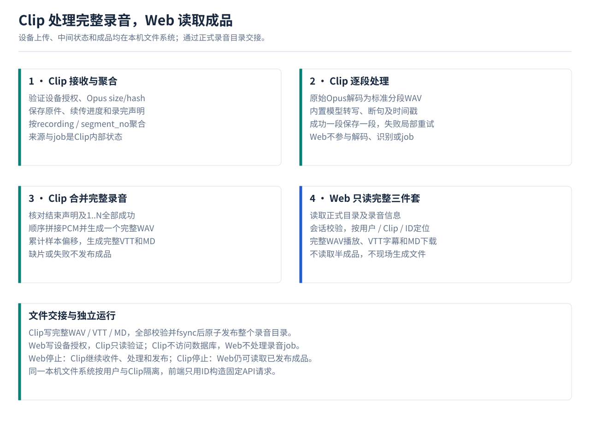
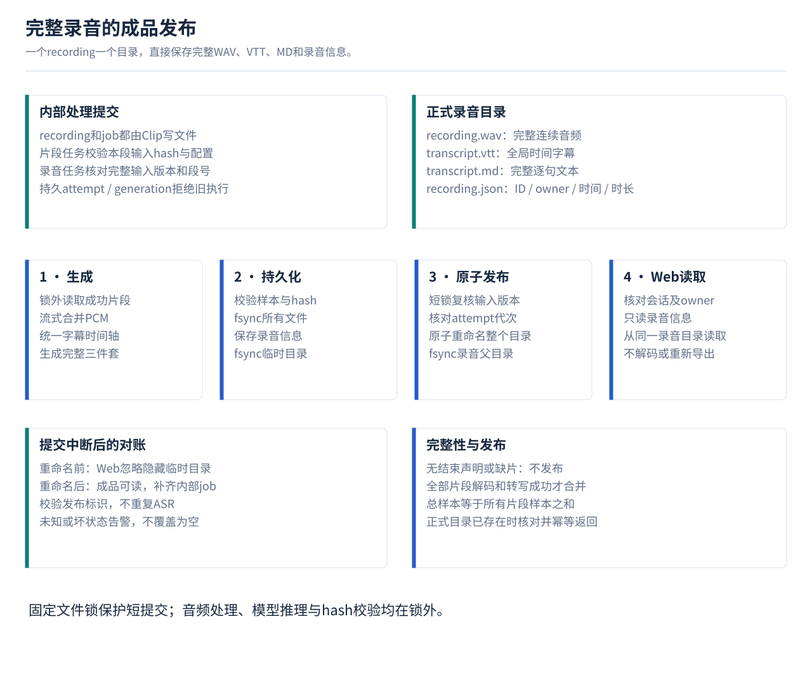

# ReSpeaker Clip · Server / Web 架构与模块设计

v12 · 2026-11-02 · 目标设计，尚未实现服务代码。

<a id="overview"></a>

## 1. 整体架构图


系统有两个应用进程。Clip Server负责设备接入，以及原始Opus从收件、解码、转写到整条录音成品的全部处理；Web Server负责用户和设备管理，只读取、播放和下载已经发布的完整录音。

统一使用本机文件存储，授权、原件、录音状态、job、中间WAV和最终文件按目录区分。每条recording最终生成一个完整WAV、一个完整VTT和一个完整Markdown文件，不做双写或副本复制。SQLite仅有accounts和devices两张表，仅Web访问；Clip完全不连接数据库。Nginx、整体部署和整机备份由OP负责。

<a id="services"></a>

## 2. 两个服务

### 2.1 Clip Server

监听DTLS/UDP 9528，读取Web发布的设备授权文件，验证身份后接收原始Opus。进程内一个后台循环管理recording/job文件，完成逐段解码和模型推理，再按recording合并完整WAV、VTT和MD，最后发布完整recording目录。Clip不负责Google登录、用户设备数据库或网页请求。

Web停止时，Clip仍可凭已有有效授权收件、处理和发布成品。解码子进程仅在执行期间存在，模型在Clip内常驻，不另设ASR服务或常驻job进程。

### 2.2 Web Server

监听`127.0.0.1:9529`，由OP的Nginx提供HTTPS入口。Web管理accounts/devices、登录会话和设备授权文件；从正式成品目录的录音信息读取本人录音，提供完整WAV播放、VTT字幕和WAV/VTT/MD下载。

Web不接触上传半成品，不领取音频job，不执行解码、转写、拼接或格式生成。Clip停止时，Web仍可读取已经发布的成品。

### 2.3 两服务交互

```text
浏览器 → Nginx（HTTPS 443）→ Web Server → accounts / devices
Web Server → 本机授权文件 → Clip Server验证设备
设备 → Clip Server → Opus → 分段WAV → 分段转写
Clip Server → 按recording合并 → 完整WAV + 完整VTT + 完整MD → 发布录音目录
Web API → 仅返回Clip与录音ID → 前端拼固定URL → Web按用户作用域读取成品
```

两个服务通过本机文件交接授权和成品，不相互调用ASR接口。raw、录音状态、job和中间结果是Clip内部处理数据；Web只读取正式recording目录的录音信息及完整成品。两个角色各自单实例，不共享进程内连接或缓存。

<a id="architecture-guide"></a>

## 3. 模块划分


### 3.1 Clip Server 模块

| 模块 | 核心职责 |
| --- | --- |
| 启动与生命周期 | 设备监听、处理循环、模型和角色锁统一管理 |
| DTLS与协议 | 设备连接、帧解析及消息状态机 |
| 身份与凭证验证 | 读取本地授权，验证设备、归属及授权代次 |
| 原件收件与续传 | 校验Opus、记录上传进度、预留容量 |
| recording聚合与结束判定 | 按会话聚合片段，确认最终段号和完整性 |
| 录音/job文件仓储 | 录音、中间结果、执行预算和提交标识 |
| 调度与重试 | 一个后台循环执行解码、ASR、合并及发布 |
| Opus解码 | 每个原始片段生成标准PCM WAV |
| 内置转写与断句 | 中文为主夹少量英语，每句一行及匿名说话人 |
| 整条录音合并 | 拼接PCM、统一字幕时间、生成完整VTT/MD |
| 成品发布 | 一次发布完整WAV/VTT/MD及录音信息 |
| 设备报告与健康 | 遥测、队列和收件/处理状态 |

### 3.2 Web Server 模块

| 模块 | 核心职责 |
| --- | --- |
| 启动与生命周期 | HTTP、数据库、会话和成品读取资源管理 |
| 登录与用户 | Google OIDC、会话、CSRF和本人资料 |
| 设备管理与授权发布 | 激活、BLE配置确认、解绑与本地授权文件发布 |
| 成品目录与查询 | 读取正式目录的录音信息，按owner列出完整录音 |
| 播放与下载 | 鉴权后读取已经生成的WAV、VTT和MD |
| 用户与设备数据库 | 仅accounts/devices，显式初始化与迁移 |
| Web页面 | 设备配置、完整录音播放器、字幕及下载 |

### 3.3 公共契约与边界

公共契约定义授权文件、来源、job和录音信息的格式、版本与错误；基础能力提供配置、受控路径、文件锁和原子写入。公共模块不持有数据库连接、网络监听或模型资源。

Clip独占音频处理和成品写入；Web独占数据库和授权变更。请求入口不能绕过仓储直接修改业务状态。两个进程不导入对方的运行资源，跨进程只交换版本化文件。前端仅从ID拼接固定API路由，不接收磁盘路径或设备凭证文件。

<a id="clip-modules"></a>

## 4. Clip Server 模块说明

### 4.1 启动与生命周期模块

配置、授权、既有录音/job和模型清单 → DTLS监听、处理循环及健康状态。

校验路径/格式/证书 → 取得clip.instance.lock → 确认旧执行已停止 → 对账进度、来源、录音、job与成品发布 → 开放DTLS并启动处理循环 → 异步加载离线模型。DTLS和处理状态分别报告；模型未就绪时可收件和解码，暂停ASR及成品发布。

SIGTERM先停止新连接和job领取，保存已确认进度、取消排队任务，再等待正在执行的解码/推理/合并。释放角色锁前必须确认旧执行不能再提交；默认停机窗口45秒，OP托管器超时终止整个进程组。Clip崩溃后按持久job预算恢复，不重跑已提交识别结果。

### 4.2 DTLS与协议模块


网络帧与证书配置 → 认证、上传、续传和会话完成消息。

验证长度、版本和状态机；身份验证和最终提交交给对应模块。协议层不生成任意文件路径，不接触数据库，不把连接对象传入音频规则。DTLS事件循环不等待模型推理。

<a id="clip-verification"></a>

### 4.3 身份与凭证验证模块

连接凭证、上报身份和授权版本 → 已验证设备上下文，失败即拒绝。

Web依据devices发布`SPEAKER_STATE_ROOT/device-authorizations/<device_id>.json`；Clip只读该文件和私有凭证材料，不查数据库或来源表。文件包含schema_version、device_id/device_uid、owner、binding_id、epoch、credential_version、state和verification_material_ref。只有active且全部身份、代次和凭证匹配才接收；缺失、损坏、撤销或不匹配均拒绝。

验证后采用设备的session、segment、时间和完整性声明，仍核对格式、限额和实际size/hash。设备时间标为device_unverified，不能据此保证时钟准确。Web内同一配置mutex覆盖设备操作及启动对账的完整文件/SQL流程：

1. 激活、换绑或轮换：持短state锁发布deny并fsync → 释放锁后提交devices事务 → 原子发布匹配新行的active。active落盘后才返回可用配置。
2. 解绑或禁用账号：先持久化对应设备deny，再更新数据库；失败仍保持deny。
3. Clip在握手、续传和原件最终接受时复核授权，最终复核与ready发布同一临界区完成，旧连接不能绕过撤销。
4. Web启动对账：deny、缺失或版本不一致保持拒绝，配置未明确完成时不自动恢复active；接口显示配置待修复。

投影写入遵循第6.2节原子写规则，禁止持state锁等待SQL。校验材料0600，不进入API或日志；已经接受的录音保持原owner。

### 4.4 原件收件、续传与容量模块

已验证设备、片段声明及字节流 → progress、不可变raw和ready来源文件。

先持久化容量预留，再确认接收字节。用户/Clip隔离根内的`incoming/<recording_id>/<upload_id>/progress.json`保存身份、source_key、已确认偏移和预留；续传重新验证当前授权。同一source和hash幂等，不同内容报冲突。结束时核对实际size/hash，在同一短锁临界区复核授权，发布并fsync raw、ready后才确认成功；孤立raw不能代表收件完成。

ready schema_version=1，包含source_id、device_id/device_uid、owner、binding_id、binding_epoch、credential_version、session、segment、profile、size/hash、recording_id、录音时间及time_source、服务端received_at/verified_at。source_key由已验证绑定身份、代次、会话和段号无歧义生成；路径只由服务端生成。owner在来源和recording中冻结，后续设备换绑不改写旧录音。

每片raw≤8MiB，固定16kHz、mono、20ms profile，单片≤300秒；完整recording≤12小时。每个owner默认音频额度10GiB（SPEAKER_USER_QUOTA_BYTES）；Clip跨该owner下所有Clip的ready/progress按source_key去重汇总，不能按单台Clip分别发放额度。无需额度表或Web回调。

容量预留覆盖最终合并：每份片段预留`raw实际声明字节 + 2 × (9,600,000 + 4,096)`，分别容纳分段WAV及其在完整WAV中的字节；末段保守按300秒计算。原件和成品不是冗余副本，而是不同处理阶段的文件。JSON/VTT/MD另有体积上限；合并前再次检查真实剩余空间，至少保留256MiB余量。空间不足时暂停相关工作，不把额度充足当作磁盘可写证明。

预留先落progress，完成时移交ready；两者同时存在按同source只计一次。重启扫描重建，换绑仍计原owner。未完上传确认中止且临时文件已清理后才释放其预留；已接受raw默认保留。首次成品已计入预留，不能按文件数量再次重复计费。维护重建新成品版本还须预留额外物理空间和用户额度，不覆盖已发布版本凑空间。

<a id="ingest"></a>

### 4.5 recording聚合与结束判定模块

已接受ready、不可变session-event → recording片段列表、最终段号和完整性状态。

聚合键为binding_id＋binding_epoch＋source_session，segment_no从1开始。同来源重放幂等，同段号不同内容报source_identity_conflict；不按文件名或mtime猜测owner、顺序及完成状态。Clip在启动和后台循环中对账来源，不由Web导入。

完整录音需要受认证的会话级结束声明（session_end），明确最终段号N。参考实现现有v3 OPEN只携带device/session/segment/size/digest/token，COMPLETE仅确认单份文件收到，不能当作整条录音结束。完整成品的协议前置条件是固件/接入支持同一已验证绑定和会话的session_end元数据；这是待实现的协议能力，不能宣称旧v3已支持。未提供该元数据的设备仍可收件和预处理，但recording保持未发布，不通过Web超时或最后一段长度猜测结束。

设备的结束声明写入用户/Clip隔离根内的`session-events/<recording_id>/<event_id>.json`，字段包括owner、绑定/代次、source_session、final_segment_no、claim_hash和verified_at；单事件≤64KiB。相同声明幂等，冲突保留首份并写有界冲突标记；最终段号须符合第4.6.1节段号范围。device-reports可覆盖，不能承载唯一录完证据。

若结束声明随raw上报，ready同时保留已验证声明。ready持久化后、独立事件发布前中断时，Clip直接重放内嵌声明到recording，不要求设备重传。解绑后的已接受证据仍有效，但不能接受新的撤销后上报。

只有明确结束声明指定N、1..N全部来源就绪且无冲突时，integrity为confirmed_complete。完整性按已收唯一段号的数量及范围判断，不按N预分配数组。有声明但缺片为gap，没有声明为unknown；静默超时不能当录完。缺片可等待补齐，但不得跳号、补静音或把部分结果发布成完整录音；结束后新上报的>N段号视为冲突，不偷偷扩展原recording。已经发布的成品保持只读，后续冲突只拒绝并告警，不回写或撤下原成品。

已收到的片段可提前解码和识别，结果只保存在Clip内部。整条录音的成品发布还要求1..N全部解码、转写成功，全部WAV和文字可验证。静音识别成功为有效结果；模型失败不能以空文本冒充成功。

<a id="data-model"></a>
<a id="audio-guide"></a>
<a id="tables"></a>

### 4.6 录音、片段与job文件仓储模块

已验证来源及阶段结果 → 原子JSON和不可变产物引用。

Clip为唯一写入方。录音是内部处理结果的提交点；job保存运行状态和预算。Web不读取recording/job/逐段转写，公开查询只读第4.11节的正式成品目录。

```text
<SPEAKER_BUSINESS_DB_PATH>                       # Web专用数据库文件
<SPEAKER_DEVICE_MATERIAL_ROOT>/                  # Web管理，Clip只读
<SPEAKER_STATE_ROOT>/
├── locks/                                      # 两个角色锁及固定state锁
├── device-authorizations/<device_id>.json       # 当前设备授权
├── device-reports/<device_id>.json              # 当前设备遥测
├── status/                                     # 各自进程健康状态
└── users/<owner>/clips/<device_id>/             # Clip内部状态隔离根
    ├── incoming/<recording_id>/<upload_id>/progress.json
    ├── sources/ready/<recording_id>/<source_id>.json
    ├── session-events/<recording_id>/<event_id>.json
    ├── recordings/<recording_id>/
    │   ├── recording.json                      # 内部处理状态
    │   └── transcripts/<segment_no>.json
    └── jobs/<recording_id>/<job_id>.json

<SPEAKER_USER_DATA_ROOT>/                        # 可配置的用户录音数据根
└── <owner>/clips/<device_id>/                   # Clip录音文件隔离根
    ├── incoming/<recording_id>/<upload_id>/audio.part
    ├── raw/<recording_id>/<segment_no>.opus
    ├── segments/<recording_id>/<segment_no>.wav
    └── recordings/<recording_id>/              # Web只读此正式成品目录
        ├── recording.wav
        ├── transcript.vtt
        ├── transcript.md
        └── recording.json                      # 必要录音信息
```

目录都是本机文件存储；每个用户、每台Clip分别有自己的录音与内部状态根。用于原子重命名的临时目录和目标目录必须位于同一文件系统。设备授权、遥测和角色锁是控制数据，不混入录音目录；Web显示设备遥测时仍核验报告归属与当前授权上下文。

#### 4.6.1 ID与路径推导规则

`owner`是accounts.user_id，来自已验证设备授权或Web登录会话；`device_id`就是devices.id，作为本文的Clip ID，不使用设备名称、邮箱或硬件UID拼路径。`recording_id`由Clip按本节规则从已验证会话身份稳定计算，整条处理链保持不变；`segment_no`是从1开始的规范十进制段号。上传恢复和重传复用原recording_id，不新建目录。

生产recording_id为以下有序数组的规范JSON（UTF-8、无额外空白、epoch为整数）的SHA-256小写十六进制：`[owner, device_id, binding_id, epoch, source_session]`。同会话重传/重启得到同一个ID，不需要路径映射表；换用户、Clip或绑定代次得到不同ID。文档中的`rec-example`和`rec-demo-20261102-001`仅是便于阅读的示意ID。

三个ID只使用小写字母、数字、下划线和连字符，限定为`[a-z0-9][a-z0-9_-]{0,127}`；段号范围1..999999999，与现有v3协议一致。部署迁移先核验历史ID，不允许把不兼容ID静默截断、转小写或清洗成另一个ID。输入按框架解码后的值校验，拒绝斜杠、反斜杠、点、百分号、空白及二次解码；客户端不能提交目录、文件名或完整磁盘路径。

绝对根目录由部署配置提供，后端只固定根目录以下的ID层级；`/var/lib/speaker/audio/users`不是代码常量，也不要求目录一定叫audio或users。后台使用以下规则，不维护“ID→文件地址”映射表：

```text
A = SPEAKER_USER_DATA_ROOT/<owner>/clips/<device_id>
S = SPEAKER_STATE_ROOT/users/<owner>/clips/<device_id>

上传中的字节： A/incoming/<recording_id>/<upload_id>/audio.part
上传确认的原件：A/raw/<recording_id>/<segment_no>.opus
分段解码结果： A/segments/<recording_id>/<segment_no>.wav
最终成品目录： A/recordings/<recording_id>/
内部录音状态： S/recordings/<recording_id>/recording.json
任务状态：     S/jobs/<recording_id>/<job_id>.json
```

例如将`SPEAKER_USER_DATA_ROOT`改为`/data/recordings`后，成品位置自动成为`/data/recordings/<owner>/clips/<device_id>/recordings/<recording_id>/`，不再额外拼接audio/users。前端ID和请求URL保持不变。

`A`和`S`仅表示本节规则的前缀，不是额外目录或配置。Clip接收原件时先将验证上下文的owner/device_id/recording_id固定到progress及ready，所有后续任务沿用它们推导路径，不根据设备后来的绑定重算用户归属。内部任务以所在owner/device_id目录为上下文，来源和录音中的身份必须与目录一致方可处理。后台打开文件时还须验证受控根、普通文件及非符号链接，不能只做字符串拼接。

同一用户不同Clip由device_id目录隔开；不同用户即使使用过同一Clip，文件也分别位于各自owner目录。设备换绑不搬迁旧录音，新用户不能凭旧recording_id访问原用户目录；原用户仍能读取自己已发布的历史录音。

#### 4.6.2 内部recording.json

```jsonc
{
  "schema_version": 5,
  "recording_id": "rec-example",
  "owner": "demo-user",
  "device_id": "demo-device",
  "binding_id": "demo-binding",
  "binding_epoch": 1,
  "source_session": "20261102100000",
  "integrity": "gap",
  "final_segment_no": 2,
  "content_revision": 3,
  "state": "waiting_segments",
  // Clip内部引用，不返回给Web或浏览器。
  "segments": [
    {
      "segment_no": 1,
      "source_id": "source-1",
      "raw_sha256": "example-raw-hash", "sample_count": 4800000,
      "wav_sha256": "example-wav-hash",
      "decode_job_id": "decode-1-g1", "asr_job_id": "asr-1-g1",
      "last_decode_commit": {"job_id":"decode-1-g1","attempt_id":"attempt-d1"},
      "last_asr_commit": null
    }
  ],
  "published_at": null,
  "last_publish_commit": null
}
```

示例已收到最终段号2，但目前只有第一段，故为gap/waiting_segments；第一段已经解码，ASR尚未执行，对应下节pending任务。第二段补齐前不能合并成品。示例hash/digest仅为占位，正式文件必须写真实SHA-256。state为receiving/processing/waiting_segments/failed/published；完整性和处理状态分别记录。所有身份字段及片段hash来自已验证来源。process_config冻结解码profile、模型清单digest、断句及导出格式版本，失败重试沿用。

#### 4.6.3 job文件

```jsonc
{
  "schema_version": 1,
  "job_id": "asr-1-g1",
  "recording_id": "rec-example",
  "segment_no": 1,
  "stage": "asr",
  "generation": 1,
  "input_revision": null,
  "config_digest": "example-process-config-hash",
  "input_hash": "example-wav-hash",
  "state": "pending",
  "attempt": 0,
  "attempt_id": null,
  "run_after": 0,
  "error_code": null
}
```

stage为decode/asr/assemble/export/publish/repair；录音级阶段segment_no=null。state为pending/running/retry_wait/ready/failed/not_configured，最后一种仅用于显式关闭ASR。job≤64KiB；不保存音频正文、设备凭证或姓名。job位于对应录音的jobs子目录，ID按阶段、段号和代次生成，例如decode-1-g1、asr-1-g1、assemble-g1；重复扫描不增建。分段任务input_revision=null，以输入hash和config_digest校验；录音级任务保存冻结的content_revision，二者不能混用。

<a id="publication"></a>

### 4.7 调度、重试与中断对账模块


ready来源、内部recording/job → 分段结果及可发布成品。

一个后台循环负责扫描、领取和提交；耗时解码、推理、PCM拼接和hash在锁外执行，DTLS保持独立响应。顺序为每段decode→asr；录音收齐后assemble和export；完整三件套校验通过后publish。不由Web请求触发处理。

领取在state排他锁内检查依赖、due时间、attempt<4，生成attempt_id，先增加次数并写running再释放锁。分段decode/asr/repair提交仅核对本段attempt_id、generation、输入hash和冻结配置，不因其他新片段改变录音content_revision而丢弃有效结果；录音级assemble/export/publish才额外核对完整content_revision和最终段号。旧执行不得覆盖新状态。每阶段最多4次，退避30秒、2分钟、10分钟；结构/hash冲突直接failed，暂时故障retry_wait。人工重试明确新代次和预算，轮询不重置次数。

模型未就绪、缺片、空间不足等领取前发现的依赖问题不消耗次数。领取后的失败保留已记attempt，不能因进程崩溃退还预算。显式关闭ASR时保存raw及分段WAV，识别等待配置；未生成完整文字时不向Web发布recording。

阶段提交先发布/fsync不可变产物，再写recording的引用和执行提交标识，最后标job ready并补齐下一阶段。结果已提交而job仍running时，重启校验提交标识后补标ready；没有提交结果则保留次数退避重试。不凭临时文件存在猜测成功。

正式recording目录的原子重命名是Web可见提交点。重命名前先在内部录音状态保存本次发布意图和冻结输入摘要；目录已出现而内部recording/job尚未标成功时，Clip核对该目录的录音信息、文件hash与内部发布意图，补齐状态，不重做识别或另存一套文件。残留临时目录不对Web可见；正式目录缺文件或内容不符则告警，不补猜为成功。

WAV缺失可由repair job使用冻结配置从raw重建并核对预期hash，保留已提交文字；原件缺失或重建不同则停止相关阶段并告警。JSON损坏/未知版本不覆盖为空；保留现场交由OP或人工排查。上传续传和job对账是应用内断点处理，不是整机备份。

<a id="storage"></a>
<a id="decode"></a>

### 4.8 Opus解码与本机文件模块

完整raw及冻结profile → 分段WAV、sample_count、size/hash。

raw格式为`[uint16 little-endian长度][Opus包]`，16kHz、mono、20ms，每包320样本，payload 1–2000字节；不是Ogg容器。逐包校验边界，使用独立decoder，不拼raw、不补帧或猜测缺失样本。其他profile拒绝。

每份raw生成一个16kHz单声道PCM16 WAV，标准段300秒、末段保留实际长度。边读边写，单段PCM最多9,600,000字节，实际时长由sample_count计算，不用段号乘五分钟。受控隔离解码器只见输入和临时输出，不见数据库、授权或其他状态，无网络；默认600秒超时，取消时终止并等待后代退出。

临时文件与最终路径位于同一文件系统，完成校验/fsync后原子发布，不写第二份原件或磁盘副本。Clip独占每个用户/Clip隔离根的原件、中间及成品写入；Web仅通过成品读取模块访问其中recordings正式目录。运行期间不删除正式成品或在途引用的文件；启动对账后只清理确认无引用的临时产物，raw/ready/结束声明默认保留。

<a id="transcript"></a>

### 4.9 内置转写与逐句断句模块

经过验证的分段WAV、冻结模型配置 → 不可变逐段文字和句子列表。

模型采用Paraformer-zh＋FSMN-VAD＋CT-Punc＋CAM++候选组合；manifest固定权重hash、运行库版本及参数。离线安装、禁自动下载和动态模型路径；不暴露ASR HTTP或Unix socket接口。调度模块通过进程内接口提交已验证WAV。

默认单推理槽、最多8个待处理输入、计算线程4；排队和执行共用600秒deadline。不能安全中断的在途推理占用原槽直至结束，超时结果丢弃，不另开无限替代任务。可捕获模型错误只暂停识别；原生库崩溃/OOM可能中断整个Clip，由托管器重启后对账。

逗号保留在句内，按句末标点断句，每行一句。每句有片段内start_ms/end_ms，满足0≤start<end≤片段实际时长，舍入最多1ms越界可夹取；其他非法时间、编码、NUL或超限整段失败。每句≤10000字符、每段原文≤8MiB、整条≤100000句。静音成功可返回空句列表，识别失败不能伪装静音。

A/B/C仅表示匿名说话人，不做姓名识别。首版沿用片段内聚类，合并成品中保留“片段1·A”等片段作用域，不能把不同片段的A直接当成同一人。未来若增加整条录音内说话人对齐，需要独立验证，不能由文本拼接推断身份。

此前短音频测试仅证明候选组合能运行；300秒输入、中英混合、多人切换和最终长录音仍须真实样本验收，不用模型名代替准确率或吞吐保证。

### 4.10 整条录音合并与格式生成模块


confirmed_complete、冻结的1..N段WAV及转写 → 完整三件套、时长和hash。

固定本次content_revision、最终段号、各段hash和配置版本；重新核对1..N齐全且decode/asr均成功。任一缺片、失败、坏文件或版本变化都不发布完整结果；已有成功分段结果保留，补齐后再合并。

WAV按segment_no顺序流式读取各段的PCM data，验证一致的采样率/位宽/声道，写入一个新的RIFF/WAV头及连续PCM数据。不能直接串接含文件头的WAV字节，也不拼接Opus包再解码。总sample_count等于各段之和；12小时PCM约1.38GB，低于标准RIFF数据上限，越界明确拒绝，不截断。合并不额外重采样、补静音或重复模型识别。

第i段起点为前面所有段sample_count之和。逐句全局时间以该起点换算，不用segment_no×300秒；VTT在最终序列化时统一舍入到毫秒，验证0≤start<end≤总时长，并按全局时间及稳定句序输出。静音片段保留真实时长，后续字幕不能前移。末段实际长度直接参与累加。

VTT固定UTF-8、无BOM、LF和HH:MM:SS.mmm，转义&、<、>，匿名voice标记包含安全片段作用域；cue编号全局连续。MD使用固定模板，按同一全局句序输出每句一行，可带时间与匿名标签，转义原文HTML/Markdown控制字符。静音录音仍有完整WAV、合法空VTT和明确“未检测到语音”的MD；不是转写失败。

VTT/MD单文件≤64MiB，成品录音信息≤1MiB；生成时检查体积和总句数，不静默截断。整条WAV超过HTTP文字导出限额仍正常支持流式播放/下载，不能套用64MiB上限。三个文件对应同一次冻结处理输入，不混用不同处理结果的音频和文字。

### 4.11 成品发布模块

已校验的三件套及录音信息 → `A/recordings/<recording_id>/`内的四个文件。

先在同一用户/Clip隔离根的recordings父目录下的隐藏临时目录`.tmp-<recording_id>-<attempt_id>/`生成完整WAV、VTT、MD和`recording.json`，校验hash、总样本、字幕时间和身份。临时目录也位于`A/recordings/`，不另开全局共享暂存目录。全部文件及临时目录fsync完成后，在短state锁内复核输入和执行代次，再将整个目录原子重命名为`A/recordings/<recording_id>/`并fsync父目录。Web忽略所有隐藏临时目录，只读取正式recording目录；目录出现时四个文件已经完整，不会读到半成品。

一个recording只有一个正式目录，不设置版本子目录或发布指针。正式目录发布后只读；重复执行先核对同一recording的身份、冻结输入和文件hash，一致时幂等完成，不一致则报冲突，不逐个覆盖成品文件。现有目录的全文件hash核对在锁外进行，短锁内只复核身份、输入摘要和执行代次；禁止持state锁重读整条音频。



#### 4.11.1 实际落盘地址示例

以下使用示意ID：用户`demo-user`、Clip `demo-device`、录音`rec-demo-20261102-001`。设备上传3段Opus，分别300秒、300秒和42秒，最终合并为10分42秒。以下实际地址以`SPEAKER_USER_DATA_ROOT=/var/lib/speaker/audio/users`、`SPEAKER_STATE_ROOT=/var/lib/speaker/state`为例，都是部署配置值。

第1段完成上传后的原始文件实际地址：

```text
/var/lib/speaker/audio/users/demo-user/clips/demo-device/raw/rec-demo-20261102-001/1.opus
```

最终成品实际目录及内容：

```text
/var/lib/speaker/audio/users/demo-user/clips/demo-device/recordings/rec-demo-20261102-001/
├── recording.wav
├── transcript.vtt
├── transcript.md
└── recording.json
```

第1段解码后的WAV和内部处理状态分别为：

```text
/var/lib/speaker/audio/users/demo-user/clips/demo-device/segments/rec-demo-20261102-001/1.wav
/var/lib/speaker/state/users/demo-user/clips/demo-device/recordings/rec-demo-20261102-001/recording.json
```

同一用户的另一台Clip `demo-device-2`使用`users/demo-user/clips/demo-device-2/`；同一Clip换绑给`other-user`后，新录音使用`users/other-user/clips/demo-device/`。旧目录保留在原用户下面，不随当前devices.owner改变。

上述地址是开发和运维依据ID定位文件的规则，不通过Web API返回或直接映射为静态资源。Web只知道登录用户及API返回的ID，即可在后台计算正式目录；不读取raw、segments、内部recording或job。

#### 4.11.2 recording.json示例

只保留录音标识、归属、开始时间和时长四个字段：

```jsonc
{
  "recording_id": "rec-demo-20261102-001",
  "owner": "demo-user",
  "recorded_at": 1793584800000,
  "duration_ms": 642000
}
```

- `recording_id`：录音ID，与目录名一致。
- `owner`：归属用户ID，用于Web鉴权；由Clip接受原件时的身份确定。
- `recorded_at`：录音开始时间，UTC毫秒；来源缺少开始时间时使用首片服务端接收时间。
- `duration_ms`：完整录音时长，毫秒；示例为10分42秒，由合并后的实际样本数计算。

三个成品文件名固定，不在JSON中重复保存路径。完成状态由整个目录原子发布保证；片段数量、采样参数、文件hash、模型和job状态留在Clip内部处理记录中。此文件只给Web读取必要信息，与`S/recordings/<recording_id>/recording.json`内部处理状态不同。

下面的字幕和文字仅展示格式，未附真实WAV或声称已经完成ASR。

#### 4.11.3 完整VTT与MD示例

transcript.vtt：

```vtt
WEBVTT

1
00:00:00.800 --> 00:00:04.200
<v s001_A>我们先确认今天的录音流程。</v>

2
00:05:00.300 --> 00:05:03.500
<v s002_A>Next, we review the results.</v>

3
00:10:40.200 --> 00:10:41.500
<v s003_A>这次录音到这里结束。</v>
```

transcript.md：

```markdown
# 录音：rec-demo-20261102-001

时长：00:10:42

[00:00:00.800] 片段1·A：我们先确认今天的录音流程。
[00:05:00.300] 片段2·A：Next, we review the results.
[00:10:40.200] 片段3·A：这次录音到这里结束。
```

上例仅用三句话展示文件格式。第二段起点为05:00，第三段起点为10:00；VTT使用整条录音的时间，不在每段重新从零开始。`s001_A`、`s002_A`、`s003_A`分别对应片段1、2、3中的局部A，不能据此断言是同一个人。

来源owner来自已验证收件，不查询accounts。设备后来解绑不改变历史成品归属。接收完成后的内部处理不重新要求旧设备凭证仍active，但不能据此接收新的撤销后来源。正式成品目录不参与临时文件清理，本版不提供在线覆盖或多版本管理。



### 4.12 设备报告与健康模块

已验证报告和进程计量 → device-reports与status/clip.json。

设备遥测可覆盖，不承担唯一录完证据。健康区分dtls_ready、processing_ready、asr_ready、队列积压及发布错误，OP据此观察；不增加公网管理接口，不让Web通过健康状态领取job。

<a id="web-modules"></a>

## 5. Web Server 模块说明


### 5.1 启动与生命周期模块

Web配置、accounts/devices及已发布成品 → 用户设备API、成品播放和下载。

取得web.instance.lock，核验数据库版本并对账设备授权后开放本机HTTP。Clip或模型未在线不影响Web启动；没有成品时列表为空，不读取job来拼处理进度。Web无音频后台调度，不创建解码/ASR执行器。关闭时等待HTTP读取结束、关闭数据库和会话，再释放角色锁。

<a id="oauth"></a>
<a id="users-api"></a>

### 5.2 登录、会话与用户模块

OIDC回调、Cookie和本人资料请求 → 用户视图、会话及CSRF结果。

账号持久化到accounts，临时登录态和本站会话只在Web内存。每请求核验账号状态；设备和录音模块取得服务端确定的owner，不接受客户端替换。

accounts保存Google身份、邮箱、显示名、账号状态和会话代次，完整字段见[SQL](#sql)。

新用户ID使用uuid4().hex；符合第4.6.1节ID规则的历史user_id原样保留，不符合则返回migration_invalid_storage_id，由离线迁移明确处理，不能静默改写。相同 sub 复用用户；邮箱与其他 sub 冲突时返回 account_identity_conflict，保留原归属。

设备别名、配置确认和硬件UID分别保存在devices.display_name、confirmed_revision、device_uid；录音及job字段见[文件仓储](#tables)。

#### 5.2.1 用户接口
用户首次通过 Google 登录时由 Server 自动建立 accounts 记录，HTTP 接口使用 `/users/me` 表示当前会话用户。两项接口均返回 `Cache-Control: private, no-store`；会话失效返回 401，账号禁用返回 403 account_disabled。

GET `/users/me` 和 PATCH `/users/me` 的成功响应使用相同结构：

```jsonc
{
  "user_id": "demo-user",
  "email": "user@example.com",
  "display_name": "示例用户"
}
```

PATCH `/users/me` 请求：

```jsonc
{
  "display_name": "我的名字"
}
```

PATCH 请求须通过 Origin 和 CSRF 检查，且只能包含 display_name。缺少字段、类型错误、超过 100 字符或包含其他字段，均返回 422。Server 使用参数化 SQL 更新本人记录的 display_name、updated_at，并返回最新资料。user_id、email、google_sub、status、auth_version 和 owner 均不可由此接口修改。

`GET /auth/session` 返回登录状态和 CSRF，其中的 user 与 `/users/me` 都读取 accounts 当前记录。首次 Google 登录可初始化名称，后续登录保留本站名称。用户接口仅管理本人资料；管理员操作和账号删除不在本版范围内。

#### 5.2.2 登录与会话
Web 通过顶层导航发起 Google 登录。Google 授权后回调 Server，Server 校验本次 state 和 Google ID token，按 google_sub 找到或建立 accounts 用户，再创建本站 session、设置 Cookie，303 返回 `/`。后续请求使用本站 Cookie。

- GET `/auth/google/start`：302 跳 Google；scope 为 openid email profile，使用 Code / OIDC + S256 PKCE
- GET `/auth/google/callback`：Google 成功返回 code、state，取消时返回 error、state；校验后设置会话 Cookie 并 303 到 `/`；取消授权返回 `/?login_error=login_cancelled`
- GET `/auth/session`：200 返回下方用户与 CSRF 对象；失效返回 401 session_expired
- DELETE `/auth/session`：校验 Origin/CSRF，删除当前会话、清 Cookie，返回 204；已失效返回 401，Web 同样清理本地状态

- 登录临时状态：Web内存保存state、nonce和PKCE verifier，5分钟、一次消费；临时Cookie为Secure/HttpOnly/SameSite=Lax。ID token校验签名、issuer、audience、有效期及nonce，只使用已验证的sub和email；未验证邮箱不能建立账号
- 本站 session：Server 内存，闲置 24 小时、最长 7 天；Cookie 为 Secure/HttpOnly/SameSite=Strict、Path=/、host-only、Max-Age=604800
- 退出、到期、Server 重启：会话失效，重新 Google 登录；账号和业务数据继续保留

GET `/auth/session` 成功响应：

```jsonc
{
  "user": {
    "user_id": "demo-user",
    "email": "user@example.com",
    "display_name": "示例用户"
  },
  "csrf_token": "example-csrf-token"
}
```

会话内存保存token摘要、user_id、auth_version、CSRF及闲置/绝对到期时间；Cookie只持有随机token，请求时核对当前账号状态和auth_version。

账号禁用返回 403 account_disabled，身份映射冲突返回 409 account_identity_conflict；回调错误返回 400 login_invalid_or_expired，Google 不可用返回 503 login_unavailable。登录响应和会话接口设置 no-store，日志使用脱敏格式。

服务器配置 GOOGLE_CLIENT_ID、GOOGLE_CLIENT_SECRET_FILE、PUBLIC_WEB_ORIGIN，secret从私有文件读取。Google Console 回调登记为 `PUBLIC_WEB_ORIGIN/api/boa/v1/auth/google/callback`，与请求保持完全一致。协议使用 [Google OIDC](https://developers.google.com/identity/openid-connect/openid-connect)。

<a id="ble"></a>

### 5.3 设备管理与授权发布模块

已登录用户、设备UID及BLE读回确认 → 设备对象和受控上传配置。

设备操作按第4.3节配置mutex及deny-first顺序执行；激活完成才发布active，解绑保持deny。历史录音owner不随换绑改变。

POST `/devices/activate`：device_uid为1–255字符的硬件UID字符串，须匹配受控登记；200响应见下一节：

```jsonc
{
  "device_uid": "0011223344556677"
}
```

POST `/devices/{id}/binding/confirm`：提交BLE读回的device_uid、binding_id、revision及saved=true：

```jsonc
{
  "device_uid": "0011223344556677",
  "binding_id": "demo-binding",
  "revision": 1,
  "saved": true
}
```

binding_id必须与当前设备一致、revision为正整数且等于下发值、saved固定true；确认成功响应：

```jsonc
{
  "binding_id": "demo-binding",
  "revision": 1,
  "state": "provisioned"
}
```

PATCH `/devices/{id}`：display_name为1–100字符的字符串；200返回更新后的display_name和device_id：

```jsonc
{
  "display_name": "我的 Clip"
}
```

DELETE `/devices/{id}/binding` 无 body，成功响应：

```jsonc
{
  "state": "revoked",
  "device_cleanup_pending": true
}
```

#### 5.3.1 设备与上传配置

GET `/devices`返回`{items:[设备对象]}`。device_id、binding_id和device_uid来自同一devices行；列表不返回configuration或凭证。

```jsonc
{
  "device_id": "demo-device",
  "device_uid": "0011223344556677",
  "binding_id": "demo-binding",
  "epoch": 1,
  "display_name": "我的 Clip",
  "revision": 1,
  "firmware": null,
  "capabilities": null,
  "telemetry": {
    "online": {"value":null,"sampled_at":null,"source":null},
    "battery": {"value":null,"sampled_at":null,"source":null},
    "pending": {"value":null,"sampled_at":null,"source":null}
  }
}
```

telemetry.value分别为boolean、0–100整数、非负整数；无可信值时三个字段均为null，sampled_at为UTC毫秒，source为可信来源标识。固件/能力无可信值也返回null。

POST `/devices/activate`成功响应在同一设备对象中增加configuration，响应no-store；其内容为：

```jsonc
{
  "device_id": "demo-device",
  "device_uid": "0011223344556677",
  "owner_id": "demo-user",
  "binding_id": "demo-binding",
  "epoch": 1,
  "revision": 1,
  "endpoint": "upload.example.com:9528",
  "device_token": "example-device-token"
}
```

身份、代次及版本须与外层对象和登录用户一致；endpoint取SPEAKER_UPLOAD_ENDPOINT，token仅供受控BLE写入，不进入列表、URL、日志或持久前端缓存。

#### 5.3.2 BLE与请求规则
- 绑定：验证登记与 owner；本人重复激活复用绑定，未登记到当前用户的 device_uid 返回 409 enrollment_required
- 配置确认：Web 经 BLE 写入后读回 binding/epoch/revision，再提交 device_uid、binding_id、revision、saved
- 改名：更新本人设备行的 display_name；设备身份和上传凭证保持原值
- 移除：撤销上传凭证；device_cleanup_pending 沿用现有维护确认；已上传录音保留原 owner
- Wi-Fi：Clip 扫描 `{ssid,rssi,security}[]`，选择结果后经 BLE 写入密码，读取 saved/connected/error；密码在调用结束后清空
- 设备能力：以真实 capability 为准；已保存网络最多 5 个，基线为 2.4 GHz WPA2
- 请求管理：切换用户/数据时取消旧请求，退出清理音频和定时器；录音暂不可用时提示并重试读取
- 轮询：录音可见 5 秒、设备可见 15 秒；隐藏后 30 秒，恢复可见立即刷新

旧数据导入在离线维护窗口执行：先核验ID规则及owner/邮箱映射，缺项返回migration_owner_mapping_required；用户设备归并到accounts/devices，录音、任务及原件按对应owner/device_id目录落盘并校验。迁移不增加运行时旧表、旧路径或兼容接口，普通启动不自动迁移或创建空状态。

<a id="media-api"></a>

### 5.4 成品目录与ID查询模块

当前会话及筛选条件 → device_id和recording_id列表；不返回服务器磁盘路径、下载URL或路径映射字段。

先取会话用户`owner`，只扫描`SPEAKER_USER_DATA_ROOT/<owner>/clips/`内各Clip的recordings正式目录，忽略隐藏临时目录。读取成品recording.json，验证owner与会话一致、recording_id与目录一致、时间/时长合法，并检查三个固定成品文件存在。禁止先扫描所有用户再过滤。单条成品目录损坏时跳过该条并告警，不中断其他正常录音的列表；直接读取该录音按下节返回503。

GET `/recordings`成功响应示例：

```jsonc
{
  "items": [
    {
      "device_id": "demo-device",
      "recording_id": "rec-demo-20261102-001"
    }
  ],
  "next_cursor": null
}
```

from/to为UTC毫秒的录音开始时间范围，按左闭右开筛选；limit默认50、最大200。后台按recorded_at、device_id、recording_id稳定倒序分页，cursor只携带最后一条的排序键、限4KiB并验证格式；每次仍以当前会话owner限定目录，不从cursor取得用户身份。可选device_id只限制当前用户目录内的Clip，不检查其当前绑定用户。还有下一页时next_cursor为游标，否则为null。

录音发现/列表只返回定位ID及分页游标；登录、设备配置及显式读取recording.json仍按各自数据契约返回。前端不接收或保存磁盘路径。身份和路径规则不依赖录音索引表；缓存仅是当前owner作用域内可丢弃的内存视图。

前端得到这两个ID后，按下节固定路由拼出录音信息与媒体请求URL。Web在每次读取时独立校验会话和ID，并使用同一规则计算磁盘地址，不能信任浏览器计算的路径。

### 5.5 按ID读取录音信息、播放与下载模块

当前会话、device_id、recording_id和固定文件类型 → 该用户/Clip下的录音信息或预生成媒体文件流。

`owner`只取当前会话，不接受查询串、JSON或URL指定另一个用户。后台用第4.6.1节规则定位`A/recordings/<recording_id>/`，校验成品JSON的owner与会话一致。读取历史成品不以devices当前owner作为权限依据，设备换绑不能转移旧文件或阻断原用户自己的历史读取。

文件类型仅允许`recording.json`、`recording.wav`、`transcript.vtt`和`transcript.md`，不能接受任意filename/path参数。路由为：

```text
/api/boa/v1/recordings/<device_id>/<recording_id>/recording.json
/api/boa/v1/recordings/<device_id>/<recording_id>/recording.wav
/api/boa/v1/recordings/<device_id>/<recording_id>/transcript.vtt
/api/boa/v1/recordings/<device_id>/<recording_id>/transcript.md
```

示例：前端从上面的ID列表自行拼出完整WAV请求地址：

```text
/api/boa/v1/recordings/demo-device/rec-demo-20261102-001/recording.wav
```

Web收到该请求后，假设当前会话为demo-user，计算实际读取地址：

```text
/var/lib/speaker/audio/users/demo-user/clips/demo-device/recordings/rec-demo-20261102-001/recording.wav
```

录音列表查询API只返回ID；`recording.json`路由是读取成品目录中的四字段录音信息文件，用于展示时间和时长，不是额外的地址查询接口。WAV/VTT/MD路由直接返回对应成品字节。四个文件均支持GET/HEAD，每次核验会话及owner；可推导的ID和URL不代表匿名可访问。

路径归属不符或在当前用户作用域找不到录音时统一404 recording_not_found，不搜索其他用户目录。属于当前用户的目录内文件缺失/损坏返回503 result_unavailable并告警。非法ID或文件类型拒绝读取，不执行路径规范化来“修复”输入。Nginx不能把数据根静态暴露或绕过鉴权。

WAV支持bytes=start-end、start-和-suffix，裁剪end到文件长度；非法/越界416并返回`Content-Range: bytes */size`，多范围退回整文件200。HEAD忽略Range、空body；JSON/VTT/MD忽略Range，GET/HEAD从同一个已打开文件取得实际大小，不触发处理。

录音信息使用application/json，WAV使用audio/wav，VTT使用text/vtt，MD使用text/markdown；文本UTF-8，MD固定作为附件下载，VTT可供字幕加载。

文件受控打开，拒绝符号链接、非普通文件和根外访问；校验与读取使用同一文件句柄。Content-Length/Last-Modified使用该句柄stat，响应设private,no-store和nosniff，附件名由后台固定生成；每owner最多4个并发媒体请求，超额429及Retry-After: 1。Web不解码、转写、合并或生成MD。

前端自行按ID拼URL，播放完整WAV、加载完整VTT、读取recording.json展示基本信息并下载文件。路由是应用协议，物理根目录仅在后台配置，调整部署目录不影响前端请求。

<a id="sql"></a>
<a id="business-sql"></a>

### 5.6 用户与设备数据库模块

用户/设备用例的受控参数 → 账户/设备行和明确事务结果。

只接受参数化SQL；业务层不能保存录音/job到表。普通启动核验版本，不自动新建空库；初始化和迁移使用显式维护入口。

只有 Web Server 连接数据库。每个连接设置 foreign_keys=ON、synchronous=FULL、busy_timeout=5000；录音/job/收件文件不参加 SQLite 事务。设备身份、当前归属及配置放在同一个 devices 行中，不保留 users、bindings、device_uids、binding_profiles、sources 等旧表。

```sql
-- v5 新库参考，仅 accounts / devices；不是旧库迁移脚本。
PRAGMA foreign_keys=ON;
PRAGMA journal_mode=WAL;
PRAGMA synchronous=FULL;
PRAGMA busy_timeout=5000;
BEGIN IMMEDIATE;
CREATE TABLE accounts (
  user_id TEXT PRIMARY KEY NOT NULL,
  google_sub TEXT UNIQUE CHECK(google_sub IS NULL OR length(google_sub) BETWEEN 1 AND 255),
  email TEXT NOT NULL UNIQUE COLLATE NOCASE
    CHECK(email=trim(email) AND length(email) BETWEEN 3 AND 254 AND instr(email,'@')>1),
  display_name TEXT NOT NULL DEFAULT '' CHECK(length(display_name)<=100),
  status TEXT NOT NULL DEFAULT 'active' CHECK(status IN ('active','disabled')),
  auth_version INTEGER NOT NULL DEFAULT 1 CHECK(auth_version>0),
  last_login_at INTEGER, created_at INTEGER NOT NULL, updated_at INTEGER NOT NULL
);
CREATE TABLE devices (
  id TEXT PRIMARY KEY NOT NULL,
  device_uid TEXT NOT NULL UNIQUE CHECK(length(device_uid) BETWEEN 1 AND 255),
  owner TEXT REFERENCES accounts(user_id),
  binding_id TEXT UNIQUE,
  epoch INTEGER NOT NULL DEFAULT 0 CHECK(epoch>=0),
  display_name TEXT NOT NULL DEFAULT '' CHECK(length(display_name)<=100),
  state TEXT NOT NULL DEFAULT 'registered'
    CHECK(state IN ('registered','provisioning','provisioned','revoked')),
  revision INTEGER NOT NULL DEFAULT 0 CHECK(revision>=0),
  confirmed_revision INTEGER NOT NULL DEFAULT 0
    CHECK(confirmed_revision>=0 AND confirmed_revision<=revision),
  credential_version INTEGER NOT NULL DEFAULT 0 CHECK(credential_version>=0),
  verification_material_ref TEXT,
  device_cleanup_pending INTEGER NOT NULL DEFAULT 0 CHECK(device_cleanup_pending IN (0,1)),
  firmware_json TEXT CHECK(firmware_json IS NULL OR json_valid(firmware_json)),
  capabilities_json TEXT CHECK(capabilities_json IS NULL OR json_valid(capabilities_json)),
  telemetry_json TEXT CHECK(telemetry_json IS NULL OR json_valid(telemetry_json)),
  created_at INTEGER NOT NULL, updated_at INTEGER NOT NULL,
  CHECK(state NOT IN ('provisioning','provisioned') OR
    (owner IS NOT NULL AND binding_id IS NOT NULL AND epoch>0
      AND revision>0 AND credential_version>0 AND verification_material_ref IS NOT NULL))
);
CREATE INDEX devices_owner ON devices(owner,id);
-- 收件、来源、录音、片段、job、会话均不建表。
PRAGMA user_version=5;
COMMIT;
```

firmware/capabilities/telemetry 来自已验证的 Clip 上报，Web 可将最新值缓存到 devices 的 JSON 字段；缺少值保持 null，不单设遥测表。verification_material_ref 引用私有凭证校验材料，不保存可公开读取的明文设备 token。devices 行保存当前归属；历史录音的 owner 固定在收件与录音 JSON，不随设备重新绑定改写。

<a id="shared-modules"></a>

## 6. 公共契约与一致性

### 6.1 文件所有权

| 数据 | 唯一写入方 | 读取方 |
| --- | --- | --- |
| accounts/devices SQLite | Web | Web |
| 设备授权及凭证材料 | Web设备用例/受控部署 | Clip只读，Web对账 |
| progress、ready、session-events、raw | Clip | Clip内部处理 |
| recording/job、逐段转写、分段WAV | Clip | Clip内部处理 |
| 完整WAV/VTT/MD及成品recording.json | Clip | Web只读成品，Clip对账 |
| device-reports | Clip | Web设备遥测及OP |
| status/clip.json、status/web.json | 各自进程 | OP观察 |

raw→分段WAV→完整成品属于处理链；所有权按上表约束，Web无录音/job写权限。

### 6.2 文件锁与提交

每角色持固定instance.lock，短时元数据提交共用固定state.lock，并配合各进程mutex。锁inode不删除或替换；不能锁随后被rename的业务JSON。JSON用同目录临时文件→fsync→原子替换→fsync父目录；耗时音频I/O、模型、hash和数据库等待不占state锁。

统一锁顺序为角色锁→Web设备配置mutex（如涉及授权）→本进程state mutex→state flock。Web配置mutex覆盖deny-first文件/SQL流程；SQLite短事务与文件发布不冒充跨存储原子事务。Clip内部结果提交用attempt_id/generation/输入hash拒绝旧执行，最终将包含完整三件套和录音信息的目录原子发布。

### 6.3 数据契约与版本

授权、来源、内部recording和job维护schema_version，SQLite用user_version；未知必填版本拒绝处理。成品recording.json固定为上述四个业务字段，不另外保存格式版本或处理状态。所有时间统一UTC毫秒，音频内部偏移优先使用整数样本数。文件引用均为受控根下相对路径，不接收任意绝对路径、URL或模型位置。

<a id="web-api"></a>

### 6.4 API公共约定

路径前缀`/api/boa/v1`。除登录入口、回调和health，其余接口验证会话；写请求验证Origin和X-CSRF-Token，精确匹配PUBLIC_WEB_ORIGIN。owner由会话或已验证来源确定，不接收客户端指定。用户和设备接口见第5.2、5.3节；录音接口见第5.4、5.5节，无启动ASR/job/合并接口。

错误统一为`{code,message,request_id}`，message不含私钥、token或磁盘路径。GET/PATCH用户资料、设备激活/配置/解绑沿用上述契约；录音读取不会修改任何处理状态。

### 6.5 服务停止与故障边界

| 情况 | Clip行为 | Web行为 |
| --- | --- | --- |
| Web停止 | 继续有效授权收件、音频处理和成品发布 | 重启后扫描已发布成品 |
| Clip停止 | 停止收件和新处理，保存进度 | 继续读取已有完整WAV/VTT/MD |
| 模型未就绪/失败 | 保存原件，可解码；识别等待，不发布缺文字成品 | 已有成品照常提供 |
| recording缺片/无结束声明 | 保留逐段结果，等待确认 | 不出现在成品列表 |
| SQLite不可写 | 不查库，按已有授权处理 | 暂停用户/设备写入，依赖失败明确返回503 |
| 本机文件系统不可写 | 停止相关收件/处理/发布 | 可读成品继续提供，缺失返回503 |
| 来源/状态/成品损坏 | 保留现场并告警，不清空或猜owner | 损坏成品拒绝读取，其他录音继续可用 |

## 7. 单机运行与部署接口

<a id="deployment-guide"></a>

整体部署、Nginx、HTTPS证书、托管器及整机备份由OP负责；应用只提供两个入口、文件读写边界、配置及健康状态。

### 7.1 入口与目录

浏览器→Nginx HTTPS 443→Web `127.0.0.1:9529`；设备→Clip DTLS/UDP 9528。ASR由Clip内部调用，不设TCP/Unix socket服务。数据库、状态、原件、中间文件和完整成品都在本机目录中，具体目录见第4.6节。

目标入口为`python -m speaker.clipserver`和`python -m speaker.webserver`，当前仓库不含对应产品实现。每角色单实例，Web workers=1且禁用reload；Clip一个处理循环，有界执行线程和短时解码子进程。初始化/迁移为显式维护操作，普通启动不建空库或覆盖既有状态。两个入口的配置/健康检查不监听、不领取job。

PUBLIC_WEB_ORIGIN为对外HTTPS域名，Google回调使用该origin追加`/api/boa/v1/auth/google/callback`。Web只信任指定Nginx地址的转发头，默认127.0.0.1；代理清理伪造头，Web不从任意Host推导回调。Cookie仍为Secure/HttpOnly，Origin/CSRF不因本机HTTP而取消。DTLS仍由Clip验证证书，HTTPS私钥仅OP的Nginx使用。

### 7.2 权限

数据在静态资源目录之外，专用账号、目录0700、文件0600、umask0077。OP按角色限制目录：Clip可写收件、recording/job、中间及成品，只读授权/模型，不可见数据库及Google秘密；Web可写数据库和授权，成品读取模块只打开当前用户/Clip下recordings目录的四种固定文件，不访问原件、内部recording/job、模型或DTLS私钥。相同UID仍属同一主机信任域，文件契约和应用鉴权不能替代部署隔离。

不要求多磁盘、双写、备份任务或应用换盘流程。空间、进程托管和整机数据保护由OP统一安排，应用只报告故障并保持可对账的持久状态。

<a id="configuration-templates"></a>

### 7.3 应用配置

角色解析器按白名单加载，未知字段报错；Clip拒绝数据库和Google配置，Web拒绝解码/模型/job处理配置。以下只定义应用参数，不提供Nginx或托管器模板。

<a id="shared-env"></a>

#### 7.3.1 storage.env

```dotenv
SPEAKER_USER_DATA_ROOT=/var/lib/speaker/audio/users
SPEAKER_STATE_ROOT=/var/lib/speaker/state
SPEAKER_DEVICE_MATERIAL_ROOT=/var/lib/speaker/credentials/devices
SPEAKER_LOCK_TIMEOUT_SECONDS=2
```

两服务加载同一份storage.env，使用一致的用户数据根和状态根。上述绝对地址都是示例，可由OP改为其他本机目录；应用从配置读取，不硬编码部署路径。启动解析真实路径，校验绝对地址、权限和本机文件系统能力；用户数据根与状态根不得相等或互相包含，数据库及凭证目录不得落入用户数据根，数据均不得位于Web静态目录。Clip不加载数据库地址，由Web配置检查及OP部署校验确认数据库边界。变更配置不自动搬迁已有数据，目录迁移由OP在维护窗口安排。

<a id="web-env"></a>

#### 7.3.2 web.env

```dotenv
SPEAKER_BUSINESS_DB_PATH=/var/lib/speaker/db/business.sqlite3
SPEAKER_WEB_HOST=127.0.0.1
SPEAKER_WEB_PORT=9529
PUBLIC_WEB_ORIGIN=https://speaker.example.com
SPEAKER_TRUSTED_PROXY_IPS=127.0.0.1
SPEAKER_UPLOAD_ENDPOINT=upload.example.com:9528
GOOGLE_CLIENT_ID=replace-with-client-id
GOOGLE_CLIENT_SECRET_FILE=/etc/speaker/secrets/web/google-client-secret
```

<a id="clip-env"></a>

#### 7.3.3 clip.env

```dotenv
SPEAKER_CLIP_HOST=0.0.0.0
SPEAKER_CLIP_PORT=9528
SPEAKER_CLIP_TRANSPORT=dtls
SPEAKER_CLIP_CERT_FILE=/etc/speaker/tls/clip/server-chain.pem
SPEAKER_CLIP_KEY_FILE=/etc/speaker/tls/clip/server.key
SPEAKER_CLIP_MAX_ACTIVE_UPLOADS=32
SPEAKER_CLIP_UPLOAD_IDLE_SECONDS=60
SPEAKER_USER_QUOTA_BYTES=10737418240
SPEAKER_DECODER_TIMEOUT_SECONDS=600
SPEAKER_ASR_ENABLED=true
SPEAKER_ASR_MODEL_ROOT=/opt/speaker/models
SPEAKER_ASR_MODEL_MANIFEST=/opt/speaker/models/manifest.json
SPEAKER_ASR_THREADS=4
SPEAKER_ASR_MAX_CONCURRENT=1
SPEAKER_ASR_QUEUE_SIZE=8
SPEAKER_ASR_TIMEOUT_SECONDS=600
SPEAKER_RECORDING_MAX_SECONDS=43200
SPEAKER_ASSEMBLE_TIMEOUT_SECONDS=1800
```

SPEAKER_UPLOAD_ENDPOINT是设备可到达的公开DTLS主机及端口，由Web发布配置；SPEAKER_CLIP_HOST和SPEAKER_CLIP_PORT是Clip本机监听地址，两者不能混为同一参数。OP使用NAT或端口映射时可不同；公开地址不能为0.0.0.0，禁止请求方临时覆盖。Web监听地址仅允许本机回环，PUBLIC_WEB_ORIGIN必须为实际对外HTTPS origin，不含路径；Google回调由它追加固定API路径。

首版SPEAKER_ASR_MAX_CONCURRENT只允许1；SPEAKER_RECORDING_MAX_SECONDS范围1..43200，默认12小时。其余线程、队列、超时和额度参数须为正整数，SPEAKER_ASR_ENABLED为布尔值，端口范围1..65535。协议/profile及固定文件名不是可覆盖配置。

合并默认1800秒超时，按本机真实长录音压测调整；线程/CPU/内存限制基于300秒片段及12小时合并测试。配置超时不代表已经验证能在该时间完成。模型未就绪不丢原件，完整三件套就绪前不发布到Web。

### 7.4 健康与日志

Web提供`/api/boa/v1/health`，只报告自身及成品目录读取状态；不以Clip在线作为已有成品读取的前提。Clip写status/clip.json，分别报告dtls_ready/processing_ready/asr_ready、积压和发布错误；Web写status/web.json。默认每15秒更新，60秒未更新告警，不含正文/秘密，不授予job权限。

日志只含role/build/request/job/recording等定位ID、阶段、耗时和错误码。监控、保留期、证书轮换、备份和整体恢复交给OP；应用不实现对应任务。

<a id="security-guide"></a>
<a id="security"></a>

## 8. 安全与完整性

| 边界 | 必须满足的规则 | 详细设计 |
| --- | --- | --- |
| 设备接入 | 验证凭证、owner、绑定代次；握手、续传和最终接受时复核撤销 | [身份验证](#clip-verification) |
| 用户与Clip隔离 | owner只取当前会话；按ID进入本人目录，每次GET/HEAD/Range重新鉴权 | [路径规则](#data-model)、[成品API](#media-api) |
| 文件与提交 | 受控根、ID白名单、普通文件/O_NOFOLLOW；四个文件校验并fsync后原子发布目录 | [存储](#storage)、[提交](#publication) |
| 不可信音频 | 解码器隔离、禁网，限制CPU/内存/输出；取消后等待后代退出 | [解码](#decode) |
| 模型与文本 | 离线权重、禁动态代码和音频出站；校验时间/长度，页面用textContent，VTT/MD由Clip转义 | [转写](#transcript) |
| 秘密与日志 | Google秘密仅Web、DTLS私钥及模型仅Clip、HTTPS私钥由OP管理；日志排除凭证及录音正文 | [运行边界](#deployment-guide) |

原生模型库与Clip共用故障域，OOM/崩溃会中断收件和处理；按持久状态续传/对账，Web仍可读取已有成品。缺片、坏文件和超限必须报错，不静默补齐、截断或覆盖为空。


OP负责部署、资源、监控和整机备份。下一章的本机恢复包仅用于设备固件初始化。

<a id="web-serial-candidate"></a>

## 9. 附录：Web Serial固件初始化候选设计

本附录独立于录音服务，仍待硬件和浏览器验收，不代表已实现或允许自动擦写。

### 9.1 范围与组件

用户打开HTTPS网页，通过USB初始化受支持的旧版Clip，无需安装本地工具。网页负责串口交互，Worker运行固定版本的LittleFS WASM、迁移及hash校验；准备包、恢复包和任务记录仅保存在用户电脑，后端不接收原始配置、密钥或迁移镜像。配网、绑定、录音上传另行验收。

首版仅接纳实机验证过的Chrome/macOS、固件布局、签名链和overwrite-only USB Recovery组合。未知设备、Bootloader/网络核升级及SD数据不在范围；Recovery损坏可能需要SWD，网页不承诺修复。

页面不加载第三方脚本或分析采集，CSP和Serial权限限本站及必要WASM；制品签名由可信前端固定的信任锚验证，不能信任下载包自带的公钥。进行中的任务不切换前端/Worker版本。

### 9.2 准备、备份与写入

1. **准备包**：取得USB及本机任务目录授权，下载并验证维护、目标、已知原布局回退镜像、patch及清单，保存任务ID、兼容条件和恢复材料，读回确认。此步骤早于维护应用上传，保证只覆盖应用时也有回退镜像。
2. **维护模式**：停止录音、BLE/Wi-Fi和LittleFS挂载，读取UID/几何。原始区域为`[0x130000, 0x800000)`，共7,143,424字节；Bootloader、网络核和SD不改动。
3. **双读与迁移**：全区独立读两次，每块核对长度/CRC，两份字节和hash一致；只读挂载旧数据，目标布局/容量取自签名清单；WASM与既有工具须按相同输入验证语义一致，迁移后核对文件、目录、用户属性及重新挂载结果。失败不格式化、不擦外置Flash。
4. **最终恢复包**：一次性保存`clip-recovery-<任务ID>.cliprestore`，含格式/兼容版本、UID/几何、原始字节O、目标字节T及摘要、制品与签名清单、双读/迁移证据；关闭文件并读回核验，包不再覆盖。再次确认设备原始数据仍等于O后才允许ARM/擦除。
5. **外置写入**：按擦除块写T并完整回读。T确认完整后才装目标应用；恢复O确认完整后才装旧应用。维护应用在外置改写期间始终留在主槽，复位不能自动回退旧正常应用。

准备包不能替代维护模式下的原始备份。浏览器缓存、IndexedDB和OPFS只辅助恢复，不是唯一副本；保存恢复包也不等于原生fsync或抵御整机磁盘损坏。默认不额外设密码，恢复包含敏感数据，提示本机妥善保存；网页不能保证目录非云同步或强制POSIX权限。

### 9.3 身份、状态与恢复

Web Serial不提供可依赖的原生USB序列号，不能用VID/PID代替UID。Bootloader身份查询未验证前，只允许连接一台设备并由用户确认，进入维护模式后必须核对UID和几何；不匹配停止。若要求应用上传前也自动确认UID，该能力须先经硬件验收。

串口独占与Web Locks限制同机并发。每次副作用前，先持久化IndexedDB意图并在用户任务目录追加不可变状态快照，关闭后读回；持久化失败就不再发擦写命令，已发命令结果按不确定处理。任务日志不能代替Flash回读，也不能证明某次写入从未开始。

重新打开时导入同一恢复包，核验签名、UID/几何及当前模式；若目标应用仍正常，先只读检查，不先刷成维护模式。需要读取外置区域时再进入维护模式，以当前整区C判定：

| 当前数据 | 处理 |
| --- | --- |
| C=O | 尚未改写或已恢复，可复用同一包迁移或安装回退应用 |
| C=T | 外置已完成，继续安装并验证同一目标应用 |
| C既非O也非T | 可能是中断，也可能是正常使用后的变化；不自动续写或回退。用户明确选择历史回退后，逐块恢复O并回读，再安装旧应用 |
| UID/几何不符或恢复包无效 | 禁止擦写，保留现场 |

恢复中断仍使用同一O重复块校验、擦除和重写，不能从现场创建新的“原始备份”。维护模式下无有效恢复材料时禁止猜测性迁移；只有当前连续会话确认从未写外置数据，或现场与既有双读原始摘要一致时，才允许重新只读备份。可挂载、缺少写入日志均不足以证明未改写。

完成后另存含O/T摘要、制品、整区回读及启动结果的收据，不修改恢复包。无收据时不能自动区分正常使用与中断；历史回退会覆盖后续外置配置，必须明示。原始恢复材料丢失且已擦写时，不承诺无损恢复。

### 9.4 失败与完成边界

| 失败 | 处理 |
| --- | --- |
| 准备包、双读、迁移计算或恢复包保存失败 | 不擦外置区域；解决原因后重试 |
| 应用上传中断或维护串口失效 | 回USB Recovery，重装同一已验证镜像，再核对UID和外置数据 |
| 外置擦写/恢复中断 | 保持维护应用，重连完整读取；按上表判定并复用同一恢复包 |
| 目标应用不启动 | 回维护模式确认UID，恢复并验证O，再装回退应用 |
| 浏览器数据清理或换电脑 | 打开兼容恢复页面、导入本机包、重新授权；没有有效材料则停止 |

已打开页面可在服务器离线或业务会话过期后继续操作。离线重开依赖已验收的Service Worker缓存；缓存被清理时需联网打开兼容页面，再导入本机包，不能承诺仍可离线启动。恢复入口不要求业务登录。

完成需要外置数据=T、目标镜像验证通过且设备实际启动，Wi-Fi/录音/上传/BLE再独立验证。成功刷写不等于业务验收，已完成任务默认只读复核，不因后来配置变化而自动回退。

依据：[Chrome Web Serial](https://developer.chrome.com/docs/capabilities/serial)、[MDN Web Serial](https://developer.mozilla.org/en-US/docs/Web/API/Web_Serial_API)、[MDN文件保存](https://developer.mozilla.org/en-US/docs/Web/API/Window/showSaveFilePicker)、[浏览器存储配额](https://developer.mozilla.org/en-US/docs/Web/API/Storage_API/Storage_quotas_and_eviction_criteria)。
