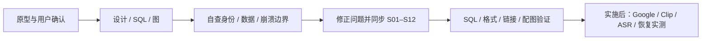

# 完整设计 · 自我评审

2026-10-29 · 范围：设计、参考 SQL、图与实施计划；没有实现或部署产品。[图解](boa-v1-illustrated-guide.md) · [总设计](superpowers/specs/2026-10-29-boa-server-web-v1-design.md)

| 自查发现 | 已写入的修正 | 归属任务 |
|---|---|---|
| 旧设计仍有持久会话表 | 删除 browser_sessions；用户持久，登录事务/会话在有界内存 | S01–S02 |
| Google 回调遇到 Strict 临时 Cookie 会丢绑定 | 临时 Cookie Lax；本站会话 Strict；同源固定 HTTPS 回调 | S02 |
| 只比较 state 或邮箱不足以确认身份 | 浏览器绑定、一次消费、PKCE、nonce、token 校验；仅 sub 映射 | S02 |
| 内存重启失效可能被误认为设备掉线 | 网页重登；DTLS 凭证、录音与持久任务独立 | S02/S12 |
| “文字存在 VTT”不等于结构化原文落库 | transcript_cues 保存原文/整数毫秒/speaker/版本，JSON v1 同名 | S08/S10 |
| VTT 文件先发布，崩溃后 cues 可能没提交 | 只凭 hash 不补 ready；重跑 ASR 再原子提交 cues/文件指针 | S06/S08 |
| 静音可能被当成识别失败 | 允许 0 cues，区分 ready 空结果、failed、not_configured | S08–S10 |
| 多请求分页可能混用音频版本 | 强制 revision 与游标绑定；复制取齐后才写剪贴板 | S07/S10 |
| “扫描 Wi-Fi”可能错误落到电脑端 | 只认目标 Clip BLE 扫描结果；无能力不伪造、不手填 SSID | S04/S11 |

验证证据与剩余验收

文档级验证结果见本次提交：业务库 10 表（accounts 9 字段），registry 仅增 source_outbox；SQL 外键/约束/事务、JSON 与 VTT 示例语义、相对链接/锚点、12 组图源与 SVG、S01–S12 共 60 步保持一致。自查为作者评审，不代表独立安全审计或代码测试通过。

| 验收项 | 当前证据 | 实施后必须取得 |
|---|---|---|
| Google 登录 | 官方协议核对 + 契约 | 真实客户端配置、跳转、取消/重放/退出/重启；无 token 日志 |
| SQLite / 文件一致性 | 参考 SQL 与事务设计 | 每个发布边界故障注入，重启后只展示一致数据 |
| Clip 添加与 Wi-Fi | 产品路径明确 | 可信设备登记、真实 BLE 扫描/写入/连接结果 |
| ASR 原文与 VTT | 合成 JSON/VTT 示例 | 授权真实音频识别质量、说话人/时间戳、中文解析 |
| 设备与录音隔离 | owner/复合 FK 设计 | 跨用户 API、Range、下载、禁用与旧 Bearer 回归 |
| 容量与备份 | 单进程、有界内存、停机备份设计 | 实测长录音、容量、隔离恢复与迁移回退 |

设计结论：保持一个服务、10 张业务表、两类持久任务、两个页面。当前可作为开发输入；真实 Google 配置、可信设备发放、固件扫描与 ASR 端点是明确的联调前提，尚未验收。

