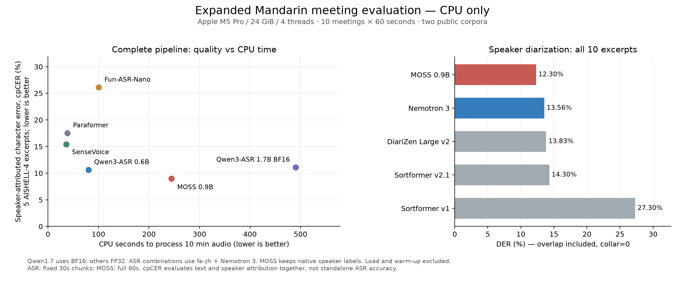

# 中文会议 CPU 模型测试与选型

更新日期：2026-11-06。测试硬件：Apple M5 Pro、24 GiB 内存、CPU 4 线程。

**本次三套 CPU 流程对比：默认选 Qwen 0.6B 组合，质量优先选 MOSS 0.9B；FireRed 当前官方 CPU 路径不优先。**

本轮使用 **11 场真实中文会议的 13 分钟片段**，累计实测 7 套转写流程、5 种分区模型。下表主比较使用 10 场各 1 分钟；另有一场连续 3 分钟补测。结果支持本轮中文 CPU 选型，尚不是 Clip 实机、英文 Roger 录音或长会议验收。

## 阅读入口

- [2026-11-08 服务器 CPU 实测](server-cpu-2026-11-08.md)，含 7 套转写流程、5 种分区方案和同批本机对照。

- [测试数值释义与计算示例](metrics.md)：每列的含义、单位、公式、分母及 CSV / JSON 字段。

- [FireRed 追加测试和 CPU 占用](#firered-追加测试和-cpu-占用)：三套流程同批复测。
- [完整流程质量与速度](#完整流程质量与速度)：先决定用什么组合。
- [说话人分区效果](#说话人分区效果)：单独比较谁在说话。
- [连续三分钟补测](#连续三分钟补测)：看较长片段的表现。
- [全部会议与完整转写](#全部会议与完整转写)：11 场会议、73 份完整结果，带时间和匿名标签。
- [评分口径与待确认](#评分口径与待确认)：理解指标、异常和验证边界。

## FireRed 追加测试和 CPU 占用

本节为**同一批 10 × 60 秒主测试 + 1 × 180 秒补测**的三套流程新一轮复测。三者均为 CPU FP32、4 个计算线程、1 个 interop 线程，正式运行各一次。Qwen 与 MOSS 也重新测量，CPU 数字不是用线程数推算。

### 同批十分钟主测试

| 完整流程 | 联合错误率 cpCER ↓ | 完整耗时 ↓ | 实时倍数 ↑ | 平均进程 CPU |
| --- | ---: | ---: | ---: | ---: |
| FireRedASR2-AED 组合 | 17.09% | 1128.0 秒 | 0.53 倍 | 124.3% |
| Qwen 0.6B 组合 | 10.64% | 87.9 秒 | 6.83 倍 | 177.5% |
| MOSS 0.9B | 8.96% | 251.8 秒 | 2.38 倍 | 153.1% |

本表读法：

- **cpCER**：联合编辑错误数 / 1071 个参考字符。FireRed、Qwen、MOSS 分别为 `183/1071`、`114/1071`、`96/1071`；越低越好，不代表错句或认错人的比例。
- **完整耗时**：识别、适用的标点、对齐和分人的推理墙钟秒之和；排除加载、热身、读音频与写结果。1128.0 秒约为 18 分 48 秒。
- **实时倍数**：600 秒音频 / 完整耗时。Qwen 的 6.83 倍表示每秒计算处理约 6.83 秒音频；FireRed 的 0.53 倍表示处理慢于录音时长。
- **平均进程 CPU**：累计 CPU 秒 / 推理墙钟秒 × 100%。177.5% 约为平均占用 1.78 个核，不是整机总 CPU 177.5%。详见[指标释义](metrics.md#耗时-速度与-cpu)。

**cpCER 仅覆盖五场 AISHELL-4、53 个完整人工区间、1071 个参考字符；AliMeeting 的长重复异常不在该文字错误率覆盖范围内。** 下列耗时与 CPU 统计覆盖全部十场。

**当前官方 FP32 beam=3 CPU 路径下，FireRed 不作为默认方案：存在明显长尾耗时与长重复输出。默认仍建议 Qwen 0.6B 组合；质量取舍结合下表、全文和可靠性记录判断。**

### 同批十分钟资源用量

| 完整流程 | 折算整机 CPU | 累计 CPU 秒 ↓ | ASR 峰值内存 |
| --- | ---: | ---: | ---: |
| FireRedASR2-AED 组合 | 8.3% | 1402.4 | 5.03 GiB |
| Qwen 0.6B 组合 | 11.8% | 155.9 | 3.93 GiB |
| MOSS 0.9B | 10.2% | 385.5 | 4.30 GiB |

资源表读法：**折算整机 CPU** 为上表进程 CPU / 15 核，例如 Qwen 约 11.8%，只计测试任务，其他应用另计。**累计 CPU 秒** 是各核忙碌时间之和，Qwen 的 155.9 CPU 秒不同于等待 87.9 秒。**ASR 峰值内存** 是 ASR 进程生命周期最大驻留内存，含加载；1 GiB = 1,073,741,824 字节，3.93 GiB 约为 4.22 GB，不是权重文件体积。

### 一分钟片段的 ASR 延迟范围

| 流程 | 最快一段 | 最慢一段 | 最慢样本 |
| --- | ---: | ---: | --- |
| FireRedASR2-AED 组合 | 43.8 秒 | 464.1 秒 | `alimeeting_R8006_M8012_MS803` |
| Qwen 0.6B 组合 | 6.0 秒 | 9.8 秒 | `alimeeting_R8002_M8002_MS802` |
| MOSS 0.9B | 11.0 秒 | 36.6 秒 | `alimeeting_R8005_M8007_MS806` |

“最快/最慢”是十个不同输入的 ASR 耗时最小/最大值，不是多次复跑的波动或 P95；“最慢样本”是输入标识。这些是同一批十段 60 秒录音的 ASR 阶段范围，MOSS 包含原生分人；每段仅运行一次。官方 FireRed beam=3 会等待全部候选完成，较短的最终文本也可能对应很长的内部搜索；本次未观测每个 beam 的完整停止轨迹。

**CPU 读法：单核满载 = 100%，因此 200% 约等于平均占用 2 个核。** 本机共有 15 核，整机折算比例 = 进程 CPU / 15。四线程是配置上限的一部分，不表示始终占满四核。累计 CPU 秒同时反映占用和持续时间，数值越低，完成这批任务消耗的 CPU 时间越少。

平均进程 CPU = 各推理阶段的进程 user + system CPU 秒之和 / 这些阶段墙钟秒之和 × 100%。计入该进程所有线程，排除下载、模型加载、热身、磁盘音频读取；完整流程包含 ASR、标点（适用时）、对齐与分人。没有采样瞬时 CPU 峰值。峰值内存为 ASR 进程全生命周期值，可能包含模型加载；不等于推理阶段常驻内存。

FireRed 的官方 AED 模型本身不分人，本次补上 **CT-Punc + 与 Qwen 相同的 fa-zh 对齐 + Nemotron 3**。FireRed 使用官方默认 beam=3，Qwen 为 greedy；FireRed 未启用原生 CTC 时间戳，使用共同对齐路径，以比较完整分人转写。MOSS 保留原生说话人，再进行字级对齐。

**本轮发现：** FireRed 联合错误率 17.09%，Qwen 10.64%，MOSS 8.96%；FireRed 的完整耗时为 Qwen 的 12.84 倍、MOSS 的 4.48 倍。上述为本机单轮结果，错误率仍仅有五场、1071 个参考字符，不能据小差异断言泛化能力。

本轮主测试中，**联合错误率最低：MOSS 0.9B；处理最快：Qwen3 ASR 0.6B + Nemotron 3；累计 CPU 时间最少：Qwen3 ASR 0.6B + Nemotron 3。**

### 连续三分钟补测

| 完整流程 | 完整耗时 ↓ | 实时倍数 ↑ | 平均进程 CPU | 分区 DER ↓ |
| --- | ---: | ---: | ---: | ---: |
| FireRedASR2-AED 组合 | 207.7 秒 | 0.87 倍 | 117.7% | 19.05% |
| Qwen 0.6B 组合 | 23.8 秒 | 7.56 倍 | 182.2% | 19.05% |
| MOSS 0.9B | 149.4 秒 | 1.20 倍 | 201.9% | 10.63% |

本表的耗时与实时倍数以 **180 秒**为音频长度：例如 Qwen `180/23.8234 ≈ 7.56 倍`。CPU 仍以单核 100% 计；MOSS 201.9% 约为平均 2.02 个核。**DER** 是错误说话人秒 / 参考说话人秒，越低越好；19.05% 不代表 19.05% 的文字或真实身份错误，详见[DER 释义](metrics.md#分区质量-der)。

FireRed 与 Qwen 共用同一次 Nemotron 3 活动结果，所以分区 DER 相同；这不表示文字、对齐或最终逐句归属质量相同。补测无人工文字，因此不报告 cpCER，也不混入十分钟主排名。

### 本轮可靠性记录

| 流程 | 主测试生成上限命中 | 补测生成上限命中 | 主测试对齐失败 | 补测对齐失败 |
| --- | ---: | ---: | ---: | ---: |
| FireRedASR2-AED + CT-Punc + Nemotron 3 | 0/20 | 0/6 | 0/20 | 0/6 |
| Qwen3 ASR 0.6B + Nemotron 3 | 0/20 | 0/6 | 0/20 | 0/6 |
| MOSS 0.9B | 0/10 | 0/1 | 0/179 | 0/72 |

表中为 **检测事件数 / 实际检查单位数**，不是百分比。FireRed/Qwen 按 30 秒识别块检查；MOSS 生成按整段计，对齐按非空原生语音段计。MOSS 主集 180 个原生段有 1 个空文本跳过，因此对齐分母为 179。**生成上限命中**指最终候选达到 token 长度限制；**对齐失败**指字级文字/时间结果未通过检查。0 次不表示整体文字零错误或人工验收通过。[检查单位详解](metrics.md#可靠性次数的检查单位与分母)

长重复复核信号（同一 ASR 块规范化后，同字连续至少 8 次；保留文字，不判断是否为原话）：

| 流程 | 主集长重复块 | 补测长重复块 |
| --- | ---: | ---: |
| FireRedASR2-AED 组合 | 3/20 | 0/6 |
| Qwen 0.6B 组合 | 0/20 | 0/6 |
| MOSS 0.9B | 0/180 | 0/72 |

此处同样为事件数 / 检查块数。FireRed 的 **3/20** 来自 **2 场会议**，不是 3 场会议失败。MOSS 的重复检查单位为原生语音段，与整段生成次数不同；“至少 8 次”是检测阈值，不是 8 秒或人工确认的幻觉标准。

FireRed 的长度上限标记仅检查最终选中候选的 token 数，未跟踪其他 beam 的停止原因；零标记不证明内部所有 beam 都提前结束。Qwen 采用官方解码器，保留其内置重复修复；FireRed 采用官方解码并仅补标点，不改写识别词；MOSS 原始说话人时间重叠仍标待确认。本轮三套流程均无对齐失败，全部原文和待确认标记保留。三者全文均在下方会议页面，Qwen/MOSS 页面已换成本轮复测输出，其余四种模型保留首轮结果。

可核对材料：[三套流程汇总](firered-cpu-summary.json) · [逐会议逐阶段 CPU 记录](cpu-by-sample-stage.csv) · [配置与测量方法](cpu-method.md)。

## 完整流程质量与速度

以下为首轮六套流程的历史对照，未采集 CPU 占用；本轮三套流程的最新对比见上节。历史数字保留以避免将不同轮次混为一组。

耗时覆盖同一批 **10 分钟录音**，包含识别、字级对齐和说话人处理；排除模型加载与热身。实时倍数 = 录音时长 / 处理耗时，越高越快。cpCER 为文字与说话人归属的联合错误率，越低越好。

| 完整流程 | 联合错误率 cpCER ↓ | 处理 10 分钟耗时 ↓ | 实时倍数 ↑ | ASR 峰值内存 | 选型判断 |
| --- | ---: | ---: | ---: | ---: | --- |
| Qwen3 ASR 0.6B + Nemotron 3 | 10.64% | 80.2 秒 | 7.48 倍 | 4.86 GiB | **默认推荐**，质量与速度均衡 |
| MOSS 0.9B | 8.96% | 244.7 秒 | 2.45 倍 | 4.35 GiB | **质量优先**，等待时间更长 |
| SenseVoiceSmall + CT-Punc + Nemotron 3 | 15.41% | 36.4 秒 | 16.47 倍 | 3.64 GiB | **速度优先** |
| Paraformer-zh + CT-Punc + Nemotron 3 | 17.55% | 38.4 秒 | 15.62 倍 | 3.58 GiB | 保留基线 |
| Qwen3 ASR 1.7B BF16 + Nemotron 3 | 11.11% | 490.5 秒 | 1.22 倍 | 5.04 GiB | 本轮不优先，慢且有生成上限命中 |
| Fun-ASR-Nano 2512 HF + Nemotron 3 | 26.14% | 100.7 秒 | 5.96 倍 | 5.12 GiB | 本轮不优先，存在循环与对齐失败 |

本历史表的各列含义与前面相同：cpCER 越低越好；耗时覆盖 600 秒音频；实时倍数 = 600 / 耗时；内存为 ASR 进程峰值。**0.6B / 1.7B / 0.9B 是模型规模标称名称，B 表示十亿参数量级，不是 GB 内存；BF16 / FP32 是浮点精度格式**，见[内存与精度释义](metrics.md#内存-参数与数值精度)。首轮未采集 CPU，不能用最新百分比回填。

**错误率只基于 AISHELL-4 的 5 场、53 个完整人工文字区间，共 1071 个规范化参考字符；速度覆盖全部 10 场。** cpCER 不是单独的 ASR CER，也不能用 `100% − cpCER` 当作业务准确率。

除 MOSS 使用原生分人外，其余流程均采用 fa-zh 字级对齐与 Nemotron 3。MOSS 的完整流程也包含字级对齐。内存列为 ASR 进程峰值，不是整机内存。

Qwen 1.7B 使用 **BF16**，其余使用 **FP32**。1.7B 的 FP32 尝试因当前系统交换内存增长触发保护中止，无有效成绩。1.7B BF16 比 0.6B 多 5 个字符编辑错误，不能据此断言模型质量高低；可以确认本机该 BF16 路径慢得多。

## 说话人分区效果

以下为首轮五种分区模型对比；本轮复测的 Nemotron 3、MOSS 分区输出保持一致。

DER 越低越好。这里计入重叠讲话，采用零边界宽容；DER 衡量说话活动归属，与文字识别和断句是不同指标。

| 模型 | 整体 DER ↓ | AISHELL-4 DER | AliMeeting DER | 处理 10 分钟耗时 | 耗时包含什么 |
| --- | ---: | ---: | ---: | ---: | --- |
| MOSS 0.9B | 12.30% | 10.14% | 13.76% | 220.22 秒 | ASR + 分区 |
| Nemotron 3 | 13.56% | 6.15% | 18.56% | 3.80 秒 | 仅分区 |
| DiariZen Large v2 | 13.83% | 10.07% | 16.37% | 231.42 秒 | 仅分区 |
| Sortformer streaming v2.1 | 14.30% | 6.91% | 19.30% | 12.38 秒 | 仅分区 |
| Sortformer offline v1 | 27.30% | 8.09% | 40.28% | 6.68 秒 | 仅分区 |

分区表读法：**整体 DER** 先汇总十段的误差说话人秒再除以参考说话人秒，不是百分比的简单平均；两列子语料 DER 各汇总五段。两人同时讲话 1 秒，参考计 2 说话人秒。**耗时包含什么**决定比较范围：3.80 秒仅做分区，220.22 秒还做识别。零 collar 表示不排除边界时间；CSV 中 collar 0.25 表示边界两侧各排除 0.125 秒。[公式与实例](metrics.md#分区质量-der)

**Nemotron 3 适合默认独立分区组件**：速度快，在 AISHELL-4 上更好。**MOSS 在 AliMeeting 上更好，整体 DER 也略低**。两种数据的排序不同，不能把某一种模型概括为所有场景最优。MOSS 耗时包含 ASR，不能与独立分区模型作同任务速度比较。

首轮质量与速度图（不含 FireRed 追加轮，最新 CPU 数值见前表）：

## 首轮连续三分钟补测

以下为首轮历史数据，最新三套流程结果见前面的追加测试。

另取 AliMeeting `R8002_M8003_MS803` 原录音 60–240 秒，4 位说话人。只有人工分区标注，无人工文字，因此**不计算 cpCER，也不混入主排名**。

| 完整流程 | 处理 3 分钟耗时 | 实时倍数 | 分区 DER ↓ |
| --- | ---: | ---: | ---: |
| Qwen3 ASR 0.6B + Nemotron 3 | 23.0 秒 | 7.81 倍 | 19.05% |
| MOSS 0.9B | 133.2 秒 | 1.35 倍 | 10.63% |

本历史表的音频分母为 180 秒，其他单位与最新补测表相同；例如 `180/23.0331 ≈ 7.81 倍`。DER 只衡量活动归属，不测文字或句界。历史轮次和复测轮次时间分别保留，不将两者求平均。

本段 MOSS 分人更好，Qwen 组合更快。两者均无生成截断和对齐失败。MOSS 有两处同说话人时间自重叠，原始时间保留并标注待确认。单个 3 分钟片段不足以证明数十分钟或数小时会议的稳定性。

[查看本段三套完整转写](meetings/alimeeting_R8002_M8003_MS803_long180.md)。

## 全部会议与完整转写

每场会议单独一页，包含各模型**全部输出**，不是节选；共 70 份主测试结果和 3 份连续补测结果。

- 每行保留时间、匿名 A/B/C 标签与 `待确认`。
- 时间相对于所选片段起点 00:00；表中“原录音区间”用于回到来源定位。
- **不同模型的 A 不保证是同一人，跨会议也不延续身份。**
- 按模型标点逐句显示，分块边缘可能是半句；未人工逐句听校。没有 `待确认` 标记也不代表人工通过。

| 会议 | 原录音区间 | 片段时长 | 完整结果 |
| --- | ---: | ---: | --- |
| AISHELL-4 · L_R003S01C02 | 150–210 秒 | 60 秒 | [查看 7 套完整转写](meetings/aishell4_L_R003S01C02.md) |
| AISHELL-4 · L_R004S01C01 | 180–240 秒 | 60 秒 | [查看 7 套完整转写](meetings/aishell4_L_R004S01C01.md) |
| AISHELL-4 · M_R003S01C01 | 150–210 秒 | 60 秒 | [查看 7 套完整转写](meetings/aishell4_M_R003S01C01.md) |
| AISHELL-4 · S_R003S01C01 | 120–180 秒 | 60 秒 | [查看 7 套完整转写](meetings/aishell4_S_R003S01C01.md) |
| AISHELL-4 · S_R004S01C01 | 225–285 秒 | 60 秒 | [查看 7 套完整转写](meetings/aishell4_S_R004S01C01.md) |
| AliMeeting · R8002_M8002_MS802 | 60–120 秒 | 60 秒 | [查看 7 套完整转写](meetings/alimeeting_R8002_M8002_MS802.md) |
| AliMeeting · R8004_M8005_MS803 | 210–270 秒 | 60 秒 | [查看 7 套完整转写](meetings/alimeeting_R8004_M8005_MS803.md) |
| AliMeeting · R8005_M8007_MS806 | 120–180 秒 | 60 秒 | [查看 7 套完整转写](meetings/alimeeting_R8005_M8007_MS806.md) |
| AliMeeting · R8006_M8012_MS803 | 120–180 秒 | 60 秒 | [查看 7 套完整转写](meetings/alimeeting_R8006_M8012_MS803.md) |
| AliMeeting · R8008_M8014_MS807 | 180–240 秒 | 60 秒 | [查看 7 套完整转写](meetings/alimeeting_R8008_M8014_MS807.md) |
| AliMeeting · R8002_M8003_MS803（连续补测） | 60–240 秒 | 180 秒 | [查看 3 套完整转写](meetings/alimeeting_R8002_M8003_MS803_long180.md) |

时间列读法：**原录音区间**以来源录音为零点，例如 150–210 秒是原录音的 02:30–03:30；**片段时长**为两端之差 60 秒。转写里的 `[00:03.830–00:06.950]` 以裁剪片段为零点，三位小数是显示到毫秒，不表示已验证到毫秒级准确。主集 7 套、补测 3 套结果表示本样本可读的模型流程数量，不是说话人数。

## 评分口径与待确认

| 项目 | 本轮做法与边界 |
| --- | --- |
| CPU 配置 | 4 intraop / 1 interop 线程；单模型顺序执行，无 GPU/MPS/MLX；每模型每样本正式运行一次 |
| 音频 | 原远场阵列第 1 通道，16 kHz、单声道、PCM16；不做增强或波束形成 |
| 抽样 | 每场选一个片段，偏向多说话人；不是随机抽样，不能代表整个语料库统计 |
| 分块 | 常规 ASR 为固定 30 秒，MOSS 主测试为完整 60 秒；连续补测 MOSS 整段 180 秒 |
| cpCER | 按说话人串接文字，匿名标签最优匹配后求编辑距离；仅在完整人工文字的安全区间评分 |
| 文字规范化 | NFKC、转小写、去标点和事件标签，保留汉字/数字/字母；不改写数字 |
| DER | 重叠计入，按参考说话人时长微平均；同一人自重叠取时间并集；官方 pyannote 与精确积分交叉核对 |
| 断句 | 依据模型标点显示；TextGrid 区间并非人工语言学句界，因此没有测断句正确率 |
| 人工验证 | 本轮未人工听校；尚未验证长会议、真实 Clip 链路或跨片段身份连续性 |

### 异常没有从结果中隐藏

- **Fun-ASR-Nano**：AliMeeting 两个 30 秒块循环生成，达到 512 token 上限，且两块对齐失败。它们没有人工文字参考，不影响五场 AISHELL 的 cpCER 覆盖，但影响实际可靠性。
- **Qwen 1.7B BF16**：一个 30 秒块达到生成上限。
- **Qwen 解码**：采用官方 `transcription_only` 解码器，自带长重复修复；没有额外人工改写。原始生成另行留存在本地测试产物。
- **MOSS 连续片段**：两处同人时间自重叠，原文与时间保留；DER 对活动时间取并集，不删除重复文字来改善 cpCER。

### 后续值得补测什么

FireRedASR2-AED 已完成本节追加测试。Community-1、SoulX-Transcriber 需授权，按此前约定暂不测试。应增加人工听校、独立句界标注和完整长会议，再决定是否用于产品。

## 数据和可核对材料

- [全部指标、单位、公式与字段字典](metrics.md)
- [DER 误差分子与参考说话人秒](der-components.json)

- [数据来源、固定版本与样本清单](sources.md)
- [完整流程原始数值 CSV](pipeline-comparison.csv)
- [分区原始数值 CSV](diarization-comparison.csv)，另含边界 collar 0.25 秒的结果
- [评分汇总 JSON](summary.json)

这里整理的是本轮公开中文会议测试。Roger 私人录音、服务器信息、模型权重及本机运行日志未包含在文档目录内。
