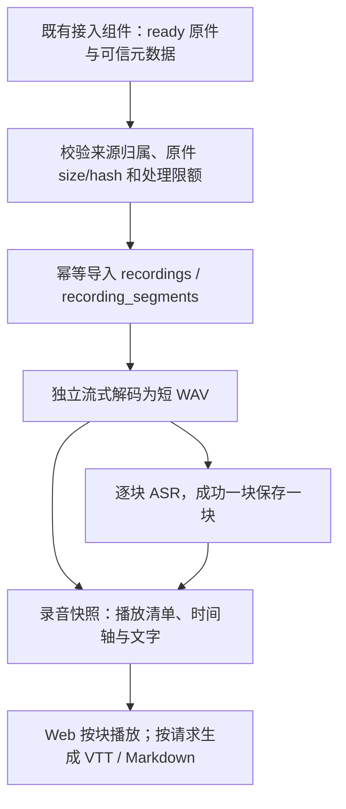

# 分块音频、转写与字幕开发设计

v2 · 2026-11-02 · [Server / Web 主文档](../README.md)

## 概述

1. 每份 raw 原件独立解码为短 WAV，默认每块 60 秒；逐块识别，失败只重试当前块。
2. accounts 保存用户，recording_segments 保存原件和分块结果，recordings 保存整条录音的结果快照。
3. 核心 WAV 存为文件，识别结果存为 SQLite JSON；VTT 和 Markdown 在下载时由快照生成。
4. 一个后台工作者持有独占锁，顺序执行处理和恢复。本版暂不支持对成功结果在线更换模型重新识别。

本文为设计稿。分块时长、上下文、超时和限额采用默认配置，须结合实际 ASR 服务验证。

[导入](#ingest) · [字段](#tables) · [分块与存储](#storage) · [转写](#transcript) · [提交与恢复](#publication) · [接口](#media-api) · [安全](#security)

<a id="ingest"></a>

## 1. 原件导入与录音聚合

接入组件提供已保存的 raw、归属与片段信息、大小、SHA-256，以及 registry.sources 的 ready 记录。业务模块从这些记录开始导入；设备传输过程不在本文范围内。




- 一条 recordings 对应一次录音；一条 recording_segments 对应一个 raw 文件；一个 segment 可解码成多个 chunk。
- 录音聚合键为 source_namespace（绑定 ID）+ binding_epoch + source_session；segment_no 从 1 开始。owner 取可信来源，不接受 Web 自行指定。
- 只导入 ready 来源；通过受控文件句柄验证原件存在、类型、实际大小及完整 SHA-256，缺失/冲突时保留来源并记录导入错误，暂不创建业务 segment、不填写 projected_at。额度核算按同一物理文件去重，导入索引不重复计费。
- 同一业务事务按 source_namespace/source_id 去重，复核 owner、录音、段号、size/hash，首次导入递增 content_revision。相同来源幂等返回，不同内容报 source_identity_conflict。
- 业务提交后才写 registry.sources.projected_at，标记失败可重放；启动每批 500 条对账全部 ready 来源，不只依赖该标记。旧来源 created 从 Unix 秒转毫秒。两个 SQLite 库不做跨库事务。
- 导入后即可处理；后段可提前独立识别。缺号只阻止无法确定偏移的全局结果发布，不阻止后段本地处理。
- integrity 为 unknown / gap / confirmed_complete，由接入侧可信完整性元数据提供；没有明确完成依据时保持 unknown，静默不能当作录完。完整性变化也更新 content_revision。

<a id="tables"></a>

## 2. 数据表与处理状态

完整 DDL 见[主文档](../README.md#business-sql)。accounts 与原件身份字段沿用主文档；下面只展开处理字段。JSON 在 SQLite 中保存为 TEXT，示例 jsonc 展开后附注释。

### 2.1 recordings：内容版本与结果快照

```jsonc
{
  // TEXT；录音主键，owner/来源/时间字段见主文档。
  "id": "recording-001",
  // INTEGER；原件导入、可见块结果/文件状态、完整性变化时递增。
  "content_revision": 8,
  // INTEGER；已发布快照的内容版本，允许跳号；0 表示从未发布。
  "result_revision": 7,
  // TEXT(JSON)|null；同一快照同时包含音频清单、覆盖状态、文字和导出格式。
  "result_json": null,
  // TEXT(JSON)|null；汇总失败对应的内容版本与原因。
  "merge_error_json": {"revision": 8, "code": "transcript_limit_exceeded", "retryable": false}
}
```

`content_revision > result_revision` 时需要汇总。音频和转写进度在查询时根据 segment/chunk 计算。各块 cues 保存识别原文，result_json 是可据此重建的录音快照。

### 2.2 recording_segments：原件与分块结果

```jsonc
{
  // TEXT；一份 raw 原件的主键；owner/来源/路径/原件 size/hash 另保留。
  "id": "segment-001",
  // INTEGER|null；完成一次全量校验后得到的原件 PCM 样本总数；修复不改变。
  "sample_count": 960000,
  // TEXT(JSON)|null；首次解码前冻结；ASR 部分在首次识别尝试前冻结。
  "process_config_json": {"decoder_version": "example-build", "raw_profile": "clip-16k-mono-20ms-v1", "chunk_seconds": 60, "context_seconds": 1, "asr": {"config_version": "example-v1", "model": "example-model", "language": "zh"}},
  // TEXT；pending / running / retry_wait / ready / failed；也用于原件 WAV 修复。
  "decode_state": "ready",
  // INTEGER；解码或当前修复一轮的执行次数。
  "decode_attempt": 1,
  // INTEGER；本原件最早允许解码/修复时间。
  "decode_run_after": 1793491200000,
  // TEXT|null；解码/修复错误。
  "decode_error_code": null,
  // TEXT(JSON)；数组按 index 从 0 连续；每块独立保存识别状态和重试预算。
  "chunks_json": [{
    // TEXT；服务端由 segment_id 与 index 确定，不含客户端路径。
    "id": "segment-001-c0",
    "index": 0,
    // INTEGER；相对原件的核心样本区间 [start_sample,end_sample)，无重叠。
    "start_sample": 0,
    "end_sample": 960000,
    // OBJECT；核心 WAV 文件，识别上下文不存入播放时长。
    "wav": {"state": "ready", "relative_path": "derived/segment-001/c0/publication.wav", "size_bytes": 1920044, "sha256": "bbbbbbbbbbbbbbbbbbbbbbbbbbbbbbbbbbbbbbbbbbbbbbbbbbbbbbbbbbbbbbbb"},
    // TEXT；not_configured / pending / running / retry_wait / ready / failed。
    "asr_state": "ready",
    // INTEGER；本块识别执行次数；调用前持久化，成功也保留。
    "asr_attempt": 1,
    // INTEGER；本块最早允许重试时间，切换其他块不会丢失。
    "asr_run_after": 1793491200000,
    // TEXT|null；本块错误，成功时为 null。
    "asr_error_code": null,
    // ARRAY|null；相对原件毫秒；null 表示未成功，[] 表示成功静音。
    "cues": [{"start_ms": 0, "end_ms": 2400, "speaker": "segment-001-c0:A", "text": "确认一下今天的安排。"}]
  }]
}
```

只有 ready 原件会创建业务 segment，因此片段表无需单独保存接收状态。原件就绪状态由接入组件写入 registry.sources。

### 2.3 后台调度与重试

- Server 使用一个应用进程、一个后台工作循环。启动时对业务 DB 同目录的 `speaker.worker.lock` 取得非阻塞排他 flock，并持有至所有后台工作和子进程结束；第二实例直接启动失败。锁针对同一个本地数据目录，禁止多 Uvicorn worker、热重载重叠实例或多机共享运行。
- 只有持锁工作者可更改处理状态、调用 ASR、修复和清理文件。原件导入可并发写业务库；媒体接口发现缺失文件只通知工作者复核，不自行修改 chunks_json。
- 调用解码器/ASR 前在短事务中增加对应 attempt 并置 running；I/O 在事务外。每次 ASR 返回后保存一个块，再轮转其他可执行块和录音汇总。
- 每个 decode 单元和每个 ASR 块最多 4 次执行，重试等待 30 秒、2 分钟、10 分钟。暂时网络/存储故障可重试；格式/hash/额度/结构超限直接 failed。失败块不影响其他块；终止后的人工重试须明确重置该单元的预算。
- 超时先终止并等待本地解码子进程退出，或取消并等待 ASR 请求返回；不得让旧本地执行仍能回写时启动重试。已送达远端的请求可能继续执行和计费，重试也可能重复调用。
- 重启持锁后，遗留 running 恢复为 retry_wait，但保留已执行次数；达到 4 次则置 failed。成功 cues 保留。
- 解码/切块配置首次解码前固定，ASR 配置首次调用前固定，包括失败重试。未配置 ASR 时可先解码播放，随后只允许一次性补齐 ASR 设置；默认值改变只作用于未冻结配置。成功块暂不支持在线更换模型重新识别。

<a id="storage"></a>
<a id="decode"></a>

## 3. 流式解码、上下文与 WAV

raw 仍为 uint16 little-endian 长度 + Opus payload，限定 16 kHz、mono、20 ms profile，每包 320 样本、payload 1–2000 字节。每份原件独立建立 decoder，完整校验包边界、size/hash；不拼 raw 共用解码器，不补帧或自行裁剪 pre-skip。其他 profile 报 unsupported_media_profile。

- 默认每块核心区间 60 秒，末块保留实际长度；逐包解码到有界缓冲区，输出 16 kHz、单声道 PCM16 WAV。60 秒 PCM 为 1,920,000 字节；不把整份 PCM 留在内存，不生成整条 WAV。
- 完整扫描原件、验证所有 WAV 后才一次提交 sample_count 与 chunks_json，并将 decode_state 置 ready。扫描失败不发布半份原件，也不开始它的 ASR；重试可重解码这一份 raw，成功 ASR 仅在后续文件修复时保留。
- 识别时从同一原件内前后核心块各取至多 1 秒上下文，生成临时短 WAV。播放使用无上下文核心 WAV；临时识别文件用后删除。
- 上下文仅取自同一原件，补传相邻 segment 不会影响已有成功块。原件边界仍可能出现断句、重复或漏词，需用实际录音验证。
- 默认 raw≤8 MiB、单原件≤1 小时、整条已收录音≤12 小时；process_config_json≤64 KiB、chunks_json≤8 MiB、汇总文字≤8 MiB、result_json≤16 MiB、单次导出≤64 MiB。实际处理先检查限额，超限明确失败，不静默截断。
- 原件解码默认超时 10 分钟，单块 ASR 超时 120 秒。ASR adapter 登记实际时长/字节上限；启动时检查核心长度加双侧上下文及 WAV 头不超限，未配置 ASR 时跳过该能力检查。

raw 按数据保留策略保存；核心 WAV 是播放产物。原件导入检查实际大小与处理额度，解码按时长上限预留核心 WAV 和一个临时识别输入；所有原件、派生/临时/待清理文件计入用户额度，同物理硬链接只计一次，另保留至少 256 MiB 空闲空间。数据根目录和备份设置见主文档。

孤儿清理只在启动取得独占锁、完成状态恢复之后、开放 HTTP API、启动原件导入和新处理之前执行。分批扫描 derived/临时目录，保留 segment 索引和已发布快照引用的文件，删除无引用文件并 fsync。运行期间不删除孤儿文件；替换后的旧 WAV 留到下次启动清理，期间仍计入用户额度。清理时服务尚未开放，无需追踪下载引用。ASR 自己的临时输入可在本次请求结束后删除，不属于孤儿扫描。

raw 目录不参与上述清理；原件由既有来源管理组件的显式保留规则管理，不能因为尚未业务投影就删除。默认保留原件，不自动删除。

<a id="transcript"></a>

## 4. 块结果与整条时间轴

### 4.1 块内校验

ASR 返回时间先换为样本，加上上下文在原件内的起点；按 cue 中点是否落在核心 [start_sample,end_sample) 决定归属，保留后裁到核心范围并换成原件内整数毫秒。原文存 chunks_json；不能用字符串相同删除真实重复发言。归属规则可以排除邻块上下文，但不同调用的识别措辞仍可能造成边界误差。

拒绝非法编码、空白句、NUL 或不合法时间；最多 1 ms 舍入越界可夹到范围，其他越界整块失败。转换后须 start<end。每句≤10000字符、整条≤100000 cues，同时检查 JSON 体积。静音成功为 ready、cues=[]；失败不能用空数组替代。

speaker 只在本次调用内有效，保存为 `segment_id-cN:局部编号`；无标识为 null。不同块的 A 不表示同一个人，本版不做跨块说话人匹配。

### 4.2 顺序、缺号与部分结果

按 segment_no 累加完整校验过的 sample_count，得到从 1 开始的连续前缀。先累计整数样本，最后统一换算为毫秒，避免逐段舍入产生累计误差。收件时间不参与音频偏移计算。未知样本数或缺号处停止全局发布；后段可先识别并保留原件内时间，补齐后只重汇总。

已知音频但 ASR 失败的块保留占时，后面字幕不能前移。已知时长但 WAV 缺失的块仍保留区间，清单标 missing、URL 为空；播放到这里停止并提示修复，不跳过缺失内容。

进度在同一读事务内聚合，只有 API 层字段，不在 recordings 重复存储：

- 音频：全部已收原件可定位且 WAV ready 为 ready；有可用块但不全为 partial；无可用块且有可执行/待补原件为 pending；无可用块且处理终止为 failed。
- 文字：无 ASR 配置且没有已启动识别为 not_configured；全部已收块识别成功且可定位为 ready；有成功可定位块但不全为 partial；无成功且尚可继续为 pending；无成功且处理终止为 failed。成功静音算成功。
- ready 只描述当前已收内容，录音是否完整单看 integrity。快照 partial 还包含完整性未知；`result_stale` 表示当前内容版本尚未汇总，两者不能混用。

### 4.3 结果快照

```jsonc
{
  // INTEGER；等于本快照发布时的 content_revision。
  "revision": 7,
  // INTEGER；冻结导出格式，保证同一快照 GET/HEAD 字节一致。
  "export_format_version": 2,
  // ENUM；快照捕获的原件完整性。
  "integrity": "unknown",
  // BOOLEAN；有缺号、待处理、失败块或尚未确认录完。
  "partial": true,
  // INTEGER|null；当前可定位前缀总时长。
  "duration_ms": 60000,
  // ARRAY；播放核心块，缺失文件仍有时间范围，URL 由 API 生成。
  "audio_items": [{"chunk_id": "segment-001-c0", "segment_id": "segment-001", "start_sample": 0, "end_sample": 960000, "wav": {"state": "ready", "relative_path": "derived/segment-001/c0/publication.wav", "size_bytes": 1920044, "sha256": "bbbbbbbbbbbbbbbbbbbbbbbbbbbbbbbbbbbbbbbbbbbbbbbbbbbbbbbbbbbbbbbb"}}],
  // ARRAY；各定位块的识别覆盖状态；pending 包括 running/retry_wait。
  "coverage": [{"chunk_id": "segment-001-c0", "start_ms": 0, "end_ms": 60000, "state": "ready"}],
  // ARRAY；缺号之后尚不能定位的原件 ID。
  "unpositioned_segment_ids": [],
  // ARRAY；全局毫秒，排序后从 1 编号；合法说话重叠保留。
  "cues": [{"cue_index": 1, "start_ms": 0, "end_ms": 2400, "speaker": "segment-001-c0:A", "text": "确认一下今天的安排。"}]
}
```

仅存在成功可定位块（含静音）时开放文字导出。VTT、Markdown 都使用此处的 cues；纯静音导出合法空字幕。部分结果在 Web 和 Markdown 标题注明，VTT 响应头注明。快照是整体替换，不逐句在当前快照上追加。

<a id="publication"></a>

## 5. 提交、版本竞争与恢复


### 5.1 WAV 与识别结果提交

WAV 使用服务端生成的 segment_id、chunk_id 和发布 UUID 组成路径。临时文件与最终文件位于同一文件系统：独占创建临时文件，写入并 fsync，校验样本数、大小和 hash，再用 link 创建最终路径并 fsync 目录。最终路径禁止覆盖。

整份原件验证完成后，在短事务中提交 chunks_json、sample_count 和 ready 状态，同时递增录音的 content_revision。事务提交前，Web 无法读取这些文件。

每块识别成功后，在同一事务中保存 cues、asr_state 和执行次数，并递增 content_revision。其他块的结果保留。若远端已成功、本地提交前崩溃，恢复后可能再次请求该块；已提交成功的块不会重新识别。

首次导入、文件可用性、识别覆盖状态或 integrity 变化时，在同一业务事务中递增 content_revision。重复导入、轮询、重试计数以及仍归为 pending 的 running/retry_wait 切换，不增加版本；failed 恢复为 pending 时增加版本。

### 5.2 快照更新

后台工作者在同一读事务中读取 content_revision 和所有 segment 结果，再在事务外生成快照。汇总受体积上限限制，过程不调用 ASR，也不读写文件。

提交使用条件更新：`UPDATE recordings ... WHERE id=? AND content_revision=?`。版本未变时，写入 result_json，将 result_revision 设为本次读取的版本，并清空 merge_error_json。若期间有原件导入或完整性更新，条件更新失败，本次结果丢弃，留到下一轮重新汇总。块结果由唯一工作者修改；其他会影响快照的写入也必须递增 content_revision。

当前内容版本大于结果版本时调度汇总；每次工作单元之后优先尝试一次。临时数据库错误以进程内退避重试，重启后仍可由版本差发现；永久结构/体积错误保存 merge_error_json 的版本与原因，暂停该版本的自动汇总，维护修正或内容变化后再尝试。汇总失败时保留原快照，不重新识别已成功的块。

### 5.3 中断与修复

- ready 来源尚未导入或业务标记不全：按可信元数据和 hash 对账，幂等补导入；接入侧的未就绪原件不由业务模块修复。
- WAV 已落盘但索引未提交：重启后重新解码该份 raw，写入新路径；无索引引用的文件由启动清理删除。
- ASR 调用中断：按持久次数重试当前块，其他成功块保持不变；退避状态可继续其他块。
- 块成功但快照尚未提交：根据版本差重新汇总，沿用已保存的块结果。
- WAV 缺失/损坏：工作者标 missing 并递增内容版本，保留 sample_count/cues。用冻结解码配置流式重建缺失块，核对原样本区间及预期 hash，写新路径再更新索引；修复提交须核对原 sample_count、块数及所有样本区间，只替换目标块的 wav 描述，不走首次解码的整体初始化路径，完整保留各块 cues/asr_state/asr_attempt/asr_run_after；不重新 ASR。首次进入修复时重置 decode_attempt 作为一次修复预算，终止后须维护显式重试，不能检测到 missing 就反复重置预算。
- 找不到原解码依赖或重建内容不同：报 repair_dependency_unavailable/repair_content_mismatch，保留已存文字。邻块缺失导致上下文不可构造时先修复，等待依赖不消耗 ASR 次数。
- VTT/Markdown 生成失败只影响本次下载，不改识别状态；不支持的导出格式版本报 export_format_unavailable，保留快照指定的格式版本。

DDL 用于新建业务库。已有部署须另写迁移脚本：先停写备份，保留身份和 raw，再重建分块、校验后切换；旧任务记录或整条 WAV 不能直接当作新分块。迁移与 user_version 更新在同一事务内执行，未知高版本拒绝启动。

<a id="media-api"></a>

## 6. 播放与导出接口

前缀 `/api/boa/v1`，所有读取验证会话、owner 与 revision，跨 owner 为 404。详情返回 content_revision、result_revision、result_stale，以及实时计算的 audio_state/transcript_state；partial/duration/preview/links 来自已发布快照。

- GET `/recordings/{id}/audio?revision=N`：从同一 result_json 返回音频清单，含 revision、partial、duration_ms、items；每项为 chunk_id、segment_id、start_ms、duration_ms、sample_count、state、url。sample_count 为 end_sample-start_sample，start_ms 由全局样本数换算；missing 的 URL 为 null。
- GET/HEAD `/recordings/{id}/chunks/{chunk_id}.wav?revision=N`：该块必须在此录音当前快照清单中；读取核心 WAV，支持单范围 Range。不能仅凭 chunk_id 绕过归属与版本检查。
- GET `/recordings/{id}/transcript?revision=N`：返回 revision、schema_version=2、time_unit=ms、partial、coverage、unpositioned_segment_ids、cues。内部磁盘路径不返回 Web。
- GET/HEAD `/recordings/{id}/transcript.vtt?revision=N` 与 `transcript.md?revision=N`：从本次读取的同版本快照确定性生成字节；按 export_format_version 转义并序列化，计算长度与 ETag，不落盘。

快照版本与 N 不符为 409 recording_revision_changed；没有可定位音频为 409 audio_not_ready。没有成功可定位识别块为 409 transcript_not_ready；若该录音尚无 ASR 配置则 503 asr_not_configured。即使有更新的当前进度，也不据此隐藏旧快照已提交的成功文字。文件不可用为 503 audio_unavailable。

Web 根据清单将全局播放位置换算为块内偏移，最多预取下一块。遇到 missing 或缺号处停止并提示。逐块切换可能有间隙，无缝播放需另行验证。result_stale 时可继续读取旧快照；新快照切换后新请求须重取版本，已打开文件句柄/导出字节可完成，不混用两个版本。

核心 WAV 支持 bytes=start-end、start-、-suffix，按文件大小裁 end；非法或越界返回 416 和 `Content-Range: bytes */size`；多范围按整文件 200。HEAD 忽略 Range，空 body。文字导出忽略 Range，HEAD 与 GET 使用同样的序列化字节计算长度。

VTT 固定 UTF-8、无 BOM、LF、HH:MM:SS.mmm，正文先转义 &、<、>，去首尾换行、压平内部空白行；speaker 使用服务端安全匿名 ID。Markdown 固定模板转义原文控制字符；同快照及格式版本生成同字节。单次超出 64 MiB 报 export_limit_exceeded，不能截断正文。文件/导出 ETag 为实际字节 SHA-256；响应设 X-Recording-Revision、X-Recording-Partial、private,no-store、nosniff，下载文件名由 Server 生成。

错误 body 沿用主文档；媒体每 owner 最多 4 个活动请求，超额 429、Retry-After: 1。GET/HEAD/Range 均重新鉴权，以同一文件句柄校验类型/size 后读取。

<a id="security"></a>

## 7. 文件与音频数据安全


- 用户隔离：所有列表、GET/HEAD/Range、JSON/VTT/Markdown 读取与后台处理先限定 owner；原件 owner 来自验证通过的 Clip 绑定
- 文件路径：raw 沿用服务端 object_id，派生路径使用服务端 segment_id/chunk_id/发布 UUID；历史 owner 不直接拼进路径。以存储根目录句柄逐级 openat/O_NOFOLLOW，拒绝符号链接和非普通文件；路径检查与打开使用同一目录链
- 元数据写入：使用参数化 SQL，owner 由会话/来源确定；按录音、owner、版本复核关联后提交
- 存储访问：数据位于 Web 静态资源之外，由专用服务账号访问；目录 0700，音频、SQLite/WAL/SHM、配置和备份 0600
- Web 与远程 ASR 访问使用 HTTPS；原件接入仅消费可信已就绪来源
- 静态数据：数据卷与独立备份启用存储层加密；卷解锁和备份密钥由部署环境管理，密钥与备份分开授权
- 文件完整性：发布、ASR 输入和恢复核对完整 SHA-256；下载使用同一已打开文件句柄检查类型与 size，异常停止读取并标记产物不可用
- 资源限制：导入检查实际字节数、用户额度和空间；解码限制输出/时长/超时；媒体 GET/HEAD 按 owner 最多 4 个活动请求，超额返回 429 与 Retry-After: 1
- 解码执行：以服务账号用参数数组启动受控解码器，输入输出来自验证后的文件标识；部署环境限制 CPU/内存，超时结束子进程及其临时输出
- ASR 出站：仅调用服务端配置的 HTTPS 或明确登记的本机端点；禁用重定向，校验 TLS 证书，出站网络只放行配置目标；发送已校验 WAV，凭证由服务器侧加载
- 文本输出：JSON 保留纯文本，Web 用 textContent；VTT 转义，Markdown 用固定模板并转义原文中的 HTML/Markdown 控制字符后作为附件返回；响应设置 nosniff 和 private,no-store
- 日志：记录 request_id、recording_id/segment_id/chunk_id、阶段、错误码和必要计量；认证凭证与录音/识别正文只用于业务处理
- 清理：Wi-Fi 密码、Google token 用毕释放引用，ASR 凭证仅服务端持有；临时音频在处理结束后清理，仅在启动开放服务前由持锁工作者清理无索引/快照引用的派生残留；原件与 WAV 按第 3 节保留/清理

ASR 配置须登记供应方保留期限和删除方式；选择不留存/不用于训练的处理设置。服务端可清理本地副本，供应方数据按其已核实的处理约定执行。

存储保护参考 [OWASP 文件上传](https://cheatsheetseries.owasp.org/cheatsheets/File_Upload_Cheat_Sheet.html)与[访问控制](https://cheatsheetseries.owasp.org/cheatsheets/Authorization_Cheat_Sheet.html)；额度、超时和保留期按本文配置。

### 7.1 一致性备份与恢复

- 默认备份：每日暂停原件导入并通过运维暂停既有来源组件写入，停止后台处理、终止未结束子进程并关闭数据库，生成加密快照后重启；待复制完成前保持停写。保留最近 7 个验证成功快照，周期与份数可配置
- 快照内容：两个数据库及仍存在的 WAL、raw/来源元数据及既有接入组件的恢复数据、核心 WAV、分块结果和录音快照、配置和恢复所需凭证；SHM 在恢复时重建
- 独立副本：备份置于独立存储介质，恢复授权与线上读写分开；备份清单记录时间、数据库版本、文件 size/hash
- 验证：在临时验证副本校验数据库完整性、外键、原件数量和文件 size/hash；备份包保持只读，验证成功后才替换旧快照
- 恢复：在隔离环境解密并校验清单，执行 integrity_check/foreign_key_check；重做来源投影、未提交解码与未更新快照；全部通过再切换数据卷，失败保留原卷。历史录音 owner 保持原值
- 恢复后的凭证：本站会话清空，先将恢复账号全部 disabled、auth_version 加 1，撤销所有恢复的上传/Bearer 凭证；维护人员依据当前可信登记逐一启用并核发凭证，确认前保持拒绝访问

恢复点为最近验证成功快照；默认备份间隔 24 小时，备份失败须告警。备份位置与加密密钥未配置、存储卷未解锁、配额非法时，服务拒绝启动。
