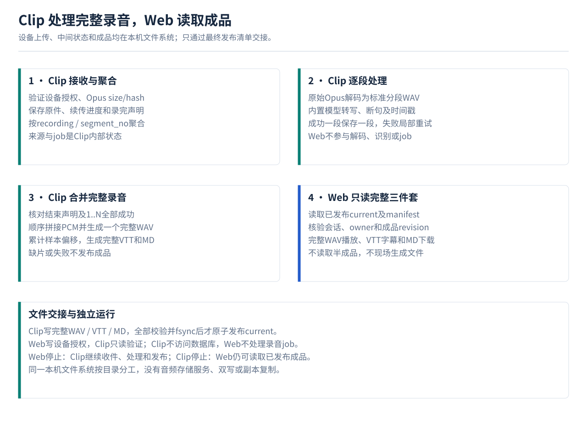
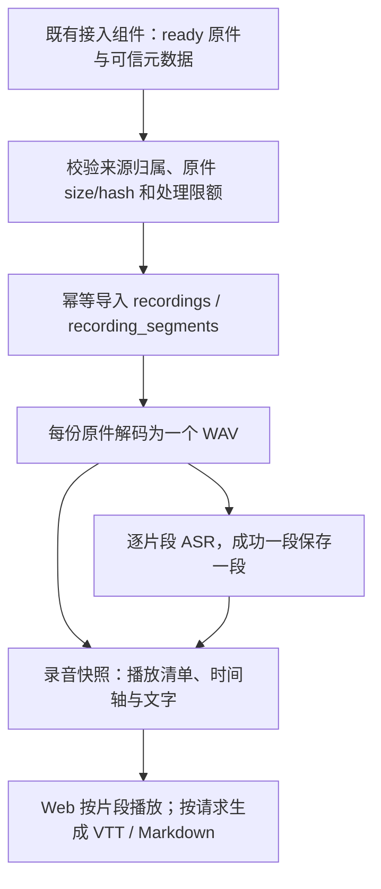
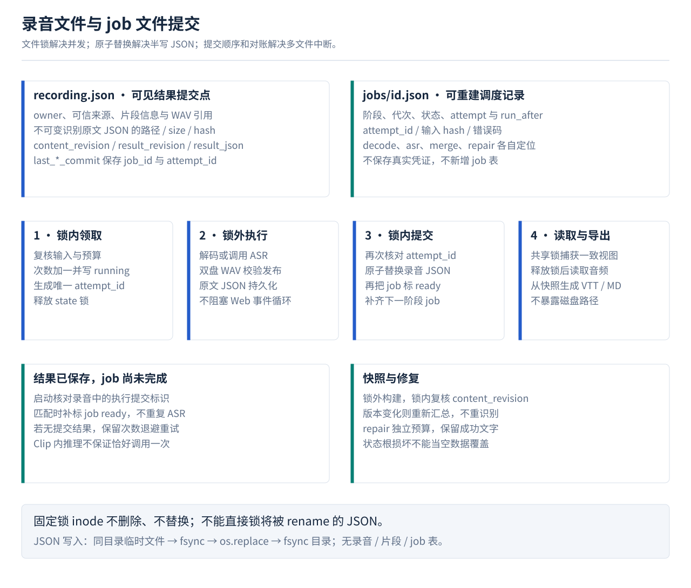
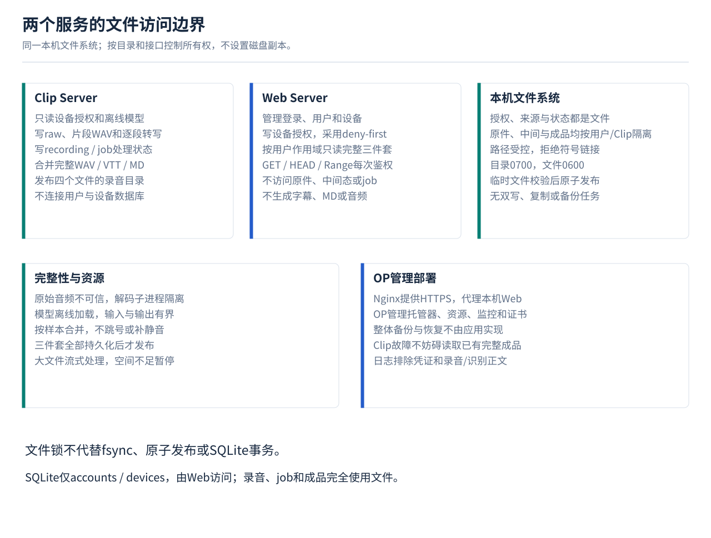

# 录音片段、转写与字幕设计

v3 · 2026-11-02 · [Server / Web 主文档](../README.md)

## 概述

1. 设备每 5 分钟生成一个 segment，末段可不足 5 分钟。Server 按 segment 解码和识别，失败只重试该片段。
2. accounts 保存用户，recording_segments 保存每份原件、WAV 和识别状态，recordings 保存整条录音的结果快照。
3. raw 和 WAV 在两块独立磁盘各保存一份，在线 SQLite 位于主盘，副本盘保存一致性检查点；VTT 和 Markdown 在下载时由快照生成。
4. 一个后台工作者持有独占锁，顺序执行处理和恢复。本版暂不支持对成功结果在线更换模型重新识别。

本文为设计稿。设备片段时长为 5 分钟；ASR 须支持直接识别这一长度的 WAV。超时和限额须结合实际服务验证。

[导入](#ingest) · [字段](#tables) · [解码与存储](#storage) · [转写](#transcript) · [提交与恢复](#publication) · [接口](#media-api) · [安全](#security)

<a id="ingest"></a>

## 1. 原件导入与录音聚合

接入组件提供已保存的 raw、归属与片段信息、大小、SHA-256，以及 registry.sources 的 ready 记录。业务模块从这些记录开始导入；设备传输过程不在本文范围内。





- 一条 recordings 对应一次录音；一条 recording_segments 对应设备生成的一份 raw 文件。每个 segment 生成一个 WAV、保存一份识别结果。Server 不再二次切块。
- 录音聚合键为 source_namespace（绑定 ID）+ binding_epoch + source_session；segment_no 从 1 开始。owner 取可信来源，不接受 Web 自行指定。
- 只导入 ready 来源；通过受控文件句柄验证原件存在、类型、实际大小及完整 SHA-256，缺失/冲突时保留来源并记录导入错误，暂不创建业务 segment、不填写 projected_at。来源通过校验后，先按第 3 节复制原件和来源描述到副本盘，两份均持久化才提交业务记录。额度核算按同一物理文件去重，导入索引不重复计费。
- 同一业务事务按 source_namespace/source_id 去重，复核 owner、录音、段号、size/hash，首次导入递增 content_revision。相同来源幂等返回，不同内容报 source_identity_conflict。
- 业务提交后才写 registry.sources.projected_at，标记失败可重放；启动每批 500 条对账全部 ready 来源，不只依赖该标记。旧来源 created 从 Unix 秒转毫秒。两个 SQLite 库不做跨库事务。
- 导入后即可处理；后段可提前独立识别。缺号只阻止无法确定偏移的全局结果发布，不阻止后段本地处理。
- integrity 为 unknown / gap / confirmed_complete，由接入侧可信完整性元数据提供；没有明确完成依据时保持 unknown，静默不能当作录完。完整性变化也更新 content_revision。

<a id="tables"></a>

## 2. 数据表与处理状态

完整 DDL 见[主文档](../README.md#business-sql)。accounts 与原件身份字段沿用主文档；下面只展开处理字段。JSON 在 SQLite 中保存为 TEXT，示例 jsonc 展开后附注释。

### 2.1 recordings：内容版本与结果快照

下面示例表示首次汇总失败、尚无已发布快照；第 4.3 节给出发布后的快照结构。

```jsonc
{
  // TEXT；录音主键，owner/来源/时间字段见主文档。
  "id": "recording-001",
  // INTEGER；原件导入、可见片段结果/文件状态、完整性变化时递增。
  "content_revision": 8,
  // INTEGER；已发布快照的内容版本，允许跳号；0 表示从未发布。
  "result_revision": 0,
  // TEXT(JSON)|null；同一快照同时包含音频清单、覆盖状态、文字和导出格式。
  "result_json": null,
  // TEXT(JSON)|null；汇总失败对应的内容版本与原因。
  "merge_error_json": {"revision": 8, "code": "transcript_limit_exceeded", "retryable": false}
}
```

`content_revision > result_revision` 时需要汇总。音频和转写进度在查询时根据 segment 计算。各片段的 transcript_json 保存识别原文，result_json 是可据此重建的录音快照。

### 2.2 recording_segments：原件、WAV 与识别结果

```jsonc
{
  // TEXT；原件 ID；owner、来源、原件路径和 size/hash 见主文档 DDL。
  "id": "segment-001",
  // INTEGER|null；完整解码得到的 PCM 样本数；此例正好 5 分钟。
  "sample_count": 4800000,
  // TEXT(JSON)|null；解码前固定解码器；首次 ASR 前固定模型和语言，不含凭证。
  "process_config_json": {"decoder_version": "example-build", "raw_profile": "clip-16k-mono-20ms-v1", "asr": {"config_version": "example-v1", "model": "example-model", "language": "zh"}},
  // TEXT；pending / running / retry_wait / ready / failed；也用于 WAV 修复。
  "decode_state": "ready",
  // INTEGER；本轮解码或修复的执行次数，最多 4 次。
  "decode_attempt": 1,
  // INTEGER；下次可执行解码或修复的时间。
  "decode_run_after": 1793491200000,
  // TEXT|null；解码或修复错误。
  "decode_error_code": null,
  // TEXT；none / ready / missing；missing 时保留原预期元数据供修复。
  "wav_state": "ready",
  // TEXT|null；当前 WAV 的不可变相对路径。
  "wav_relative_path": "derived/segment-001/publication.wav",
  // INTEGER|null；WAV 字节数，和原始文件 size_bytes 分开保存。
  "wav_size_bytes": 9600044,
  // TEXT|null；当前 WAV 的 SHA-256。
  "wav_sha256": "bbbbbbbbbbbbbbbbbbbbbbbbbbbbbbbbbbbbbbbbbbbbbbbbbbbbbbbbbbbbbbbb",
  // TEXT；not_configured / pending / running / retry_wait / ready / failed。
  "asr_state": "ready",
  // INTEGER；本片段 ASR 执行次数，调用前保存，最多 4 次。
  "asr_attempt": 1,
  // INTEGER；本片段下次允许识别的时间。
  "asr_run_after": 1793491200000,
  // TEXT|null；识别错误。
  "asr_error_code": null,
  // TEXT(JSON)|null；时间相对本片段；null 未成功，cues=[] 为成功静音。
  "transcript_json": {"schema_version": 3, "time_unit": "ms", "cues": [{"start_ms": 0, "end_ms": 2400, "speaker": "segment-001:A", "text": "确认一下今天的安排。"}]}
}
```

只有 ready 原件会创建业务 segment，因此片段表无需单独保存接收状态。原件就绪状态由接入组件写入 registry.sources。

### 2.3 后台调度与重试

- Server 使用一个应用进程、一个后台工作循环。启动时对业务 DB 同目录的 `speaker.worker.lock` 取得非阻塞排他 flock，并持有至所有后台工作和子进程结束；第二实例直接启动失败。锁针对同一个本地数据目录，禁止多 Uvicorn worker、热重载重叠实例或多机共享运行。
- 只有持锁工作者可更改处理状态、调用 ASR、修复和清理文件。原件导入可并发写业务库；媒体接口发现缺失文件只通知工作者复核，不自行修改片段状态。
- ASR 仅领取 decode_state=ready、wav_state=ready，且 asr_state 为 pending/retry_wait、asr_run_after 已到期、asr_attempt<4 的片段，并检查固定配置可用。等待解码或 WAV 修复不消耗识别次数；asr_state=ready 的片段不再领取。
- 调用解码器/ASR 前在短事务中增加对应 attempt 并置 running；I/O 在事务外。每次 ASR 返回后保存当前片段，再轮转其他可执行片段和录音汇总。
- 每个片段的解码和 ASR 各最多执行 4 次，重试等待 30 秒、2 分钟、10 分钟。暂时网络/存储故障可重试；格式/hash/额度/结构超限直接 failed。失败片段不影响其他片段；终止后的人工重试须明确重置该单元的预算。
- 超时先终止并等待本地解码子进程退出，或取消并等待 ASR 请求返回；不得让旧本地执行仍能回写时启动重试。已送达远端的请求可能继续执行和计费，重试也可能重复调用。
- 重启持锁后，遗留 running 恢复为 retry_wait，但保留已执行次数；达到 4 次则置 failed。成功 transcript_json 保留。
- 导入时根据有效 ASR 配置显式设置 asr_state：有配置为 pending，无配置为 not_configured；DDL 的 pending 默认值不能代替此判断。未配置期间不领取 ASR，也不增加 asr_attempt。配置补齐后将尚未开始识别的片段由 not_configured 改为 pending、设置 asr_run_after，并在同一事务递增 content_revision。领取前再次检查配置，未冻结配置的片段若仍无可用 ASR，恢复为 not_configured，不消耗次数。
- 解码配置首次解码前固定，ASR 配置首次调用前固定，包括失败重试。未配置 ASR 时可先解码播放，随后只允许一次性补齐 ASR 设置；默认值改变只作用于未冻结配置。成功片段暂不支持在线更换模型重新识别。

<a id="storage"></a>
<a id="decode"></a>

## 3. 按片段解码与存储

raw 为 uint16 little-endian 长度 + Opus payload，限定 16 kHz、mono、20 ms profile，每包 320 样本、payload 1–2000 字节。每份原件独立建立 decoder，校验包边界、size/hash；不拼 raw 共用解码器，不补帧或自行裁剪 pre-skip。其他 profile 报 unsupported_media_profile。

- 每份原件流式解码为一个 16 kHz、单声道 PCM16 WAV，设备标准片段为 5 分钟，末段保留实际时长。Server 不做切块、上下文重叠或整条音频合成。
- 5 分钟 PCM 为 9,600,000 字节，另加 WAV 头。边读边写 WAV，不将整份 PCM 保留在内存。实际时长由 sample_count 计算，不能用 segment_no×5 分钟推断。
- 完整扫描原件并验证两盘 WAV 副本后，一次提交 sample_count、wav 元数据和 decode_state=ready，随后才能识别。扫描失败不发布半份音频，重试只重解码当前 segment。
- ASR 直接读取已校验的片段 WAV，不额外生成上下文音频。片段边界可能截断句子，本版接受这一限制，不跨片段去重或拼接音频识别。
- raw≤8 MiB、单片段≤5 分钟、整条已收录音≤12 小时；process_config_json≤64 KiB、每段 transcript_json≤8 MiB、汇总文字≤8 MiB、result_json≤16 MiB、单次导出≤64 MiB。超限明确失败，不截断或自动细分原件。
- 解码默认超时 10 分钟，片段 ASR 默认超时 600 秒。ASR adapter 须登记输入时长/字节上限，并支持 300 秒及对应 WAV 字节数；服务不支持时拒绝启用该 ASR 配置，不退回二次切块。未配置 ASR 时仍可解码和播放。

### 3.1 主盘与副本盘

主盘和副本盘分别配置 SPEAKER_PRIMARY_ROOT、SPEAKER_REPLICA_ROOT，必须位于两个独立磁盘或独立故障域的存储卷。两个目录、两个分区或硬链接不能替代独立磁盘。部署时核实设备与挂载，不能只凭路径不同认定隔离。

raw 与 WAV 在两盘使用相同的相对路径，数据库只保存相对路径和 size/hash。导入原件前，同时保存一份不可变来源描述，包含 schema_version=1、source_id、source_namespace/binding_id、binding_epoch、session、segment_no、raw 相对路径/object_id、时间、原件 size/hash，以及 owner 和 user_id/google_sub 等账户身份映射；描述文件与 raw 一起复制并校验，用于数据库检查点较旧时重建归属和片段索引。描述不含登录 token、密码或设备凭证。

新文件在两盘各自的临时目录写入，分别校验完整 SHA-256、fsync 文件、发布到不可变最终路径并 fsync 目录；两份成功后才提交业务索引。跨盘不能用 rename/link 代替数据复制。临时与最终文件只要求在各自所属磁盘内为同一文件系统。

raw 按保留策略保存，WAV 用于播放和识别。用户逻辑额度按一份业务数据核算；两盘物理容量分别检查和预留，计入各自临时文件及待清理旧文件，均至少保留 256 MiB 空闲空间。任一盘容量不足或不可写就暂停新的持久写入并告警，不静默退化为单副本；主盘正常时已有结果仍可读取。

### 3.2 清理

孤儿清理在启动持锁并恢复状态后、开放 HTTP API 和开始导入处理前执行。分别扫描两盘 derived/临时目录，保留当前索引、已发布快照和保留的数据库检查点清单仍引用的文件。只有确认无引用的文件才删除并 fsync；无法读取副本清单时停止清理。

运行期间不做孤儿删除，修复产生的旧 WAV 留到下次启动清理，仍计入物理容量。raw 和来源描述不参与孤儿清理，默认保留。每日版本备份位于独立 backups/ 目录，不能被副本对账或孤儿扫描删除。

<a id="transcript"></a>

## 4. 片段结果与整条时间轴

### 4.1 片段识别结果校验

ASR 返回的时间戳相对当前 segment，从 0 开始。转换为整数毫秒后验证 0≤start_ms<end_ms≤片段实际时长，原文保存到 transcript_json。最多 1 ms 的舍入越界可夹到范围，其他越界整段识别失败。

拒绝非法编码、空白句和 NUL。每句≤10000 字符、整条录音≤100000 cues，同时检查 JSON 体积。成功静音为 asr_state=ready、cues=[]；识别失败不以空数组代替。

speaker 仅在当前片段有效，保存为 `segment_id:局部编号`；无标识为 null。不同片段的 A 不表示同一个人，本版不做跨片段说话人匹配。

### 4.2 顺序、缺号与部分结果

按 segment_no 累加完整校验过的 sample_count，得到从 1 开始的连续前缀。先累计整数样本，最后统一换算为毫秒，避免逐段舍入产生累计误差。收件时间不参与音频偏移计算。未知样本数或缺号处停止全局发布；后段可先识别并保留原件内时间，补齐后只重汇总。

ASR 失败的片段保留原时长，后面字幕不能前移。已知时长但 WAV 缺失的片段仍保留区间，清单标 missing、URL 为空；播放到这里停止并提示修复，不跳过缺失内容。

进度在同一读事务内聚合，只有 API 层字段，不在 recordings 重复存储：

- 音频：全部已收原件可定位且 WAV ready 为 ready；有可用片段但不全为 partial；无可用片段且有可执行/待补原件为 pending；无可用片段且处理终止为 failed。
- 文字：无 ASR 配置且没有已启动识别为 not_configured；全部已收片段识别成功且可定位为 ready；有成功可定位片段但不全为 partial；无成功且尚可继续为 pending；无成功且处理终止为 failed。成功静音算成功。
- ready 只描述当前已收内容，录音是否完整单看 integrity。快照 partial 还包含完整性未知；`result_stale` 表示当前内容版本尚未汇总，两者不能混用。

### 4.3 结果快照

audio_items 中的 start_sample/end_sample 是整条录音上的全局半开区间；二者之差必须等于该 segment 的 sample_count。原始片段的 ASR 时间仍是片段内毫秒，汇总时按起始样本偏移换算为全局时间。

下面示例含 5 分钟第一段和 1 分钟末段。第二段从样本 4,800,000、即 300,000 ms 开始，结束于样本 5,760,000；示例中第二段识别成功且为静音。schema_version=3 是 JSON 结构版本，export_format_version=2 是独立的字幕序列化版本。

```jsonc
{
  // INTEGER；等于本快照发布时的 content_revision。
  "revision": 7,
  // INTEGER；冻结导出格式，保证同一快照 GET/HEAD 字节一致。
  "export_format_version": 2,
  // ENUM；快照捕获的原件完整性。
  "integrity": "unknown",
  // BOOLEAN；有缺号、待处理、失败片段或尚未确认录完。
  "partial": true,
  // INTEGER|null；当前可定位前缀总时长。
  "duration_ms": 360000,
  // ARRAY；样本区间为全局位置，URL 由 API 生成；缺失文件仍保留区间。
  "audio_items": [
    {"segment_id": "segment-001", "start_sample": 0, "end_sample": 4800000, "wav": {"state": "ready", "relative_path": "derived/segment-001/publication.wav", "size_bytes": 9600044, "sha256": "bbbbbbbbbbbbbbbbbbbbbbbbbbbbbbbbbbbbbbbbbbbbbbbbbbbbbbbbbbbbbbbb"}},
    {"segment_id": "segment-002", "start_sample": 4800000, "end_sample": 5760000, "wav": {"state": "ready", "relative_path": "derived/segment-002/publication.wav", "size_bytes": 1920044, "sha256": "cccccccccccccccccccccccccccccccccccccccccccccccccccccccccccccccc"}}
  ],
  // ARRAY；state 为 not_configured / pending / ready / failed；pending 包括 running/retry_wait。
  "coverage": [
    {"segment_id": "segment-001", "start_ms": 0, "end_ms": 300000, "state": "ready"},
    {"segment_id": "segment-002", "start_ms": 300000, "end_ms": 360000, "state": "ready"}
  ],
  // ARRAY；缺号之后尚不能定位的原件 ID。
  "unpositioned_segment_ids": [],
  // ARRAY；全局毫秒，排序后从 1 编号；合法说话重叠保留。
  "cues": [{"cue_index": 1, "start_ms": 0, "end_ms": 2400, "speaker": "segment-001:A", "text": "确认一下今天的安排。"}]
}
```

存在成功可定位片段（含静音）时开放文字导出。VTT、Markdown 都使用此处的 cues；纯静音导出合法空字幕。部分结果在 Web 和 Markdown 标题注明，VTT 响应头注明。快照是整体替换，不逐句在当前快照上追加。

<a id="publication"></a>

## 5. 提交、版本竞争与恢复



### 5.1 双盘文件与业务索引提交

WAV 使用服务端生成的 segment_id 和发布 UUID 组成路径。主盘和副本盘分别写临时文件、校验样本与 size/hash、fsync 文件，再在各自磁盘内用 link 创建最终路径并 fsync 目录。最终路径禁止覆盖，两份文件的相对路径、大小和 hash 必须一致。

两盘文件均验证完成后，在主盘业务库的短事务中提交 WAV 元数据、sample_count、decode_state=ready 和 content_revision。任一副本失败时不提交可读状态，已写入的半成副本留待恢复或清理。原件导入也遵守“两盘原件及来源描述成功，再提交业务记录”的顺序。

每段识别成功后，在同一事务中保存 transcript_json、asr_state 和执行次数，并递增 content_revision。其他片段的结果保留。正常重启时已提交成功的片段不再识别。若远端成功但本地提交前崩溃，或主盘损坏而最新文字尚未进入数据库检查点，则恢复后可能再次请求该片段。关键事务提交后立即申请更新副本检查点，写入方式见第 7.1 节。

首次导入、文件可用性、识别覆盖状态或 integrity 变化时，在同一业务事务中递增 content_revision。重复导入、轮询、重试计数以及仍归为 pending 的 running/retry_wait 切换，不增加版本；failed 恢复为 pending 时增加版本。

### 5.2 快照更新

后台工作者在同一读事务中读取 content_revision 和所有 segment 结果，再在事务外生成快照。汇总受体积上限限制，过程不调用 ASR，也不读写文件。

提交使用条件更新：`UPDATE recordings ... WHERE id=? AND content_revision=?`。版本未变时，写入 result_json，将 result_revision 设为本次读取的版本，并清空 merge_error_json。若期间有原件导入或完整性更新，条件更新失败，本次结果丢弃，留到下一轮重新汇总。片段结果由唯一工作者修改；其他会影响快照的写入也必须递增 content_revision。

当前内容版本大于结果版本时调度汇总；每次工作单元之后优先尝试一次。临时数据库错误以进程内退避重试，重启后仍可由版本差发现；永久结构/体积错误保存 merge_error_json 的版本与原因，暂停该版本的自动汇总，维护修正或内容变化后再尝试。汇总失败时保留原快照，不重新识别已成功的片段。

### 5.3 中断与修复

- ready 来源尚未导入或业务标记不全：按可信元数据和 hash 对账，幂等补导入；接入侧的未就绪原件不由业务模块修复。
- 只有一盘文件写成、或两盘文件成功但索引未提交：先校验两份内容，补齐文件副本后重放导入/解码；不得仅因任一盘存在文件就标 ready。无引用文件留待启动清理。
- ASR 调用中断：按持久次数重试当前片段，其他成功片段保持不变；退避期间可处理其他片段。
- 片段成功但快照尚未提交：根据版本差重新汇总，沿用已保存的片段结果。
- WAV 缺失/损坏：在同一事务将 wav_state 置 missing、decode_state 置 pending 并递增内容版本，保留 sample_count 和 transcript_json。先校验另一盘的完整副本，匹配原 size/hash 时直接复制恢复；两份均不可用时才按 raw 与固定配置重建本段 WAV。恢复文件须在两盘均通过原 sample_count、size/hash 校验，再用新路径更新 WAV 元数据，将 decode_state 恢复为 ready 并清空 decode_error_code，同时递增 content_revision；保留全部 asr_* 字段和已识别文字，不重新 ASR。首次进入修复时重置 decode_attempt，形成一次修复预算；终止后须维护显式重试，不能重复检测 missing 就重置次数。
- 缺少原解码依赖或重建内容不同：报 repair_dependency_unavailable/repair_content_mismatch，保留已存文字。等待 WAV 修复不消耗 ASR 次数。
- VTT/Markdown 生成失败只影响本次下载，不改识别状态；不支持的导出格式版本报 export_format_unavailable，保留快照指定的格式版本。

DDL 用于新建业务库。已有部署须另写迁移脚本：先停写备份，保留身份和 raw，再重建各 segment 的 WAV、校验后切换；旧任务记录或整条合成 WAV 不能直接当作片段结果。迁移与 user_version 更新在同一事务内执行，未知高版本拒绝启动。

<a id="media-api"></a>

## 6. 播放与导出接口

前缀 `/api/boa/v1`，所有读取验证会话、owner 与 revision，跨 owner 为 404。详情返回 content_revision、result_revision、result_stale，以及实时计算的 audio_state/transcript_state；partial/duration/preview/links 来自已发布快照。

- GET `/recordings/{id}/audio?revision=N`：从同一 result_json 返回音频清单，含 revision、partial、duration_ms、items；每项为 segment_id、start_ms、duration_ms、sample_count、state、url。sample_count=end_sample-start_sample，start_ms=round(start_sample×1000/16000)，duration_ms=round(end_sample×1000/16000)-start_ms，确保相邻段边界连续；missing 的 URL 为 null。
- GET/HEAD `/recordings/{id}/segments/{segment_id}.wav?revision=N`：该片段必须在此录音当前快照清单中；读取片段 WAV，支持单范围 Range。不能仅凭 segment_id 绕过归属与版本检查。
- GET `/recordings/{id}/transcript?revision=N`：返回 revision、schema_version=3、time_unit=ms、partial、coverage、unpositioned_segment_ids、cues。内部磁盘路径不返回 Web。
- GET/HEAD `/recordings/{id}/transcript.vtt?revision=N` 与 `transcript.md?revision=N`：从本次读取的同版本快照确定性生成字节；按 export_format_version 转义并序列化，计算长度与 ETag，不落盘。

快照版本与 N 不符为 409 recording_revision_changed；没有可定位音频为 409 audio_not_ready。没有成功可定位识别片段为 409 transcript_not_ready；若该录音尚无 ASR 配置则 503 asr_not_configured。即使有更新的当前进度，也不据此隐藏旧快照已提交的成功文字。文件不可用为 503 audio_unavailable。

Web 根据清单将全局播放位置换算为片段内偏移，最多预取下一段。遇到 missing 或缺号处停止并提示。片段切换可能有间隙，无缝播放需另行验证。result_stale 时可继续读取旧快照；新快照切换后新请求须重取版本，已打开文件句柄/导出字节可完成，不混用两个版本。

片段 WAV 支持 bytes=start-end、start-、-suffix，按文件大小裁 end；非法或越界返回 416 和 `Content-Range: bytes */size`；多范围按整文件 200。HEAD 忽略 Range，空 body。文字导出忽略 Range，HEAD 与 GET 使用同样的序列化字节计算长度。

VTT 固定 UTF-8、无 BOM、LF、HH:MM:SS.mmm，正文先转义 &、<、>，去首尾换行、压平内部空白行；speaker 使用服务端安全匿名 ID。Markdown 固定模板转义原文控制字符；同快照及格式版本生成同字节。单次超出 64 MiB 报 export_limit_exceeded，不能截断正文。文件/导出 ETag 为实际字节 SHA-256；响应设 X-Recording-Revision、X-Recording-Partial、private,no-store、nosniff，下载文件名由 Server 生成。

错误 body 沿用主文档；媒体每 owner 最多 4 个活动请求，超额 429、Retry-After: 1。GET/HEAD/Range 均重新鉴权，以同一文件句柄校验类型/size 后读取。

<a id="security"></a>

## 7. 文件与音频数据安全



- 用户隔离：所有列表、GET/HEAD/Range、JSON/VTT/Markdown 读取与后台处理先限定 owner；原件 owner 来自验证通过的 Clip 绑定
- 文件路径：raw 沿用服务端 object_id，派生路径使用服务端 segment_id/发布 UUID；历史 owner 不直接拼进路径。以存储根目录句柄逐级 openat/O_NOFOLLOW，拒绝符号链接和非普通文件；路径检查与打开使用同一目录链
- 元数据写入：使用参数化 SQL，owner 由会话/来源确定；按录音、owner、版本复核关联后提交
- 存储访问：数据位于 Web 静态资源之外，由专用服务账号访问；目录 0700，音频、SQLite/WAL/SHM、配置和备份 0600
- Web 与远程 ASR 访问使用 HTTPS；原件接入仅消费可信已就绪来源
- 静态数据：数据卷与独立备份启用存储层加密；卷解锁和备份密钥由部署环境管理，密钥与备份分开授权
- 文件完整性：发布、ASR 输入和恢复核对完整 SHA-256；下载使用同一已打开文件句柄检查类型与 size，异常停止读取并标记产物不可用
- 资源限制：导入检查实际字节数、用户额度和空间；解码限制输出/时长/超时；媒体 GET/HEAD 按 owner 最多 4 个活动请求，超额返回 429 与 Retry-After: 1
- 解码执行：以服务账号用参数数组启动受控解码器，输入输出来自验证后的文件标识；部署环境限制 CPU/内存，超时结束子进程及其临时输出
- ASR 出站：仅调用服务端配置的 HTTPS 或明确登记的本机端点；禁用重定向，校验 TLS 证书，出站网络只放行配置目标；发送已校验 WAV，凭证由服务器侧加载
- 文本输出：JSON 保留纯文本，Web 用 textContent；VTT 转义，Markdown 用固定模板并转义原文中的 HTML/Markdown 控制字符后作为附件返回；响应设置 nosniff 和 private,no-store
- 日志：记录 request_id、recording_id/segment_id、阶段、错误码和必要计量；认证凭证与录音/识别正文只用于业务处理
- 清理：Wi-Fi 密码、Google token 用毕释放引用，ASR 凭证仅服务端持有；临时音频在处理结束后清理，仅在启动开放服务前由持锁工作者清理无索引/快照引用的派生残留；原件与 WAV 按第 3 节保留/清理

ASR 配置须登记供应方保留期限和删除方式；选择不留存/不用于训练的处理设置。服务端可清理本地副本，供应方数据按其已核实的处理约定执行。

存储保护参考 [OWASP 文件上传](https://cheatsheetseries.owasp.org/cheatsheets/File_Upload_Cheat_Sheet.html)与[访问控制](https://cheatsheetseries.owasp.org/cheatsheets/Authorization_Cheat_Sheet.html)；额度、超时和保留期按本文配置。

### 7.1 数据库副本与版本备份

两个在线 SQLite 库只在主盘运行。副本盘 checkpoints/ 保存可恢复的数据库检查点，禁止用普通文件复制直接覆盖正在写入的 SQLite/WAL/SHM，也不同时向两套在线数据库执行业务 SQL。

默认每 60 秒检查一次待同步数据；用户、绑定、来源导入、识别结果或快照等关键事务完成后立即申请更新，由同一协调器合并请求。生成检查点时，按 registry、业务库的固定顺序取得写锁，阻止快照期间写入；通过独立读取连接使用 SQLite backup API 导出两个数据库，目标库转为 DELETE 日志模式并关闭连接，形成可独立打开的快照文件后释放锁；耗时或锁获取失败须告警并退避，不能把“60 秒检查周期”当作已保证的恢复点间隔。

检查点写入副本盘新临时目录，不覆盖上一份。核对 integrity_check、foreign_key_check；已导入 raw 和来源描述必须双盘校验，wav_state=ready 的 WAV 也须双盘 size/hash 一致，missing/failed 的可重建产物在清单记录状态与预期元数据，不因文件缺失阻止保存数据库检查点。写入包含两库相对路径、数据库版本、快照时间、文件状态和 size/hash 的 manifest，逐一 fsync 目标数据库、manifest 和目录后，原子发布完成标记并再次 fsync 父目录。只恢复有完成标记且验证通过的检查点，至少保留最近两份成功检查点。registry 中尚未导入的来源不视为已双盘保护的业务数据。

DB 事务提交与副本检查点不是跨盘原子事务：主盘损坏时，检查点之后的用户修改、处理进度或识别文字可能丢失，需要核对或重做。已完成双盘导入的 raw 和来源描述仍可用于重建录音；不得把副本模式描述成数据库零数据损失。

每日另做一次停写完整备份：暂停原件导入、来源组件写入和后台处理，关闭数据库，复制两库、raw/来源描述、WAV、配置及必要恢复数据到 SPEAKER_BACKUP_ROOT。保留最近 7 份验证成功的加密备份；密钥单独授权。完整备份是独立版本目录，不被日常副本同步覆盖，另存到第三处或离线介质可增加故障隔离。

<a id="disk-recovery"></a>

### 7.2 单盘损坏后的恢复

- 副本盘损坏：暂停新的持久写入，保留主盘读取；更换磁盘后从主盘复制并验证文件、重新生成检查点，两盘均健康后恢复写入。
- 主盘损坏：停止服务和全部写入，保留副本盘只读；在替换盘或隔离目录恢复最新有效检查点，按清单验证 raw、WAV 和来源描述。源盘故障时不自动把空目录当成新库初始化。
- 对账恢复：检查数据库完整性和外键；根据副本中未进入检查点的来源描述补回原件索引，严格保留 owner 和账户映射，身份冲突暂停导入。缺失 WAV 从另一份或 raw 重建，识别结果缺失时按保存的次数预算重新 ASR，已达上限的任务须维护确认后重试，再汇总快照。
- 访问恢复：清空本站会话，将恢复账号设为 disabled、auth_version 加 1，撤销恢复的旧上传/Bearer 凭证。维护人员依据当前可信登记确认账号和归属后重新启用，不自动沿用可能过期的授权。
- 切换：恢复验证完成后配置新主盘，修复第二份副本并生成检查点，再开放写入；失败保留原副本和恢复记录。两盘同时损坏时，只有另存第三处或离线的完整备份才能恢复；默认 backups/ 与副本位于同盘，不能覆盖双盘同时损坏。恢复点为可取得的最近验证成功版本。

双盘保护从业务模块取得原件并完成复制后开始；接入组件尚未交付的文件不在本节承诺范围内。两盘挂载、加密、配额、备份目录或密钥配置缺失时拒绝启动。磁盘故障、检查点失败和备份失败须告警。
