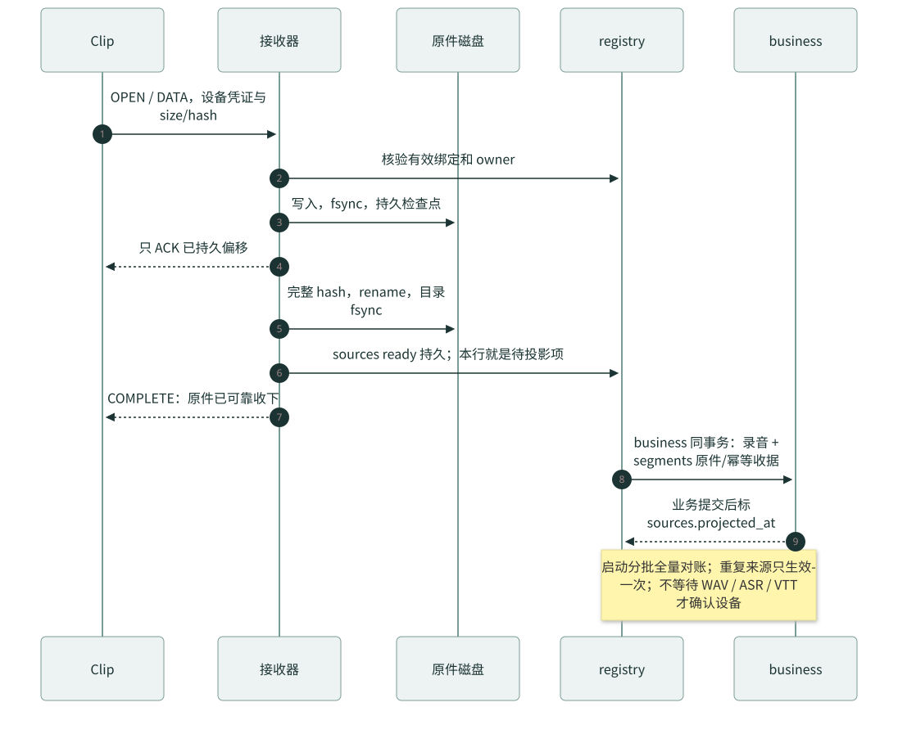
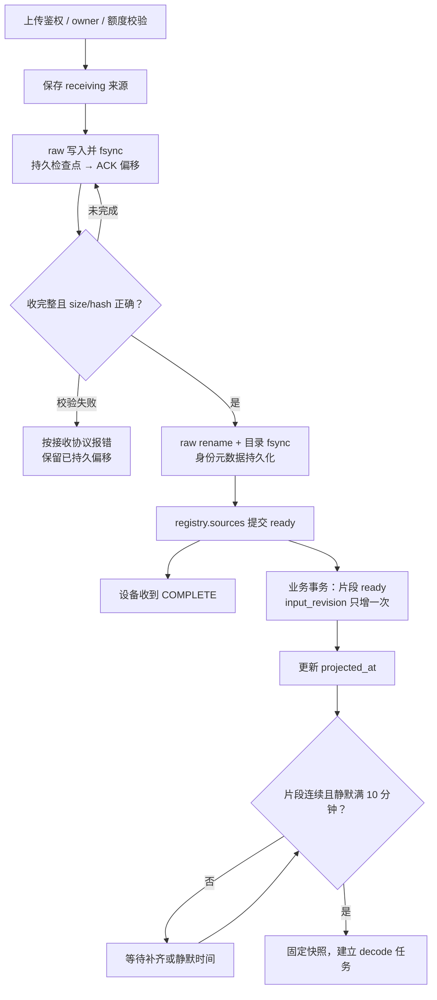
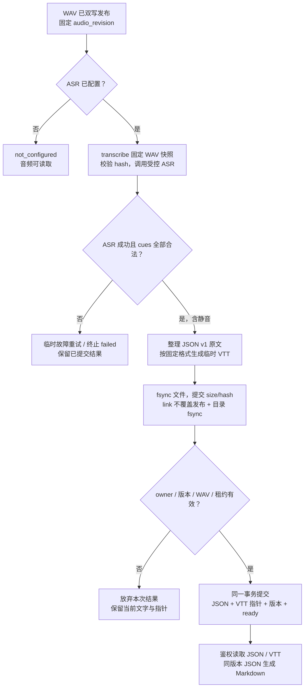
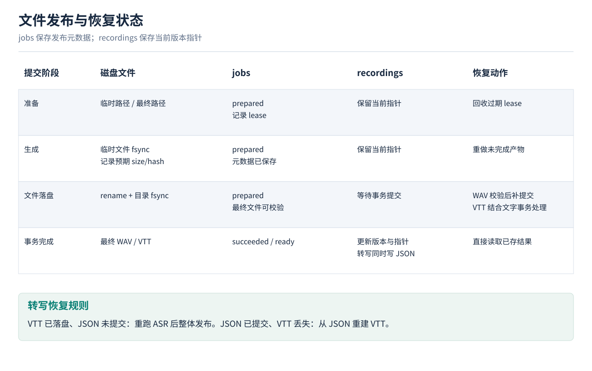
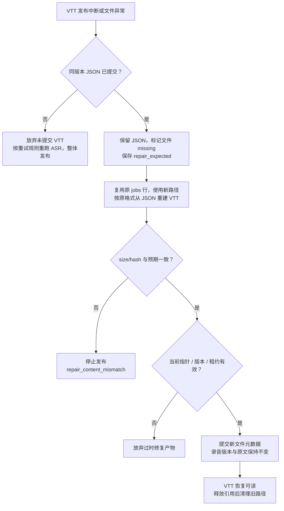
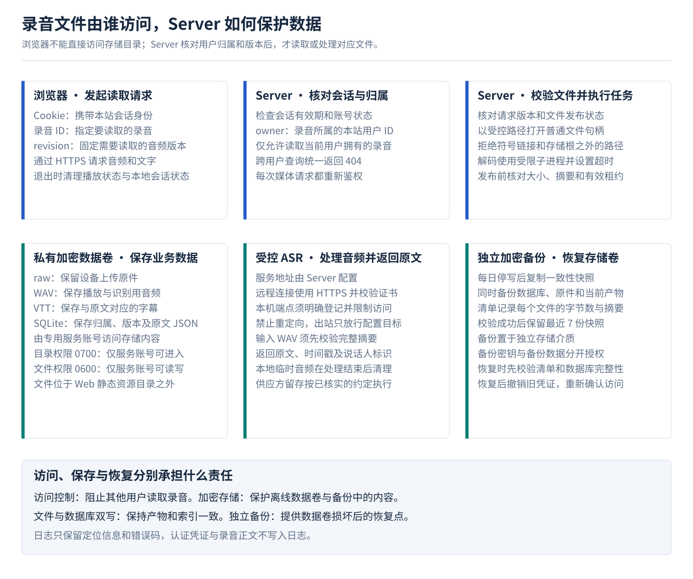

# 音频存储、双写与 VTT 开发设计

v1 · 2026-10-30 · [Server / Web 主文档](../README.md)

## 关键点

1. 原件先完成文件和来源索引持久化，再给设备 COMPLETE；解码与 ASR 在后台独立处理。
2. WAV/VTT 先可靠落盘，再提交 jobs 和录音指针；转写 JSON 与 VTT 指针在同一事务提交。
3. 每个文件关联 owner、recording_id 和版本；通过鉴权接口读取，存储卷与独立备份采用加密保护。
4. raw 原件与当前 WAV 分别保留，VTT/Markdown 由同组原文生成；损坏或中断按已提交状态恢复。

[收件](#ingest) · [字段](#tables) · [存储](#storage) · [转写](#transcript) · [双写恢复](#publication) · [接口](#media-api) · [安全](#security)

<a id="ingest"></a>

## 1. 原件收件与录音聚合





- 原件格式：uint16 little-endian 包长度 + Opus payload；校验包边界、size/hash 与媒体 profile
- 持久确认：data fsync、持久检查点、完整 hash、rename/目录 fsync；raw、身份元数据及 registry.sources ready 持久后返回 COMPLETE
- 来源归属：从验证通过的 Clip binding 取得 owner；旧来源 owner 保持原值
- 聚合键：source_kind + source_namespace + binding_epoch + source_session；source_kind 固定 clip_direct；Clip 的 source_namespace 使用 binding_id
- 输入版本：原始片段首次 ready 导入时 input_revision 加 1；重复来源保持版本
- 处理触发：片段从 1 开始连续且静默 10 分钟后处理当前已收内容；缺号时等待补齐
- 完整性：现有协议缺少整段闭合信息时保持 unknown；确认完整须有协议证据

业务投影使用一个短事务：按 source_namespace/source_id 查询片段；已有 ready 且 owner、recording_id、segment_no、hash/size 全部一致则幂等返回，冲突报 source_identity_conflict；首次 ready 同时保存原件元数据、imported_at 并增加录音版本。business 提交后再更新 registry.sources.projected_at。

启动按每批 500 条核对全部 ready 来源，检查 raw 存在和 size/hash；来源时间 created 从既有秒值转为 UTC 毫秒。receiving 保存上传状态，校验完成后创建处理输入。

<a id="tables"></a>

## 2. 处理对象与数据表

完整 DDL 见[主文档](../README.md#business-sql)。以下 jsonc 展示三张表的行对象，每个字段注明 SQL 类型、约束和用途；注释仅用于文档。时间为 UTC Unix 毫秒，时长为毫秒，size 为字节数。

### 2.1 recordings

```jsonc
{
  // TEXT；主键；必填。录音 ID。
  "id": "demo-recording",
  // TEXT；必填；外键。所属用户 ID，引用 accounts.user_id。
  "owner": "demo-user",
  // TEXT；必填。固定 clip_direct；Clip 经 Wi-Fi/DTLS 直传。
  "source_kind": "clip_direct",
  // TEXT；必填。等于 registry.bindings.id；片段与录音使用同一命名空间。
  "source_namespace": "demo-binding",
  // INTEGER；必填；>0。Clip 绑定代次，正整数。
  "binding_epoch": 1,
  // TEXT；必填。来源的录音 session；与来源/绑定代次一起确定一条录音。
  "source_session": "demo-session",
  // INTEGER；可空。录音时间，可空；时间不可信时按 received_at 查询。
  "recorded_at": null,
  // TEXT；必填。device_unverified / server_received / client_confirmed。
  "time_source": "server_received",
  // INTEGER；必填。首次收件时间。
  "received_at": 1793318400000,
  // INTEGER；必填。最近片段收件时间。
  "last_received_at": 1793318400000,
  // TEXT；必填；默认 'unknown'。unknown / gap / confirmed_complete；依协议证据更新。
  "integrity": "unknown",
  // INTEGER；必填；默认 0；≥0。已收输入版本；新 ready 片段首次导入时加 1。
  "input_revision": 1,
  // INTEGER；>0 且 ≤ input_revision。当前 WAV 对应的输入版本，可空。
  "audio_revision": 1,
  // INTEGER；>0 且 ≤ input_revision。当前转写对应的输入版本，可空；ready 时等于 audio_revision。
  "transcript_revision": 1,
  // TEXT；必填；默认 'pending'。当前输入的解码状态：pending / running / ready / failed。
  "audio_state": "ready",
  // TEXT；必填；默认 'pending'。not_configured / pending / running / ready / failed。
  "transcript_state": "ready",
  // TEXT；录音/owner/版本复合外键。当前 WAV 的 decode 任务，可空。
  "wav_job_id": "demo-decode-job",
  // TEXT；录音/owner/版本复合外键。当前 VTT 的 transcribe 任务，可空。
  "vtt_job_id": "demo-transcribe-job",
  // INTEGER；≥0。当前 WAV 时长，毫秒，可空。
  "duration_ms": 5800,
  // TEXT；合法 JSON v1；≤8 MiB。转写原文；数据库为序列化 JSON TEXT，此处展开展示。未识别时为 null；静音成功时 cues=[]。
  "transcript_json": {
    // integer；持久化结构版本。
    "schema_version": 1,
    // string；整数毫秒。
    "time_unit": "ms",
    // array；同一 WAV 的识别结果，字段规则见第 4 节。
    "cues": [
      {
        // integer；连续编号，从 1 开始。
        "cue_index": 1,
        // integer；相对 WAV 的开始毫秒。
        "start_ms": 0,
        // integer；相对 WAV 的结束毫秒。
        "end_ms": 2400,
        // string|null；稳定匿名说话人标识。
        "speaker": "A",
        // string；识别原文。
        "text": "我们确认一下今天的安排。"
      },
      {
        // integer；连续编号。
        "cue_index": 2,
        // integer；相对 WAV 的开始毫秒。
        "start_ms": 2400,
        // integer；相对 WAV 的结束毫秒。
        "end_ms": 5800,
        // string|null；另一位说话人。
        "speaker": "B",
        // string；识别原文。
        "text": "先检查设备，再核对录音文字。"
      }
    ]
  },
  // INTEGER；必填。录音状态或结果更新时间。
  "updated_at": 1793318400000
}
```

### 2.2 recording_segments

```jsonc
{
  // TEXT；主键；必填。原始片段 ID。
  "id": "demo-segment",
  // TEXT；必填；与录音组成复合外键。所属用户；与 recording_id 对应的录音一致。
  "owner": "demo-user",
  // TEXT；必填；与 owner 组成复合外键。所属录音 ID。
  "recording_id": "demo-recording",
  // TEXT；必填。等于 registry.bindings.id；片段与录音使用同一命名空间。
  "source_namespace": "demo-binding",
  // TEXT；必填；与 source_namespace 组合唯一。来源索引 ID；与 source_namespace 组成幂等键。
  "source_id": "demo-source",
  // INTEGER；必填；>0；录音内唯一。录音内片段号，从 1 开始。
  "segment_no": 1,
  // TEXT；必填。receiving / ready。
  "state": "ready",
  // TEXT；唯一。原件相对路径，可空；ready 时必须存在。
  "raw_relative_path": "clip/demo-binding/demo-object.bin",
  // INTEGER；>0。原件字节数，可空；ready 时必须存在。
  "size_bytes": 1024,
  // TEXT；64 字符。原件的 SHA-256，可空；ready 时必须存在。
  "sha256": "aaaaaaaaaaaaaaaaaaaaaaaaaaaaaaaaaaaaaaaaaaaaaaaaaaaaaaaaaaaaaaaa",
  // INTEGER；必填。片段首次接收时间。
  "received_at": 1793318400000,
  // INTEGER；可空。首次导入业务库的时间，可空；ready 时填写，兼作来源收据。
  "imported_at": 1793318400000
}
```

### 2.3 jobs

```jsonc
{
  // TEXT；主键；必填。任务 ID；一个任务对应一个 WAV 或 VTT 文件。
  "id": "demo-decode-job",
  // TEXT；必填；与录音组成复合外键。任务所属用户，与录音 owner 相同。
  "owner": "demo-user",
  // TEXT；必填；与 owner 组成复合外键。任务处理的录音 ID。
  "recording_id": "demo-recording",
  // INTEGER；必填；>0。任务对应的输入版本。
  "input_revision": 1,
  // TEXT；必填；与录音/版本组合唯一。decode / transcribe。
  "kind": "decode",
  // TEXT；必填。pending / running / retry_wait / succeeded / failed。
  "state": "succeeded",
  // INTEGER；必填；默认 0；0–4。已执行次数；0–4，包含首次执行与 3 次重试。
  "attempt": 1,
  // INTEGER；必填。允许领取的最早时间。
  "run_after": 1793319000000,
  // TEXT；可空。当前执行的随机标识，可空；running 时填写。
  "lease_token": null,
  // INTEGER；可空。当前执行的到期时间，可空；running 时填写。
  "lease_until": null,
  // TEXT；必填；合法 JSON。固定输入快照；数据库为序列化 JSON TEXT，此处展开展示；当前例子为 decode，transcribe 与修复附加值见 2.4。
  "input_json": {
    // integer；输入快照结构版本，固定 1。
    "schema_version": 1,
    // array；按 segment_no 升序，所有片段须属于同一 owner/recording_id。
    "segments": [{
      // string；recording_segments.id，运行时从索引取得路径。
      "segment_id": "demo-segment",
      // integer >0；录音内片段号，从 1 连续。
      "segment_no": 1,
      // integer >0；原件预期字节数。
      "size_bytes": 1024,
      // string；64 位小写十六进制 SHA-256。
      "sha256": "aaaaaaaaaaaaaaaaaaaaaaaaaaaaaaaaaaaaaaaaaaaaaaaaaaaaaaaaaaaaaaaa"
    }],
    // object；固定实际解码参数，普通重试保持不变。
    "decoder": {
      // string；可复现的解码器构建版本，部署时填写实际版本。
      "version": "example-decoder-build",
      // string；已验证固件音频格式，当前为 16 kHz/mono/20 ms。
      "raw_profile": "clip-16k-mono-20ms-v1",
      // integer；输出采样率 Hz。
      "sample_rate": 16000,
      // integer；输出声道数。
      "channels": 1,
      // string；PCM16 little-endian。
      "sample_format": "s16le",
      // integer；固定 WAV 头与编码格式版本。
      "wav_format_version": 1
    }
  },
  // TEXT；必填；默认 none。none / prepared / ready / missing / abandoned。
  "publication_state": "ready",
  // TEXT；唯一。临时产物相对路径，可空；prepared 时填写。
  "tmp_relative_path": null,
  // TEXT；唯一。最终文件相对路径，可空；prepared/ready 时填写。
  "final_relative_path": "derived/demo-decode-job/demo-publication.wav",
  // INTEGER；>0。最终产物字节数，可空；ready 时填写。
  "size_bytes": 185644,
  // TEXT；64 字符。最终产物 SHA-256，可空；ready 时填写。
  "sha256": "bbbbbbbbbbbbbbbbbbbbbbbbbbbbbbbbbbbbbbbbbbbbbbbbbbbbbbbbbbbbbbbb",
  // INTEGER；≥0。WAV 的 PCM 样本数，可空。
  "sample_count": 92800,
  // TEXT；可空。固定错误码，可空；记录失败原因。
  "error_code": null,
  // INTEGER；必填。任务建立时间。
  "created_at": 1793319000000,
  // INTEGER；必填。任务或文件状态更新时间。
  "updated_at": 1793319000000
}
```

- owner：片段、任务与录音 owner 相同
- 来源唯一键：source_namespace + source_id
- 录音内片段：recording_id + segment_no 唯一
- 后台处理：recording_id + input_revision + kind 唯一；一个 running
- 当前文件指针：复合 FK 保证录音/owner/版本；读写逻辑校验 WAV=decode、VTT=transcribe
- registry.sources：保存原件身份和 ready/projected_at，业务投影后再更新标记

### 2.4 jobs.input_json

decode 输入已在上一节 jobs.input_json 中展开。

转写任务输入：

```jsonc
{
  // integer；输入快照结构版本。
  "schema_version": 1,
  // object；已发布 WAV 快照。
  "wav": {
    // string；对应 decode jobs.id。
    "job_id": "demo-decode-job",
    // integer >0；WAV 字节数。
    "size_bytes": 185644,
    // string；WAV SHA-256，执行前复核。
    "sha256": "bbbbbbbbbbbbbbbbbbbbbbbbbbbbbbbbbbbbbbbbbbbbbbbbbbbbbbbbbbbbbbbb",
    // integer >=0；PCM 样本数。
    "sample_count": 92800
  },
  // object；固定识别参数，凭证由服务端配置读取。
  "asr": {
    // string；端点/凭证配置引用及版本。
    "config_version": "example-asr-config-v1",
    // string；实际部署模型标识。
    "model": "example-model",
    // string；供应方约定的语言参数。
    "language": "zh"
  },
  // integer；VTT 序列化版本，重建时沿用。
  "vtt_format_version": 1
}
```

已提交文件修复时，在原快照中附加 repair_expected：

```jsonc
{
  // object；修复前已发布文件的预期元数据。
  "repair_expected": {
    // integer >0；原文件字节数。
    "size_bytes": 185644,
    // string；原文件 SHA-256，修复结果须一致。
    "sha256": "bbbbbbbbbbbbbbbbbbbbbbbbbbbbbbbbbbbbbbbbbbbbbbbbbbbbbbbbbbbbbbbb",
    // integer|null；WAV 原样本数；VTT 为 null。
    "sample_count": 92800,
    // string；原最终路径，修复后按下载引用清理。
    "final_relative_path": "derived/demo-decode-job/demo-publication.wav"
  }
}
```

领取时再按 owner/recording_id 校验片段与任务，路径从索引取得。修复必须取得原版本解码器/格式，无法取得时记 repair_dependency_unavailable。

<a id="storage"></a>
<a id="decode"></a>

## 3. 音频文件存储

### 3.1 保存对象与读取条件

- raw：原件文件；registry.sources 和 recording_segments 保存归属、size/hash、路径；完整校验后 sources/segment 为 ready；持续保存，用于重试和恢复
- WAV：文件；decode jobs 保存最终路径、size/hash、sample_count；文件 ready 且被 recordings.wav_job_id 引用；每条录音一个当前版本；旧版本在引用释放后清理
- 转写 JSON：recordings.transcript_json、transcript_revision；与当前音频同版本且文字 ready；整体替换为新版本原文
- VTT：文件；transcribe jobs 保存路径、size/hash；文件 ready 且被 recordings.vtt_job_id 引用；与对应 JSON 一起发布和保留
- Markdown：从同版本 JSON 即时生成；文字 ready；随本次下载返回

raw 与 WAV 是两种分别保存的音频。双写是文件持久化与 SQLite 记录提交，具体顺序见[第 5 节](#publication)。文件索引继续使用现有三张处理表，DDL 见[主文档](../README.md#business-sql)。

### 3.2 文件保存规则

- 文件标识：owner、recording_id、job_id 由 Server 取得或生成；final_relative_path 按输入版本和本次执行生成，发布后保持不变
- 路径使用：路径只保存在索引中；Web 使用录音 API 地址；原件沿用现有 ResumeStore
- 临时文件：创建时独占新文件，放在与最终文件相同的文件系统；写入期间 publication_state=prepared
- 完整性：raw 入库、派生产物发布、ASR 调用前与备份恢复时校验 size/SHA-256；WAV 另核对格式、样本数和时长
- 容量检查：OPEN 按原件声明 size 预留；生成前按 raw 包时长计算 WAV 上限，VTT 按 64 MiB 上限预留；检查用户余额与实际空闲空间，另留至少 256 MiB。写入时继续检查，空间不足立即停止
- 用户额度：部署必须配置每用户额度，单位为正整数字节数。raw 按 registry.sources 唯一来源计费：ready 计实际 size，receiving 计完整声明 size；业务片段索引不重复计费。加上该 owner 的派生文件、临时文件和待清理旧文件；同一物理文件的硬链接只计一次。续传沿用原预留，超额反馈 storage_quota_exceeded
- 清理：放弃的临时文件在执行结束后清理；旧产物须无当前指针、任务输入或下载引用。先将 jobs 同时置 state=failed、publication_state=abandoned、error_code=artifact_superseded 并提交，再删除文件并 fsync 目录，最后删除无引用 jobs 行；中断后继续清理，下载断开时释放引用
- 原件缺失：保留来源索引，暂停依赖该原件的处理并记录 source_missing；由校验通过的备份恢复

存储失败按发生位置返回：

- 原件接收：使用既有 HTTP/DTLS 接收协议反馈过限、空间不足或身份/hash 冲突；失败时仅保留已持久偏移
- 后台生成：error_code 保存 storage_full、storage_quota_exceeded、source_missing 等；仅临时故障进入 retry_wait，重试规则见第 5 节；终止后 state=failed
- Web 查询：详情返回 audio_error_code / transcript_error_code；已成功发布的旧结果继续按版本读取
- 媒体读取：文件不可用时返回 503 audio_unavailable / vtt_unavailable；错误格式见主文档

### 3.3 解码与产物校验

固定来源清单，按 segment_no 从 1 连续读取。逐包解析 uint16 little-endian 长度与 Opus payload，检查包边界、size/hash 和媒体 profile；临时解码后合成一份 **16 kHz、mono、PCM16 little-endian WAV**。

支持的 raw profile 固定为 16 kHz、mono、20 ms Opus：每包解码得到 320 个样本，单包 payload 为 1–2000 字节；逐段创建 decoder，保留完整解码样本，不自行补帧或裁剪 pre-skip。其他 profile 返回 unsupported_media_profile。sample_count 为拼接后的样本总数，duration_ms=round(sample_count×1000/16000)；原件的段号和包顺序保持不变。任务固定解码器/格式配置，已发布结果沿用原配置。

- 单 raw 段：8 MiB；按实际已收字节执行限制
- 连续录音：默认上限 8 小时，PCM16 约 115.2 MB/小时
- 输出文件：WAV 上限 1 GiB，VTT 上限 64 MiB；写入过程中执行限制
- 执行时间：decode 默认 10 分钟，ASR 默认 60 分钟
- 空间不足：接收或生成停止，原件和上一份已提交结果保留；错误为 storage_full

解码成功后将 size_bytes、sha256、sample_count 保存到对应 jobs 行，按第 5 节发布。解码错误使用 packet_invalid、segment_gap、decode_timeout 等固定 code。WAV 使用固定 fmt/data 头和 PCM 内容，避免时间戳等可变头信息影响同版本修复的 hash。

<a id="transcript"></a>

## 4. 识别原文与 VTT



持久格式为 `{schema_version:1,time_unit:"ms",cues:[...]}`。接口补充 recording_id、revision 和 next_cursor：

<a id="json-example"></a>

```jsonc
{
  // integer；结构版本，固定 1。
  "schema_version": 1,
  // string；仅接口返回，recordings.id；不写入 transcript_json。
  "recording_id": "demo-recording",
  // integer；仅接口返回，recordings.transcript_revision；须等于 audio_revision。
  "revision": 1,
  // string；时间单位，固定 ms。
  "time_unit": "ms",
  // array；持久化原文；静音成功时为空数组。
  "cues": [
    {
      // integer；从 1 连续，按起点和供应方稳定顺序排列。
      "cue_index": 1,
      // integer；相对当前 WAV 的起点毫秒，>=0。
      "start_ms": 0,
      // integer；start_ms < end_ms <= duration_ms。
      "end_ms": 2400,
      // string|null；A/B/C…稳定匿名映射，缺失时 null。
      "speaker": "A",
      // string；UTF-8 原文，CRLF/CR 统一为 LF，保留标点和换行。
      "text": "我们确认一下今天的安排。"
    },
    {
      // integer；下一句连续编号。
      "cue_index": 2,
      // integer；相对 WAV 的起点毫秒，允许多人发言重叠。
      "start_ms": 2400,
      // integer；相对 WAV 的终点毫秒。
      "end_ms": 5800,
      // string|null；另一位说话人。
      "speaker": "B",
      // string；识别原文，输出时按格式转义。
      "text": "先检查设备，再核对录音文字。"
    }
  ],
  // string|null；仅接口返回，不透明分页游标；末页为 null。
  "next_cursor": null
}
```

秒数在 ASR adapter 中转换为整数毫秒，最多 1ms 的边界精度误差夹到音频范围，处理后仍须 start<end。拒绝 NUL、非法编码、空白句和非法时间，整批校验后发布；合法多人重叠保留。每句最多 10000 字符、每录音最多 100000 cues，JSON 最多 8 MiB UTF-8，超限返回 transcript_limit_exceeded。

静音识别成功保存 cues=[]、状态 ready 和 `WEBVTT\n\n`；ASR 未配置为 not_configured，识别失败为 failed。WAV 独立可播放。

<a id="vtt-example"></a>

对应 VTT：

```vtt
WEBVTT

1
00:00:00.000 --> 00:00:02.400
<v A>我们确认一下今天的安排。</v>

2
00:00:02.400 --> 00:00:05.800
<v B>先检查设备，再核对录音文字。</v>
```

VTT format v1 固定使用 UTF-8、无 BOM、LF 换行。文件以 `WEBVTT\n\n` 开始，各 cue 为编号、`HH:MM:SS.mmm --> HH:MM:SS.mmm`、正文和一个空行，末尾同样保留空行。正文先去掉首尾换行，将内部空白行合并为一个换行，再依次转义 `&`、`<`、`>` 为实体；speaker 非空时套 `<v A>…</v>`，为空时输出正文。重建沿用同一格式版本，JSON 原文保持不变。格式依据：[W3C WebVTT](https://www.w3.org/TR/webvtt1/)。

Web 用 textContent 渲染原文。Markdown 标题使用有效录音日期，按 cue 顺序输出时间、speaker 和转义后的原文；结果作为附件下载。

<a id="publication"></a>

## 5. 文件与数据库双写



### 5.1 原件双写与业务投影

- 1：校验有效上传凭证、owner、绑定代次和原件身份，保存 receiving 来源；接收请求可继续
- 2：写 raw 数据并 fsync，再持久化检查点；恢复时以检查点偏移为准；ACK 已持久偏移
- 3：收完整后验证 size/hash，原件 rename，目录 fsync，保存可恢复的身份元数据；等待完成确认
- 4：registry.sources 提交 ready，保留 owner、binding/session/segment、object_id、size/hash；返回 COMPLETE
- 5：业务短事务提交 recordings、recording_segments、imported_at 与输入版本；随后标记 projected_at；后台执行

原件与 registry 双写完成是 COMPLETE 的条件。业务库暂不可用时，ready 来源留待投影，设备确认继续按原件持久结果执行。业务提交后标记失败则重放，相同来源只增加一次版本。

### 5.2 WAV/VTT 双写提交

- 1：短事务保存 owner、recording_id、input_revision、输入快照、lease、临时/最终路径，提交 prepared；处理结果未发布
- 2：生成临时文件，校验内容、size/hash，文件 fsync；短事务提交 jobs.size_bytes/sha256，WAV 同时提交 sample_count；处理结果未发布
- 3：复核任务身份与版本；同一文件系统以 link(tmp,final) 原子创建最终文件，禁止覆盖；fsync 目录；文件已存在，API 仍等待提交
- 4：一个短事务核对 owner、录音/输入版本、kind、lease_token 与有效期；提交 jobs ready/succeeded 及录音结果；当前版本可读
- WAV 结果：wav_job_id、audio_revision、duration_ms 同事务更新；文字按配置置 pending/not_configured；音频可读取
- 转写结果：transcript_json、vtt_job_id、transcript_revision、文字 ready 与 jobs 成功同事务更新；文字与 VTT 一起发布

最终路径已存在时核对该任务、版本及 size/hash；相同内容幂等复用，冲突记 file_publication_conflict 并保留已有文件。提交后删除临时硬链接并 fsync 目录；最终事务失败时保留原录音指针，由恢复流程处理已落盘文件。

发布事务使用以下条件，任一不符都放弃本次结果：

- 新 WAV：owner/recording_id 匹配；kind=decode；任务版本等于 recordings.input_revision
- 新转写：kind=transcribe；任务版本同时等于 input_revision 与 audio_revision；wav_job_id 等于输入快照的 WAV job_id，且该文件 ready、hash 与快照一致
- 文件修复：按 5.4 的当前指针与已发布版本判断；保留原文字，不要求等于最新 input_revision
- 所有类型：owner/recording_id 匹配；jobs.state=running、publication_state=prepared、lease_token 匹配且未到期；最终文件 size/hash 与已存元数据一致

### 5.3 后台执行与恢复



- kind / 去重键：decode、transcribe；recording_id + input_revision + kind
- 执行：顺序领取一个任务，固定 owner、输入版本与配置
- 租约：60 秒，15 秒续期；发布时校验 token、有效期和版本
- 重试：最多 4 次执行，间隔 30 秒 / 2 分钟 / 10 分钟
- 旧版本：普通待处理旧版本设 state=failed、error_code=input_superseded；执行中发现版本变化也停止发布。当前已发布文件的修复按指针判断
- 恢复次数：启动先将过期 running 置 retry_wait 并清 lease，保留 prepared 文件与元数据；重新领取后核验补提交不增加 attempt，真正重做增加 attempt，达到上限标 failed
- 故障分类：ASR 超时/429/5xx、临时存储或数据库故障进入 retry_wait；包/hash/身份冲突、额度/输出超限、配置缺失和修复不匹配直接 failed。状态更新与对应错误码同事务保存

- raw 数据已写，检查点尚未提交：按持久检查点恢复，未确认的尾部截断后续传
- raw 完整，registry ready 未提交：由身份元数据和 size/hash 对账补 ready，再响应重试请求
- 业务已提交，projected_at 未更新：幂等重放，保持一次版本递增
- WAV 已落盘，DB 最终事务未提交：校验元数据、当前输入和新租约后补提交
- VTT 已落盘，JSON 未提交：放弃本次未提交产物，重跑 ASR 后整体发布
- JSON 已提交，VTT 缺失/不可信：保留原文，从同版本 JSON 重建 VTT
- WAV 缺失/不可信：jobs.publication_state=missing，从校验通过的 raw 重建
- 原件缺失：记录 source_missing，保持来源归属，等待备份恢复
- 文件冲突、磁盘满、事务失败：保留 raw 与上一份已提交结果；API 返回明确状态

- 新来源投影：同事务增加 input_revision、置 audio_state=pending，保留已发布文件与文字
- 满足处理条件：片段连续且静默满 10 分钟，固定当前快照并幂等建立 decode 任务；启动补建符合条件的缺失任务
- 领取 / 发布 WAV：领取置 audio_state=running；发布同事务置 ready、更新 WAV，并按配置置文字 pending/not_configured；已配置时建立同版本 transcribe 任务
- 领取 / 发布文字：领取置 transcript_state=running；发布时 JSON、VTT 指针和 ready 同事务提交
- 任务终止：仅当前版本普通任务回写对应录音状态 failed；过时任务只更新 jobs
- 文件修复：只改变 jobs 的文件状态，JSON/Markdown 继续按已提交文字状态读取

### 5.4 已提交文件修复

- 开始修复：当前已成功产物首次变为 missing 时，复用同一 jobs 行，原 size/hash/sample_count/最终路径写入 input_json.repair_expected，再置 pending、attempt=0；修复失败按本轮上限停止，维护确认后才可再次重启
- 新路径：每次发布另生成 Server UUID 作为唯一标识；重试和修复使用新路径，避免复用旧 attempt 路径
- WAV 修复：使用原输入快照和固定解码配置，从 raw 重建；输出 size/hash/sample_count 必须与 repair_expected 一致，否则 repair_content_mismatch
- VTT 修复：直接从已提交同版本 JSON 重建，不重新 ASR；校验结果与 repair_expected 的 size/hash 一致
- 修复提交：WAV 复核 wav_job_id/audio_revision 仍指向本任务/版本；VTT 复核 vtt_job_id、transcript_revision、audio_revision 与 JSON 仍对应；只替换文件元数据，不改变录音版本和文字；提交后按下载引用清理 repair_expected 保存的旧路径
- 已被替换：当前指针已更新或版本不再匹配时，放弃旧文件修复并清理本次临时产物

普通新结果发布以当前 input_revision 为条件；修复以当前已发布指针和版本为条件。两者都在最终事务内复核 owner 和租约，旧执行结果不能覆盖新结果。

<a id="media-api"></a>

## 6. 音频与文字 API

路径前缀 `/api/boa/v1`，携带本站会话，owner 取自会话；统一错误格式见[主文档](../README.md#web-api)。

- GET `/recordings/{id}/audio.wav`：revision；可选 Range；audio/wav，200 或 206
- HEAD `/recordings/{id}/audio.wav`：revision；200，资源头和空 body；忽略 Range
- GET `/recordings/{id}/transcript`：revision、cursor；JSON v1，每页最多 200 cues
- GET `/recordings/{id}/transcript.vtt`：revision；text/vtt; charset=utf-8，附件
- GET `/recordings/{id}/transcript.md`：revision；text/markdown; charset=utf-8，附件

- 401 / 403：会话失效 / 账号禁用
- 404：不存在或不属于当前 owner
- 409 recording_revision_changed：请求版本与当前音频不符
- 409 audio_not_ready / transcript_not_ready：对应结果处理中
- 503 asr_not_configured / transcript_failed：ASR 未配置 / 识别失败
- 503 audio_unavailable / vtt_unavailable：WAV / VTT 文件缺失或不可用；VTT 缺失时已存 JSON 和 Markdown 仍可读取
- 429：单用户媒体请求超过并发上限
- 416：GET 字节范围无效

### 6.1 版本与分页

详情先固定 recordings.audio_revision。所有媒体请求的 revision 为正整数；文字接口返回的 revision 取自 transcript_revision，并须等于 audio_revision。游标绑定 recording_id、revision、last_cue_index。

- 录音不存在或 owner 不匹配：404
- audio_revision 为空：解码失败为 503 audio_unavailable，其余为 409 audio_not_ready
- 请求 revision 与当前 audio_revision 不同：409 recording_revision_changed
- 文字请求且 transcript_state 为 not_configured / failed：503 asr_not_configured / transcript_failed
- 文字处理中或 transcript_revision 尚未匹配：409 transcript_not_ready
- 文件请求：校验 jobs.kind、publication_state、路径；WAV 来自 decode，VTT 来自 transcribe；文件缺失分别返回 503 audio_unavailable / vtt_unavailable

先在同一数据库快照内取得 owner、版本和文件元数据，再打开受控文件句柄；响应开始前复核会话有效。audio_state 描述当前输入的处理进度；已有 WAV 以 wav_job_id/audio_revision 及对应文件状态判断可用性。VTT 文件缺失不影响同版本 JSON/Markdown 读取。

JSON 使用 json_each 按 cue 数组下标读取 201 条：返回前 200 条，第 201 条决定 next_cursor。Markdown 迭代同一快照的全部 cues。复制取齐同版本全部页后再写剪贴板；仅遇到 409 recording_revision_changed 时重置旧音频和分页；not_ready 状态继续查询处理结果。

### 6.2 Range 与响应头

支持单一 `bytes=start-end`、`bytes=start-`、`bytes=-suffix`。end 截至 size-1，省略 end 时取 size-1；suffix>0 时 start=max(0,size-suffix)。start≥size、start>end 或 suffix=0 返回 416 与 `Content-Range: bytes */<size>`。多范围请求按普通 GET 返回整文件 200。

以 1000 字节文件为例：

- GET，bytes=0-99：206；bytes 0-99/1000；Content-Length=100
- GET，bytes=900-2000：206；bytes 900-999/1000；Content-Length=100
- GET，bytes=-200：206；bytes 800-999/1000；Content-Length=200
- GET，bytes=1000-：416；bytes */1000
- HEAD，bytes=0-99：200；Content-Length=1000，空 body

所有媒体请求重新鉴权。JSON body 返回 revision，文件响应设置 X-Recording-Revision。WAV/VTT 使用不可变路径，ETag 取对应 jobs.sha256；响应设置 Cache-Control: private, no-store。导出文件名由 Server 生成。Range/HEAD 依据 [RFC 9110 §14.2](https://www.rfc-editor.org/rfc/rfc9110.html#section-14.2)。

<a id="security"></a>

## 7. 文件与音频数据安全



- 用户隔离：所有列表、GET/HEAD/Range、JSON/VTT/Markdown 读取与后台处理先限定 owner；原件 owner 来自验证通过的 Clip 绑定
- 上传凭证：OPEN、续传和 COMPLETE 检查有效绑定/凭证；撤销后拒绝继续写入，历史归属保持原值
- 文件路径：raw 沿用服务端 object_id，派生路径使用服务端 job_id/发布 UUID；历史 owner 不直接拼进路径。以存储根目录句柄逐级 openat/O_NOFOLLOW，拒绝符号链接和非普通文件；路径检查与打开使用同一目录链
- 元数据写入：使用参数化 SQL，owner 由会话/来源确定；按录音、owner、版本复核关联后提交
- 存储访问：数据位于 Web 静态资源之外，由专用服务账号访问；目录 0700，音频、SQLite/WAL/SHM、配置和备份 0600
- 传输：Web 使用 HTTPS，Clip 使用现有认证 DTLS；证书和设备凭证由服务端受控配置
- 静态数据：数据卷与独立备份启用存储层加密；卷解锁和备份密钥由部署环境管理，密钥与备份分开授权
- 文件完整性：发布、ASR 输入和恢复核对完整 SHA-256；下载使用同一已打开文件句柄检查类型与 size，异常停止读取并标记产物不可用
- 资源限制：接收检查实际字节数、用户额度和空间；解码限制输出/时长/超时；媒体 GET/HEAD 按 owner 最多 4 个活动请求，超额返回 429 与 Retry-After: 1
- 解码执行：以服务账号用参数数组启动受控解码器，输入输出来自验证后的文件标识；部署环境限制 CPU/内存，超时结束子进程及其临时输出
- ASR 出站：仅调用服务端配置的 HTTPS 或明确登记的本机端点；禁用重定向，校验 TLS 证书，出站网络只放行配置目标；发送已校验 WAV，凭证由服务器侧加载
- 文本输出：JSON 保留纯文本，Web 用 textContent；VTT 转义，Markdown 用固定模板并转义原文中的 HTML/Markdown 控制字符后作为附件返回；响应设置 nosniff 和 private,no-store
- 日志：记录 request_id、recording_id/job_id、阶段、错误码和必要计量；认证凭证与录音/识别正文只用于业务处理
- 清理：Wi-Fi 密码、Google token 用毕释放引用，ASR 凭证仅服务端持有；临时音频在处理结束后清理，启动时回收无任务引用的残留；原件与旧产物按第 3 节保留/清理

ASR 配置须登记供应方保留期限和删除方式；选择不留存/不用于训练的处理设置。服务端可清理本地副本，供应方数据按其已核实的处理约定执行。

存储保护参考 [OWASP 文件上传](https://cheatsheetseries.owasp.org/cheatsheets/File_Upload_Cheat_Sheet.html)与[访问控制](https://cheatsheetseries.owasp.org/cheatsheets/Authorization_Cheat_Sheet.html)；额度、超时和保留期按本文配置。

### 7.1 一致性备份与恢复

- 默认备份：每日关闭接收入口，停止后台领取、终止未结束子进程并关闭数据库，生成加密快照后重启；待复制完成前保持停写。保留最近 7 个验证成功快照，周期与份数可配置
- 快照内容：两个数据库及仍存在的 WAL、raw/身份元数据/检查点、当前 WAV/VTT、配置和恢复所需凭证；SHM 在恢复时重建
- 独立副本：备份置于独立存储介质，恢复授权与线上读写分开；备份清单记录时间、数据库版本、文件 size/hash
- 验证：在临时验证副本校验数据库完整性、外键、原件数量和文件 size/hash；备份包保持只读，验证成功后才替换旧快照
- 恢复：在隔离环境解密并校验清单，执行 integrity_check/foreign_key_check；重做来源投影和未提交发布；全部通过再切换数据卷，失败保留原卷。历史录音 owner 保持原值
- 恢复后的凭证：本站会话清空，先将恢复账号全部 disabled、auth_version 加 1，撤销所有恢复的上传/Bearer 凭证；维护人员依据当前可信登记逐一启用并核发凭证，确认前保持拒绝访问

恢复点为最近验证成功快照；默认备份间隔 24 小时，备份失败须告警。备份位置与加密密钥未配置、存储卷未解锁、配额非法时，服务拒绝启动。
