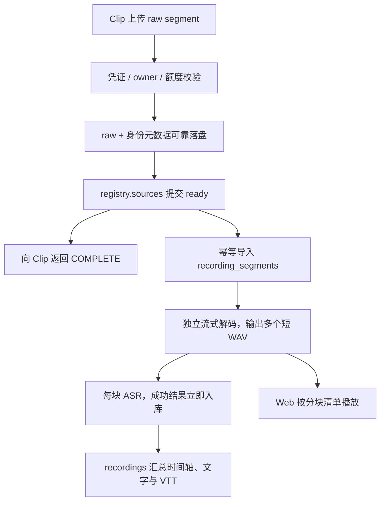
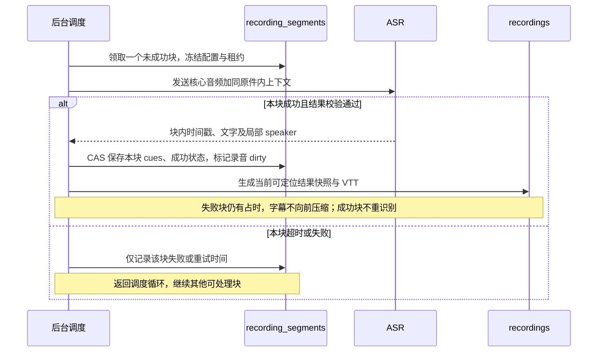

# 分块音频、转写与 VTT 开发设计

v2 · 2026-11-01 · [Server / Web 主文档](../README.md)

## 关键点

1. 不先合成整条录音的大 WAV。每份 raw 原件独立流式解码，输出有界的播放块；ASR 按块识别，整条录音只合并时间轴与字幕。
2. 业务库仅保留 accounts、recordings、recording_segments 三张表。删除独立 jobs 表；处理进度、租约、失败重试与分块结果放在原始片段行内，汇总发布状态放在录音行内。
3. 已完成块持续保存，ASR 失败只重试对应块；后续新片段不会使先前成功块失效。WAV 播放与转写分别推进。
4. 原件收完整即确认设备；块结果与汇总结果分层提交，可恢复中断。部分结果明确标记 partial，不冒充整条录音已完成。

这是设计替换稿，尚未实现或实机验收。采用前述分块方案；以下默认时长、上下文和限额属于工程设计值，须按实际 ASR 能力配置和验证。

[收件](#ingest) · [字段](#tables) · [存储与分块](#storage) · [转写](#transcript) · [发布恢复](#publication) · [接口](#media-api) · [安全](#security)

<a id="ingest"></a>

## 1. 原件收件与录音聚合

两个独立 SQLite 数据库分别是：设备与上传 SQLite（registry）保存绑定、凭证与来源；业务 SQLite 保存用户、录音、原始片段及行内分块结果。raw 文件保存在私有目录，`registry.sources` 是来源表，不是另一种存储服务。




- 来源聚合键为 source_kind + source_namespace + binding_epoch + source_session；source_kind 固定 clip_direct，source_namespace 为绑定 ID；原件 segment_no 从 1 开始。
- receiving 的持久偏移才可 ACK；原件 size/hash 正确、文件和目录 fsync、身份元数据及来源 ready 均持久化后才 COMPLETE。解码或 ASR 失败不撤销已完成收件。
- 业务短事务按 source_namespace/source_id 去重；已存在且 owner、录音、段号、size/hash 一致时不重复导入，不重复增加 input_revision，冲突返回 source_identity_conflict。
- 业务提交后才更新 registry.sources.projected_at；启动每批 500 条对账全部 ready 来源，不只依赖此标记。来源 created 由旧 Unix 秒转为 UTC 毫秒。
- ready 原件可立即处理，无须等待整条录音静默 10 分钟，也不因缺少前段而停止后段本地解码/识别。缺号只阻止未知全局时间轴的发布。
- integrity 仍是 unknown / gap / confirmed_complete。静默只能表明暂时无新上传，不能证明录音完整；confirmed_complete 必须有协议闭合证据。

<a id="tables"></a>

## 2. 三张业务表与处理归属

完整 DDL 见[主文档](../README.md#business-sql)。保留 accounts；下面展示 recordings 和 recording_segments 新增或变化的字段。SQL JSON 字段均以 TEXT 序列化，以下用 jsonc 展开，每个字段注明含义；时间为 UTC 毫秒，音频位置以 16 kHz PCM 样本数为准。

### 2.1 recordings：整条录音及已发布汇总

```jsonc
{
  // TEXT 主键；owner、来源身份、时间和 integrity 沿用主文档。
  "id": "recording-001",
  // INTEGER；新 raw 原件首次导入时递增，表示输入集合变化。
  "input_revision": 3,
  // INTEGER；每次发布新音频清单/文字/VTT 时递增；不等于原件数量。
  "result_revision": 5,
  // INTEGER；当前结果快照所覆盖的输入版本，发布后不随新上传自动变化。
  "published_input_revision": 3,
  // INTEGER；样本数已知且从 segment_no=1 连续的前缀长度。
  "timeline_prefix_no": 2,
  // INTEGER；已发布连续前缀总时长；无时间轴时为 null。
  "duration_ms": 120000,
  // TEXT；pending / partial / ready / failed。只描述当前已收输入的音频进度。
  "audio_state": "partial",
  // TEXT；not_configured / pending / partial / ready / failed。
  "transcript_state": "partial",
  // TEXT(JSON)；已发布播放清单，结构见接口；不包含原件磁盘路径。
  "audio_manifest_json": {"schema_version": 2, "items": []},
  // TEXT(JSON)；唯一已发布整条文字来源。包含 cues、coverage 和完整性标记。
  "transcript_json": {"schema_version": 2, "time_unit": "ms", "cues": [], "coverage": []},
  // TEXT(JSON)|null；当前 VTT 的不可变路径、size/hash、格式版本、ready/missing 状态。
  "vtt_file_json": null,
  // INTEGER；存在未汇总的输入或块状态变化时为 1，发布后按 CAS 条件清零。
  "merge_dirty": 1,
  // TEXT；idle / pending / running / retry_wait / failed；仅用于汇总，不调用 ASR。
  "merge_state": "pending",
  // INTEGER；当前汇总输入快照的执行次数，最多 4 次。
  "merge_attempt": 0,
  // INTEGER；下次允许汇总的时间；新块会重新标记 dirty。
  "merge_run_after": 1793491200000,
  // TEXT|INTEGER|null；汇总执行租约；running 时必须存在。
  "lease_token": null,
  "lease_until": null,
  // TEXT|null；汇总失败原因；分块失败在 segment/chunk 内保存。
  "merge_error_code": null,
  // TEXT(JSON)|null；待发布快照及 VTT 元数据，供落盘后补提交，不重新识别。
  "pending_publication_json": null,
  // TEXT(JSON)；替代后待清理文件，下载引用释放且删除完成才移除。
  "retained_files_json": []
}
```

`result_revision` 替代旧 audio_revision/transcript_revision。播放清单、汇总 JSON 和 VTT 共用一个结果快照版本，ASR 进度不再依赖整条 WAV。input_revision 只统计原件变化，块识别完成不增加它。

### 2.2 recording_segments：一份原件及其分块处理

一行始终对应一份 raw 原件。chunk 是该原件内部的计算块，保存在行内 JSON 数组中，不增加 chunk 表或 jobs 表。数组按 index 有序，单进程逐项处理；这是减少表数量的取舍，不以此支持大量并发写入。

```jsonc
{
  // TEXT；原件 ID，owner/recording_id/source_namespace/source_id 等仍保留。
  "id": "segment-001",
  // INTEGER；录音内原件序号，不能当作 chunk 序号。
  "segment_no": 1,
  // TEXT；receiving / ready；只表示 raw 是否收到，与转写进度分开。
  "state": "ready",
  // TEXT；原件路径，size_bytes/sha256 保留原件含义，不挪作 WAV 元数据。
  "raw_relative_path": "raw/object-001.bin",
  // INTEGER；原件解码配置代次，默认 1；主动换模型/切块规则时显式增加。
  "process_generation": 1,
  // TEXT(JSON)|null；冻结解码器、模型、语言、切块/上下文及序列化版本，不含凭证。
  "process_config_json": {"chunk_seconds": 60, "context_seconds": 1, "sample_rate": 16000, "decoder_version": "example-build", "asr_config_version": "example-v1", "vtt_format_version": 2},
  // TEXT(JSON)|null；主动重处理前的完整旧代配置、样本数和 chunks；新代未全成前仍用于汇总。
  "previous_generation_json": null,
  // INTEGER|null；完整扫描原件后得到的准确 PCM 样本总数。
  "sample_count": 1920000,
  // TEXT；pending / running / retry_wait / ready / failed。
  "decode_state": "ready",
  // TEXT；not_configured / pending / partial / running / retry_wait / ready / failed。
  "transcript_state": "partial",
  // TEXT|null；当前领取的工作阶段：decode / transcribe / repair。
  "work_stage": null,
  // INTEGER|null；正在识别或修复的块号；解码扫描时可空。
  "work_chunk_index": null,
  // INTEGER；解码/修复尝试次数；ASR 时镜像所领取块的 asr_attempt。
  "attempt": 1,
  // INTEGER；重试最早时间；60 秒租约每 15 秒续期。
  "run_after": 1793491200000,
  // TEXT|INTEGER|null；同一行一次只允许一个执行者处理。
  "lease_token": null,
  "lease_until": null,
  // TEXT|null；当前阶段/块失败原因；永久失败须保留。
  "error_code": null,
  // TEXT(JSON)；只含本原件的有界分块结果；每次成功提交一块。
  "chunks_json": [{
    // TEXT；由 segment_id / generation / index 确定的服务端块标识。
    "id": "segment-001-g1-c0",
    // INTEGER；原件内从 0 开始连续。
    "index": 0,
    // INTEGER；核心区间 [start_sample,end_sample)，无重叠，相对本原件。
    "start_sample": 0,
    "end_sample": 960000,
    // OBJECT；无重叠的核心 WAV；播放只读取核心音频。
    "wav": {
      "state": "ready",
      "relative_path": "derived/segment-001/g1/c0/publication.wav",
      "size_bytes": 1920044,
      "sha256": "bbbbbbbbbbbbbbbbbbbbbbbbbbbbbbbbbbbbbbbbbbbbbbbbbbbbbbbbbbbbbbbb"
    },
    // TEXT；pending / running / retry_wait / ready / failed / not_configured。
    "asr_state": "ready",
    // INTEGER；本块 ASR 的执行次数，与其他块独立。
    "asr_attempt": 1,
    // INTEGER；本块下次识别时间；切换处理其他块后仍保留。
    "asr_run_after": 1793491200000,
    // ARRAY；替代后待清理文件描述，删除并 fsync 后才移除。
    "retired_paths": [],
    // ARRAY|null；相对原件的毫秒时间；null 未成功，[] 表示识别成功但静音。
    "cues": [{"start_ms": 0, "end_ms": 2400, "speaker": "segment-001-g1-c0:A", "text": "确认一下今天的安排。"}],
    // TEXT|null；本块最终失败码；成功块不能因别块失败而清空。
    "asr_error_code": null
  }],
  // TEXT(JSON)|null；当前块 prepared 文件元数据或修复预期；不改变已发布结果。
  "pending_artifact_json": null
}
```

数组内的 wav 元数据、cues 字段类型、枚举、范围与上限由应用层校验，DDL 只保证 JSON 外层和体积。每次修改 chunks_json 都在短事务内复核原件 hash、generation、阶段、块号及有效租约，并更新整行；不得以旧数组覆盖其他已提交结果。同一事务将 recordings.merge_dirty=1。

### 2.3 领取与状态规则

- 一个后台调度循环顺序处理解码、单块 ASR、修复、录音汇总；每次 ASR 只发送一个核心块加上下文。每次单块 ASR 完成即归还调度；一次原件解码扫描受时长/超时上限约束，汇总与其他可执行原件在扫描结束后继续轮转。
- `BEGIN IMMEDIATE` 领取目标行，保存随机 lease_token、lease_until、work_stage 和 work_chunk_index。外部调用、解码与文件 I/O 在事务外执行，发布用条件更新；租约过期者不得提交。
- segment.attempt 保存当前 decode/repair 次数，ASR 时只是所领取块 asr_attempt 的镜像；每块的 asr_attempt/asr_run_after 是持久重试依据。最多 4 次，间隔 30 秒、2 分钟、10 分钟，切换其他块不清除失败块的次数和待执行时间。行 run_after 是下一可执行工作的最早时间，由扫描块状态重新计算；汇总使用 recordings.merge_attempt。
- 暂时故障（超时、429、5xx、临时存储故障）进入 retry_wait；原件/hash/格式冲突、配额和结构超限直接 failed。失败块保留，调度可继续其他块；维护确认后才显式重试永久失败块。
- 已成功块按原件 hash + generation + index + 固定配置复用；补传新 segment 不重跑旧块。主动改变配置是显式重处理，冻结旧已发布快照；重处理中的 segment 在新 generation 全部解码和识别完成前，仍引用该 segment 的旧已发布块，首次处理则允许 partial。新代开始前在同一事务将旧 generation、process_config_json、sample_count 和完整 chunks_json 保存到 previous_generation_json，再初始化当前代。汇总在新代未全成前选择 previous_generation_json；新代全部成功后以事务切换并触发汇总。旧代字段及文件保留到已发布/下载引用释放。只有显式重处理终止或成功后才允许再次更换 generation，不能丢失尚在使用的旧代。
- 未配置 ASR 时 decode 继续，块与 segment 文字状态为 not_configured；配置完成后冻结 ASR 设置并补识别，不能覆盖已有成功块。更换已有识别配置须新 generation。

<a id="storage"></a>
<a id="decode"></a>

## 3. 流式解码与分块存储

### 3.1 原件与计算块

原始 segment 是上传协议的文件边界，chunk 是 Server 的识别边界；两者不必一一对应。默认核心块 60 秒，最后一块不足时保持实际长度。切块按 PCM 样本数固定，区间无重叠、无丢帧，空文件或零样本原件拒绝。

raw 格式仍是 uint16 little-endian 长度 + Opus payload；支持 16 kHz、mono、20 ms profile，每包 320 样本、payload 1–2000 字节。每份原件独立建立 decoder，完整校验包边界、size/hash，不拼 raw 后共用解码器，不擅自裁剪 pre-skip 或补帧。其他 profile 报 unsupported_media_profile。

解码器顺序读取原件并流式输出有界 WAV；不把整份 PCM 放入内存，不生成整条录音 WAV。完整扫描结束才提交 segment.sample_count 与 decode_state=ready；仅在此后领取该原件的 ASR 块，确保上下文和完整性已经确定；扫描失败时已落盘的块只作为可核验缓存，该 segment 不进入全局播放时间轴。扫描重试可从原件开头重做并复用同内容缓存，无须重做已有成功 ASR。

- 核心 WAV 固定 16 kHz、单声道、PCM16 little-endian；固定 fmt/data 头。60 秒核心 PCM 为 1,920,000 字节；实际 ASR 输入还包含上下文与 WAV 头。
- 相邻核心块是紧接的样本区间。识别时读取同一原件内前后核心 WAV 各至多 1 秒作为上下文，形成临时短 WAV；播放始终使用无上下文的核心 WAV。
- 只在同一原件内部提供重叠；原始 segment 边界不借用尚未到达的相邻原件，避免新上传使旧识别失效。边界句子可能受截断影响，这是 v2 明确限制，不能宣称完整消除了断句。
- 默认 raw 原件上限 8 MiB、单原件解码时长上限 1 小时、已收录音总时长上限 12 小时；每个 segment 的 chunks_json ≤8 MiB、process_config_json ≤64 KiB，previous_generation_json ≤16 MiB（含旧分块及配置包装），汇总原文 ≤8 MiB、VTT ≤64 MiB。超限明确失败，不能静默截断；这些是待压测的产品限额。
- 默认单原件解码 10 分钟超时、单块 ASR 120 秒；ASR adapter 须登记实际输入时长/字节上限，启动校验核心时长加双侧上下文及 WAV 体积不超限。实际供应方能力尚待选型验证。

### 3.2 文件生命周期与容量

raw 永久按保留策略保存，核心 WAV 是默认播放产物；识别临时 WAV 用后删除。VTT 属于录音汇总；Markdown 从已提交 JSON 生成。不再维护整条合成 WAV，也不提供默认完整 WAV 导出；将来如有导出需求，可单独设计流式导出，不作为转写前置条件。

路径使用服务端 segment_id、generation、chunk_id 和发布 UUID；不可把 owner 或客户端路径直接拼接为磁盘地址。每次发布使用新路径，不覆盖旧文件。接收预留 raw 声明大小，解码按采样上限预留核心 WAV 与一份临时识别 WAV；汇总预留 JSON/VTT 上限，额外保留至少 256 MiB 空闲空间。

用户额度包含唯一 raw 原件、全部核心 WAV、临时文件、当前及尚待清理的旧结果；硬链接只计一份。无引用产物先在事务内标记 retired，再等待下载句柄释放、删除并 fsync；清理中断后可重入。chunk 数组保留 retired_paths 直至删除完成，避免失去待清理文件索引。原件缺失时保留记录，停止依赖处理，以可信备份恢复。

<a id="transcript"></a>

## 4. 分块识别、时间轴与字幕合并



### 4.1 块内校验与边界归属

ASR 输入相对时间先换算为整数样本，随后加上本次上下文的 segment 内起点。按 cue 中点是否落在核心区间 [start_sample,end_sample) 决定由哪一块负责；最后将保留 cue 的范围裁到核心区间，再换算为整数毫秒。这样上下文不进入播放时长，不重复计入时间轴。忽略仅属于邻块上下文的 cue，不能按字符串相同粗暴删除真实重复发言。

中点规则是一种确定性的合并策略，跨次 ASR 的措辞和断句仍可能不同，需要边界样本验收，不保证语言层面零重复或零漏字。每次返回须校验编码、非空白文字、0≤start<end≤输入时长；最多 1 ms 的舍入越界可夹到范围，其他越界整块失败，不能丢掉坏 cue 后假装成功。每句 ≤10000 字符，整条最多 100000 cues，仍受 JSON 体积限制。

局部 speaker A/B 只在本次 ASR 有意义；持久化为 segment_id/generation/chunk_index 加局部编号，不跨块认作同一个人。没有 speaker 返回 null。要识别整条录音同一人需另加跨块说话人匹配，v2 不包含。

### 4.2 全局时间轴与部分结果

- 主动重处理时，时间轴与文字一律使用当前被选中的同一代；新代尚未全成则使用 previous_generation_json 内的旧 sample_count/chunks/config，不能混用新代时长与旧代文字。
- 按 segment_no 升序累加 **准确 PCM 样本数** 得到 segment 全局偏移，再加块内时间。用整数样本累计，最后统一换毫秒，不能逐段四舍五入后累计漂移。
- 只对从 1 开始连续、decode_state=ready 的前缀建立全局时间轴；缺失片段或样本数未知处停止。后段可提前识别并缓存相对时间，不能用收件时间或“少一段就跳过”猜偏移；补齐后只重汇总，旧块无需重新 ASR。
- 音频已知但 ASR 失败的块保留其真实时间区间；后续成功字幕按原时间出现，失败区间在 coverage 标记 failed/pending。成功静音块为 ready 且 cues=[]，不能与失败混淆。
- recordings.audio_state/transcript_state 是当前进度缓存，导入、领取、块提交、失败及恢复时均在同一事务按当前 segment 状态重算，不能等到汇总发布才更新；已发布快照中的 partial/coverage 则只在新 result_revision 提交时更换。`audio_state=ready` 表示当前已收输入全部可定位、核心 WAV 可读；`transcript_state=ready` 表示这些块全部识别成功。两者都不等于设备已录完，是否完整由 integrity 单独表示。
- 有可用音频或成功文字、但存在缺号/待处理/失败块时为 partial；无可用结果且仍在处理为 pending；无可用结果且所需处理已终止为 failed。未配置识别时文字为 not_configured。
- 部分字幕允许下载，但 JSON coverage、详情状态和下载响应 `X-Recording-Partial: true` 必须标识；Web 展示“部分结果”及缺口，不把缺口显示成静音。

### 4.3 汇总 JSON 与 VTT

```jsonc
{
  // INTEGER；对应 recordings.result_revision，不依赖是否有完整 WAV。
  "revision": 5,
  // INTEGER；此次快照使用的原件集合版本。
  "input_revision": 3,
  // BOOLEAN；仍有未定位/未识别输入，或录音完整性尚未得到协议确认。
  "partial": true,
  // INTEGER；JSON 结构版本。
  "schema_version": 2,
  // STRING；所有 cue 与 coverage 为全局毫秒时间。
  "time_unit": "ms",
  // ARRAY；保留每块覆盖状态，失败区间不能压缩或伪装静音。
  "coverage": [{"segment_id": "segment-001", "chunk_id": "segment-001-g1-c0", "start_ms": 0, "end_ms": 60000, "state": "ready"}],
  // ARRAY；未知全局位置的后段单列 ID，不伪造时间。
  "unpositioned_segment_ids": ["segment-003"],
  // ARRAY；排序后从 1 编号，合法多人重叠保留。
  "cues": [{"cue_index": 1, "start_ms": 0, "end_ms": 2400, "speaker": "segment-001-g1-c0:A", "text": "确认一下今天的安排。"}]
}
```

`partial` 还取决于 integrity，所以当前已收块 ready 但闭合未知时仍可为 true。纯静音成功可发布 cues=[] 和 `WEBVTT\n\n`。VTT 格式版本 2 固定 UTF-8、无 BOM、LF，使用 HH:MM:SS.mmm；正文转义 &、<、>，去掉首尾换行并压平内部空白行；speaker 只使用服务端安全匿名 ID。Markdown 从同版本 JSON 生成，部分结果在导出标题中注明。原文不因字幕转义而改变。

<a id="publication"></a>

## 5. 分层提交与失败恢复


### 5.1 核心 WAV 与块结果

1. 按 owner、raw hash、generation 和有效租约领取工作。WAV 使用同文件系统临时文件，先在 segment.pending_artifact_json 保存块号、临时/最终路径与 frozen config。
2. 写核心 WAV、校验样本范围、size/hash 并 fsync，提交预期文件元数据；link 到新最终路径，禁止覆盖已有文件，fsync 目录。
3. 短事务复核 raw hash、generation、租约；将对应 chunk.wav 标记 ready 并清理 pending 描述，记录临时清理路径。所有块与完整样本数校验后才将 segment.decode_state 置 ready。
4. 单块识别成功时先校验 cues，再在事务内保存该块 cues/asr_state=ready、保存该块 asr_attempt/asr_run_after、同时清 lease_token/lease_until/work_stage/work_chunk_index 并标记录音 merge_dirty；即使稍后汇总失败也不重新识别成功块。外部识别成功但本地提交前崩溃仍可能再次调用 ASR，无法承诺外部调用 exactly-once。

### 5.2 录音汇总与原子发布

1. 领取 recordings 汇总租约，捕获 input_revision、所有相关 segment 的 generation 与块结果摘要。只做清单/文本合并，不调用 ASR，不等待合成大音频。
2. 将完整候选音频清单、JSON、覆盖状态、VTT 格式及新 result_revision 写入 pending_publication_json；记录新 VTT 路径与预期 size/hash。候选 JSON 有同样体积上限，旧已发布字段保持可读。
3. 写临时 VTT 并 fsync、校验、link 到不可变最终路径、fsync 目录。汇总没有可定位成功文字时可不生成 VTT，候选明确将文字链接置空。
4. 一个事务按汇总租约、base result_revision、输入版本及捕获的 segment 摘要做 CAS；同时替换 audio_manifest_json、transcript_json、vtt_file_json、result_revision、published_input_revision 和时长；进度缓存按当前片段重新核算，清理 pending 并置 idle。只有捕获内容未变化才清 merge_dirty；有新块时放弃候选并再次汇总。
5. CAS 失败不覆盖旧结果，候选文件登记后清理。新输入只使汇总重做，不能重置已成功块。持续上传时每个调度周期只做一次有界汇总，分块处理与汇总公平轮转。

### 5.3 中断、缺失与重试

- 原件完整但 registry ready 未提交：按身份文件和 hash 对账；业务已提交但 projected_at 未填：幂等导入。
- 核心 WAV 已落盘、chunk 元数据未提交：按 pending 描述与租约重新领取后校验并补提交；不符则清理重解码该原件。ASR 成功块保持不变。
- ASR 失败：只重试对应块，下一块拥有独立重试预算。识别临时 WAV 从核心及同原件邻块重建，成功块不重发。
- 块结果成功、汇总失败：直接从 chunks_json 重新合并；VTT 落盘而录音事务未提交时按 pending 候选补提交或重新汇总，不重跑 ASR。
- 已提交 VTT 丢失：保留 JSON/Markdown，从同版本 JSON 与固定格式重建；验证原 size/hash，使用新路径原子替换 vtt_file_json。修复不改变 result_revision，也不改变文字。
- 核心 WAV 丢失：标记 missing、保留 cue 结果和原预期 hash/样本范围；修复描述保存 target_generation，普通处理只提交到当前 generation，旧代修复则 CAS 校验该旧代仍被 previous_generation_json 或当前发布快照引用，不能写入新代数组；用固定解码器从原件流式重建目标块并核验，成功后替换不可变路径并重汇总清单。缺依赖报 repair_dependency_unavailable，内容不符报 repair_content_mismatch，不能静默改音频。
- lease 过期：将相应阶段及被领取块置 retry_wait，并同时清 lease_token/lease_until/work_stage/work_chunk_index，保留 prepared 描述和块号供重新领取；补提交不计一次新的外部处理，真正重做才增加 attempt。启动先恢复 pending 发布，再领取新工作。
- 保留正在下载的旧文件直至句柄释放；录音以 retained_files_json 记录已被新结果替代、但尚未删除的文件，清理完成后移除条目。绝不因换 generation 提前删除旧快照引用的核心 WAV。

### 5.4 替换旧设计

删除 jobs、wav_job_id、vtt_job_id、audio_revision/transcript_revision 以及“整条 WAV 就绪才转写”的规则。DDL 是 v2 新库参考，不是线上迁移脚本。已有数据必须停写备份后执行专用迁移：保留 raw、用户/owner 和来源幂等键；旧合成 WAV/整体转写不能直接冒充逐块结果，先留作只读旧版本，按 raw 生成新块并校验后再切换。未知高版本拒绝启动；迁移及 user_version 更新在同一事务，切换完成前不删除旧产物。

<a id="media-api"></a>

## 6. 播放、文字与版本 API

前缀 `/api/boa/v1`；列表和详情仍见主文档。所有接口先鉴权并按 owner 限定录音，跨 owner 返回 404。Web 不接收磁盘路径。

- GET `/recordings/{id}/audio?revision=N`：返回同版本播放清单；无清单为 409 audio_not_ready。每个 item 包含 chunk_id、segment_id、start_ms、duration_ms、sample_count 和授权读取 URL；按全局时间排序。内部 audio_manifest_json 的每项还必须保存 generation、原件 hash、核心样本区间、该代原件 sample_count 和完整 frozen 解码/切块配置；这些内部字段不直接返回 Web。旧代修复使用快照内配置，不能读取已被新代覆盖的 process_config_json；旧配置和文件直到所有已发布/下载引用释放才清理。
- GET/HEAD `/recordings/{id}/chunks/{chunk_id}.wav?revision=N`：读取当前快照实际引用的核心 WAV。必须在该录音/版本清单中，不能仅凭 chunk_id 绕过 owner、generation 或版本检查。
- GET `/recordings/{id}/transcript?revision=N`：返回第 4 节 JSON；允许 partial，未配置为 503 asr_not_configured，无成功可定位文字为 409 transcript_not_ready。成功静音不属于“无成功结果”。
- GET/HEAD `/recordings/{id}/transcript.vtt?revision=N`、`transcript.md?revision=N`：返回同版本字幕或 Markdown。VTT 缺失仅影响 VTT；JSON 和 Markdown 继续可用。
- 当前版本不等于 N 返回 409 recording_revision_changed；详情 links 使用 result_revision。新版本发布前旧已提交快照保持可读；版本切换后新请求重新获取清单，已打开下载句柄可完成。

播放清单示例：

```jsonc
{
  // INTEGER；整份清单及文字的共同快照版本。
  "revision": 5,
  // BOOLEAN；不完整音频、缺号或闭合尚未知时为 true。
  "partial": true,
  // INTEGER；可定位前缀总时长，毫秒。
  "duration_ms": 120000,
  // ARRAY；核心块无重叠，播放到块尾切换下一块；不播放识别上下文。
  "items": [{"chunk_id": "segment-001-g1-c0", "segment_id": "segment-001", "start_ms": 0, "duration_ms": 60000, "sample_count": 960000, "url": "/api/boa/v1/recordings/recording-001/chunks/segment-001-g1-c0.wav?revision=5"}]
}
```

Web 把全局 seek 映射为某个核心块与块内偏移；预取最多下一块，仍受媒体并发限制。默认逐块播放器可能存在切换间隙，不承诺 sample-accurate 无缝播放；如需无缝，再单独评估缓冲播放方案。缺号处停止，不把后段压到前段时间轴。新版本到达时按全局样本位置恢复播放，不静默混用两个版本。

### 6.1 Range、HEAD 与响应

核心 WAV 支持单一 bytes=start-end、start-、-suffix；按实际大小裁 end，非法/越界范围返回 416 与 `Content-Range: bytes */size`；多范围按整文件 200。HEAD 忽略 Range，返回整文件元数据和空 body。VTT/Markdown 按导出整份返回，HEAD 使用同版本已确定的字节内容计算长度。

文件使用同一打开句柄核验普通文件和 size；发布与恢复校验完整 hash。ETag 为对应核心 WAV/VTT 的 sha256，Markdown 为确定性序列化后摘要。响应设置 X-Recording-Revision、X-Recording-Partial、Cache-Control: private,no-store、nosniff，文件名由 Server 生成。JSON 同样 no-store。

错误统一使用主文档 error/request_id：401 会话失效、403 权限/CSRF、404 不存在/跨 owner、409 版本或未就绪、422 参数、429 并发超限、503 audio_unavailable/vtt_unavailable 等依赖或文件故障。单 owner 最多 4 个活动媒体请求，超额 Retry-After: 1。

<a id="security"></a>

## 7. 文件与音频数据安全


- 用户隔离：所有列表、GET/HEAD/Range、JSON/VTT/Markdown 读取与后台处理先限定 owner；原件 owner 来自验证通过的 Clip 绑定
- 上传凭证：OPEN、续传和 COMPLETE 检查有效绑定/凭证；撤销后拒绝继续写入，历史归属保持原值
- 文件路径：raw 沿用服务端 object_id，派生路径使用服务端 segment_id/chunk_id/发布 UUID；历史 owner 不直接拼进路径。以存储根目录句柄逐级 openat/O_NOFOLLOW，拒绝符号链接和非普通文件；路径检查与打开使用同一目录链
- 元数据写入：使用参数化 SQL，owner 由会话/来源确定；按录音、owner、版本复核关联后提交
- 存储访问：数据位于 Web 静态资源之外，由专用服务账号访问；目录 0700，音频、SQLite/WAL/SHM、配置和备份 0600
- 传输：Web 使用 HTTPS，Clip 使用现有认证 DTLS；证书和设备凭证由服务端受控配置
- 静态数据：数据卷与独立备份启用存储层加密；卷解锁和备份密钥由部署环境管理，密钥与备份分开授权
- 文件完整性：发布、ASR 输入和恢复核对完整 SHA-256；下载使用同一已打开文件句柄检查类型与 size，异常停止读取并标记产物不可用
- 资源限制：接收检查实际字节数、用户额度和空间；解码限制输出/时长/超时；媒体 GET/HEAD 按 owner 最多 4 个活动请求，超额返回 429 与 Retry-After: 1
- 解码执行：以服务账号用参数数组启动受控解码器，输入输出来自验证后的文件标识；部署环境限制 CPU/内存，超时结束子进程及其临时输出
- ASR 出站：仅调用服务端配置的 HTTPS 或明确登记的本机端点；禁用重定向，校验 TLS 证书，出站网络只放行配置目标；发送已校验 WAV，凭证由服务器侧加载
- 文本输出：JSON 保留纯文本，Web 用 textContent；VTT 转义，Markdown 用固定模板并转义原文中的 HTML/Markdown 控制字符后作为附件返回；响应设置 nosniff 和 private,no-store
- 日志：记录 request_id、recording_id/segment_id/chunk_id、阶段、错误码和必要计量；认证凭证与录音/识别正文只用于业务处理
- 清理：Wi-Fi 密码、Google token 用毕释放引用，ASR 凭证仅服务端持有；临时音频在处理结束后清理，启动时回收无任务引用的残留；原件与旧产物按第 3 节保留/清理

ASR 配置须登记供应方保留期限和删除方式；选择不留存/不用于训练的处理设置。服务端可清理本地副本，供应方数据按其已核实的处理约定执行。

存储保护参考 [OWASP 文件上传](https://cheatsheetseries.owasp.org/cheatsheets/File_Upload_Cheat_Sheet.html)与[访问控制](https://cheatsheetseries.owasp.org/cheatsheets/Authorization_Cheat_Sheet.html)；额度、超时和保留期按本文配置。

### 7.1 一致性备份与恢复

- 默认备份：每日关闭接收入口，停止后台领取、终止未结束子进程并关闭数据库，生成加密快照后重启；待复制完成前保持停写。保留最近 7 个验证成功快照，周期与份数可配置
- 快照内容：两个数据库及仍存在的 WAL、raw/身份元数据/检查点、当前分块 WAV、分块结果和汇总 VTT、配置和恢复所需凭证；SHM 在恢复时重建
- 独立副本：备份置于独立存储介质，恢复授权与线上读写分开；备份清单记录时间、数据库版本、文件 size/hash
- 验证：在临时验证副本校验数据库完整性、外键、原件数量和文件 size/hash；备份包保持只读，验证成功后才替换旧快照
- 恢复：在隔离环境解密并校验清单，执行 integrity_check/foreign_key_check；重做来源投影和未提交发布；全部通过再切换数据卷，失败保留原卷。历史录音 owner 保持原值
- 恢复后的凭证：本站会话清空，先将恢复账号全部 disabled、auth_version 加 1，撤销所有恢复的上传/Bearer 凭证；维护人员依据当前可信登记逐一启用并核发凭证，确认前保持拒绝访问

恢复点为最近验证成功快照；默认备份间隔 24 小时，备份失败须告警。备份位置与加密密钥未配置、存储卷未解锁、配额非法时，服务拒绝启动。
