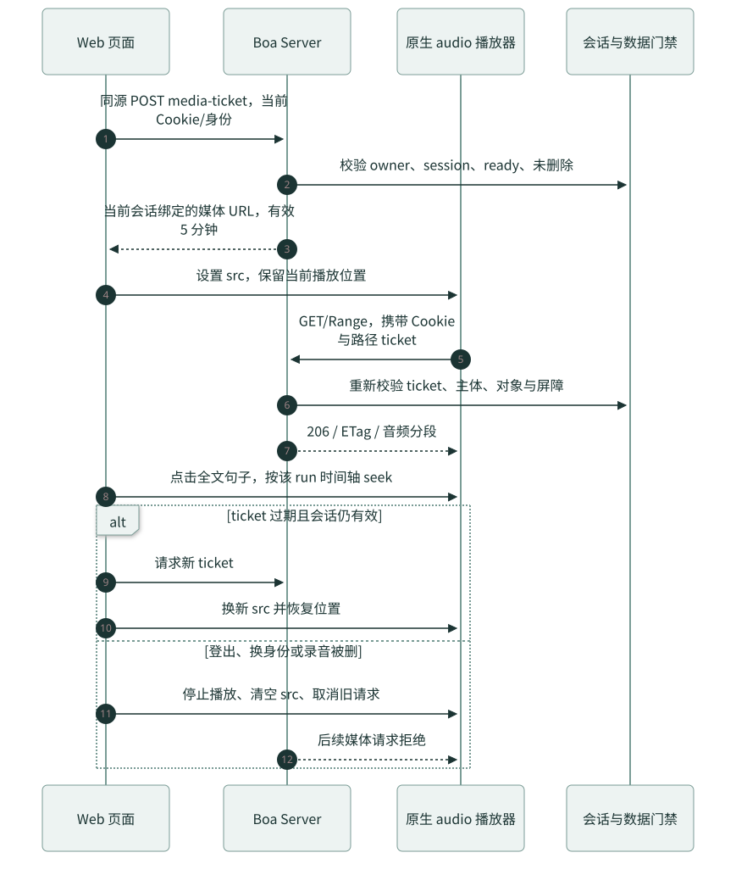

# Boa Voice 第一版：架构图解与关键步骤

日期：2026-10-29。本文将已确定的设计串成可阅读、可核验的流程，配套 [完整设计](superpowers/specs/2026-10-29-boa-server-web-v1-design.md) 和 [24 项实施计划](superpowers/plans/2026-10-29-boa-server-web-v1-implementation-plan.md)。

**阅读约定：图表示拟实施行为，不表示该流程已上线或已实机验证。** 每节依次给出“要解决什么 → 图 → 操作步骤 → 成功与失败判据”。图中的细节若与代码当前行为不同，以完整设计和实际实现记录区分，不将目标当作现状。

## 阅读导航

| 想了解什么 | 阅读顺序 |
|---|---|
| 产品/项目负责人：系统做什么，先交付什么 | [1 总览](#overview) → [5 录音解码](#decode) → [12 实施顺序](#implementation) |
| 后端开发：谁能读，怎样入库，失败怎样恢复 | [2 基本用户](#users) → [4 上传](#ingest) → [6 双写](#publication) → [9 删除恢复](#deletion) → [10 数据模型](#data) |
| Web 开发：页面何时展示哪种状态 | [3 设备绑定](#onboarding) → [7 结果版本](#versions) → [8 播放鉴权](#playback) |
| 测试/运维：完成的依据与恢复顺序 | 各节“验收判据” → [11 迁移恢复](#migration) → [12 实施顺序](#implementation) |

## 1. 系统总览：一套服务，三条主要链路

Server 接收并保管设备录音，Web 管理用户和设备、播放原声并展示处理结果。用户登录、设备上传、后台处理是相互关联但独立的链路。

| 链路 | 输入 → 处理 → 输出 | 边界 |
|---|---|---|
| 用户链路 | 浏览器 → HTTPS API → 当前用户的录音、设备与纪要 | 当前 user_id 决定数据归属，不引入组织或邀请权限 |
| 设备链路 | Clip → DTLS 接收 → 原件持久收件与归属索引 | 收件成功不等于整段会议完整，也不等于 AI 完成 |
| 后台链路 | 已收件原件 → 任务调度 → WAV、MP3、全文与纪要 | 一次仅一个活动处理任务；解码/模型推理不阻塞接收线程 |

**关键边界：** 一个长期运行的 Boa Python 进程，媒体工具可以是短期子进程；私有模型服务独立于主进程。文件存本机持久卷，SQLite 存结构化信息。双写不等于异机备份，不引入云盘转存。

**完成判据：** 两个 HTTPS 入口共用身份和数据目录，后台任务只启动一次；用户隔离、接收和处理分别验证。

对应任务：T01–T03、T08、T21。[图源](assets/diagrams/01-system-architecture.mmd)。

## 2. 基本用户：一个稳定 ID 管住本人的设备与录音

新版原型是 Google 登录入口、录音/设备两项导航和账号退出菜单。本轮只设计基本用户表，不展开 OAuth 流程，不建邀请、组织、密码或多身份关系。

| 字段组 | accounts 中的字段 | 作用 |
|---|---|---|
| 稳定归属 | user_id、google_sub | 内部 owner 主键与唯一的已验证 Google 身份标识；旧用户迁移 google_sub 可空 |
| 页面资料 | email、display_name | 展示邮箱和昵称；头像首字母可派生，不增头像配置 |
| 最少状态 | status、auth_version | 可用/禁用及技术会话撤销版本；不是组织角色 |
| 时间 | created_at、updated_at、last_login_at | 创建、资料修改与最近成功登录时间 |

**关键步骤：**

1. 上游完成身份验证后，把已验证身份交给用户资料服务；本轮不定义授权跳转和令牌交换。
2. 按 google_sub 查找用户；首次生成内部 user_id，后续沿用，不按邮箱自动合并。
3. 录音、设备、导出和会话均关联这个 user_id，用户不能指定其他 owner。
4. 账号菜单显示邮箱/名字并提供退出；退出撤销会话，保留设备和历史录音。
5. 旧用户迁移保留旧 user_id；google_sub 尚未核验时不猜填，不凭同邮箱认领旧录音。

**验收判据：** 用户 ID/身份唯一、无邀请状态、空昵称正常展示、禁用/退出后不可读、跨用户数据不可见。详细字段与约束见 [用户表设计](superpowers/specs/2026-10-29-boa-server-web-v1-design.md#user-model)。

对应任务：T03–T05。[图源](assets/diagrams/02-user-data-model.mmd)。

## 3. 设备绑定与配网：登记、写入、读回、收件分开核验

Web 通过蓝牙配置用户已分配的设备。设备名称只便于选择，完整硬件 UID 和服务端归属决定是否能拿到配置。

| 步骤 | 输入与动作 | 成功证据 |
|---|---|---|
| 1 管理员准备 | 登记完整 UID，核验设备对应的用户归属 | registry 存在有效 binding/epoch；交接清理锁已满足 |
| 2 用户连接 | 用户主动点击浏览器 BLE 选择器 | Web 读到实际硬件 UID 和协议能力 |
| 3 请求配置 | 当前用户向 Server 请求该设备绑定配置 | owner、UID、binding/epoch 一致，非按短名称猜测 |
| 4 写入设备 | BLE 写上传目标与凭证，用户填写单 Wi-Fi | Wi-Fi 密码仅在页面/设备链路内，不发到 Boa API |
| 5 读回确认 | 读取 binding_id、epoch、revision 后上报 | 页面显示“配置已读回”，不提前显示“上传已成功” |
| 6 实际上传 | 设备通过 Wi-Fi 发送录音 | Server 校验完整原件并记录实际收件时间 |

**失败恢复：** 设备忙则等空闲后重试；未登记或归属不符则联系管理员，不开放抢绑。蓝牙已连接不代表 Wi-Fi 在线；没有可信遥测时在线、电量等显示未知。

**验收判据：** 配置读回与真实录音收件都具备独立证据；同名设备不会误绑定；不支持 BLE 的浏览器仍能查看云端录音。

### 手动 OTA 的完整操作与成功判据

| 步骤 | 用户/系统动作 | 不可跳过的检查 |
|---|---|---|
| 1 确认条件 | 连接目标 Clip，确认设备空闲、电源条件与当前能力 | 目标板型、固件 profile、设备已有 OTA 能力必须匹配；先处理未同步录音 |
| 2 选择固件 | 从已发布、验签可信且兼容的制品中选择 | 核对整文件 SHA-256；签名私钥不进入 Server 或 Web |
| 3 用户发起 | 用户明确点击升级，Web 通过 BLE SMP 写入 | 普通用户不能导入/发布固件；不能把旧设备自动当作支持 OTA |
| 4 等待重连 | 传输结束后设备重启 | 此时只记“待重连核实”，不能显示升级成功 |
| 5 读回核实 | 重新连接，读取运行镜像状态 | 目标 image hash、active、confirmed 均符合，才记成功；image hash 不是下载文件 SHA-256 |
| 6 处理异常 | 保存阶段与诊断信息，重新连接核实或按维护说明恢复 | overwrite-only 不保证自动回滚；USB/SWD 恢复需按实际损坏范围另行判断 |

对应任务：T02、T20。[图源](assets/diagrams/03-device-onboarding.mmd)。

## 4. 上传到 SQLite：原件先可靠收下，业务索引可重放

设备等待的是原始片段的持久确认，不应被转写或纪要拖住。不同库之间的同步采用持久事件与幂等收据。

| 步骤 | 操作与持久位置 | 成功判据 |
|---|---|---|
| 1 鉴权 | 验证设备凭证、binding/epoch、owner 和删除屏障 | 已撤销/已删除来源不能继续发布收件完成 |
| 2 分片持久化 | 数据落 partial，fsync 后发布持久检查点 | ACK 偏移不超过持久偏移，断电后不会凭文件长度猜进度 |
| 3 原件完成 | 校验完整 size/hash，rename，目录 fsync | 原件和重建归属所需 identity 已持久，才可 COMPLETE |
| 4 写来源事件 | registry 同事务写完整 sources 状态和 source_outbox | 有索引就有事件；遗漏时从原件/identity 对账补回 |
| 5 建业务投影 | business 同事务写录音、片段、raw 对象、source_receipt、后续任务 | 唯一 event/source 防重，不重复增加 input_revision |
| 6 标消费 | 确认业务提交后标记原 outbox consumed | 中途崩溃可重复投递，效果仍只有一次 |

**App 上传：** 继续走原 HTTP 分片协议，完成事件先写到它自己的原接收库，再由相同业务投影规则消费。使用 `app:<user_id>` namespace 和 epoch=0，不伪造 Clip binding。

**失败恢复：** raw 已完成而索引失败，按 `.identity` 与 raw 重建来源；业务已提交而消费标记失败，凭收据确认已处理，不重复建录音。hash 冲突需报冲突，不能用 UPSERT 覆盖原件身份。

**验收判据：** 在原件落盘、来源提交、业务提交、消费标记四个边界中断后都能恢复；设备 COMPLETE 不依赖 AI 或业务页面是否在线。

对应任务：T06/T07。[完整双写设计](superpowers/specs/2026-10-29-boa-server-web-v1-design.md#dual-write) · [图源](assets/diagrams/04-raw-ingest-outbox.mmd)。

## 5. 解码转存：原件、WAV、MP3 各司其职

Clip 文件是 `uint16 小端长度 + raw Opus 包`，不是已有 Ogg 文件。解码前先验证来源与包结构，再得到可复核的样本时间轴。

| 步骤 | 操作 | 结果 |
|---|---|---|
| 1 校验原件 | 重算 raw size/hash，确认来源 profile | 损坏/不支持则停止，原件保留 |
| 2 解包或探测 | Clip 检查长度前缀、Opus 包与时长；App 检查真实容器/编码 | 不能只看扩展名或客户端 MIME |
| 3 逐段解码 | 受控解码工具输出 16 kHz、mono、PCM16 LE | 记录输入声道、decoder/profile、sample_count |
| 4 核验 WAV | 检查文件头、参数、样本数、长度、独立 hash | raw hash 与 WAV hash 不混用 |
| 5 发布片段 | 按下一节的可靠发布协议存 decoded.wav | 原件与片段 WAV 双保留，业务对象可追溯 |
| 6 检查连续性 | 固定输入版本，并确认从片段 1 开始无缺号 | 有缺号时允许单段播放，暂停整段 AI |
| 7 合并转码 | 生成 session asr.wav，再生成 playback.mp3 | 使用样本累计时间轴，MP3 编码延迟纳入映射 |
| 8 独立发布 | 媒体 ready 后即可播放 | 转写失败不阻止听原声 |

| 文件 | 默认保留 | 能否重建 |
|---|---|---|
| raw 原件 | 录音最终删除前保留 | 不能把它当可随意丢弃的缓存 |
| 片段 decoded.wav | 录音最终删除前保留 | 可以从 raw 重建，但默认持久保留 |
| session asr.wav | 转写完成 7 天后可回收 | 从连续的片段 WAV 重建 |
| playback.mp3 | 录音最终删除前保留 | 从对应输入版本的 WAV 重建 |
| 临时 Ogg/PCM | 成功或过期任务回收 | 不作为正式原件 |

**时间与容量：** Opus/Ogg granule 使用 48 kHz 时基，不是 WAV 输出采样率；raw 缺 pre-skip 元数据时记录这一时间来源限制。16 kHz mono PCM16 约 115.2 MB/小时，需按解码体积预算磁盘；单 raw 段 8 MiB、连续快照建议最长 8 小时。

**验收判据：** 同一 raw+解码版本可复核样本数和 WAV hash；原件不被改写；截断、缺片、超时和过长内容有明确错误；长录音头/中/尾的全文 seek 与原声一致。

对应任务：T09–T11。[完整解码设计](superpowers/specs/2026-10-29-boa-server-web-v1-design.md#recording-decode) · [图源](assets/diagrams/05-decode-and-retain.mmd)。

## 6. 文件与 SQLite 双写：先记录发布意图，再可靠落盘

普通文件和 SQLite 没有共同原子事务。中途失败时，要知道“哪个文件准备发布、预期是什么、还能不能发布”。

| 步骤 | 持久动作 | 此时能否对用户读取 |
|---|---|---|
| 1 准备 | DB 写 staged 对象与 prepared 日志，固定 owner、录音、输入版本、lease、删除 epoch | 否 |
| 2 生成 | 事务外生成临时文件并校验，flush/fsync | 否 |
| 3 固定预期 | DB 记录 size/hash/sample_count 等预期信息 | 否 |
| 4 发布文件 | 持来源锁，重检 fence；独占 rename；相关目录 fsync | 否，文件存在不等于业务 ready |
| 5 提交业务 | DB 再检 fence，同事务写 ready、asset、阶段指针与后续事件 | 是，但仍必须通过会话/owner/删除屏障 |
| 6 收尾 | 清理临时内容；按保留规则回收旧派生对象 | 只有已发布版本对外可见 |

**恢复决策：**

| 现场 | 处理 |
|---|---|
| 只有 prepared，临时文件不完整 | 过期租约后重新处理，保留 raw |
| 最终文件已存在、DB 未 ready | 恢复任务领取新 lease，核对 hash 与版本后补提交 |
| 文件同路径但 hash 不同 | 隔离冲突，不能覆盖 |
| DB ready 但文件丢失/损坏 | 标 missing/corrupt 并拒绝读取，派生对象可从 raw 重建 |
| 任务输入过期或录音已删 | 不更新 current 指针，登记过期对象供回收 |

**验收判据：** 文件 fsync 前没有 ready，rename 后崩溃可恢复；旧 lease、旧输入版本、旧删除 epoch 不能发布新结果。文件和两库的关系是可恢复一致性，不是“同时提交”。

对应任务：T08/T09/T14。[图源](assets/diagrams/06-file-database-publication.mmd)。

## 7. 转写与纪要：分阶段发布，不互相阻塞

同一会议后续可能继续收到片段，因此每次处理必须绑定冻结的输入版本。播放、全文、纪要分别有当前已发布 run。

| 步骤 | 处理 | 用户看到什么 |
|---|---|---|
| 1 新片段入库 | 新 source 才递增 input_revision，冻结样本和指纹 | 当前已收到内容与完整性说明 |
| 2 媒体发布 | 更新 current_media_run | 新音频立即可播放 |
| 3 全文发布 | 校验时间戳，更新 current_transcript_run，触发搜索投影 | 新全文可读、可定位；说话人不支持时显示未区分 |
| 4 纪要校验 | schema、原文引用、时间范围与当前 fence 均合法 | 发布概要、结论、待办和章节 |
| 5 纪要失败 | 保留当前已完成音频/全文及旧纪要 | 提示失败或重试；旧纪要标明基于较早内容 |

**引用规则：** 旧纪要的“在原文中查看”必须打开旧 run 的全文和对应时间轴；不能因列表显示了新全文而将旧引用重定向过去。人名、责任人和截止时间原文未明确时留空或标未明确。

**失败恢复：** 私有服务未配置显示 disabled；暂时失败最多自动重试 3 次，分别间隔 30 秒、2 分钟、10 分钟；输入/认证等确定性错误直接失败。一次只有一个活动处理任务，60 秒租约、每 15 秒续期；过期执行者不能提交结果。

**验收判据：** 新片段到达不会让旧任务覆盖新版本；畸形 JSON、越界引用拒绝发布；AI 失败仍可听原声。接口成功与样本转写/纪要质量分别验收。

### 从处理结果到搜索与导出

1. **搜索：** Web 提交标题/概要/全文查询，后端按当前 owner、未删除条件和查询游标检索；切换查询要丢弃旧游标与未完成响应。
2. **核对：** 打开录音详情，先看结果对应的 run 和完整性说明，再用引用定位原文/原声；旧结果保留自己的版本标识。
3. **申请导出：** 固定录音、run、TXT/DOCX 格式与幂等键，后台生成真正 DOCX 或 UTF-8 TXT，不将 HTML 改后缀冒充 Word。
4. **等待下载：** 导出 ready 后重新鉴权下载；24 小时过期，录音删除或会话失效后拒绝下载，不变成公开访问文件。
5. **访问记录：** 服务端记录查看/下载/导出；复制纪要只记录客户端 copy_requested，不能宣称证明剪贴板成功。用户可查看本人近 30 天记录。

对应任务：T07/T08/T15–T19。[图源](assets/diagrams/07-result-versioning.mmd)。

## 8. 网页播放：短期授权与每次 Range 都检查权限

原生 audio 播放器不能像业务 fetch 一样附加自定义用户头，因此使用 Boa 会话与会话绑定的短期媒体 ticket。

| 步骤 | 操作 | 关键检查 |
|---|---|---|
| 1 申请 ticket | 页面携当前会话发起 POST | owner、session、ready、删除屏障 |
| 2 装载资源 | audio.src 指向短期媒体 URL | ticket 存摘要，5 分钟有效，绑定会话与对象 |
| 3 播放/拖动 | 浏览器请求 GET/Range | Server 每次重新鉴权，合法范围返回 206，非法范围 416 |
| 4 点击全文 | 使用该 run 的样本时间轴 seek | 不混用旧/新 run，保存倍速和当前位置 |
| 5 续期 | 会话仍有效时申请新 ticket | 换源后恢复位置，不能跨身份沿用 |
| 6 退出/换身份 | 清空 audio、取消旧请求、清理页面缓存 | 后续 Range 和旧 ticket 拒绝；旧响应不能污染新页面 |

**边界说明：** 已发送给浏览器的字节无法追回，立即撤销意味着停止页面播放并拒绝后续请求。媒体 URL 日志脱敏，响应 no-store/no-referrer，不提供公开分享 URL。

**验收判据：** 正常/后缀/越界 Range 与 HEAD 行为正确；跨用户、注销、删除、ticket 过期均正确拒绝；大录音无需整段下载到 Web 内存才播放。

对应任务：T12/T13/T19。[图源](assets/diagrams/08-authorized-playback.mmd)。

## 9. 删除与恢复：先挡住读写，再处理文件回收

删除覆盖整个来源 session，包含之后才首次上传的片段；不能仅给当前已知文件打标。

| 步骤 | 操作 | 保证 |
|---|---|---|
| 1 取得锁 | 完整键 source_kind/namespace/epoch/session | Clip 与 App 不碰撞，不与在途发布交错 |
| 2 持久屏障 | registry 递增 deletion_epoch、enabled=1，同事务写事件 | 即使 business 暂时失败，新读取和发布仍被拒绝 |
| 3 业务隐藏 | 回收站、撤媒体 ticket、取消任务、移除搜索 | 不再出现在普通列表或下载接口 |
| 4 期限内恢复 | CAS 核对 epoch，重建业务数据后再解除屏障 | 解除也递增 epoch，删除前的旧任务仍失效 |
| 5 到期回收 | deleting→unlink/目录 fsync→deleted | raw、WAV、MP3、全文、纪要、导出按规则清理 |
| 6 长期防复活 | 保留 session 墓碑和必要审计 | 迟到上传与旧事件不会重新生成可见录音 |

**跨库对账：** 消费者读取 registry **当前** epoch/enabled 状态，不能盲目按旧 delete/restore 事件覆盖新状态。旧固件可能持续重试已删 session，Server 返回真实 ERROR，不伪造成功收件。

**云端与设备分离：** 删除云端录音不等于远程擦除 Clip；移除设备则先撤上传凭证，离线或清理失败保留交接锁，不能让新用户绕过旧数据清理。

**验收判据：** Clip/App 删除均覆盖迟到片段、旧 Bearer 下载、媒体、导出、搜索和在途任务；7 天内可恢复，到期后不被重放复活。

对应任务：T02/T14/T20。[图源](assets/diagrams/09-delete-restore.mmd)。

## 10. SQLite 关系：身份、输入、文件和结果各有主记录

图只表示业务库内的核心关系。registry 与 business 之间不建立跨库外键，依靠身份核验、事件收据和对账。

| 问题 | 主记录 | 约束/定位方式 |
|---|---|---|
| 用户是谁 | accounts | 原 user_id 保留；google_sub 唯一 |
| 录音属于谁 | recordings + recording_segments | owner、来源 session、绑定 epoch 决定归属 |
| 某次处理用了什么 | processing_runs + run_input_segments | 输入快照、hash、样本偏移；run/segment 必须同录音 |
| 物理文件在哪 | storage_objects | 路径、独立 hash/size、格式、ready/missing 等状态 |
| 怎样恢复文件发布 | jobs + file_publications | lease/fence、预期 hash、临时/最终路径与发布阶段 |
| 某个 run 产出了什么 | media_assets、transcript_segments、summaries | 各阶段独立发布并保留 run 归属 |
| 纪要原文依据 | summary_references | 引用必须命中同 run 的全文片段 |
| 是否删除/能否恢复 | registry session_tombstones + business tombstones | registry 权威屏障优先；事件按最新 epoch 对账 |

**查表顺序：** 先确定 actor → 找可见 recording → 固定 run → 找 asset/object 或全文 → 再核对状态与权威屏障。不能通过猜 object_id 或 source_id 跳过 owner 校验。

完整字段、CHECK、索引和 FK 见 [业务库 SQL](superpowers/specs/2026-10-29-boa-v1-business-schema.sql) 与 [registry 扩展 SQL](superpowers/specs/2026-10-29-boa-v1-registry-additions.sql)。**建表成功只说明结构有效**，真实旧库迁移和失败恢复仍需独立测试。

对应任务：T01/T06/T09/T22。[图源](assets/diagrams/10-core-data-model.mmd)。

## 11. 迁移与恢复：先在副本证明可迁移、可回退

发布代码前先保住原件、身份与绑定证据；迁移失败不能靠覆盖真实数据根来“重来”。

| 步骤 | 关键操作 | 放行条件 |
|---|---|---|
| 1 建基线 | 记录源码/schema、每用户文件数、字节、hash 与绑定 | 清单完整，不含凭证正文 |
| 2 停机快照 | 确认服务停止/排他锁，整体加密备份库/WAL、原件、身份、固件与私密配置 | 备份可读取且权限受限；设备停机重试行为单独验收 |
| 3 副本迁移 | 版本化升级，保留旧 ID/目录/绑定；回填来源事件 | 不改真实数据，失败可重跑 |
| 4 核验归属 | 对比数量、字节、hash、owner、屏障和旧接口 | 一致后才允许切换 |
| 5 启新服务 | 先关 AI，验证收件/下载，再开放处理 | 处理不阻塞原件接收 |
| 6 恢复演练 | 向另一个隔离目录恢复快照 | 恢复后可登录、找回归属、播放原件/派生文件 |
| 7 必要时回退 | 保存上线后新增 raw 与身份，再恢复旧代码/快照并对账 | 新增原件不被旧快照覆盖丢失 |

**验收判据：** 实测记录恢复耗时与恢复点；日备 7 份、周备 4 份，RPO≤24 小时/RTO≤4 小时是目标，演练达标后才写“满足”。

对应任务：T00/T22/T23。[图源](assets/diagrams/11-migration-and-recovery.mmd)。

## 12. 实施顺序：先验证原件安全与可听，再完成 AI 产品体验

下图是推荐串行落地顺序；精确硬依赖以实施计划每项“前置”字段为准，虚线表示实际联调所需外部资源。

| 里程碑 | 完成什么 | 必须拿到的验收证据 |
|---|---|---|
| M1 账户与页面 | T00–T05 | 数据底座、基本用户、会话隔离、两个导航与账号退出 |
| M2 第一条业务闭环 | T06–T14 | 上传→业务入库→raw/WAV 双保留→MP3→播放→删除恢复；崩溃重启能恢复 |
| M3 AI 产品能力 | T15–T19 | 实际私有服务转写/纪要、原文引用、搜索、TXT/DOCX 和页面状态 |
| M4 候选发布 | T20–T23 | 设备配置、受控手动 OTA、打包、迁移/恢复、容量和分层验收 |

每项任务按“失败用例 → 看到失败 → 最小实现 → 目标测试通过 → 独立提交”执行。AI、设备和目标主机未准备好时，明确标记哪一层尚未验收，不将模拟成功当作真实完成。

**关键交付检查：**

1. raw ACK、录音完整性、WAV 发布、播放 ready、全文 ready、纪要 ready 分别有状态和证据。
2. 单元/集成测试、浏览器操作、真实 Clip 上传、真实 OTA、AI 样本质量、远程部署、备份恢复分别报告。
3. 不扩展为无固件支持的远程设置、多 Wi-Fi、自动升级或“失败自动恢复”承诺。

继续实施请按 [完整任务计划](superpowers/plans/2026-10-29-boa-server-web-v1-implementation-plan.md) 的 T00–T23 执行，而不是仅按图跳过测试和迁移步骤。[图源](assets/diagrams/12-implementation-order.mmd)。
