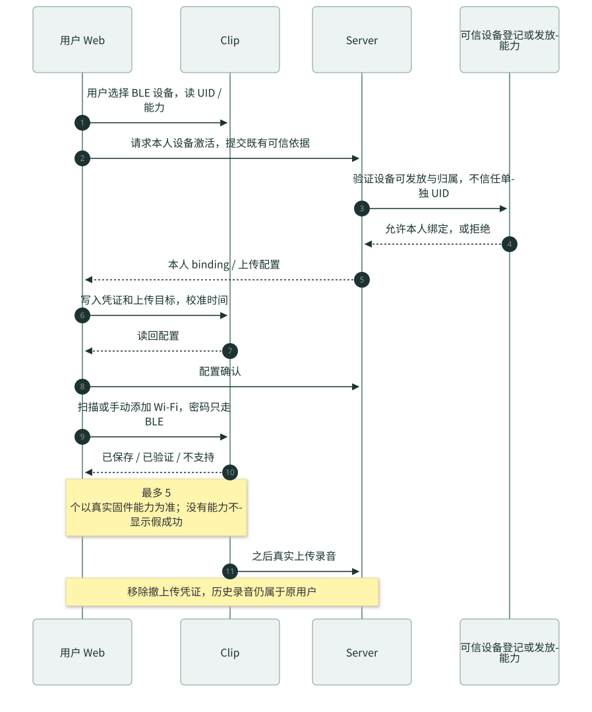
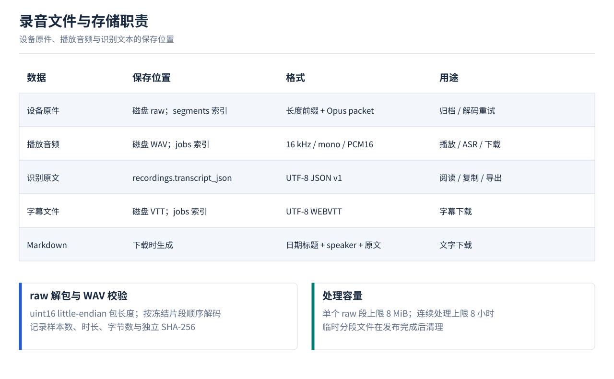

# 录音助手：精简架构图解与关键步骤

2026-10-29。本文与[当前原型](https://comfy-faloodeh-ec9b57.netlify.app/)重新对齐；图是设计，不是已上线证据。先读[原型核对与删减](2026-10-29-prototype-review.md)，细则见[完整设计](superpowers/specs/2026-10-29-boa-server-web-v1-design.md)，开发按[S01–S12](superpowers/plans/2026-10-29-boa-server-web-v1-implementation-plan.md)。

## 导航

[1 架构](#overview) · [2 用户](#users) · [3 设备](#devices) · [4 收件](#ingest) · [5 WAV](#decode) · [6 双写](#publication) · [7 VTT](#vtt) · [8 实施](#implementation)

<a id="overview"></a>

## 1. 一套服务，两张产品页面


Web 只有“录音、设备”导航及账号菜单。Server 沿用一个 Python 进程，SQLite 管资料/索引，本机文件存 raw/WAV/VTT；媒体工具子进程解码，私有 ASR 输出文字。没有纪要模型、搜索引擎、异步导出平台或管理工作台。

**成功判据：** 原件接收独立于模型，用户只看到本人设备和录音；同一份 WAV 同时供播放、转写和下载。

<a id="users"></a>

## 2. 基本用户与数据归属



用户只有 9 字段：内部 ID、Google sub、邮箱、名字、状态、会话版本、最近登录/创建/更新时间。只消费已验证的身份，不展开 OAuth，不引入邀请、组织、密码或多身份体系。

**步骤：** 核验输入来自可信身份适配器 → 按 sub 找用户 → 首次生成内部 ID、以后沿用 → 用同一 ID 过滤设备/录音/文件。旧用户保留旧 ID，未核验 sub 留空，不按同邮箱合并。

**退出：** 只撤当前会话并停止旧请求，不删用户、设备或录音。

对应 S02；字段见[用户设计](superpowers/specs/2026-10-29-boa-server-web-v1-design.md#user-model)。

<a id="devices"></a>

## 3. 用户添加设备，不增加账号管理流程



| 步骤 | 操作 | 成功证据 |
|---|---|---|
| 准备/连接 | 设备开机，用户主动选择 BLE，读完整 UID/能力 | 实际读回，不凭名字猜设备 |
| 自动激活 | Server 沿可信登记/发放建立本人绑定，Web 写凭证、校时 | 既有设备证据通过，binding/epoch/revision 读回；他人设备拒绝 |
| Wi-Fi | 扫描附近或手动添加，密码仅 BLE，最多 5 个 | 分清搜到/已保存；附近可验证，远处待验证 |
| 完成 | 回到列表，设备以后自行上传 | 真实 size/hash 收件才证明上传成功 |

设备卡片保留改名、只读版本、可信遥测、Wi-Fi 管理和移除；移除撤上传凭证，**保留已上传录音**。没有 OTA、维修、远程录音设置页面。

**能力缺口：** 当前代码主要受控登记；自动激活需可信发放依据，不能以 UID 当认证。多 Wi-Fi、扫描、在线遥测只有真实固件支持才启用；单 Wi-Fi 降级不是完整 5 网络验收。公司服务器不存 Wi-Fi 密码。

对应 S03/S04/S11。

<a id="ingest"></a>

## 4. 原件先收好，SQLite 投影可重放


1. Server 核验有效设备凭证、binding 和 owner。
2. 分片写盘并 fsync 后发布检查点，只 ACK 持久偏移。
3. 整文件 size/hash 正确、rename/目录 fsync、身份元数据可恢复后才 COMPLETE。
4. 完整 sources 与 outbox 同事务写；业务库写录音、片段、raw 对象及 source_receipt 后才标消费。
5. 崩溃时重放事件，重复 source 不重复增 input_revision。receiving 状态只能来自真实接收索引。

**失败恢复：** 文件已持久而索引失败，从 raw/identity 补回；业务已提交而消费标记失败，收据去重。ACK 不等 WAV/文字，也不代表整个会议已经传完。

**完整性：** 旧协议未知总片段，页面不显示虚假总进度。静默 10 分钟可处理当前连续片段，缺片则等待，不拼静音。对应 S05。

<a id="decode"></a>

## 5. raw 解码为一份 WAV



**步骤：** 检查 raw hash → 按 uint16 LE 包长度解析 Opus → 校验时长/声道 → 临时分段解码 → 连续片段合为 16 kHz mono PCM16 WAV → 校验样本数/hash → 可靠发布。

| 文件 | 用途与保留 |
|---|---|
| 设备 raw | 原始证据，持续保留，不受 ASR 失败或移除设备影响 |
| recording.wav | 当前可播放/可下载/ASR 音频，持续保留；内部更新按版本不可变写入 |
| transcript.vtt | 当前音频对应的时间戳文字 |
| Markdown | 同组 cues 按需生成，不维护 exports 表或过期链接 |
| 临时分段 PCM/WAV | 处理后回收，不长期另存片段 WAV、MP3 或 ASR WAV |

raw 不是 Ogg/WAV，不能改后缀冒充。WAV 是原件解码所得，原型按钮“音频原文件”建议改为“下载音频（.wav）”。8 MiB raw 段、默认 8 小时处理上限、资源不足都应有明确错误；失败时原件保留。对应 S07。

<a id="publication"></a>

## 6. 文件与数据库双写：最少但能恢复


**顺序：** staged/prepared → 事务外生成临时文件并 fsync → 保存预期 size/hash → 锁内检查输入版本/lease → 独占 rename/目录 fsync → DB ready 和当前指针同事务提交。

文件存在不等 ready。rename 后、DB 提交前崩溃，恢复任务领取新 lease 校验文件后补提交；旧输入不覆盖当前结果。缺文件标 missing，派生内容从 raw 重建，raw 缺失另行告警。只保留 decode/transcribe 两类任务，VTT 随转写生成，不增加导出工作流。

一个活动任务，60 秒 lease/15 秒续期；瞬时失败最多三次重试（30 秒/2 分钟/10 分钟）。对应 S06。

<a id="vtt"></a>

## 7. 一组 cues，文字、VTT、Markdown 共用



| 步骤 | 内容 | 判据 |
|---|---|---|
| 1 ASR | 输入当前 WAV，输出时间戳/文字/可空 speaker | 无模型配置显示未配置；无分离结果不猜 A/B |
| 2 校验 | `0 <= start < end`、不超时长、起点不倒序 | 合法多人重叠保留；坏时间拒绝 |
| 3 生成 | UTF-8 WEBVTT、毫秒时间、可选 voice 标签 | 文本转义，不能注入控制块 |
| 4 发布 | VTT 文件持久后，cues/指针/文字 ready 最终事务提交 | 中断可重做，不暴露半成品 |
| 5 使用 | Web 文字/复制，WAV/MD/VTT 下载 | 请求/分页固定 audio_revision，失效 409 后重新载入 |

### VTT 内容

```vtt
WEBVTT

1
00:00:00.000 --> 00:00:02.400
<v A>我们确认一下今天的安排。</v>

2
00:00:02.400 --> 00:00:05.800
<v B>先检查设备，再核对录音文字。</v>
```

这是人工示例：[下载 recording.vtt](examples/recording.vtt)。正式内容来自同一份 `transcript_cues`；响应 `text/vtt; charset=utf-8`，格式依据 [W3C WebVTT](https://www.w3.org/TR/webvtt1/)。不加字幕编辑器、新版/旧版切换或独立字幕页面。

详情拿到音频版本后，WAV/JSON/VTT/MD 和 cue 游标都携带该版本。新音频发布或任何 409 会取消旧分页/播放；复制全部分页成功后才写剪贴板，避免音频与文字错配。对应 S08/S10。

<a id="implementation"></a>

## 8. 12 项任务，先闭环再验收


| 里程碑 | 任务 | 出口 |
|---|---|---|
| M1 | S01–S04 | 基本用户、可信设备接口、两个导航与向导 |
| M2 | S05–S08 | 收件/入库→WAV 双写与播放→ASR/VTT，故障恢复可测 |
| M3 | S09–S12 | 日期列表、文字/下载、设备卡片、实机与迁移验收 |

真实身份接入、可信设备发放、扫描/多 Wi-Fi/遥测、ASR 是独立的集成证据，缺项不靠模拟“通过”。发布前在隔离目录迁移/整体备份恢复，核对旧用户/绑定/raw hash；回退先保存新收件。没有录音删除/回收站或备份调度平台。

具体文件、接口、测试和提交顺序见[开发计划](superpowers/plans/2026-10-29-boa-server-web-v1-implementation-plan.md)；本轮只更新文档，尚未实施产品代码。
