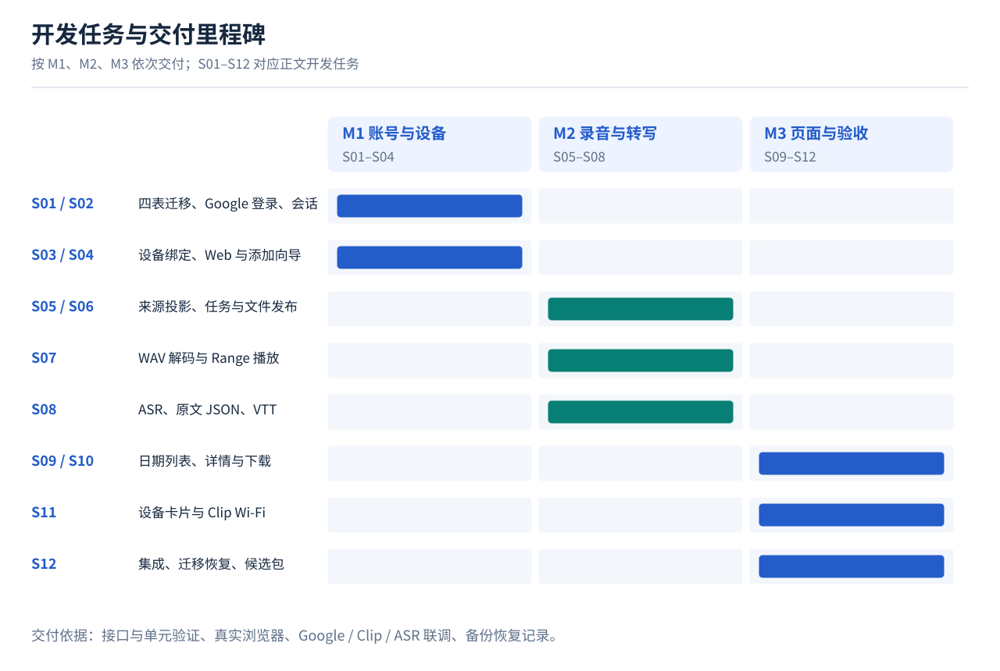

# Boa Voice Server + Web v1 Implementation Plan

> **For agentic workers:** REQUIRED SUB-SKILL: Use superpowers:subagent-driven-development (recommended) or superpowers:executing-plans to implement this plan task-by-task. Steps use checkbox (`- [ ]`) syntax for tracking.

**Goal:** 交付带基本用户、SQLite 产品数据、可靠录音解码双写、网页播放/全文/纪要及设备管理的第一版 Boa Voice。

**Architecture:** 沿用一个 Python 常驻进程、现有 DTLS 接收器、SQLite 和原生静态 Web。原件接收是事实来源，业务库通过持久事件及对账建立投影；解码工具采用受控子进程，AI 使用可配置私有端点。先建立权限、删除屏障、任务 fencing 和文件发布恢复，再接产品页面。

**Tech Stack:** 现有 Python 3.12+ / FastAPI / Uvicorn / SQLite / pyOpenSSL / cryptography / 原生 ES modules / Node test runner / pytest；媒体工具和 DOCX 依赖仅在所属任务引入并锁定。

**Spec:** [完整设计](../specs/2026-10-29-boa-server-web-v1-design.md)、[业务库参考 SQL](../specs/2026-10-29-boa-v1-business-schema.sql)、[registry 扩展参考 SQL](../specs/2026-10-29-boa-v1-registry-additions.sql)。参考 SQL 不是可直接应用到旧库的迁移。

## 阅读导航

首次阅读先看 [架构图解与关键步骤](../../boa-v1-illustrated-guide.md)，再按本文的 [任务地图](#task-map) 找依赖、按 T00–T23 找具体步骤，最后按 [里程碑出口](#milestones) 核对交付证据。每项任务中的 Files/接口/前置/复选步骤一起构成实施单元，不能只按标题开工。

图中实线为推荐串行顺序，虚线为真实联调所需外部资源；精确硬依赖以各任务“前置”字段为准。

## Global Constraints

- 本文仅拆开发任务；尚未执行产品代码、数据迁移、固件刷写或部署。
- 现有实现基线为 [`BofAI/reSpeaker_Clip`](https://github.com/BofAI/reSpeaker_Clip)（本机检出 `/Users/bobo/code/respeaker-boa-integration`）；本仓库 [`boboliu-1010/speaker`](https://github.com/boboliu-1010/speaker) 先管理设计/计划。执行时先使用 using-git-worktrees 技能建立隔离工作区，再将这三份设计附件和本计划的固定提交快照带入实施分支；在实施记录中注明文档仓库 commit，避免两份文档独立漂移，不在两个目录各维护一份产品实现。
- 保留 `python -m server`、9528 API/UDP DTLS、9529 Web、单数据根目录锁；不得多 worker 共用数据目录。
- 复用旧用户 ID、binding/epoch、raw 路径、固件索引、DTLS v3 帧格式和持久 ACK 语义；不等待解码/AI 才确认 raw 收件。
- 每连接 `foreign_keys=ON`、`busy_timeout=5000`、`synchronous=FULL`；业务库 WAL；新时间字段 UTC Unix 毫秒，旧库秒字段只在桥接时转换。
- 按新版原型只保留基本用户：accounts 的内部 user_id 与唯一 google_sub；无邀请、组织、本地密码或多身份表；OAuth 协议流程不在本轮范围。
- 正式会话 Secure/HttpOnly/Strict，闲置 30 天、绝对 90 天；会话与用户资料分表，退出只撤当前会话，不删用户/设备/录音。
- 原件与片段 WAV 双保留；WAV 默认 16 kHz / mono / signed PCM16 LE；播放 MP3；raw 单段 8 MiB，连续快照建议上限 8 小时。
- 旧固件 session 完整性未知；静默 10 分钟仅触发处理，不证明完整；缺号暂停整段 AI，禁止补静音伪造连续录音。
- 单个活动处理任务，租约 60 秒、每 15 秒续期；初次失败后最多重试 3 次，间隔 30 秒/2 分钟/10 分钟。
- 原件不因 AI 失败删除；回收站 7 天；会话 WAV 在转写完成 7 天后可回收；导出 24 小时过期。
- 不提交录音、私钥、token、登录凭证；不扩展为团队协作、公开分享、自动 OTA 或固件协议开发。

## Review Focus

1. 历史数据库的部分迁移、缺目录和时间单位混杂：必须停在可恢复状态，不能把秒解释为毫秒。归属 T01/T06/T22。
2. 同邮箱不同身份、重复用户同步、旧用户映射和多标签退出：不得串号、误合并或恢复已撤销会话。归属 T03/T04/T05。
3. 删除/恢复与在途收件、后台发布、旧 outbox 乱序并发：迟到片段和旧 lease 不得复活数据。归属 T02/T06/T09/T14。
4. 压缩文件体积小但解码极长、截断包、错误声道、MP3 编码延迟：有界失败且全文 seek 不漂移。归属 T10/T11/T13。
5. AI 返回貌似成功的畸形 JSON、越界引用或旧输入结果：不能发布错误纪要或覆盖新版本，原声始终可用。归属 T15/T16/T19。

## 任务地图与执行规则

这是一个相互依赖的产品计划，按可单独审查的交付拆为 **T00–T23，共 24 项**。每项结束即保留一个可回退提交；同一任务内的小修正不重复全套测试。表中的前置项是硬依赖，不是建议顺序。

| 阶段 | 任务 | 交付结果 | 必须前置 |
|---|---|---|---|
| A 基础与权限 | T00 基线、T01 迁移、T02 删除屏障 | 不改协议的数据底座与统一读取门禁 | 按编号 |
| B 用户 | T03 基本用户/会话、T04 用户约束与旧 ID 映射、T05 Web 框架 | 两个主导航与账号退出 | T01/T02；不含 OAuth 协议开发 |
| C 收件投影 | T06 事件、T07 聚合 | raw 上传自动进入业务录音 | T01/T02/T03 |
| D 解码播放 | T08 任务、T09 发布、T10 解码、T11 合并、T12 API、T13 Web | raw→WAV→MP3→网页播放闭环 | T06/T07；其余按编号 |
| E 数据生命周期 | T14 删除/恢复/清理 | 已删除内容不会被迟到上传或任务复活 | T02/T06/T09/T12 |
| F AI 产品功能 | T15 ASR、T16 纪要、T17 搜索、T18 导出审计、T19 Web | 全文、纪要、搜索、导出可用 | T11/T14；T16←T15，T19←T15–18 |
| G 设备与运维 | T20 设备、T21 管理健康 | BLE 引导、OTA 证据、服务诊断 | T03/T05/T12/T14/T18 |
| H 发布准备 | T22 迁移恢复、T23 综合验收 | 可迁移、可恢复、证据齐全的候选包 | T00–T21 |

**推荐实际顺序：** T00→T01→T02→T03→T04→T05→T06→T07→T08→T09→T10→T11→T12→T13→T14→T15→T16→T17→T18→T19→T20→T21→T22→T23。在已有契约稳定时可并行推进“账户/Web”和“收件/媒体”，但共享的 `boa_app.py`、`web_sessions.py`、`registry.py` 由同一负责人合并；本计划不自动派发 agent。

**外部前置项，在 T00 登记并提前准备：**

- 经授权的录音样本、至少一个可操作 Clip、BLE 浏览器环境；升级固件需具备正确签名和兼容 profile。
- 私有 ASR 与纪要端点、模型、认证、同步/异步协议和样本质量基准。未提供时先做 adapter/契约测试，不能宣称 P3 AI 验收完成。
- 发布主机、持久卷和备份目标；这些只影响最终部署/恢复实测，不阻塞离线开发。

不预设日期工期：媒体运行环境、旧库体量和 AI 服务尚未实测。完成 T00/T10 和真实 AI 接口确认后，再按剩余工作给出排期，避免将外部等待算成已完成开发。

## 文件结构与公共契约

下文的仓库相对路径均相对**实际隔离工作区根目录**。新增 Python 业务模块统一放 `server/boa/product/`；现有接收/存储代码保留原路径。每个生产模块对应 `server/boa/tests/product/test_<name>.py`，共享 fixture 位于该目录 `conftest.py`。

| 路径 | 职责 |
|---|---|
| `server/boa/product/{__init__,contracts,db,migrations}.py` 与 `migrations/*.sql` | 产品装配、公共数据类型、数据库、版本化迁移 |
| `product/{access,accounts,auth}.py` | 统一门禁、基本用户资料、会话与旧 ID 映射 |
| `product/{events,recordings,jobs,publication}.py` | 来源同步、聚合、持久任务、文件发布日志 |
| `product/{decode,media,media_http,idempotency}.py` | raw 解码、连续时间轴/MP3、鉴权 Range、HTTP 幂等键 |
| `product/{lifecycle,asr,summary,search,exports,audit,devices,admin}.py` | 对应产品能力 |
| `server/boa/{boa_app,registry,receiver,web_sessions,frontend,manage,run}.py` | 接入新能力，保持旧调用兼容 |
| `server/storage/{app,store}.py` | App 完成收件通知、删除门禁；不改变旧上传契约 |
| `server/web/product/index.html`、`style.css` 及 `{app,api-client,auth,router,polling,recordings-list,recording-detail,player,insights,devices,account-menu}.mjs` | 新产品 Web 页面、样式和功能模块 |
| `server/web/{app,clip-config,clip-binding,binding-configuration,smp}.mjs` | 复用旧 BLE/固件模块，最小必要适配 |
| `scripts/{migrate-boa-v1,verify-boa-v1,backup-boa-v1}.py` | 隔离迁移、验收、停机快照工具 |
| `server/requirements.txt`、`scripts/package-boa-server.sh`、`server/boa/DEPLOYMENT.md` | 锁依赖、发布包和部署说明 |

T01 定义并由后续任务引用以下契约；不得各模块自己定义第二套 owner/source 标识：

- `Actor(user_id: str, role: str, method: str, session_digest: str | None, auth_version: int)`。
- `SourceKey(source_kind: str, namespace: str, epoch: int, session: str)`，Clip namespace=真实 binding ID；App namespace=`app:<旧 user_id>`、epoch=0。
- `SourceEnvelope(event_id: str, source_id: str, owner: str, key: SourceKey, segment_no: int, relative_path: str, size: int, sha256: str, received_at_ms: int)`。
- `InputSnapshot(recording_id: str, owner: str, input_revision: int, deletion_epoch: int, fingerprint: str, segments: tuple[SourceEnvelope, ...])`。
- `Lease(job_id: str, run_id: str | None, recording_id: str, input_revision: int, deletion_epoch: int, token: str, expires_at_ms: int)`。
- `PCMInfo(path: Path, sha256: str, size: int, sample_rate: int, channels: int, sample_count: int, profile: str, decoder_version: str)`。
- `ProductContext(root: Path, registry: Registry, db: BusinessDB, clock_ms: Callable[[], int], locks: SourceLocks)`：服务生命周期持有的装配上下文，不是新的常驻服务。
- `SourceLocks` 在 contracts 中为协议类型，要求 `hold(key: SourceKey) -> ContextManager`；T01 测试可注入无并发 stub，T02 提供真实锁池，避免数据库任务先依赖尚未实现的锁模块。
- `ProductError(code: str, http_status: int, retryable: bool=False)`，HTTP 统一错误序列化带 request_id；不泄露路径/正文。

测试命令在实施根目录执行。T00 先建立 `.venv-boa`；后文 `PY=.venv-boa/bin/python` 是文档简写，命令直接使用完整相对路径。新增 Python fixture 统一提供 `ctx`（临时库与 fake clock）、`two_users`（alice/bob）、`client`（TestClient）、`source_factory`（仅合成内容）、`faults`（命名中断点）；需要某 fixture 的任务负责扩展它。测试中的真实录音和登录凭证 通过私有临时目录输入，不写入仓库。

---

## A. 数据底座

### T00：实施基线与验收素材清单

**文件：** 新增 `docs/development/boa-v1-baseline.md`、`server/boa/tests/product/conftest.py`、`server/boa/tests/product/fixtures/README.md`；读取原测试与 requirements。\
**前置：** 无。**产出：** 可复现启动/测试命令、源码 SHA、旧数据结构清单、外部依赖状态；这一步不改产品行为。

- [ ] 按 using-git-worktrees 工作流隔离源仓库，检查适用 AGENTS，记录基线 SHA/工作区状态；将设计和计划复制进该分支文档目录。
- [ ] 用现有 requirements 建 `.venv-boa`；记录 Python/SQLite/Node 和现有媒体工具版本。执行 `.venv-boa/bin/python -m pytest server/tests server/boa/tests server/storage/tests -q`、`node --test server/web/tests/*.test.mjs`，结果原样记录；环境缺失单列，不能写成测试通过。
- [ ] 建临时数据、fake clock、故障注入 fixture；区分 `RIFF-test-audio` 等旧传输测试字节和真正可解码的音频样本，不拿前者做音频验收。
- [ ] 登记已有身份适配器、AI/Clip/备份目标是否可用；合成音频 fixture 不含任何用户内容，真实样本仅列私有引用及授权范围。
- [ ] 提交 `docs: establish boa v1 implementation baseline`；验收为清单与命令可复现，无需为文档新增形式化测试。

### T01：版本化 SQLite 迁移与公共契约

**文件：** 新增 `product/contracts.py`、`db.py`、`migrations.py`、`migrations/001_business.sql`、`migrations/001_registry.sql`、`test_db.py`、`test_migrations.py`。\
**前置：** T00。**接口：** `BusinessDB.connect() -> sqlite3.Connection`；`migrate(root: Path, *, dry_run: bool) -> dict`；`bootstrap_context(root: Path, registry: Registry, clock_ms: Callable, locks: SourceLocks) -> ProductContext`。

- [ ] 写失败用例 `test_fresh_and_legacy_migrations_preserve_ids`、`test_each_connection_enforces_fk`、`test_partial_migration_resumes_by_version`；断言旧 users/bindings/sources 不变、新库 FK/完整性正常、未知高版本拒绝启动、失败迁移可重跑。
- [ ] 运行 `.venv-boa/bin/python -m pytest server/boa/tests/product/test_db.py server/boa/tests/product/test_migrations.py -q`，确认未实现行为导致失败。
- [ ] 将参考 DDL 转为可识别实际旧 schema 的迁移；DDL 校验和、schema_migrations、秒→毫秒桥接规则和固定连接 PRAGMA；实现上述公共类型。每库迁移单独提交，重启按版本继续，不能声称跨库原子。
- [ ] 重跑同命令；追加原参考 SQL 的 8 类约束拒绝用例及旧库夹具升级测试，全部 PASS。
- [ ] 提交 `feat: add versioned boa product database`。

### T02：统一来源门禁、锁与权威删除屏障

**文件：** 新增 `product/access.py`、`test_access.py`；修改 `registry.py`、`receiver.py`、`boa_app.py`、`storage/app.py`。\
**前置：** T01。**接口：** `create_source_locks() -> SourceLocks`（实现 contracts 的 hold 协议）；`AccessPolicy.require_read(actor: Actor, key: SourceKey) -> None`；`get_barrier(key: SourceKey) -> tuple[int,bool]`；`set_barrier(key: SourceKey, owner: str, *, enabled: bool, expected_epoch: int) -> int`。

- [ ] 写 `test_clip_and_app_share_authoritative_gate`、`test_receiving_writer_cannot_complete_after_delete`、`test_old_bearer_download_obeys_barrier`；断言跨用户 404、App epoch=0 可入表、已删除来源对旧/新下载和在途 COMPLETE 均被阻止。
- [ ] 运行 `.venv-boa/bin/python -m pytest server/boa/tests/product/test_access.py -q`，确认 FAIL。
- [ ] 实现完整 SourceKey 锁、registry 屏障 CAS 与同事务 deletion_outbox。锁序固定为 SourceKey→文件 store 锁→单库短事务；禁止同时持有两库事务。原 App/Clip 文件读取路径同样接门禁；未认证访问不可暴露删除状态。
- [ ] 重跑目标测试和 `server/boa/tests/test_service.py`、`server/storage/tests/test_api.py`；全部 PASS。此任务只建立屏障底座，用户删除 API 在 T14 开放。
- [ ] 提交 `feat: enforce source access and deletion barriers`。

## B. 基本用户与 Web

### T03：基本用户资料与会话兼容层

**文件：** 新增 `product/accounts.py`、`auth.py`、`audit.py`（基础 append）、`test_auth.py`；修改 `web_sessions.py`、`boa_app.py`。\
**前置：** T01/T02。**接口：** `AuthService.principal(request: Request) -> Actor`；`issue_session(user_id: str) -> dict`；`AccountService.sync_verified_user(google_sub: str, email: str, display_name: str) -> str`；`Audit.append(actor: Actor, action: str, resource_id: str | None, outcome: str) -> None`。

- [ ] 写 `test_verified_identity_reuses_user_id`、`test_logout_revokes_session_not_recordings`、`test_id_mode_disabled_does_not_disable_production_session`、`test_csrf_and_cross_tab_identity_mismatch`；断言用户状态只有 active/disabled、30d/90d 边界、禁用立即拒绝、无密码或邀请分支。
- [ ] 运行 `.venv-boa/bin/python -m pytest server/boa/tests/product/test_auth.py -q`，确认 FAIL。
- [ ] 只消费上游已验证身份资料，按 google_sub 创建/查找基本用户并建立会话；实现本人资料、当前会话、退出和 CSRF 门禁。旧 Bearer/显式开发 ID 模式保持兼容；新建业务用户与原 registry 用户映射必须可重放，冲突拒绝，不按邮箱自动合并。授权跳转、回调、令牌交换不在此任务实现。
- [ ] fake clock 验证会话到期、退出与禁用；目标测试及原 `test_web_sessions.py`、`test_device_configurations.py`、`test_firmware_web.py` PASS；无真实身份适配器时明确只完成数据消费契约。
- [ ] 提交 `feat: add basic users and session compatibility`。

### T04：用户表约束、旧用户映射与数据归属回归

**文件：** 新增 `server/boa/tests/product/test_users.py`；扩展 `product/accounts.py`、`product/migrations.py` 和旧用户迁移记录。\
**前置：** T03。**接口：** `AccountService.get_user(user_id: str) -> dict`；`import_legacy_user(user_id: str, email: str, display_name: str='') -> str`；与 T03 的 sync_verified_user 共用同一用户主表。

- [ ] 写 `test_google_sub_unique_and_email_conflict_is_not_merge`、`test_legacy_user_keeps_owner_and_nullable_sub`、`test_empty_display_name_and_disabled_user`；断言同一身份不建第二个 user_id，冲突邮箱不迁移录音，旧用户无 sub 仍可迁移资料。
- [ ] 运行 `.venv-boa/bin/python -m pytest server/boa/tests/product/test_users.py -q`，确认 FAIL。
- [ ] 按设计第 17 节落实 9 个基本字段、唯一键、状态约束、时间单位与同一 owner 规则；旧身份关联必须有可信核验记录，不能根据邮箱猜填 google_sub。不添加邀请、组织、角色层级或多身份映射功能。
- [ ] 重跑 PASS；在旧用户夹具验证迁移前后设备/原件/录音 user_id 与 hash 不变，跨用户录音/媒体/导出仍 404。
- [ ] 提交 `test: enforce basic user identity and ownership constraints`。

### T05：产品 Web 入口、两个主导航与账号菜单

**文件：** 新增 `server/web/product/index.html`、`style.css`、`{app,api-client,auth,router,polling,account-menu}.mjs`、`server/web/tests/product-auth.test.mjs`；修改 `frontend.py`、`boa_app.py`、旧 Web 的身份适配入口。\
**前置：** T03/T04。**接口：** `createApiClient({fetcher,onIdentityChanged}) -> {request,reset}`；`mountAuth({root,api,onSession}) -> {dispose}`；`startPolling({load,activeMs,hiddenMs}) -> {stop}`。

- [ ] 写 JS 用例 `stale response cannot replace new session`、`account menu shows email and logout only`、`hidden tab backs off to 30000 ms`；断言身份变化 Abort、媒体清空回调被触发、轮询恢复立即刷新。
- [ ] 运行 `node --test server/web/tests/product-auth.test.mjs`，确认 FAIL。
- [ ] `/` 服务新产品静态入口，hash 路由只包含 recordings/devices；保留 `/firmware/` 和 API 旧入口。按新版原型接已有 Google 登录入口的结果适配、账号邮箱与退出，不扩展本地密码、邀请、设置或身份绑定页面；不加入 bundler 或第三方远程脚本。
- [ ] 重跑 JS 与 Python `test_frontend.py`，PASS；真实浏览器验证窄窗口、刷新/后退、双标签退出、登录取消和后端离线提示。
- [ ] 提交 `feat: add boa product web shell and login`。

## C. 接收与业务录音

### T06：来源 outbox、跨库收据和重放

**文件：** 新增 `product/events.py`、`migrations/002_app_outbox.sql`、`test_events.py`；修改 `product/migrations.py`、`registry.py`、`receiver.py`、`storage/{store,app}.py`。\
**前置：** T01/T02/T03。**接口：** `SourceBridge.pending(limit: int=100) -> list[SourceEnvelope]`；`SourceBridge.ack(event_id: str) -> None`；`reconcile_sources(ctx: ProductContext, limit: int=100) -> int`。T07 提供 `apply_source`，本任务先用事务消费者 fixture 验证投递协议。

- [ ] 写 `test_source_commit_and_outbox_are_atomic`、`test_replay_after_business_commit_is_idempotent`、`test_raw_survives_registry_failure`、`test_old_delete_event_cannot_override_restoration`；断言 ACK 不依赖 business/AI，raw→registry 对账可补回，不重复投递效果，秒时间转换正确。
- [ ] 运行 `.venv-boa/bin/python -m pytest server/boa/tests/product/test_events.py -q`，确认 FAIL。
- [ ] Clip 完成索引与 outbox 同库事务；App 在原接收库增加 outbox，由 002 迁移处理各用户已有库，新用户建库也应用该迁移，完成状态与事件同事务。App source_id 使用服务端 `SHA256(user_id + "/" + upload_id)`，SourceKey.session 保留 upload_id，避免租户内 ID 碰撞；raw `.identity` 回补流程保留，写业务收据成功后才标消费。
- [ ] 注入“raw 后/registry 后/business 后/ack 前”中断点，重启重放 PASS；运行原 DTLS/HTTP 接收目标测试，确认帧及 COMPLETE 不改变。
- [ ] 提交 `feat: project received sources through durable outbox`。

### T07：录音聚合、输入版本与完整性

**文件：** 新增 `product/recordings.py`、`test_recordings.py`；扩展 `events.py`。\
**前置：** T06。**接口：** `RecordingStore.apply_source(source: SourceEnvelope) -> str`；`snapshot(actor: Actor, recording_id: str) -> InputSnapshot`；`processable(recording_id: str, now_ms: int) -> bool`；`detail(actor: Actor, recording_id: str) -> dict`。

- [ ] 写 `test_repeat_source_does_not_increment_revision`、`test_gap_blocks_ai_without_fake_completion`、`test_late_segment_changes_snapshot_not_old_run`、`test_new_binding_never_merges_old_owner`；断言相同 source 不变、hash 冲突拒绝、10 分钟只解锁处理而完整性仍 unknown。
- [ ] 运行 `.venv-boa/bin/python -m pytest server/boa/tests/product/test_recordings.py -q`，确认 FAIL。
- [ ] 同一 business 事务写录音、片段、raw storage_object 与 source_receipt；只有新来源才递增版本；冻结 InputSnapshot 的有序片段和指纹；App 用独立 namespace，title_origin=manual 不被后续 AI 覆盖。
- [ ] 目标测试 PASS；附加同 session 不同 epoch、时间不可信、冲突 source、删除来源对账不复活的用例。
- [ ] 提交 `feat: aggregate recording sessions and immutable input revisions`。

## D. 解码双写与播放

### T08：持久任务、租约与服务生命周期

**文件：** 新增 `product/jobs.py`、`test_jobs.py`；修改 `boa_app.py`、`run.py`。\
**前置：** T07。**接口：** `JobStore.enqueue(snapshot: InputSnapshot, kind: str, pipeline_version: str) -> str`；`claim(now_ms: int) -> Lease | None`；`renew(lease: Lease) -> Lease`；`finish(lease: Lease, outcome: str) -> None`；`ProductRuntime.start()/stop()`。

- [ ] 写 `test_single_claim_and_stale_fence`、`test_retry_schedule_has_three_retries`、`test_restart_recovers_expired_job`；断言 60s/15s、30s/120s/600s 边界、旧 token 不可提交、双监听只启动一次运行时。
- [ ] 运行 `.venv-boa/bin/python -m pytest server/boa/tests/product/test_jobs.py -q`，确认 FAIL。
- [ ] 一个活动处理任务，async 调度器只领取/等待，不阻塞事件循环；启动先删除屏障投影再来源重放再恢复任务。停止领任务后最多等待 15 秒，余下下次恢复；配置错误直接失败，瞬时错误有界重试。
- [ ] fake clock 与重启用例 PASS；已有 HTTP 请求在处理任务运行时仍返回，接收线程不得调用 AI。
- [ ] 提交 `feat: add durable single worker job runtime`。

### T09：文件发布日志与文件/SQLite 双写恢复

**文件：** 新增 `product/publication.py`、`test_publication.py`；扩展 `jobs.py`。\
**前置：** T02/T08。**接口：** `Publisher.prepare(lease: Lease, role: str, segment_no: int=0) -> dict`；`publish(lease: Lease, object_id: str, info: PCMInfo | dict) -> str`；`recover_publications(ctx: ProductContext, limit: int=100) -> int`。

- [ ] 写 `test_rename_before_db_commit_recovers`、`test_no_ready_before_fsync`、`test_delete_and_expired_lease_block_publication`、`test_existing_different_hash_is_conflict`；断言不能覆盖已存在对象、staged 不可下载、恢复任务先取得新 lease。
- [ ] 运行 `.venv-boa/bin/python -m pytest server/boa/tests/product/test_publication.py -q`，确认 FAIL。
- [ ] 实现 prepare→临时文件校验/fsync→写预期元数据→独占 rename/目录 fsync→ready/asset/阶段指针事务；目录在同文件系统，跨盘显式拒绝。对象、job、run 同录音约束；发布和删除共享锁且重检 registry 屏障。
- [ ] 对设计第 19.3 节每个文件发布边界注入中断并重启，目标测试 PASS；最终缺失派生文件标 missing，可重建，原件不删。
- [ ] 提交 `feat: make media file publication recoverable`。

### T10：raw Opus 解包与片段 WAV 持久解码

**文件：** 新增 `product/decode.py`、`test_decode.py`、合成 Opus 生成/元数据 fixture；修改 `requirements.txt` 与运行资源说明。\
**前置：** T09。**接口：** `decode_clip(source: SourceEnvelope, output: Path, profile: str) -> PCMInfo`；`decode_standard(source: SourceEnvelope, output: Path) -> PCMInfo`；`run_decode_job(lease: Lease, snapshot: InputSnapshot) -> None`。

- [ ] 写 `test_raw_uint16_packet_framing_to_pcm`、`test_truncated_or_oversized_duration_rejected`、`test_decode_failure_never_alters_original`、`test_standard_audio_uses_different_profile`；合成 1 秒 16kHz 单声道输入断言 sample_count=16000、WAV 参数和原件 hash 不变。
- [ ] 运行 `.venv-boa/bin/python -m pytest server/boa/tests/product/test_decode.py -q`，确认 FAIL。
- [ ] 首选正确 Ogg 封装后使用现有受控媒体工具解码；固定 decoder/profile 版本、48k granule 与 16k PCM 转换、pre-skip 缺失标注、输入声道检查、资源/超时限制。先在 T00 环境证实该后端无隐式丢样，再锁定；若基准不通过则采用 libopus 后端，接口不变。
- [ ] 目标测试 PASS；受控工具按 argv 调用、无 shell/网络，输出使用 T09 发布。授权真实样本做 raw→WAV 对照，记录样本数、时长、哈希和试听结果；合成通过不替代真实样本。
- [ ] 提交 `feat: decode and retain recording pcm wav segments`。

### T11：连续快照 WAV、MP3 与样本时间轴

**文件：** 新增 `product/media.py`、`test_media.py`；扩展 `run_input_segments` 使用。\
**前置：** T10。**接口：** `prepare_session(lease: Lease, snapshot: InputSnapshot) -> dict`；`publish_stage(lease: Lease, stage: str) -> None`。

- [ ] 写 `test_concat_uses_exact_sample_offsets`、`test_gap_does_not_make_session_audio`、`test_new_revision_preserves_old_result`、`test_mp3_seek_matches_pcm_timeline`；断言三段样本 offset 为前段样本和、不补缺片静音、8 小时超限保留 raw 并拒绝整段处理。
- [ ] 运行 `.venv-boa/bin/python -m pytest server/boa/tests/product/test_media.py -q`，确认 FAIL。
- [ ] 对已连续的冻结快照生成 session asr.wav 与 MP3，分别经 T09 发布；media ready 就更新 current_media_run_id，不等 ASR。编码延迟/填充纳入时间映射，保存播放器时基；工具版本/参数进指纹。缺号仅允许单段 WAV，不发起整段 AI。
- [ ] 目标测试 PASS；长合成音频在头/中/尾基准点 seek 与 PCM 对照，建议偏差≤100ms，实测达不到则先修时间映射，不能删除断言。
- [ ] 提交 `feat: build session playback and sample accurate timeline`。

### T12：录音 API、短期媒体授权与 Range

**文件：** 新增 `product/media_http.py`、`idempotency.py`、`test_media_http.py`；扩展 `recordings.py`、修改 `boa_app.py`。\
**前置：** T03/T07/T08/T11。**接口：** `install_recording_routes(app: FastAPI, ctx: ProductContext, auth: AuthService) -> None`；`create_media_ticket(actor: Actor, recording_id: str) -> dict`；`Idempotency.get_or_create(actor: Actor, route: str, key: str, request_digest: str, create: Callable[[], str]) -> str`。

- [ ] 写 `test_media_ticket_is_bound_to_session_and_owner`、`test_range_206_416_and_head`、`test_logout_delete_and_missing_file_deny_media`、`test_retry_is_idempotent_and_pins_revision`；断言 5 分钟有效期、跨账户 Cookie 不可复用、旧原始下载同样遵守删除屏障，同幂等键不同内容 409。
- [ ] 运行 `.venv-boa/bin/python -m pytest server/boa/tests/product/test_media_http.py -q`，确认 FAIL。
- [ ] 实现录音列表/详情/改名、media-ticket、GET/HEAD 媒体、POST retry 接口；retry 只接受 media/transcribe/summarize 白名单和当前 input_revision，使用 T08 的持久去重。实现公用 HTTP 幂等键服务供 T18 复用。Range 复用现有解析并测试 ETag/If-Range，ready 才可读；流式文件读取，ticket/path 日志脱敏、no-store、no-referrer。列表游标绑定过滤摘要；改名 expected_revision 冲突 409。
- [ ] 目标测试及原录音/上传 API 回归 PASS；并发下载时撤销会话和权限失效后新 Range 请求被拒绝，已发送给浏览器的字节不能追回，文档如实说明。
- [ ] 提交 `feat: expose authorized recording and range playback api`。

### T13：录音列表、详情、播放器 Web 闭环

**文件：** 新增 `server/web/product/{recordings-list,recording-detail,player}.mjs`、`server/web/tests/product-recordings.test.mjs`、`product-player.test.mjs`；修改 `product/app.mjs`、`style.css`。\
**前置：** T05/T12。**接口：** `mountRecordings({root,api,onOpen}) -> {dispose}`；`mountRecordingDetail({root,api,id}) -> {dispose}`；`createPlayer({audio,api,onTime}) -> {load,seek,reset}`。

- [ ] 写 `unknown completeness never shows total progress`、`ai failure does not disable ready playback`、`logout cancels ticket refresh and audio`、`older page response cannot replace current recording`。
- [ ] 运行 `node --test server/web/tests/product-recordings.test.mjs server/web/tests/product-player.test.mjs`，确认 FAIL。
- [ ] 实现时间分组、每页 30 条、设备来源、空/加载/错误状态、未知完整性文案；播放器含 ±15 秒与规定倍速。轮询 5 秒/隐藏 30 秒，ticket 到期自动续取同一身份资源且恢复播放位置。
- [ ] 目标 JS PASS；真实 Chrome 验证长音频拖动、重播、窄窗口布局、刷新、双标签换身份、断网恢复；原 BLE/OTA 页仍能打开。
- [ ] 提交 `feat: add recording browsing and playback web flow`。

## E. 删除与恢复

### T14：回收站、恢复、GC 与迟到数据防复活

**文件：** 新增 `product/lifecycle.py`、`test_lifecycle.py`；修改录音路由、Web 列表/详情和权限适配。\
**前置：** T02/T06/T09/T12/T13。**接口：** `delete_recording(actor: Actor, recording_id: str) -> None`；`restore_recording(actor: Actor, recording_id: str) -> None`；`collect_due(now_ms: int, limit: int=100) -> int`。

- [ ] 写 `test_delete_blocks_late_new_segment`、`test_restore_epoch_fences_old_job`、`test_business_failure_still_denies_all_reads`、`test_gc_never_revives_after_source_replay`；覆盖 Clip 与 App、乱序 delete/restore 事件、7 天边界。
- [ ] 运行 `.venv-boa/bin/python -m pytest server/boa/tests/product/test_lifecycle.py -q`，确认 FAIL。
- [ ] 实现设计第 19.4 节事务顺序、恢复 CAS 和 epoch 递增；UI 加 7 天回收站/恢复；发布与检索去除删除内容，GC 用 deleting→unlink+目录 fsync→deleted。清理 24h 导出和转写完成 7 天后的 session WAV；片段 WAV 与 raw 不跟随临时清理。
- [ ] 目标测试 PASS；在接收、文件 rename、业务提交各边界并发 delete/restore，未过期前可恢复，到期仅保留墓碑/必要审计；旧固件重传得到真实 ERROR 不伪 COMPLETE。
- [ ] 提交 `feat: add recoverable recording deletion and retention`。

## F. 转写、纪要、搜索与导出

### T15：私有 ASR adapter 与版本化全文

**文件：** 新增 `product/asr.py`、`test_asr.py`；扩展 `jobs.py`、录音 routes。\
**前置：** T11/T14。**接口：** `ASRProvider.transcribe(audio: Path, *, request_id: str, language: str) -> list[dict]`；`run_asr(lease: Lease, snapshot: InputSnapshot) -> None`；`get_transcript(actor: Actor, recording_id: str, run_id: str | None, cursor: str | None) -> dict`。

- [ ] 写 `test_asr_disabled_is_explicit_and_playable`、`test_invalid_timestamps_do_not_publish`、`test_stale_asr_cannot_replace_new_revision`；断言缺少 speaker 显示未区分、每页最多 200 段、端点超时可重试、凭证错误直接失败。
- [ ] 运行 `.venv-boa/bin/python -m pytest server/boa/tests/product/test_asr.py -q`，确认 FAIL。
- [ ] 实现供应方无关契约、配置/secret 后端读取、最长 60 分钟超时与取消；以真实协议编写一套目标 provider adapter，不把泛型假端点当已集成服务。全文入库后独立更新 current_transcript_run_id、索引任务和 summarize 任务。
- [ ] 契约测试 PASS；有真实端点后完成授权样本测试并单列质量记录；否则本任务标“契约完成/真实服务待验收”，不得宣称全部完成。
- [ ] 提交 `feat: add private asr provider and transcript versions`。

### T16：结构化纪要、原文引用与独立发布

**文件：** 新增 `product/summary.py`、`test_summary.py`；扩展 `jobs.py` 和录音 routes。\
**前置：** T15。**接口：** `SummaryProvider.generate(segments: list[dict], *, request_id: str) -> dict`；`validate_summary(payload: dict, run_id: str) -> dict`；`run_summary(lease: Lease, snapshot: InputSnapshot) -> None`。

- [ ] 写 `test_unknown_segment_reference_is_rejected`、`test_malformed_json_and_unstated_owner_deadline`、`test_old_summary_links_its_own_transcript`；断言人名/日期未明确不编造、畸形 schema 不发布、summary 失败时新版全文/媒体仍可用。
- [ ] 运行 `.venv-boa/bin/python -m pytest server/boa/tests/product/test_summary.py -q`，确认 FAIL。
- [ ] 纪要最长 10 分钟；固定 schema、原文 segment ID 引用与复合 FK；原文作为不可信数据，provider 无工具能力。只在当前输入 fence 有效时更新 current_summary_run_id；保留旧 run 与“较早内容”标注，不覆盖人工标题。
- [ ] 目标测试 PASS；真实服务与 T15 同批授权样本检查概要、结论、待办与章节的事实及出处，质量不足保留待验收。
- [ ] 提交 `feat: generate validated summaries with transcript references`。

### T17：中文搜索与检索投影

**文件：** 新增 `product/search.py`、`test_search.py`；扩展 `recordings.py`、`jobs.py`。\
**前置：** T07/T14/T15/T16。**接口：** `SearchIndex.refresh(recording_id: str) -> None`；`query(actor: Actor, text: str, cursor: str | None, limit: int=30) -> dict`。

- [ ] 写 `test_chinese_bigram_and_single_character_scope`、`test_summary_failure_keeps_transcript_searchable`、`test_delete_restore_updates_search_visibility`；断言标题/概要/全文命中、owner 隔离、200 字限制与过滤游标绑定。
- [ ] 运行 `.venv-boa/bin/python -m pytest server/boa/tests/product/test_search.py -q`，确认 FAIL。
- [ ] FTS5 启动能力检测、中文二元组同构分词、单字有界匹配；索引写入与相关阶段发布同事务或持久重建任务，删除门禁在查询时再次过滤。禁止 FTS owner 文本列替代真实授权 JOIN。
- [ ] 目标测试 PASS；用合成中文语料测试排序/分页稳定性与索引重建，记录容量样本，不触碰用户全文。
- [ ] 提交 `feat: add scoped chinese recording search`。

### T18：TXT/DOCX 导出与审计 API

**文件：** 新增 `product/exports.py`、`test_exports.py`、`test_audit.py`；扩展 `audit.py`、`requirements.txt`、管理接口。\
**前置：** T09/T14/T16。**接口：** `request_export(actor: Actor, recording_id: str, run_id: str, format: str, idempotency_key: str) -> str`；`run_export(lease: Lease) -> None`；`Audit.list(actor: Actor, cursor: str | None) -> dict`。

- [ ] 写 `test_docx_is_valid_package_not_renamed_html`、`test_export_pins_run_and_expires_in_24_hours`、`test_copy_event_does_not_prove_clipboard_success`；断言跨用户/删除/过期下载拒绝，同幂等键不同请求 409，查看事件 5 分钟合并。
- [ ] 运行 `.venv-boa/bin/python -m pytest server/boa/tests/product/test_exports.py server/boa/tests/product/test_audit.py -q`，确认 FAIL。
- [ ] 生成 UTF-8 TXT 与真正 DOCX，使用锁定本地依赖；导出绑定 run，不随最新结果改变，文件经 T09 发布。审计覆盖关键服务端行为，客户端仅允许 copy_requested 枚举；本人展示 30 天、后台 180 天保留。
- [ ] 目标测试 PASS；用无敏感内容长会议样本打开 DOCX 检查中文、列表、章节及页间布局；不要只检查 ZIP 头就声称可读。
- [ ] 提交 `feat: add private recording exports and audit history`。

### T19：全文、纪要、搜索导出和账号菜单

**文件：** 新增 `server/web/product/insights.mjs`、`server/web/tests/product-insights.test.mjs`；修改 product 的详情、列表、播放器、account-menu 与 style。\
**前置：** T13/T15/T16/T17/T18。**接口：** `mountInsights({root,api,recordingId,player}) -> {dispose}`；使用 T13 的 `player.seek(ms)`，禁止以当前 run 替代旧纪要的 run。

- [ ] 写 `summary reference opens matching run`、`transcript ready renders while summary failed`、`search resets stale cursor`、`copy request is not shown as verified clipboard evidence`。
- [ ] 运行 `node --test server/web/tests/product-insights.test.mjs`，确认 FAIL。
- [ ] 详情显示概要/结论/待办/章节与分页全文；点击句子/引用 seek；搜索输入防抖并取消旧请求；异步导出状态与失败重试；账号菜单仅显示基本邮箱/名字与退出，不新增复杂账号设置或邀请入口。AI 未配置、重试等待、旧内容均有明确状态。
- [ ] 目标 JS PASS；真实 Chrome 验证长全文、旧 run 引用、播放器底部留白、键盘操作、导出文件、基本账号菜单与跨标签退出。
- [ ] 提交 `feat: complete recording insights and account settings web`。

## G. 设备与维护诊断

### T20：设备引导、配网、手动 OTA 与移除

**文件：** 新增 `product/devices.py`、`test_devices.py`、`server/web/product/devices.mjs`、`server/web/tests/product-devices.test.mjs`；最小适配现有 BLE/绑定/SMP 模块。\
**前置：** T03/T05/T12/T14/T18。**接口：** `DeviceService.list(actor: Actor) -> list[dict]`；`rename(actor: Actor, device_id: str, name: str) -> None`；`set_desired(actor: Actor, device_id: str, settings: dict, expected_revision: int) -> dict`；Web `mountDevices({root,api,ble}) -> {dispose}`。

- [ ] 写 `test_device_uid_and_owner_not_ble_name_controls_binding`、`test_offline_unbind_keeps_cleanup_lock` 与 JS `unknown telemetry never shows online`、`wifi password never enters api client`；OTA 上传完成仍为待核实。
- [ ] 运行 `.venv-boa/bin/python -m pytest server/boa/tests/product/test_devices.py -q`、`node --test server/web/tests/product-devices.test.mjs`，确认对应未实现测试 FAIL。
- [ ] 复用完整 UID 核对、配置读回、忙时重试、单 Wi-Fi 与受控 BLE OTA；用户别名存业务库，最近收件带时间；无遥测显示未知。PATCH preferences 接设备别名和白名单 desired 设置，CAS 维护 desired_revision；只有蓝牙读回后更新 applied_revision，不与 binding revision 混用。保留固件发布兼容和设备清理锁，不能实现未经支持的远程设置、自动升级或“保证不丢录音”按钮。
- [ ] 目标测试与现有 binding/SMP/Wi-Fi 回归 PASS；真实 Clip 分别验证配网→收件→解绑，以及在获准刷写时执行 OTA→重连 image hash/active/confirmed 核验，证据分开。
- [ ] 提交 `feat: integrate device onboarding and verified manual ota`。

### T21：维护诊断、健康与打包配置

**文件：** 新增 `product/admin.py`、`test_admin.py`；修改 `manage.py`、`run.py`、`scripts/package-boa-server.sh`、部署说明。\
**前置：** T03/T08/T14/T18/T20。**接口：** `install_admin_routes(app: FastAPI, ctx: ProductContext, auth: AuthService) -> None`；`health_snapshot(actor: Actor) -> dict`。

- [ ] 写 `test_admin_role_checked_on_every_request`、`test_public_health_reveals_no_private_state`、`test_low_disk_blocks_derived_work_not_fakes_ack`；断言移除角色即时 403、secret/ticket/正文不出现在诊断响应或日志。
- [ ] 运行 `.venv-boa/bin/python -m pytest server/boa/tests/product/test_admin.py -q`，确认 FAIL。
- [ ] 受控维护通道的用户状态、设备登记、任务错误、固件现有发布入口与管理 health，不新增普通用户管理工作台；公网 health 仅存活。磁盘低于 10% 或 5 GiB 较大者限制派生任务；包包含迁移与本地资源版本，排除录音/数据库/密钥；配置无 AI 不无限处理中。
- [ ] 目标测试 PASS；包在干净临时目录解压启动、核对 manifest、两个监听只一套 runtime；一人角色变更、多标签场景复核。
- [ ] 提交 `feat: add product administration and operational diagnostics`。

## H. 迁移、恢复与正式验收

### T22：旧数据迁移、停机快照、恢复与回退演练

**文件：** 新增 `scripts/{migrate-boa-v1,backup-boa-v1}.py`、`server/boa/tests/product/test_recovery.py`、`docs/development/boa-v1-migration-runbook.md`；更新部署文档。\
**前置：** T00–T21。**接口：** 脚本 `--source-data`、`--target-data`、`--dry-run`；备份要求服务停止/持有排他维护锁，拒绝活跃数据根。

- [ ] 写 `test_restore_preserves_owners_hashes_and_barriers`、`test_rollback_never_overwrites_post_upgrade_raw`、`test_migration_dry_run_writes_nothing`；断言 ID/绑定/hash/文件数/总字节和删除屏障一致，真实 root 不被修改。
- [ ] 运行 `.venv-boa/bin/python -m pytest server/boa/tests/product/test_recovery.py -q`，确认 FAIL。
- [ ] 在隔离副本迁移并回填 sources/outbox；旧录音标 unknown；核对基本资料、保留旧 user_id；缺少身份核验则 google_sub 留空。停机整体快照包含库及 WAL、原件、固件、私密配置；备份加密与权限检查；派生文件可重建但不能漏掉归属证据。回退前保留上线后新增 raw，禁止整根粗暴覆盖。
- [ ] 目标测试 PASS；用真实旧数据的私密副本演练，记录迁移时间、恢复耗时与检查清单。日备 7 份/周备 4 份，RPO≤24h/RTO≤4h 仅在实测达标后报告达标。
- [ ] 提交 `ops: add migration backup and recovery runbooks`。

### T23：全链路、容量与候选发布验收

**文件：** 新增 `scripts/verify-boa-v1.py`、`server/boa/tests/product/test_end_to_end.py`、`docs/development/boa-v1-acceptance.md`；修订打包说明。\
**前置：** T22；已有身份适配器、真实 AI/设备/目标主机决定相应证据能否完成。**产出：** 候选包、哈希、分层验收报告和未完成项；此任务不自动部署或实际刷写。

- [ ] 先写集成失败场景：已验证基本用户→Clip/App 收件→业务录音→WAV/MP3→播放→ASR→纪要→搜索导出→删除/恢复；断言另一账户所有路径不可读，媒体/全文/纪要各自状态正确。
- [ ] 执行 `.venv-boa/bin/python -m pytest server/tests server/boa/tests server/storage/tests -q`、`.venv-boa/bin/python -m unittest tools.upload.tests.test_dtls_receiver -v`、`node --test server/web/tests/*.test.mjs`，修复新回归；不把 missing dependency 当测试 PASS。
- [ ] 启动候选包，真实浏览器与现有登录接入、真实 Clip 收件与哈希、授权样本 AI、真实 OTA（获准时）、恢复演练分别执行；目标环境验证断网/重启/删除并发。每项保存对应证据，不混为一个“端到端通过”。
- [ ] 固定硬件下测试 10 并发网页用户+1 处理任务的普通列表/详情 p95≤500ms；网络模拟覆盖 20% 丢包但内容仍一致，报告窗口/超时/重试参数与完成率，不承诺所有网络状况必达。至少 10 条代表性中文录音人工评估关键人名数字、漏句、定位、纪要出处；评估阈值与标注先确认。
- [ ] 候选包 SHA、源码 SHA、依赖/工具版本、数据迁移版本、证据表齐全后提交 `release: prepare boa voice v1 acceptance candidate`；真实外部依赖未就绪时保留对应未验收项，不能标正式发布完成。

## 里程碑出口与首次可用版本

| 里程碑 | 任务范围 | 可以验证什么 | 仍不能声称什么 |
|---|---|---|---|
| M1 用户与页面 | T00–T05 | 基本用户唯一性、会话隔离、两个主导航与账号退出 | 录音业务闭环 |
| M2 录音可用 | T06–T14 | 上传→raw/WAV/MP3→网页播放→删除/恢复，双写崩溃恢复 | AI 质量或设备 OTA 已验证 |
| M3 AI 可用 | T15–T19 | 全文、纪要引用、搜索、导出与状态降级 | 未接真实 provider 时不能称 AI 完成 |
| M4 候选发布 | T20–T23 | 设备功能、迁移恢复、容量与分层证据 | 未部署不称已上线，未实机不称已验收 |

建议先以 **M2 作为第一条必须跑通的产品闭环**；开发时可用受控的已验证用户夹具检查数据链路，真实登录适配接入单独记录。AI 或设备工作不应拖住 raw 安全收件、解码双写和播放链路。

## 提交与验证约定

- 每个 Txx 以一个独立提交/审查单元交付，数据库迁移、权限、发布恢复不得为了凑小提交拆成暂时不安全的半功能。
- 常规功能任务遵循先失败用例→最小实现→目标测试→提交。步骤中的 PASS 是未来验收要求，本文没有执行这些新测试。
- 当前仓库无新测试文件时运行目标命令可能先报 import/missing；实现前失败需核对原因，不能把拼错路径当作证明功能测试有效。
- 提交前按 task Files 清单逐项 `git add`，不 `git add .`；确认无数据、secret、私有样本和派生音频入库。
- 前端模块测试使用已有 Node runner；浏览器验证单独记，不新增一整套浏览器测试框架。高风险存储边界用故障注入，不用只 mock success 的测试替代。
- docs 中的 SQL 仍为参考；真正迁移以 `product/migrations/` 和旧库回归为准，任何 schema 调整同步设计附件，不能只改其中一份。

## 需求覆盖与自检

| 设计范围 | 责任任务 |
|---|---|
| 单进程、双监听、调度与配置 | T00/T08/T21 |
| SQLite DDL、迁移、跨用户 FK、时间单位 | T01/T02/T06/T22 |
| 基本用户、旧 ID 映射、会话与账号菜单 | T03/T04/T05/T21 |
| Clip/App 接收、完整性、晚到片段、版本 | T06/T07 |
| 原件/WAV 双保留、样本轴、MP3、双写恢复 | T08/T09/T10/T11 |
| 录音 API、Range、媒体 ticket、Web | T12/T13 |
| 删除屏障、回收站、恢复、TTL、GC | T02/T14/T22 |
| 私有 ASR、纪要出处、搜索、导出、访问记录 | T15/T16/T17/T18/T19 |
| 设备绑定、配网、OTA 与真实证据 | T20/T23 |
| 管理健康、打包、备份、回退、容量验收 | T21/T22/T23 |

本计划自检：设计 1–20 节均有责任任务；共用数据类型由 T01 定义；来源身份与 actor 统一；文件发布/删除门禁早于 AI；五类 Review Focus 均有指定失败用例。没有因为参考 DDL 通过而跳过旧库迁移，没有因为 mock provider 成功而关闭真实 AI 验收。

## 实施交接

当前交付是任务计划。建议单人按顺序执行，先 M1/M2，再 AI 与设备收尾；涉及共享事务和兼容入口较多，稳定接口后再考虑并行。执行前需确认采用本计划及执行方式；若由当前 agent 直接逐项实施，使用 executing-plans；若用户选择子代理实施，使用 subagent-driven-development 并遵守当前多代理授权规则。已有身份适配器、AI/主机等外部信息只在依赖它的验收前必需，不应反复阻塞可独立完成的开发。
