# Boa Voice Server + Web 第一版设计

日期：2026-10-29\
状态：设计草案，待用户评审；未开始产品实现。\
范围解释：将用户回复“第一版”理解为上一轮的第一条路线——沿用 Python 单进程、SQLite 与无构建依赖的静态 Web。若指的是第二条路线的第一期，应先调整本设计。\
产品参考：https://comfy-faloodeh-ec9b57.netlify.app/\
文档管理仓库：[`boboliu-1010/speaker`](https://github.com/boboliu-1010/speaker)。\
代码基线：[`BofAI/reSpeaker_Clip`](https://github.com/BofAI/reSpeaker_Clip)，本次读取 HEAD `77ae7fc`，工作区状态检查无修改。本文不表示该提交已经部署或通过真实设备验收。

## 阅读导航

先读 [架构图解与关键步骤](../../boa-v1-illustrated-guide.md)：12 张图将关键链路与成功/失败判据串起来。本文作为字段、约束、协议和验收细则的完整参考。

| 主题 | 对应章节 |
|---|---|
| 产品范围与选型 | 第 1–3 节 |
| [运行架构](#system-architecture)、数据与录音状态 | 第 4–7 节 |
| Web、权限、API、删除、固件 | 第 8–12 节 |
| 部署、迁移、验收与评审边界 | 第 13–16 节 |
| [基本用户表设计](#user-model) | 第 17 节 |
| [录音解码与转存](#recording-decode) | 第 18 节 |
| [双写一致性与恢复](#dual-write) | 第 19 节 |
| [SQLite 关系与 DDL](#sqlite-model) | 第 20 节 |

## 1. 产品目标与边界

面向录音设备用户，在电脑浏览器完成设备配置、查看录音、播放原声、阅读全文与纪要。用户日常只接触“录音、设备”两个入口及账号菜单；录音经过 Wi-Fi 自动上传，网页关闭不影响服务器收件和处理。

第一版是小规模使用的单机部署产品。建议初始容量预算为 20 个用户、40 台已登记设备、10 个同时使用网页的用户、1 个活动音频处理任务；这是规划预算，必须压测，不能作为已测容量。实际 DTLS 同时连接上限沿用并核对接收器配置，不能由设备登记数量推算。

### 第一版交付

- 基本用户资料与会话数据、退出登录；参考新版原型的 Google 登录入口，但不展开 OAuth 流程。
- 按用户隔离的设备、录音、转写、纪要、导出和访问记录。
- 复用 DTLS v3 分片接收、持久检查点、完整哈希校验和绑定隔离。
- 按设备录音 session 聚合片段；对旧协议明确展示“完整性未知”。
- 单进程内的持久任务调度；原始录音与解码 WAV 双保留，MP3 播放资源转存；文件与 SQLite 双写及恢复，转写、纪要分阶段运行与重试。
- 录音搜索、长录音播放、全文时间定位、结构化纪要、TXT 与真正的 DOCX 导出。
- 已登记设备的蓝牙配置、Wi-Fi 设置、移除和受控手动 OTA。
- 服务启动恢复、数据迁移、备份恢复与分层验收。

### 暂不交付

- 团队共享空间、角色协作、公开分享链接、计费、移动 App 开发、实时流式转写。
- 多主机或多 worker 共用数据目录；Redis、独立任务服务、微服务和对象存储集群。
- 无固件支持的设备心跳、远程指令、多 Wi-Fi、自动 OTA、失败自动回滚。
- 声纹身份识别；“说话人 1”不等于识别出真实姓名。

不能接受的结果：显示假在线/假进度、把片段当作完整会议、跨用户读取、上传中断造成误删、重试覆盖新结果、将 AI 推断展示为已确认事实。

## 2. 已有能力与参考原型

本次直接读取了现有 `server/README.md`、`server/web/README.md`、`server/boa/{run,boa_app,web_sessions,receiver,registry}.py`、`server/dtls_upload_protocol.py`、`server/web/recordings.mjs` 等。以下是源码/文档事实，不是运行验证结果。

| 事项 | 已有基础 | 第一版处理 |
|---|---|---|
| 服务形态 | Python/FastAPI、一个进程、9529 Web、9528 HTTPS API 与 UDP DTLS | 保留入口和目录锁 |
| 前端 | 原生 HTML/CSS/ES modules、无前端构建 | 保留，按页面拆模块 |
| 存储 | registry、用户音频索引、固件 SQLite 和磁盘文件 | 增加业务库，不改写原件 |
| 用户 | 用户 token、开发者角色、可选 7 天 ID Cookie 登录 | 基本用户主表与会话，保留原用户 ID；认证协议不在本轮展开 |
| 绑定 | 硬件 UID、binding、epoch、revision、撤销与清理锁 | 保留归属和清理语义 |
| 接收 | v3 OPEN 携带 device/session/segment/size/hash/token | 不改变现有帧布局 |
| 播放 | 全量下载校验，Clip 8 MiB、普通音频 64 MiB 前端上限 | 业务录音增加服务端播放资源 |
| OTA | 固件验签、发布/撤下、网页 BLE 更新、重连读回确认 | 保留能力和恢复限制 |

以最新原型的两个导航和基本账号菜单为准，旧版邀请/密码设置不再作为需求。原型数据与交互为演示，在线、电量、剩余时长、上传总量和自动升级等仍需实际协议与固件支持。

### 原型必须调整的地方

1. 无整段清单时显示“已收到 3 个片段，等待后续上传”，不显示 3/5 或“全部上传完成”。
2. 播放与 AI 分开：音频准备好即可播放，转写失败仍能听原声。
3. 每项设备状态显示来源和采样时间；最近成功收件不能直接等同在线。
4. 现有文档限定 2.4 GHz WPA2；不得用“办公室-5G”暗示支持 5 GHz。
5. 第一版使用蓝牙手动应用配置和升级，页面不承诺离线下次联网自动生效。
6. 删除“恢复固件保证录音不丢”“升级失败自动恢复”等未经验证的保证。
7. 自适应列表布局：窄窗口下标题、状态和时间分别换行，避免原型截图中长标题被压成逐字换行。

## 3. 方案选择

| 方案 | 得失 | 决定 |
|---|---|---|
| 现有单进程 + 静态 Web | 迁移小、部署简单；单机故障域，处理吞吐有限 | 本文采用；基于对“第一版”的解释 |
| 接收器 + 业务 API + 独立 worker + 独立 Web 工程 | 扩展性较好，增加部署与迁移工作 | 后续容量或维护需要时演进 |
| 微服务重写 | 运维与协议迁移成本高 | 当前不采用 |

本文提出、尚未单独确认的默认项：单人账户数据边界；管理员预登记和分配设备；本地/私有 ASR 优先；云端 AI 默认关闭；30 天闲置会话期限并设 90 天绝对期限；云端录音不自动过期；7 天回收站；20/40 的容量预算。它们可在设计评审时调整。

<a id="system-architecture"></a>

## 4. 运行架构


图中分别展示用户 HTTPS、设备 DTLS 和后台处理链路。详细操作步骤与边界见 [图解第 1 节](../../boa-v1-illustrated-guide.md#overview)，可编辑图源见 [01-system-architecture.mmd](../../assets/diagrams/01-system-architecture.mmd)。

“单进程”指一个长期运行的 Boa Python 服务；允许它启动有资源限制和超时的短期媒体工具子进程，不新增常驻 worker 服务。CPU 密集解码不能在 ASGI 事件循环或 DTLS 线程运行。大模型推理由配置的本机/私有推理端点执行，不在主进程加载模型。

- 保持 `python -m server`、9528/9529 和数据根目录锁；仅一个 ASGI 生命周期启动调度器。
- DTLS 接收线程只完成认证、接收、校验、持久化和现有索引操作；不调用 AI、不生成媒体、不等待业务库长事务。
- 业务对账任务每 10 秒增量扫描已完整入库的 `sources`，幂等建立录音与片段关系；周期性全量复核补漏。旧有索引恢复任务继续运行。
- 短事务写入 SQLite；每线程独立连接。建议新业务库 WAL、busy timeout 5 秒；锁重试有上限，不跨网络请求持有事务。
- 单个活动处理任务，媒体转换与 AI 请求设独立超时、输入大小限制和磁盘预算。API、下载仍可并行。
- Web 用可见页面轮询：活动录音每 5 秒、设备每 15 秒；隐藏页面降为 30 秒，恢复可见时立即刷新。第一版不引入 SSE/WebSocket。

## 5. 数据与目录

原有 `registry.sqlite3`、用户上传库、DTLS 检查点、`device-configurations.json`、固件库继续归各自模块所有。新增 `business.sqlite3` 保存产品聚合和任务。跨库无分布式事务：以原件及已有索引为接收事实，通过可重放对账建立业务投影。

```text
<data-dir>/
  registry.sqlite3                 # 原有：用户、绑定、sources
  business.sqlite3                 # 新增：账户、录音、处理任务与审计
  device-configurations.json        # 原有私密配置，需备份
  clip/ users/ firmware/           # 原有数据，保持路径兼容
  derived/<owner>/<recording>/<revision>/
    playback.mp3                   # 通用播放资源，生成时完整校验
    transcript.json summary.json   # 可选导出快照；数据库为结构化结果主源
  exports/<owner>/<export-id>/      # 临时导出，24 小时清理
  tmp/<job-id>/                    # 受控临时目录，重启回收孤儿
```

所有文件名使用服务端 ID；请求中的标题、邮箱、session 不直接拼接磁盘路径。数据库记录相对路径、长度与哈希；原件只读保留。

### 主要实体

| 表/实体 | 关键字段与约束 |
|---|---|
| accounts | 基本用户主表：user_id、google_sub、email、display_name、status、auth_version、last_login_at、created_at、updated_at；详见第 17 节 |
| browser_sessions | token_digest、user_id、auth_version、created/last_seen/idle_expires/absolute_expires、来源标签 |
| device_preferences | owner、device_id、display_name、desired_settings、applied_revision、observed_at；不包含 Wi-Fi 密码 |
| recordings | id、owner、binding_id、epoch、device_id、source_session、title、started_at、time_source、received_at、integrity、input_revision、current_media_run_id、current_transcript_run_id、current_summary_run_id、deleted_at |
| recording_segments / run_input_segments | 前者保存原件身份、segment_no、size、hash，后者保存某次 run 的输入快照、样本数与起始样本；偏移按 run 版本保存，不写回原始片段 |
| recording_manifests | recording_id、revision、total_segments、closed_at、来源证据、校验状态；仅可信来源生效 |
| processing_runs | recording_id、input_revision、pipeline_version、provider/model、stage states、created_at；发布结果绑定输入版本 |
| jobs | kind、recording_id、input_revision、dedupe_key UNIQUE、state、attempt、run_after、lease_until、lease_token、error_code |
| media_assets | run_id、recording_id、object_id、role、segment_no；物理路径/长度/哈希/持久状态统一由 storage_objects 保存 |
| storage_objects / file_publications | 文件位置、格式、哈希、持久状态与文件发布日志；详见第 18–20 节 |
| transcript_segments | run_id、seq、start_ms、end_ms、speaker_id nullable、text、confidence nullable |
| summaries | run_id、schema_version、title、overview、conclusions、chapters、action_items、source_refs |
| exports | id、owner、recording_id、run_id、format、state、path、expires_at |
| audit_events | id、owner、actor、action、resource_id、occurred_at、source、outcome；不记录音正文或凭证 |

索引：录音 `(owner, deleted_at, started_at DESC, id DESC)`；任务 `(state, run_after)`；审计 `(owner, occurred_at DESC)`。录音聚合唯一键为 `(binding_id, epoch, source_session)`；换绑后不得合并到前用户录音。

时间统一存 UTC；网页按用户时区分组。设备 session 时间未必可信：保留 `time_source=device_unverified/server_received/client_confirmed`；来源未知时展示上传时间，不伪造精确会议时间。旧协议同一绑定内复用 session 且内容冲突时进入人工处理，不能静默覆盖。

### 搜索

第一版采用 SQLite FTS5；启动时检查可用性并报告。中文按字符二元组建立标题、概要、全文的检索投影，查询采用同样分词；单字查询对当前用户范围做有界匹配。每次搜索必须带 owner 和 deleted 条件。更新/删除/恢复结果时同步检索投影。按相关度加时间排序，游标翻页，显示命中摘要；查询长度最多 200 字符。检索模块独立，压测不足时再换引擎。

## 6. 录音完整性与处理状态

不能用一个 `status` 同时表达收件、媒体和 AI。

| 维度 | 状态 |
|---|---|
| 完整性 | receiving / unknown / confirmed_complete / conflict |
| 媒体 | pending / running / ready / failed |
| 转写 | disabled / pending / running / ready / retry_wait / failed |
| 纪要 | disabled / pending / running / ready / retry_wait / failed |

### 无固件改动的第一版兼容方案

v3 仅证明单个片段是否完整，无法证明 session 总片段数。旧固件录音以 `unknown` 存在；最后收件后静默 10 分钟可以合并“当前收到的片段”并自动处理，但完整性始终为 unknown。这个时间窗只控制处理频率，不证明结束。

界面显示“基于已收到的 N 个片段生成，可能还有未上传内容”。片段有缺号时显示“片段缺失”，暂停整段转写和纪要，取消该输入版本未开始的 AI 任务；可单独生成与播放收到的片段，但不合并跨缺口媒体，也不提供缺口后的绝对时间定位。缺口补齐后创建新 input_revision 并重新处理。只有从 1 开始连续的片段可生成连续暂定时间线，仍不宣称整段完整。第一版不实现缺片时的逐片 AI，避免两套时间引用体系。

后续新增片段时 `input_revision + 1`，旧纪要继续可读并标注“新内容处理中”。媒体、全文、纪要分别维护当前已发布 run 指针：媒体 ready 即发布；全文 ready 即发布；纪要 ready 后发布，均在事务内核对当前输入版本。新全文已好但纪要失败时，播放/全文使用新版、纪要仍可查看旧版并明确标注“基于较早内容”。旧纪要引用只能打开其绑定 run 的全文快照，不得定位到新全文。处理期间新增片段不会让旧任务发布成最新结果。

完整性 confirmed_complete 只来自验证通过的设备闭合清单或管理员核验；用户点击“重新处理”不能确认完整。第一版允许所有旧设备保持 unknown，验收必须接受并检查这一真实限制。

### 后续固件扩展接口边界

设备闭合清单需包含 binding/epoch、session、总片段数、每段 size/hash、录音结束证据；通过设备认证传输并支持重发/幂等。不得在未协商版本时给 v3 追加字段。传输方式与固件协议单独评审，不阻塞第一版。收到清单并逐段匹配前不能显示 3/5 的总进度；本设计不实现该扩展。

## 7. 后台任务与 AI

处理任务依次执行 `prepare_media → transcribe → summarize`；检索投影在标题、全文或纪要各自发布后独立更新，纪要失败不影响已有全文被搜索。没有配置 AI 时显示“转写服务未配置”，录音与播放仍工作；不能卡在无限“处理中”。第一版正式 AI 功能验收需要部署者配置私有 ASR 与纪要端点，并用代表性录音验证质量。

AI 集成边界分两步：先实现 provider adapter 与固定契约的测试服务；部署者提供实际端点、模型、认证与授权样本后，再排实际服务适配和 P3 质量验收。当前未知实际供应实现，不能把 P3 估成无外部依赖的固定工期。建议内部契约为 ASR 接受服务端上传的 PCM 文件与 language/request_id，返回 segments（start_ms/end_ms/text/speaker_id 可空）；纪要接受带 segment ID 的全文，返回本文 schema。可配置供应方由适配器转换同步/异步协议；密钥仅后端读取。接口模拟通过只计契约验证，不计真实 AI 功能完成。

- 原件为长度前缀的 raw Opus，不直接当 Ogg 输入；校验包边界后封装/解码，按确定的片段顺序持久保存 PCM WAV，并生成 MP3 播放资源。具体采样、双写、版本和恢复契约见第 18–19 节。
- 播放资源先写临时文件、校验长度/哈希、原子改名，再发布 ready。原件不被转码替代。
- ASR 接口契约：输入音频及语言配置，输出带毫秒时间戳的片段；说话人字段可空。不支持分离时显示“未区分说话人”，不编造人数。
- 转写全文保留原输出版本；第一版不做全文编辑器。允许人工改录音标题，AI 后续不覆盖人工标题。
- 纪要输出通过固定 JSON schema 校验：概要、结论、待办、章节与原文片段引用。引用必须对应当前 run 的合法 segment ID，越界时间和不存在的引用拒绝发布。
- 人名、截止时间不明确时保留为空或“未明确”；相对时间保留原话，录音时间不可信时不自动换算日期。
- 把转写内容作为待分析数据；模型没有工具调用、网络操作或发送消息能力。显示“AI 生成，请核对原声”。
- 默认只允许配置的本机/私有推理地址；外部云服务需由部署者明确启用并向用户说明。日志中不写音频、全文、密钥。

### 可靠性

持久任务至少执行一次；去重键为 `(recording_id, input_revision, kind, pipeline_version)`。事务内领取并分配随机 lease_token；租约每 15 秒续期、60 秒过期。写结果必须核对令牌、租约和输入版本，超时旧执行者不得提交。外部调用可能重复，按供应方幂等能力传 job ID；不承诺外部计费恰好一次。

瞬时失败最多自动重试 3 次，间隔 30 秒、2 分钟、10 分钟；认证/输入损坏等确定性错误直接失败。单次媒体任务默认 10 分钟超时，ASR 最长 60 分钟、纪要 10 分钟，均为可配置初始值。超时任务取消调用或终止整个媒体子进程组。管理员可查看错误码；用户只看到可操作提示。

启动时回收过期租约、清理临时输出、重建缺失业务投影。退出时停止领新任务，最多等待 15 秒，剩余任务由下次启动恢复。失败不删除原件；磁盘不足时停止生成派生资源，并让收件按原协议返回真实失败，不能确认未持久保存的数据。

## 8. Web 页面与交互

沿用原生 ES modules。建议模块：`router`、`api-client`、`auth`、`recordings-list`、`recording-detail`、`player`、`devices`、`onboarding`、`settings`。复用已有 BLE、SMP、绑定和会话错配保护模块。使用 hash 路由，避免静态深链接回退配置。

| 页面 | 行为与关键状态 |
|---|---|
| 登录 | 新版原型为 Google 登录入口；这里只约定消费已验证身份并建立基本用户/会话，不设计授权流程 |
| 录音列表 | 今天/昨天/日期分组；标题、设备名、时长、收件与处理状态；空态、加载、失败、回收站；每页 30 条 |
| 录音详情 | 概要/结论/待办/章节/全文；各部分独立加载；处理失败不遮挡播放器和已完成全文 |
| 播放器 | 播放暂停、拖动、±15 秒、0.75/1/1.25/1.5/2 倍速；点击全文 seek；跨片段时间基于实际解码时长 |
| 设备列表 | 用户命名、短标识、绑定状态、最近收件；有可信遥测才显示在线/电量，否则显示未知 |
| 设备详情 | 蓝牙连接、单 Wi-Fi 配置、设备能力、手动 OTA、解绑与待清理状态；已保存不等于已联网 |
| 账号菜单 | 头像首字母/显示名、邮箱与退出登录；不增加密码、邀请或组织设置页 |
| 运维维护 | 沿用受控 CLI/既有开发者通道处理设备、固件与服务诊断；不新增面向普通用户的管理工作台 |

### 页面细节

- 初次添加设备采用“管理员预登记 → 用户连接 BLE → 完整 UID 核对 → 下发所属绑定配置 → 读回确认”。不能凭 BLE 名称认领，也不开放任意自助抢绑。
- 首发验收以桌面 Chrome 为目标。运行时检查蓝牙能力；不支持时仍能看录音和纪要，设备操作提示换到经验证的浏览器，不假装可以连接。
- 蓝牙选择必须来自用户点击；网页不静默连接、不启动本机扫描助手。Wi-Fi 密码只在当前输入及 BLE 写入期间存在，不发到 Boa API、不存 localStorage。
- 多 Wi-Fi 只在设备明确报告支持且实际协议验证后启用；第一版默认单 Wi-Fi。
- 普通用户会话不取得固件发布等维护权限；既有维护接口继续在后端独立鉴权，不因页面入口隐藏而省略检查。
- 播放资源通过同源鉴权 Range GET；原生 audio 无法带自定义 X-Boa-User，故资源地址绑定创建时的会话主体和短期媒体授权，不把用户选择头作为唯一身份。
- 登录切换立即停止播放、销毁资源、清空缓存，AbortController 取消旧请求；响应返回时再次核对会话版本，防旧页面污染新身份。
- 原生 audio 授权采用 HttpOnly 会话 + 服务端生成随机媒体 ticket（只存摘要、5 分钟可续、绑定 session digest 与 owner）。ticket 在路径中，日志脱敏、Referrer-Policy no-referrer、no-store；登出/换账号后旧 ticket 失效。多标签切换身份也不能播放另一主体文件。
- 可播放媒体允许浏览器按需取 Range，不再要求整段先下载到内存。服务端生成时验证完整性；“原件 SHA-256 校验通过”与“派生音频可播放”分开展示。
- 低于 900px 时录音详情纵向排列，播放器固定底部但为内容留空间；键盘焦点、按钮文字、加载提示需可访问。

## 9. 基本用户、数据归属与会话

新版原型只有 Google 登录入口、录音/设备两项导航，以及显示邮箱和退出的账号菜单。本轮只设计基本用户数据和既有登录结果的消费边界，不展开 OAuth 流程，不设置邀请关系、本地密码、组织、成员或多身份绑定体系。

`accounts.user_id` 是所有设备、录音、任务、导出的 owner 主键；既有用户沿用原 ID。`google_sub` 保存已验证身份的稳定标识，邮箱和显示名只是资料，不能按同邮箱自动合并账户。首次收到合法的已验证身份时创建基本用户；以后按 google_sub 找同一 user_id。身份验证过程另行接入，不在表设计中存授权码、令牌或临时授权状态。

会话由 browser_sessions 单独保存，只存 token/CSRF 摘要与有效期，不把会话字段塞进用户主表。Cookie 沿用 Secure/HttpOnly/Strict，闲置 30 天、绝对 90 天为当前技术默认；账号禁用与 auth_version 更新使旧会话失效。关闭开发 ID 模式不能关闭正常产品会话，旧 Bearer 与设备凭证保持兼容。

普通产品用户无组织角色层级。既有 registry.user_roles 仅为原开发者维护通道兼容，不复制到 accounts，也不向新版原型添加管理员菜单。Server 仍须根据当前身份核对 owner；不属于用户的录音统一 404，写请求校验 Origin/CSRF，跨标签换身份清空旧播放器和请求。

服务端保留最少操作审计用于排障；新版账号菜单不增加独立访问记录页面。记录查看/下载/导出等动作，不记录正文、凭证或 Wi-Fi 密码；客户端 copy_requested 不等于剪贴板成功证据。

## 10. API 草案

保留现有 `/api/boa/v1/devices`、绑定配置/确认/撤销、固件、原始文件和 `/api/audio/*`。新增产品 API 也位于 `/api/boa/v1/`；不能未经兼容修改现有返回字段含义。

| 方法与路径 | 输入/输出要点 |
|---|---|
| GET `/auth/session` | 当前用户 user_id、email、display_name、session_version、有效期 |
| DELETE `/auth/session` | 撤销当前会话并清 Cookie |
| GET `/recordings` | cursor、limit≤100、q、device_id、deleted；用户范围游标列表 |
| GET `/recordings/{id}` | 元信息、各阶段状态、input_revision、当前结果版本、完整性说明 |
| PATCH `/recordings/{id}` | title、expected_revision；并发冲突 409 |
| GET `/recordings/{id}/transcript` | run_id、cursor；时间戳与说话人，最多每页 200 段 |
| GET `/recordings/{id}/summary` | 当前或指定 run 的结构化结果及引用 |
| POST `/recordings/{id}/media-ticket` | 返回当前会话绑定的短期媒体 URL、有效期 |
| GET/HEAD `/media/{ticket}` | Cookie + ticket 鉴权；Range/206/416、ETag、no-store |
| POST `/recordings/{id}/retry` | stage、input_revision；幂等返回 job_id，不能改原件 |
| DELETE `/recordings/{id}` | 进入回收站、记录删除屏障并取消未完成任务 |
| POST `/recordings/{id}/restore` | 保留期内恢复，按仍存在原件重建投影 |
| POST `/recordings/{id}/exports` | format=txt/docx、run_id；返回异步 export_id |
| GET `/exports/{id}` | 状态、有效期 |
| GET `/exports/{id}/content` | 下载时重新鉴权、私有缓存策略、正确文件名与 MIME |
| PATCH `/devices/{id}/preferences` | 设备别名；设备设置变化只记录待蓝牙应用，不声称远程已生效 |
| GET `/audit-events` | 本人近 30 天，分页 |
| POST `/audit-events` | 仅允许有限客户端动作枚举，如 copy_requested；不得伪造系统事件 |
| GET `/admin/jobs` | 管理权限；过滤任务状态、错误码，禁止返回正文或密钥 |

创建/重试/导出等有副作用接口接收 Idempotency-Key，绑定 owner、路径与请求摘要；同键不同内容返回 409。详情返回 revision，前端每次查询完整状态快照；游标包含排序键和过滤摘要，查询改变时重置。

错误统一为 `{error: {code, message, retryable, request_id}}`，不返回堆栈、路径、上游正文。401 登录失效；403 无权限；404 不可见；409 版本/身份变化；413 过大；422 输入不合法；429 限速；503 依赖暂不可用。列表与详情均返回 UTC 时间和状态更新时间，不编造剩余分钟数。

## 11. 删除、保留与设备安全

云端录音默认长期保留，用户删除后进入 7 天回收站。回收站立即从搜索/普通列表/播放/导出隐藏；已发媒体 ticket 立即失效。后台任务在发布前检查 deleted_at，不能复活删除录音。

删除屏障以整个 `(binding_id, epoch, session)` 为范围，另记录已知片段的 hash 用于核验；它覆盖删除后才首次到达的新片段。屏障必须写入接收器可直接查询的原 registry 库，先于业务层隐藏与回收生效；跨库中途崩溃时以 registry 屏障为准，对账补齐 deleted 状态。接收路径使用既有锁协调在途 writer：删除时取消该 session 的写入，未持久完成的文件不发 COMPLETE，检查屏障与最终发布必须在同一锁保护下完成。

回收站期间与到期删除之后，同 session 的重传/迟到片段均拒收，沿用 v3 ERROR 帧报告 `recording_deleted`，不发送伪 COMPLETE。旧固件可能继续重试并保留待上传录音，页面须提示此限制；第一版不为此改变设备自动清理行为。恢复先重建业务可见数据再解除 registry 屏障，随后重传可继续；恢复中断时屏障仍保持，重试恢复幂等。

到期回收任务删除原件、派生媒体、全文、纪要、导出与检索内容；不删除必要审计标识。原 sources 与上传索引同步记录删除，不让对账重新导入。session 级墓碑长期保留，即使物理文件删除也不接受该旧 session；新录音必须使用新 session。该部分需接收器与存储联合实现和专门测试。

云端删除不远程删除设备录音。设备本地清理仍由既有固件策略执行，仅对持久校验收件成功的片段生效；服务器不能对所有已部署固件强制“延迟一天”。若出现缺片/完整性未知，页面给出真实提示，不能因 AI 已完成而清理尚未确认的片段。

移除设备先撤销服务端凭证；在线蓝牙设备尝试清理上传配置，离线或失败保留清理锁。设备换绑前沿用既有人工交接要求，不能靠重新登记绕过。历史录音继续归原用户。

## 12. 固件管理与维护

沿用现有制品 release_id/version/profile/hash、验签公钥、发布/撤下与升级记录。普通用户只看兼容的已发布版本；管理员才能导入/发布/撤下。固件签名私钥不进入 Server。

升级流程为连接设备 → 核对能力/板型/电源状态 → 下载与哈希校验 → 用户发起 BLE SMP → 重连读回目标 image hash、active、confirmed → 记成功。传输结束只记“待核实”；页面关闭/断连保留未完成记录，下次重新核实。

无设备实时状态证据时不声称正在充电、不显示自动安装。现有 overwrite-only 无自动回滚保证；恢复说明按 USB/SWD 和实际固件能力展示。第一版不把底座维修、设备日志导出作为未经实现的按钮；保留维护说明和管理员排障入口。

## 13. 部署、备份与迁移

- 初期一台持久 Linux 主机，systemd 管理 Boa 服务；建议从 4 vCPU、8 GiB RAM 起做容量验证，不含模型推理资源。限制媒体子进程线程数与内存，部署时记录实际预算。
- 保持 HTTPS 9529/9528 和 UDP 9528；使用受信任且匹配域名的证书，Clip CA 信任链单独维护。Web 与 API 同源，不直接让 Netlify 原型跨站读取私有 API。
- 生产与测试使用独立数据目录、证书、端口和凭证；源码包不包含任何实际录音、密钥或登录凭证。
- 空间按真实码率、录音时长、原件+播放+临时 PCM+备份预算测算。低空间阈值建议 10% 或 5 GiB 取较大者；进入只读诊断/限制处理并发，不自动清除用户录音。
- 公共 health 仅返回服务存活；管理 health 返回 DTLS 监听、磁盘、库、任务积压、AI 配置和最近对账状态。结构化日志含 request_id/job_id，不含凭证、ticket、正文或 Wi-Fi 密码。

### 迁移步骤

1. 停旧服务，整体备份原数据根与私密配置；复制到隔离环境演练。
2. 保留原 users.id、binding/epoch、目录与固件索引；新增业务库及明确的 schema_version。
3. 为旧用户核对邮箱并保留原 user_id；google_sub 未确认时留空，不按邮箱自动认领录音。
4. 只导入已完整校验的来源；旧片段聚合为完整性 unknown，不生成伪清单。
5. 校验每用户原件数量、总字节数、哈希与归属；抽检播放、绑定和旧 App 上传兼容性。
6. 启用新版本，先关闭自动 AI，确认收件稳定后逐步开放处理。

备份第一版采用维护窗口停止服务后整体快照，包含所有 SQLite/WAL、原件、私密配置、固件和派生结果；备份加密、访问受限，并在另一存储保存。建议每日一次、保留 7 个日备份和 4 个周备份。目标 RPO≤24 小时、恢复目标 RTO≤4 小时，必须通过恢复演练验证；停机期间设备重试保留行为亦需实机验收。

回退使用停机快照恢复数据和旧代码成套回退；若上线后已有新录音，先私密保存新增原件并制定对账方案，不能直接覆盖数据根导致丢失。新增业务库可移除不代表旧接收数据可以随意回退。

## 14. 开发顺序与验收

| 阶段 | 交付物 | 出口标准 |
|---|---|---|
| P0 基线与迁移 | 数据清单、协议能力表、备份/恢复演练、基础预算 | 旧用户/绑定/录音归属核对，旧链路可回归 |
| P1 用户与 Web 框架 | 基本用户表、身份结果适配、会话、两个导航与账号菜单 | 用户唯一性、数据隔离、会话退出与跨标签切换通过；OAuth 流程不在本轮范围 |
| P2 录音与播放 | 聚合、解码 WAV 与 MP3 转存、双写恢复、长音频 Range | SQL 约束与故障注入通过；原件哈希一致，解码可复核 |
| P3 转写与纪要 | 配置适配器、时间戳、结构化结果、搜索、导出 | 实际私有端点跑通；引用合法；失败可恢复；无假完整性 |
| P4 设备与固件 | 绑定引导、蓝牙配网、别名、手动 OTA、移除 | 真实 UID 读回；实际收件；OTA 重连核实；离线移除不越权 |
| P5 发布验收 | 回收站/清理、审计、压测、升级与恢复手册 | 删除不复活、恢复不丢数据、容量指标有实测证据 |

功能测试重点：原片段重传不重复、同 identity 不同 hash 拒绝、跨 epoch 不合并；缺号和未知总量不报完成；旧任务不覆盖新 revision；任务超时、断电与重启可恢复；删后对账不复活；跨用户 Range/导出/搜索拒绝；改密与解绑即时撤销。

浏览器验收：列表空态/异常态、窄窗口、长全文分页、点击原文定位、倍速和拖动、退出中断下载、跨标签身份变化、后端离线恢复；先验证桌面 Chrome，其他浏览器以实际测试结果标明能力。

性能验收建议：在固定硬件及 10 并发网页用户、1 处理任务条件下，普通列表/详情 API p95≤500ms（不含音频和 AI）；20% 丢包测试下收件内容完整；边收件边转换不发生由处理任务引入的协议超时。阈值为目标，不是已测结论；DTLS 压测与真实硬件测试分开报告。

AI 质量验收：用经授权的至少 10 条代表性中文录音，覆盖单人/多人、噪声、长录音；人工检查关键人名数字、时间定位、漏句、待办出处和纪要事实。模型选择与质量阈值在这批样本标注后确定，不能凭接口成功声称准确率达标；供应方不可用时产品有明确降级状态。

证据报告必须分开列：单元/集成测试、浏览器验证、真实 Clip 上传、真实 OTA、AI 样本质量、远程部署、备份恢复。任何一项通过都不能代替其他项。

## 15. 实现者可决定与评审项

实现者可自行决定：具体模块文件名、SQL 迁移工具组织、CSS 变量、图标、重试日志格式、在不改变契约下的数据库查询优化。不得自行增加多租户协作、自动升级、公开分享或云端音频外发。

设计评审重点：路线解释是否正确；第一版是否接受旧固件录音完整性 unknown；既有设备登记和交接流程如何对接新版设备页面；私有 AI 端点与录音质量目标；会话与云端保留默认值。以上在批准设计前属于建议，不是用户已确认需求。

后续：设计通过后再编写实现计划、拆分任务与测试；本文件本身不授权部署、真实设备刷写、删除既有录音或外发音频。

## 16. 本轮设计检查

此前完成过存储/删除与约束审查。本轮按用户最新要求和新版原型简化账户范围：删除邀请、本地密码、多身份映射和 OAuth 流程，将账户设计收敛为基本用户主表与独立会话。原件解码、双写、录音归属和删除恢复保持原边界。旧审查与旧 SQL 验证不自动代表本次修改已验证，以本次检查记录为准。

<a id="user-model"></a>

## 17. 基本用户表设计

### 17.1 范围和原型依据

2026-10-29 重新查看参考原型：登录页显示“用公司邮箱的 Google 账号登录”，模拟登录后展示“录音、设备”两项导航，账号菜单仅显示邮箱及退出。原型未展示邀请关系、组织或密码管理。用户明确要求只保留基本用户，因此本轮不写 OAuth 时序/回调接口，也不建邀请表、组织表、外部身份映射表或密码表。


### 17.2 accounts：用户主表

| 字段 | 类型/约束 | 用途与更新规则 |
|---|---|---|
| user_id | TEXT PRIMARY KEY | 内部稳定用户 ID，既有用户沿用 registry.users.id；所有 owner 引用它 |
| google_sub | TEXT UNIQUE，可空 | 已验证 Google 身份的稳定标识；新 Google 用户必须有值，旧用户迁移未确认时留空；不得拿邮箱猜填 |
| email | TEXT NOT NULL，NOCASE UNIQUE | 规范化、去首尾空格的邮箱；展示与资料字段，不用于自动合并账户 |
| display_name | TEXT NOT NULL DEFAULT ''，最多 100 字 | 用户显示名；为空时账号菜单从邮箱派生首字母，无需单独存头像 |
| status | active / disabled，默认 active | 最基本的可用/禁用状态；不出现 invited、pending_invitation 等业务状态 |
| auth_version | INTEGER > 0，默认 1 | 技术上的会话撤销版本；不表示用户等级或组织权限 |
| last_login_at | UTC Unix 毫秒，可空 | 最近成功登录时间；只在身份已经验证后更新 |
| created_at | UTC Unix 毫秒，必填 | 首次创建时间，不随资料同步改变 |
| updated_at | UTC Unix 毫秒，必填 | 用户资料或状态最近变更时间 |

这 9 个字段覆盖基本身份、页面展示、状态、归属和会话失效；不存密码、邀请人、组织 ID、角色列表、Google token 或 OAuth 临时状态。真实 DDL 见同目录业务库 SQL。

### 17.3 最少的数据操作规则

1. **首次建用户：** 消费上游已经验证的 google_sub/email/display_name；为新身份生成符合既有 ID 格式的 user_id，再创建用户。认证协议本身不在本节实现。
2. **重复登录：** 按 google_sub 找现有用户；允许刷新显示名与 last_login_at，禁止生成第二个 owner。email 变化发生唯一性冲突时拒绝静默合并，交由维护处理。
3. **旧数据迁移：** 保留旧 user_id、设备绑定和录音归属；缺少 google_sub 时可迁入基本资料，但不能只靠相同邮箱将 Google 身份关联到旧数据。关联需有独立可信核验记录。
4. **资料更新：** 只更新资料与 updated_at，不改 user_id，不迁移原件路径；每次写均核对服务端当前主体。
5. **禁用与退出：** 禁用检查在每次授权时生效，必要时递增 auth_version；退出只撤销当前 browser_session，不删除用户、设备或录音。
6. **删除策略：** 第一版不提供物理删除用户；录音删除仍走自己的回收站与墓碑机制，避免用户行删除破坏 owner 外键。

### 17.4 与其他表的边界

- browser_sessions：浏览器会话、token/CSRF 摘要、有效期、撤销状态；不是用户资料。
- recordings/device_preferences/audit_events：分别引用 user_id，用户只能访问本人数据。
- registry.users/bindings：保留原凭证与设备归属兼容；和 business.accounts 不建立跨库 FK，使用受控、可重放的用户资料投影。
- 原 registry.user_roles：仅保留维护通道兼容，不新增普通用户角色、邀请或成员关系。

### 17.5 验收

用户 ID 与 google_sub 唯一；同邮箱不同身份不能误合并；空 display_name 可用；disabled 用户和被撤销会话不可读取；旧 user_id 迁移后 owner 不变；退出不删除录音。SQLite 外键与完整性检查通过只证明表结构有效，不代表登录认证或迁移实测完成。

<a id="recording-decode"></a>

## 18. 录音解码、转存与原始/解码双保留

本设计将“双写”同时覆盖两件事：原始 raw Opus + 解码 WAV 双保留，以及磁盘文件 + SQLite 元数据的可靠发布；另覆盖既有 registry 与新 business 库的投影同步。不把音频 BLOB 再写一份进 SQLite，不引入云盘转存权限。第一版转存目标为本机持久数据卷。


关键分支是“来源格式”和“片段连续性”；不支持的格式停止处理，缺片不伪造整段音频。逐步操作与文件保留表见 [图解第 5 节](../../boa-v1-illustrated-guide.md#decode)。

### 18.1 文件角色

| 文件 | 用途 | 保留规则 |
|---|---|---|
| 原始 `.bin` / raw Opus | 设备字节级证据、重新解码依据 | 沿用接收路径，校验后只读；用户删除前不覆盖、不移动、不改后缀冒充标准音频 |
| 片段 `decoded.wav` | 持久解码结果、时长/样本核验 | 默认 16 kHz、单声道、PCM signed 16-bit LE；原始多声道先记录输入元数据，再按版本化规则下混 |
| session `asr.wav` | 连续片段的 ASR 输入 | 只合并从 1 开始连续的同输入版本片段；无间隙补音、无静默拼缺片；重复版本可重建 |
| session `playback.mp3` | 浏览器 Range 播放 | 由已发布 PCM 生成，编码参数版本化；MP3 延迟/填充需解析并测试时间映射 |
| 临时 `.ogg` / 中间 PCM | 解包、封装或转码中间文件 | 任务成功后清理，不计为第二份正式原件 |

片段 WAV 持久保留直到对应录音最终删除；session asr.wav 可在完成转写 7 天后回收以减少重复 PCM 占用，重新处理时由片段 WAV 重建。MP3 持久保留到删除。每一份文件单独存 size/hash，不把 raw hash 当作 WAV hash。单声道 WAV 占用约 115.2 MB/小时（十进制，16,000×2×3,600），容量预算须计入；不能按压缩 Opus 大小估算解码空间。

### 18.2 解码流水线

1. 仅处理已有完整持久文件，重算 raw SHA-256 与接收 size/hash 一致；失败标记 source_corrupt，停止解码，保留原件排障。
2. 按当前源码 `server/web/clip-audio.mjs` 的存储约定读取 `uint16 little-endian length + raw Opus packet`，校验长度、包边界、包结构、帧时长与总资源上限；不能 `ffmpeg -i raw.bin` 假设它是 Ogg。
3. 有显式 profile 的来源优先使用 profile；旧来源按固定 legacy Clip profile 处理，不靠文件扩展名猜测。校验 Opus channel 标志并保存输入声道信息，若 profile 与实际不符标记 unsupported_profile。
4. 推荐受控 libopus 解码或先正确封装 Ogg 再调用固定版本工具；这是实现者可选项，但输出必须通过相同样本基准。Ogg granule 使用 48 kHz 时基，不将其误当成 PCM 输出采样率。raw 缺少 encoder pre-skip 元数据，沿用当前保留全部解码样本策略并记录 timing_origin=`decoded_raw_no_preskip`；不宣称绝对采集时间无偏差。
5. 每段写到受控临时 WAV，校验解码器退出码、RIFF/PCM 信息、样本数、duration、文件长度与 WAV 哈希；对输入解码错误不以 PLC/静音伪造完整内容，失败留待重试或人工处理。
6. 按第 19 节发布片段 WAV 和 asset 记录；按已排序片段生成输入指纹 `SHA256(规范化的 segment_no/raw_sha256 列表 + decode_profile + decoder_version)`。同一指纹重复任务复用，参数/工具版本变化生成新对象，不覆盖旧结果。
7. 全部连续片段在快照中合并为 session WAV，再生成 MP3；时间轴按 decoded sample_count 累积计算，毫秒只是显示值，避免每段取整累积误差。时间数据保留 sample_count/sample_rate。
8. publish 时核对 lease、输入指纹、录音 deletion_epoch 与 input_revision；过期/已删除任务不能更新当前结果。全文定位使用同 run 的样本时间轴；MP3 seek 做真实长录音基准比对。

初始限制：单 raw 段仍遵守 v3 的 8 MiB；单录音连续快照建议最长 8 小时，超限展示已收到文件并拒绝整段处理，不丢原件；WAV 使用受支持容器范围并限制输出字节。所有限制是服务端配置且出现在错误提示中。媒体子进程无网络、固定参数列表、不接受任意 URL/滤镜/输出路径。

App 上传的标准音频走独立输入 profile：保留原始文件为 app_original，通过受限媒体探测核对真实容器/编码、大小与时长，再解码为相同 PCM 标准；不得套用 Clip 的 uint16 包解析器。允许的容器/编码白名单在发布包中固定并有样本测试，未知输入标 unsupported_format，不靠用户 MIME 或后缀判断。App source_id 与 namespace 由已认证服务端决定。

<a id="dual-write"></a>

## 19. 文件 / SQLite / 跨库双写一致性

SQLite 事务不能原子覆盖普通文件；WAL 下多份数据库也不能被当成整体原子提交。采用“持久原件事实 + 发布日志 + 幂等投影 + 对账”达到可恢复一致性，不能承诺文件与两库同时提交。依据见 [SQLite WAL 文档](https://sqlite.org/wal.html)与[事务文档](https://sqlite.org/lang_transaction.html)。


读图时注意：文件存在不表示 ready；只有持久文件和合法 fencing 条件都满足才可发布业务结果。收件/outbox、双写恢复及删除流程分别见 [图解第 4 节](../../boa-v1-illustrated-guide.md#ingest)、[第 6 节](../../boa-v1-illustrated-guide.md#publication)、[第 9 节](../../boa-v1-illustrated-guide.md#deletion)。

### 19.1 接收事实与设备 ACK

既有 ResumeStore 已实施“数据 fsync → 持久检查点 → 整文件 hash → rename → 目录 fsync”。第一版保留此接收确认语义：只有原件与可重建归属的身份信息持久后可回 COMPLETE，不等待 WAV、业务库或 AI。设备收到成功只表示 raw 持久收件，不表示已解码、已转写、完整 session 已收到，也不表示已有异机备份。

在 registry 的 source 完成转为可见状态时，同事务 UPSERT `source_outbox`。业务消费者在 business 单事务写 `recording_segments`、raw `storage_objects`、`source_receipts` 和后续 jobs 后才将 outbox 标已消费。此时 registry ACK/已消费字段不是第二份内容事实，只是投递状态。

文件已持久但 registry 提交失败时，现有 `.identity` + 原件可恢复，registry 对账补 source 与 outbox；业务消费者提交后尚未标 consumed 就崩溃时，依赖 event_id/source_id 唯一约束重放，不重复增加 input_revision。修改已知 source 的 hash/size 作为冲突，不 UPSERT 覆盖。

### 19.2 解码文件发布协议

1. 在 business 短事务中建立唯一 storage_object（state=staged）、file_publication（state=prepared）和任务持有者；预先固定同文件系统的 tmp/final 路径、owner、录音、输入版本、job lease_token 与 deletion_epoch。
2. 事务外产生临时文件，校验后 flush+fsync；在新的短事务记录 expected size/hash/sample_count 等发布元数据。发布日志未记录完整预期信息时不得 rename。
3. 在录音发布锁内重检删除屏障、lease 与输入版本；final 路径按 object ID 独占创建、不可覆写。将临时文件原子 rename 到 final 并 fsync 目标目录；临时/最终父目录不同时两个目录都 fsync。不把跨磁盘复制称为原子 rename。
4. business 事务再次验证 fencing 条件，将 storage_object 设 ready、file_publication 设 committed，写 media_asset，并在该阶段完整时更新对应 current_run 指针和检索/任务事件。任何一个 asset 未 ready，整段该阶段不能发布 ready。
5. 只通过 ready 对象提供下载；file_publication=prepared/renamed 是内部恢复态，不能暴露临时 URL。发布过程中始终持有短时录音锁，但不在 DB 事务中运行解码或网络操作；删除/恢复使用相同锁序。

路径独占必须由对象 ID 和实现中的 no-replace/锁保护保证，不能以 `os.replace` 可覆盖行为假设不可变。恢复可接受“final 已存在且 hash 完全相同”，不同 hash 立即隔离为 conflict。

### 19.3 崩溃 / 异常恢复表

| 中断位置 | 恢复 |
|---|---|
| 原件完成、registry/outbox 未提交 | 从既有 identity+raw 核验后补索引/事件；不重复收件 |
| outbox 已写、business 未提交 | 重放相同 event_id；同 source 只插入一次 |
| business 已提交、outbox 未消费标记 | 检查 source_receipts，确认已应用后标 consumed |
| staged 已写、临时文件未完成 | 过期 lease 后回收临时文件并重试；原件不受影响 |
| 临时文件完整、尚未 rename | 核对预期 hash 和 fencing；仍有效则继续，否则丢弃派生临时文件 |
| rename 后、DB 未 ready | 以发布日志校验 final；若任务已过期先由恢复任务领取新 lease，再发布或登记 superseded 供 GC；不能复用失效令牌 |
| DB ready、文件缺失或损坏 | 标 missing/corrupt 并拒绝读取；从原件重建派生文件；原件缺失触发管理员告警 |
| 新输入/删除在任务运行时到达 | 旧文件可登记为 superseded，但不可改 current 指针；删除对象进入 GC |
| 磁盘满 / fsync 失败 / SQLITE_BUSY 超限 | 未发布 ready，不确认未持久 raw；有界重试并显示具体阶段失败 |

启动对账先恢复 registry 删除屏障与业务 tombstone，再导入来源，最后恢复发布日志/过期任务，避免删除内容被重新导入。日常每 10 秒 outbox 消费，每小时对缺失来源和异常对象做有界复核；原件全量 hash 检查安排维护窗口，下载时按需要核验，不在接收线程全盘扫描。

### 19.4 删除一致性

删除时先持有 session 锁，在 registry 持久递增 deletion_epoch、enabled=1，并同事务发 deletion_outbox；业务事务隐藏录音、撤销媒体授权、取消任务并标 tombstone。即使业务库暂时不可写，所有原始文件/媒体/导出读取的统一授权层也检查 registry 屏障，立即拒绝。job 发布同样检查 registry，不仅检查 business.deleted_at。

权威屏障同时覆盖 Clip 和 App：完整键为 `(source_kind, binding_id_or_namespace, epoch, source_session)`。Clip 使用真实 binding_id/epoch，并验证 registry binding 所有者；App 使用服务端固定 `app:<旧 user_id>` namespace、epoch=0、source_session=原上传 ID，无需也禁止伪造 Clip binding。registry 扩展表的 clip_binding_id 仅 Clip 行必填，App 行为空；App 接收、下载及对账也接入这一统一屏障查询。锁键使用完整键，避免两类来源碰撞。

deletion_outbox 消费者每次读取权威屏障的当前 deletion_epoch/enabled 状态，而非盲目执行过时 delete/restore 事件；恢复解除屏障也递增 epoch，事件按当前 epoch 幂等投影，旧事件不能覆盖新状态。这里细化前文“epoch 单调递增”，不允许同 epoch 的 delete/restore 乱序改变可见性。

恢复时用 CAS 验证同一 deletion_epoch，先重建业务记录，再解除 registry 屏障；中途崩溃保持不可读，重放恢复完成后可读。epoch 单调递增，解除不回退，以阻止删除前任务在恢复后发布。最终回收以屏障为依据逐对象标 deleting、unlink+目录 fsync、标 deleted；保留墓碑。旧对象晚到不得重新建立存活引用。没有解码成功不影响设备已确认 raw 的收件记录，但不得因此主动删去云端唯一原件。

<a id="sqlite-model"></a>

## 20. SQLite 实体、约束与 DDL

附带两个**设计用参考 DDL**，尚未应用到真实数据；不是针对现网 schema 的自动迁移：

- [新业务库参考 DDL](2026-10-29-boa-v1-business-schema.sql)：基本用户、会话、录音、来源收据、任务、对象、发布日志、全文、纪要、导出、审计和检索。
- [既有 registry 扩展参考 DDL](2026-10-29-boa-v1-registry-additions.sql)：来源 outbox、session 删除屏障和删除事件。

两库不能建立跨库 FK；`accounts.user_id → registry.users.id`、source/binding ID 对应关系由受控迁移及每次导入核验。业务库内采用 FK、唯一键、CHECK 和同 owner 的复合引用；应用每连接执行 foreign_keys=ON、busy_timeout=5000、synchronous=FULL；WAL 与 schema_version 由受控初始化/迁移建立。不能仅在创建库时启用 foreign_keys 就认为所有连接都生效。



读图先沿 accounts→recordings 确定归属，再沿 processing_runs 看输入快照与输出；物理文件和逻辑用途分别由 storage_objects/media_assets 表达。查表顺序与主记录职责见 [图解第 10 节](../../boa-v1-illustrated-guide.md#data)。

关键表职责：accounts 的 user_id 与唯一 google_sub 决定用户归属；source_receipts 用 event_id/source_id 消除跨库重复；storage_objects 是物理文件主记录，media_assets 是某个 run 的用途引用；file_publications 保存发布恢复信息，不能用普通 job success 代替；recordings 的三个 current run 指针允许各阶段独立发布；registry session_tombstones 决定删除屏障，business.tombstones 为投影；对外读取和任务发布必须同时遵守。

DDL 字段采用 UTC Unix 毫秒，duration_ms 与 sample_count 区分；旧库秒字段在桥接时乘 1000，不改变旧协议。旧用户迁移时 google_sub 可空，但不能凭邮箱自动关联身份。SQLite 不支持跨库 FK，不能为看似完整的图伪造它。

补充验收：DDL 在全新临时库执行、foreign_key_check/integrity_check、重复 google_sub、跨 owner 文件引用、重复 source/event、无效状态、ready 无哈希等约束；对第 19.3 表每个边界做故障注入；授权录音做 raw→WAV 样本数量/时长/哈希可重复性测试。DDL 可执行只证明结构有效，不代替迁移演练、用户身份接入或真实录音解码验收。

本轮已验证：accounts 恰好 9 个字段；无邀请、密码、组织、多身份映射或 OAuth 流程表；重复 user_id、google_sub、邮箱大小写冲突、非法 invited 状态、空身份值、非法邮箱、无主用户业务引用均被拒绝。旧 user_id 与可空 google_sub、空显示名默认值通过；业务 SQL 和 registry 扩展 SQL 在临时 SQLite 库执行、外键/完整性检查通过。真实旧库迁移、断电故障注入和真实录音解码仍须在实施阶段完成。
