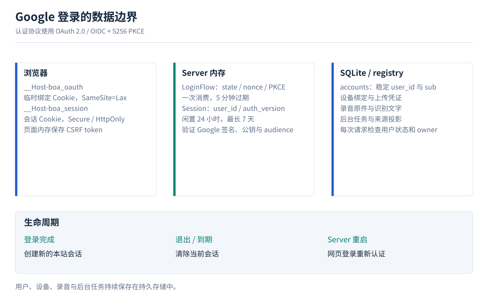

# Google 登录与转写存储 · v1 契约

2026-10-29 · 设计，尚未实现。[总设计](2026-10-29-boa-server-web-v1-design.md) · [SQL](2026-10-29-boa-v1-business-schema.sql) · [任务](../plans/2026-10-29-boa-server-web-v1-implementation-plan.md)

## 1. Google 登录：用户落库，登录状态留内存

| SQLite | 内存 | 浏览器 |
|---|---|---|
| accounts、设备归属、录音、原文、任务 | 一次性 LoginFlow、Session、Google 公钥缓存 | HttpOnly Cookie；页面临时 CSRF token |
| 重启保留 | 退出/到期/重启清除 | 会话失效后重新 Google 登录 |

登录步骤、数据结构、配置与异常处理

### 方案取舍

| 方案 | 取舍 |
|---|---|
| **选用：基本用户表 + 内存登录/会话** | 用户归属稳定；没有 OAuth/会话表，重启重登；适合既定单进程 |
| SQLite 持久会话 | 重启可续登，但增加会话持久化/清理；本版不选 |
| 完全不存用户、每次直接使用 Google token | 可构造极简服务，但旧 user_id、设备/录音归属及禁用管理更难保持；本版不选 |

### Google 接入

1. 配置 Google Web application client、同意屏幕和精确的 HTTPS 回调 URI。只申请 `openid email profile`，不申请 Drive/Gmail 权限，不请求 offline access 或 refresh token。Client secret 在服务器环境/私密配置中，不进 Web、SQLite、Git 或日志。
2. `GET /api/boa/v1/auth/google/start` 创建高熵 state、nonce、浏览器绑定值和 S256 PKCE verifier；LoginFlow 放有界内存 map。设置 5 分钟临时 `__Host-boa_oauth` Cookie，然后 302 跳 Google。使用 Authlib 处理授权码流程，PKCE 明确启用；不得用默认的客户端签名 session Cookie 替代本设计的服务端内存存储。
3. 回调是 `GET /api/boa/v1/auth/google/callback?code=&state=`。先匹配未过期 state 与临时 Cookie 的摘要，再原子取走 LoginFlow，随后交换 code。重复回调不可成功；nonce/签名验证失败也不能再次使用同一流程。Google 拒绝授权时清理匹配的流程并回登录页。
4. 通过标准 Google ID token 验证库校验签名、Google issuer、本站 client_id/audience、到期时间，再比较 nonce；多 audience 时校验 azp，要求有效 sub、email 和 `email_verified=true`。不将客户端提供的 sub 当身份。公钥允许按缓存头有界缓存；网络/密钥服务不可用时拒绝本次新登录，不绕过验证。已有本站会话不逐请求访问 Google。
5. 按 google_sub 同步 accounts，沿用稳定 user_id。首次登录建立用户；相同 sub 复用；同邮箱不同 sub 或邮箱更新撞已有账号时返回 `409 account_identity_conflict`，不自动合并、不更改归属、不创建会话。旧 sub 为空的用户只能经维护侧核实映射，不能凭邮箱自助认领。禁用账号返回 403。
6. 生成新的本站随机 session token 和 CSRF token，内存登记后设置会话 Cookie，清临时 Cookie，303 到固定 `/`。不接受任意 return URL。Google access/id token 仅在校验期间使用，结束即不再保留；不写存储、错误响应或日志。语言运行时无法保证字节级擦除，不能承诺安全擦除内存。
7. 静态首页加载后通过同源 `GET /auth/session` 取得基本资料和 CSRF token；响应 `Cache-Control: no-store`。会话 Cookie 不暴露给 JS；CSRF token 只保存在页面内存。退出 `DELETE /auth/session` 校验 Origin/CSRF 后删会话、清 Cookie，并通知其他标签停止播放/请求。退出本站不退出 Google，也不撤设备上传凭证。

### 最少内存结构

| map | 键 | 值 | 生命周期 |
|---|---|---|---|
| login_flows | SHA-256(state) | binding_digest、nonce、pkce_verifier、expires_at | 5 分钟；原子消费 |
| sessions | SHA-256(随机 32 字节 token) | user_id、auth_version、csrf_token、created_at、last_seen_at | 闲置 24 小时、绝对 7 天 |

随机值使用系统 CSPRNG，比较敏感值用恒定时间。TTL 用可注入单调时钟，不因系统校时延长；持久业务时间仍为 UTC Unix 毫秒。每次有效会话请求更新 last_seen，轮询也算活动；绝对 7 天不滑动。会话 Cookie 固定 Max-Age=604800，不因轮询反复延长。

- 临时 Cookie：`__Host-boa_oauth`，Secure / HttpOnly / SameSite=Lax / Path=/，无 Domain。Google 顶层 GET 跳回时可发送；不能设 Strict 导致回调缺浏览器绑定。
- 会话 Cookie：`__Host-boa_session`，Secure / HttpOnly / SameSite=Strict / Path=/，无 Domain。登录成功始终换新 token，不接受客户端选择 session ID。
- 每浏览器同时一个登录流程；再次发起覆盖临时 Cookie，旧流程回调安全失败，过期清理；页面可重新发起。不同浏览器互不影响，不串身份。
- 每 60 秒及 map 操作时删除过期项；LoginFlow 最多 1000，Session 最多 10000。满额先清过期项，仍满则 503 `auth_capacity_exceeded`，不驱逐有效会话。start 每 IP 每分钟最多 30 次，超过 429；IP 来自可信连接/显式受信代理，不信任任意转发头。
- Google 请求总超时 10 秒；code 交换失败不重复使用，返回可重新发起的登录错误。state/绑定/nonce/token 无效为 400 `login_invalid_or_expired`，Google 取消为 `login_cancelled`，端点不可达为 503 `login_unavailable`。对外不返回 code/token/供应方原始响应。
- `/auth/session` 会话缺失或到期为 401；每次鉴权重新查 accounts.status/auth_version，禁用返回 403 并删会话，auth_version 不匹配返回 401。写操作要求同源 Origin + `X-CSRF-Token`；GET 不产生业务写入，登录 start/callback 的临时状态变化除外。对登录路由关闭 query/body/Cookie 的访问日志和代理追踪，回调无第三方资源，使用 `Referrer-Policy: no-referrer` 与 no-store。
- 服务单进程且持数据目录锁；多 worker 启动拒绝。重启丢会话是预期行为，不增加 Redis。独立设备 DTLS 凭证、已入库的 jobs/来源索引 与录音不依赖网页会话。

配置项：`GOOGLE_CLIENT_ID`、`GOOGLE_CLIENT_SECRET`、`PUBLIC_WEB_ORIGIN`（精确 HTTPS origin）、由 origin 和固定路径导出的回调 URI。Google Console 登记值必须完全相同；配置缺失时接口返回 503 `login_not_configured`，Web 显示登录不可用，不开放模拟登录入口。

官方依据：[Google OpenID Connect](https://developers.google.com/identity/openid-connect/openid-connect)、[Web Server OAuth](https://developers.google.com/identity/protocols/oauth2/web-server)。上述会话 TTL、容量与表结构为本产品选择，不是 Google 限制。

## 2. 转写：SQLite 原文为主，VTT/Markdown 同源

[完整 JSON 示例](../../examples/transcript.json) · [对应 VTT](../../examples/recording.vtt)

| 字段 | 格式 | 示例 |
|---|---|---|
| recording_id + revision | API 录音与版本，数据库使用 id/transcript_revision | demo-recording / 1 |
| cue_index | 从 1 开始的连续整数 | 1 |
| start_ms / end_ms | 相对当前 WAV 的整数毫秒 | 0 / 2400 |
| speaker | 稳定匿名标签或 NULL | A |
| text | UTF-8 纯文本原文 | 我们确认一下今天的安排。 |

JSON、发布事务、空结果与异常恢复

### 格式与边界

SQLite 在 `recordings.transcript_json` 存一份 `{schema_version:1,time_unit:"ms",cues:[...]}`，录音 owner 与 transcript_revision 在同一行，不再建逐句表。`text` 保存识别内容，不做总结、改写或 HTML/VTT 转义，不存带 `<v>` 的字幕字符串。统一 CRLF 为 LF，拒绝 NUL/非法编码与纯空白句；原有标点、中文和换行保留。speaker 只能为 A/B/C…稳定映射或 NULL，不能猜真实姓名；Web 用 textContent 渲染。文字是用户数据，不写日志或跟踪系统。

API 外层固定为 `schema_version:1, recording_id, revision, time_unit:"ms", cues:[], next_cursor`；`revision` 对应 recordings.transcript_revision，并须等于当前 audio_revision；不能直接使用可能领先的 input_revision，cue 字段名固定为 cue_index/start_ms/end_ms/speaker/text。owner 不在客户端传入，也不暴露给其他用户。不存 API 分页 envelope 副本，不保存供应方完整 response；v1 只保留展示/导出必需内容。

供应方秒数在 adapter 中转为整数毫秒；校验 `0 <= start_ms < end_ms <= duration_ms`，最大 1ms 精度误差可夹到音频边界，夹后仍须 start < end。按 start_ms 与供应方稳定顺序排序后生成连续 cue_index；合法多人重叠保留。单句最多 10000 字符、每录音最多 100000 cues、持久 JSON 编码后最多 8 MiB UTF-8，超限报 `transcript_limit_exceeded`，不静默截断。数字/类型/文本不合法则整批失败，不发布部分文字。

静音时允许 **0 cues**：transcript_state=ready，JSON cues=[]，VTT 为 `WEBVTT\n\n`，Markdown 仅日期标题，Web 显示“未识别到文字”。ASR 未配置、失败与成功无文字是不同状态；用户仍可播放 WAV。此处不额外增加“空文本”表。

### 原子发布

1. ASR 读取冻结的同版本 WAV，校验并准备 cues；任务持有效 lease。
2. 从同组 cues 生成 UTF-8 VTT，转义 `& < >`，清理会破坏 cue 分隔的文本空行；text 原文不受影响。文件名/路径由 Server 生成。VTT 经当前 transcribe jobs 行保存的临时/最终路径、size/hash、publication_state 完成 fsync/rename 持久化；不另建文件或发布表。
3. 持录音锁，在**一个 SQLite 事务**内检查 lease、当前 input_revision/audio_revision，整体写入 transcript_json、更新 vtt_job_id/transcript_revision/transcript_state，并将对应 jobs 文件设 publication_state=ready、任务设 succeeded。任一失败全部回滚，读者不能看到半批 cues。
4. 相同任务重放不产生重复句子；失效 lease 不得覆盖新输入。针对尚未提交的同版本尝试，只在事务内替换待发布 transcript_json；已成功的相同版本任务不自动重跑。新输入先隐藏不匹配的旧文字。

### 恢复与读取

| 中断位置 | 恢复动作 |
|---|---|
| cues 仅在内存 | 任务租约回收，重跑同版本 ASR |
| VTT rename 后、cues 提交前 | 将 jobs 内未提交的文件尝试标 abandoned，重新 ASR 并整体发布；不能仅凭文件 hash 补 ready |
| cues/VTT/ready 已提交、进程退出 | SQLite 直接读文字，VTT 直接下载；不重跑成功任务 |
| 成功后 VTT 文件缺失/损坏 | 保留已存 cues，当前 VTT 下载报暂不可用；维护侧从已提交同版本 cues 经文件发布恢复，不重新 ASR |
| 音频更新或请求版本不符 | 409 recording_revision_changed；Web 取消旧请求后重新加载 |

恢复时不删除任何 raw；废弃的派生产物只有在无当前指针/在途读取引用后才清理。当前 JSON 仅在新音频对应转写成功时整体替换；已开启的旧 SQLite 读取快照按 WAL 规则完成，不对用户提供历史选择器，不引入清理平台。

JSON 每页最多 200 cues，游标绑定录音/版本。每个请求在同一 SQLite 读取快照核对 owner、当前 audio_revision、transcript_revision 和 ready 状态；不匹配拒绝。复制全部文字要取完同版本全部页才写剪贴板。VTT 已持久保存，JSON 分页/Markdown 从同一 SQLite 快照的 transcript_json.cues 按数组顺序读取；可使用 json_each 分页或迭代，避免构造整批 Python cue 对象。Markdown 按句生成；三者使用相同 speaker 和文字。JSON/VTT/MD 为当前音频同版本，响应均标注 revision，下载附件固定 UTF-8 与安全 filename。

